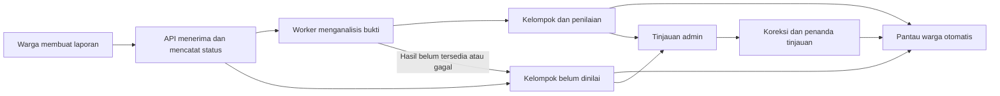

# SIAGABANJIR — Business Requirements Document

> **Living document:** perbarui bersama setiap perubahan terkait menurut [aturan dokumentasi](../rules/documentation.md#living-documents).

## 1. Kendali dokumen

| Atribut | Nilai |
|---|---|
| Versi | 0.1.0 |
| Tanggal penyusunan | 18 Oktober 2026 |
| Status | **APPROVED — baseline tahap 1, versi 0.1.0** |
| Tahap | **1 — BRD selesai**; PRD v0.1.0 dan FRD/SRS v1.0.0 APPROVED; pekerjaan aktif audit/publikasi workspace |
| Pemilik dan pengambil keputusan | Pemilik proyek dalam percakapan; nama formal belum diberikan |
| Dasar penyusunan | Pedoman BRD tahap 1, audit paket pra-coding/desain, jawaban Q-001–Q-028, dan otorisasi penyusunan USER-IMPLEMENT |
| Otorisasi yang tersedia | BRD v0.1.0 disetujui pemilik proyek melalui BRD-APPROVAL; penyusunan PRD diotorisasi |
| Batas persetujuan | Persetujuan BRD bukan hasil uji aplikasi atau persetujuan final PRD; tahap 3–5 tetap mengikuti urutan dan konfirmasi. |

Otorisasi penyusunan draf dan persetujuan final BRD dicatat sebagai dua keputusan terpisah. Q-029–Q-031 ditutup oleh persetujuan kolektif dokumen tersebut, tanpa merekayasa jawaban pilihan per pertanyaan. Sumber lama yang menulis `CONFIRMED` tetap dibedakan dari persetujuan final BRD.

**Cara membaca baseline:** bagian kebutuhan berikut mempertahankan hasil tahap 1. Penajaman dan perubahan yang disetujui selama discovery tahap 2 tercatat pada [PRD.md](PRD.md), TRACEABILITY, dan DECISIONS. Contohnya gerbang KTP, profil/pengisian otomatis keluarga, kontak pribadi lokal, dan paket delapan dokumen spesimen. Rincian yang tertulis terbuka pada baseline ini tidak otomatis masih terbuka setelah keputusan PRD; gunakan register tahap 2 untuk status terbaru. Persetujuan kebutuhan tidak menyatakan bahwa implementasi atau uji aplikasi sudah tersedia.

Dokumen pendamping: [TRACEABILITY.md](TRACEABILITY.md) memuat sumber, pernyataan, pertanyaan, lapisan konfirmasi, matriks kebutuhan, dan audit; [DECISIONS.md](DECISIONS.md) memuat keputusan, konflik, risiko, dan isu terbuka. [PRD.md](PRD.md) adalah baseline produk APPROVED; [FRD.md](FRD.md) dan [SRS.md](SRS.md) telah APPROVED v1.0.0. Pembaruan metadata serah tahap ini tidak mengubah 42 kebutuhan/AC BRD atau bukti historis persetujuannya.

## 2. Ringkasan bisnis

SIAGABANJIR adalah proyek akademik Flutter untuk demonstrasi di Kota Padang dan sekitarnya. Warga mengirim bukti serta keterangan kejadian banjir. Sistem membantu menilai kesesuaian bukti, mengelompokkan laporan terkait, dan menyajikan informasi untuk ditinjau admin. Warga juga melihat daftar sederhana lokasi terdampak berdasarkan laporan yang masuk.

Fitur inti dikerjakan terlebih dahulu. Fitur pendukung yang telah disepakati tetap menjadi hasil akhir wajib: tas siaga, kontak darurat, panduan bersuara, backup dokumen, peringatan, akun/profil, serta riwayat laporan. Pemantauan sungai diganti dengan Pantau lokasi terdampak; posko/shelter dan dispatch armada tidak termasuk cakupan saat ini.

Keberhasilan ditunjukkan melalui alur aplikasi yang benar-benar terhubung ke backend dan database, lalu diuji dosen dan mahasiswa. Tampilan contoh, fixture, atau respons AI yang disiapkan sebelumnya tidak dihitung sebagai bukti panggilan AI langsung berhasil.

## 3. Konteks, masalah, dan bukti yang tersedia

Masalah yang diajukan dalam bahan acuan adalah banyaknya laporan individual yang menyulitkan admin memahami kejadian terkait dan menentukan urutan tinjauan. Manfaat yang diharapkan ialah menggabungkan bukti yang relevan, mempertahankan kemampuan koreksi manusia, dan memberi informasi sederhana kepada warga. Ini merupakan kebutuhan yang disampaikan proyek, **belum hasil penelitian proses lapangan BPBD**.

Konteks akademik dan ketentuan dosen berasal dari penjelasan pemilik proyek: Flutter pada dua platform, Laragon 6, dan MySQL wajib; bahasa backend bebas. Rubrik tertulis dan penilaian dosen belum diterima. Tidak ada target persentase akurasi, jumlah pengguna produksi, SLA, atau tenggat kalender yang disahkan.

Audit awal menemukan 17 SVG: 12 warga dan 5 admin. Visualnya telah diperiksa secara statis. Desain menggunakan tema biru, latar terang, kartu membulat, navigasi bawah warga, dan sidebar admin. Tidak ada bukti aplikasi interaktif dari SVG tersebut. Jumlah 19 layar dalam dokumen lama tidak menjadi target wajib setelah perubahan cakupan.

## 4. Tujuan dan ukuran keberhasilan bisnis

| ID | Tujuan | Bukti keberhasilan yang akan ditinjau |
|---|---|---|
| OBJ-01 | Memenuhi target pembelajaran dua aplikasi Flutter | Android warga dan web admin menjalankan tindakan yang tersimpan/terbaca melalui backend lokal dan MySQL. |
| OBJ-02 | Menyediakan alur laporan dan analisis yang dapat ditelusuri | Penguji membuat laporan, melihat status sebenarnya, dan dapat menghubungkan hasil analisis dengan bukti sumber. |
| OBJ-03 | Membantu peninjauan admin | Admin menemukan kelompok, memeriksa laporan individual, melakukan koreksi, serta melihat hasil tindakannya. |
| OBJ-04 | Menyampaikan informasi lokasi terdampak kepada warga | Pantau berubah sesuai laporan/penilaian, membedakan hasil belum dinilai, dan memperlihatkan status tinjauan admin. |
| OBJ-05 | Menyelesaikan fitur pendukung yang disepakati | Penguji menyelesaikan tindakan utama tiap fitur; kebutuhan yang belum dirinci tetap ditandai, bukan dianggap telah berfungsi. |
| OBJ-06 | Membuat pengembangan dan demonstrasi dapat diulang | Tim menjalankan petunjuk yang sama, menguji data fiktif, mengukur pemakaian AI, dan meninjau perubahan melalui PR. |

Ukuran di atas merupakan kriteria penerimaan bisnis yang diusulkan untuk walkthrough. Tidak ada angka keberhasilan atau durasi respons yang dikarang. Hasil uji aktual dicatat pada build yang diuji di tahap implementasi, bukan pada tanggal penulisan BRD.

## 5. Aktor, tanggung jawab, dan otoritas

| Aktor | Tanggung jawab/kebutuhan |
|---|---|
| Warga/penguji warga | Membuat laporan, memantau lokasi terdampak, melihat riwayat sendiri, menggunakan fitur pendukung dan dokumen uji. |
| Admin simulasi | Meninjau dan mengoreksi bukti/kelompok, mencatat tindak lanjut sederhana, mengatur kebijakan laporan, menghapus laporan, dan menandai kejadian selesai. |
| Pemilik proyek | Backend dan AI, pemeliharaan, review PR, perapian akhir, serta keputusan kebutuhan proyek. |
| Dua teman kelompok | Desain/implementasi Flutter dan integrasi API; pembagian layar rinci belum ditetapkan. |
| Dosen dan mahasiswa penguji | Menguji alur sebenarnya dan memberi temuan; belum dicatat telah menyetujui dokumen atau aplikasi. |

Total tim pengembang adalah tiga orang, bukan dua. Akun admin aplikasi berbeda dari kewenangan maintainer GitHub. Isi backup dokumen hanya boleh diakses pemiliknya; admin tidak boleh membacanya (Q-025). Warga lain hanya melihat ringkasan Pantau tanpa identitas/kontak pelapor atau media laporan individual (Q-028). Penyuntingan konten pendukung selain pesan peringatan masih perlu diperinci; kewenangan tersebut tidak otomatis diperluas karena seseorang menjadi admin.

## 6. Proses saat ini (AS-IS)

Pada awal tahap ini, workspace proyek belum berisi aplikasi. Bahan yang tersedia adalah prompt bertahap, paket perencanaan, diagram konseptual, tabel traceability lama, dan desain statis. Beberapa tampilan lama menunjukkan instansi resmi, armada, angka kedalaman, dan kapasitas posko yang tidak sesuai cakupan baru.

Proses operasional warga/BPBD di lapangan belum diobservasi dalam pekerjaan ini. Karena itu, BRD tidak mengarang kanal pelaporan yang sedang digunakan, waktu tanggap, volume laporan, atau efektivitas petugas. Pembandingan sebelum/sesudah pada demo dilakukan terhadap tugas uji yang ditetapkan, bukan terhadap kinerja instansi yang belum diukur.

## 7. Proses yang dituju (TO-BE)

1. Warga membuka form dan memilih foto atau video sesuai kebijakan galeri serta kuota yang ditetapkan admin.
2. Warga mengirim laporan; sistem menampilkan apakah laporan diterima atau belum. Kebutuhan deskripsi/lokasi sudah menjadi bagian arah alur; kewajiban tiap field dan penanganan lokasi tidak tersedia perlu diperinci.
3. Worker memproses bukti, memanggil DeepSeek, serta menyusun hasil yang dapat ditelusuri. Pemrosesan video menggunakan frame, tidak mengartikan tiga/empat sebagai durasi atau jumlah video.
4. Sistem mengelompokkan laporan terkait dan menyusun informasi peninjauan admin. Detail graf, parameter jarak/waktu, dan formula belum dibekukan.
5. Pantau warga menampilkan kelompok lokasi secara otomatis. Kelompok yang belum bisa dinilai ditampilkan terpisah; tinjauan admin tidak menjadi gerbang publikasi.
6. Admin meninjau/mengoreksi hasil dan mencatat tindak lanjut. Penanda tinjauan memberikan konteks tambahan bagi warga.
7. Admin dapat menyelesaikan kejadian atau menghapus laporan. Kedua tindakan mempunyai akibat berbeda sebagaimana bagian 10.

Diagram merupakan arah proses, bukan kontrak endpoint, tabel database, ataupun jaminan hasil pengujian. Saat analisis belum tersedia, laporan tidak dinyatakan aman atau bahaya rendah hanya karena AI belum memberi hasil.

## 8. Cakupan dan urutan hasil

**Wajib dalam hasil akhir:** alur pelaporan, analisis bukti, kelompok/prioritas, tinjauan admin, Pantau, kontrol galeri/kuota/penghapusan, serta seluruh fitur pendukung yang dikonfirmasi. Prioritas pengembangan inti tidak menjadikan pendukung opsional.

**Dikeluarkan:** stasiun sungai/TMA/tren sensor/pompa/pintu air, modul posko/shelter termasuk kapasitas dan pilihan posko pada profil, dispatch armada/TRC, dan operasional instansi resmi. Kontak serta panduan umum tetap ada; penghapusan modul shelter tidak menghapus seluruh informasi kesiapsiagaan.

**Belum menjadi komitmen:** login Google/telepon/PIN, NIK/NIP/shift asli, peta interaktif wajib, langganan area, integrasi IoT, model AI lokal, hosting online aktif, serta angka mockup. Semua ini tetap kandidat atau di luar kebutuhan yang telah dikonfirmasi, bukan fitur yang boleh diaktifkan hanya karena terlihat pada SVG.

Milestone usulan untuk PRD: alur dasar warga–admin terhubung; inti analisis/kelompok/koreksi berfungsi; Pantau dan kontrol admin berfungsi; pendukung serta pengujian demo lengkap. Milestone tersebut belum jadwal sprint. Tidak ada tenggat keras; perkiraan satu–tiga bulan bukan komitmen penyelesaian.

## 9. Register kebutuhan bisnis dan acceptance criteria

Status `C`, `D`, dan `P` pada tabel mempertahankan asal keputusan ketika draf tahap 1 disusun: arah dikonfirmasi, default didelegasikan, atau penajaman diajukan. Persetujuan kolektif BRD dicatat pada kendali dokumen dan §19; persetujuan ini tidak mengisi nilai teknis yang memang dibiarkan terbuka. Penajaman produk selanjutnya mengikuti PRD dan register tahap 2.

Setiap `AC-xxx` berikut merupakan kriteria bisnis usulan untuk `BR-xxx` dengan nomor sama. Status pengujian aplikasi seluruhnya **NOT_RUN**.

### 9.1 Produk, aktor, dan alur inti

| ID | Kebutuhan | Kriteria penerimaan bisnis | Status |
|---|---|---|---|
| BR-001 | Demo akademik untuk Padang dan sekitarnya. | AC-001: skenario demo menyebut lokasi uji dan konteks akademik; tidak dipresentasikan sebagai layanan instansi resmi. | C |
| BR-002 | Flutter Android warga dan Flutter Web admin. | AC-002: penguji menyelesaikan alur warga pada Android dan alur admin pada browser dengan backend yang sama. | C |
| BR-003 | Tiga pengembang dengan pembagian peran yang disepakati. | AC-003: pekerjaan Flutter/integrasi dimiliki dua teman; backend/AI dan review akhir dimiliki pemilik proyek. | C |
| BR-004 | Laporan → analisis bukti → kelompok → prioritas/tinjauan admin. | AC-004: satu laporan baru dapat ditelusuri melalui seluruh alur tanpa diganti hasil demonstrasi tersembunyi. | C |
| BR-005 | Maksimal dua foto ATAU satu video maksimal lima detik per laporan. | AC-005: mode media valid diterima; jumlah/durasi berlebih atau campuran ditolak dengan alasan yang dapat dipahami. | C |
| BR-006 | AI membantu menilai kecocokan bukti dengan keterangan. | AC-006: hasil terhubung ke bukti dan keterangan; ketidakpastian ditampilkan sebagai ketidakpastian, bukan putusan kebenaran mutlak. | C/P untuk rincian keluaran |
| BR-007 | Laporan terkait dikelompokkan dengan bukti individual tetap dapat ditinjau. | AC-007: admin dapat melihat kelompok dan membuka bukti yang membentuknya; pengelompokan tidak menghilangkan laporan sumber. | C; algoritma rinci terbuka |
| BR-008 | Prioritas tinjauan admin dan indikasi bahaya untuk warga mempunyai makna yang jelas. | AC-008: walkthrough membedakan urgensi pemeriksaan dan indikasi dampak; faktor kebaruan/jumlah laporan tidak diam-diam dianggap besaran bahaya. | C untuk pengurutan; P untuk pemetaan indikator |
| BR-009 | Admin meninjau dan memperbaiki hasil AI/pengelompokan. | AC-009: perubahan admin terlihat pada hasil terkait; jenis koreksi dan aturan konflik akan diperinci di FRD. | C |
| BR-010 | Admin mencatat tindak lanjut sederhana tanpa dispatch armada. | AC-010: catatan tindak lanjut dapat dibaca kembali dan tidak mengklaim armada/bantuan nyata telah dikirim. | C |

### 9.2 Kontrol admin dan Pantau warga

| ID | Kebutuhan | Kriteria penerimaan bisnis | Status |
|---|---|---|---|
| BR-011 | Admin mengaktifkan/menonaktifkan sumber media galeri secara global. | AC-011: perubahan kebijakan berlaku bagi seluruh warga; jalur galeri tidak dapat melewati kebijakan saat pengiriman. | C; kebijakan antrean lama terbuka |
| BR-012 | Admin mengatur N laporan per H jam untuk setiap akun dengan aturan umum. | AC-012: batas yang dipilih admin berlaku per akun dan ditampilkan secara jelas; angka awal serta jenis jendela waktu belum ditetapkan. | C |
| BR-013 | Admin mereset kuota satu akun atau semua akun. | AC-013: reset memperbarui pemakaian kuota pada cakupan yang dipilih; reset kuota bukan penghapusan laporan. | C |
| BR-014 | Admin menghapus laporan dan media secara permanen dari penyimpanan aktif. | AC-014: laporan/media tidak lagi tersedia melalui akses aktif; tersisa audit tindakan minimal tanpa isi laporan. | C |
| BR-015 | Penghapusan memperbarui riwayat warga, kelompok, dan Pantau. | AC-015: laporan terhapus tidak tertinggal pada tampilan tersinkron; kelompok dihitung ulang, kelompok tanpa laporan keluar dari Pantau. | C; detail sinkronisasi P |
| BR-016 | Pantau berupa daftar sederhana kelompok lokasi yang mempunyai laporan, tanpa membuka identitas/kontak pelapor atau media laporan individual kepada warga lain. | AC-016: nama lokasi, indikasi tingkat, waktu pembaruan, dan penanda tinjauan tersedia; lokasi tanpa laporan tidak ditampilkan. Warga lain tidak dapat membuka identitas/kontak atau foto/video laporan individual melalui Pantau. | C sesuai Q-028; D untuk penggunaan kelompok |
| BR-017 | Informasi Pantau muncul otomatis tanpa menunggu persetujuan admin. | AC-017: kelompok dapat terlihat sebelum ditinjau admin; label membedakan hasil otomatis dari hasil yang ditinjau. | C |
| BR-018 | Kelompok yang belum dinilai dipisahkan dari kelompok yang sudah mempunyai tingkat. | AC-018: menunggu/gagal analisis tidak menghasilkan label bahaya rendah atau aman. | C |
| BR-019 | Tinjauan admin memberi penanda tambahan pada informasi publik. | AC-019: setelah admin meninjau, penanda dapat dibedakan dari hasil otomatis; masa berlaku penanda saat data berubah diperinci kemudian. | C |
| BR-020 | Admin menandai kejadian selesai untuk mengeluarkannya dari Pantau aktif. | AC-020: kelompok selesai tidak tampil sebagai terdampak aktif, tetapi riwayat laporan pribadi tetap ada selama tidak dihapus. | C |

### 9.3 Fitur pendukung dan batas produk

| ID | Kebutuhan | Kriteria penerimaan bisnis | Status |
|---|---|---|---|
| BR-021 | Inti didahulukan; pendukung yang disepakati tetap wajib. | AC-021: roadmap dan penerimaan akhir mencakup keduanya; penyederhanaan/penundaan wajib diminta sebagai perubahan cakupan. | C |
| BR-022 | Tas siaga berupa checklist kesiapsiagaan. | AC-022: penguji dapat mengubah checklist dan membaca progres sesuai data; aturan penyimpanan/personalitas diperinci berikutnya. | C pada kemampuan; P pada detail |
| BR-023 | Direktori kontak darurat. | AC-023: penguji menemukan kontak dan menjalankan tindakan kontak yang disepakati; nomor contoh tidak disajikan sebagai nomor resmi terverifikasi. | C pada kemampuan; P pada detail |
| BR-024 | Panduan kesiapsiagaan dengan bantuan suara. | AC-024: teks dapat dibaca dan fungsi suara dapat didemonstrasikan pada perangkat yang didukung; keadaan suara tidak tersedia dijelaskan. | C pada kemampuan; P pada detail |
| BR-025 | Backup dokumen pada backend, privat untuk pemilik dan dapat diambil kembali setelah login di perangkat lain. | AC-025: pemilik menyimpan serta mengambil dokumen uji dari perangkat lain; akun warga lain dan admin tidak dapat membaca isinya. | C sesuai Q-025; keamanan/pemulihan akun rinci terbuka |
| BR-026 | Admin membuat pesan peringatan yang masuk ke inbox seluruh warga. | AC-026: pesan admin tersedia pada inbox warga; status aktif/lama mengikuti aturan yang diperinci pada FRD. Push di luar aplikasi belum wajib untuk demo pertama. | C sesuai Q-027; rincian siklus pesan terbuka |
| BR-027 | Akun, profil, riwayat laporan, dan pembuatan akun untuk pengujian. | AC-027: penguji dapat memakai akun, melihat data terkait, serta mencoba pembuatan akun baru; metode login/reset belum dibekukan. | C pada kemampuan; P pada detail |
| BR-028 | Pemantauan sungai diganti oleh Pantau laporan. | AC-028: menu/kartu/kontrak aktif tidak membutuhkan data TMA, stasiun, pompa, pintu air, atau sensor sungai. | C |
| BR-029 | Modul posko/shelter dihapus. | AC-029: tidak ada daftar/pengelolaan posko, kapasitas, pilihan shelter, atau statistik posko yang menjadi kebutuhan aplikasi. | C |

### 9.4 Batas teknologi, biaya, kolaborasi, dan demonstrasi

| ID | Kebutuhan | Kriteria penerimaan bisnis | Status |
|---|---|---|---|
| BR-030 | Laragon 6 dan MySQL digunakan untuk lingkungan kuliah. | AC-030: petunjuk dan demonstrasi lokal menggunakan keduanya; bahasa backend tidak disamakan dengan PHP/Laravel. | C, ketentuan dosen dilaporkan pengguna |
| BR-031 | Satu codebase TypeScript dengan API dan worker sebagai proses berbeda. | AC-031: proses analisis terpisah dari penerimaan API; interoperabilitas serta pemulihan diuji pada tahap teknis. | C setelah riset |
| BR-032 | Memanfaatkan kredit API DeepSeek yang dimiliki pengguna. | AC-032: uji integrasi memanggil provider yang disetujui melalui backend; akses/key tidak dimasukkan ke aplikasi Flutter atau dokumen. | C; akses belum diuji |
| BR-033 | Efisien memakai AI: frame terbatas dan optimasi media yang mempertahankan kegunaan hasil. | AC-033: pengujian mencatat media/frame, penggunaan token dan kualitas; tidak menjanjikan persentase penghematan tanpa hasil ukur. | C untuk efisiensi, 3–4 frame, dan arah resize; P untuk default tiga, ukuran/metode resize, detail, dan cache |
| BR-034 | Demo lokal utama dan persiapan portabilitas hosting pada tahap 5. | AC-034: setup lokal dapat diikuti; paket Docker/petunjuk hosting disiapkan pada tahap yang sesuai tanpa mengklaim deployment telah dilakukan. | C |
| BR-035 | Sedapat mungkin tidak menambah langganan pengembangan berbayar yang wajib. | AC-035: dependensi dinilai kebutuhan/biayanya; layanan tambahan berbayar yang diperlukan dibahas sebelum dipilih. | C |
| BR-036 | Satu repository; branch-rafi/branch-melia/branch-hasan → PR development → PR main, mengikuti [WORKSPACE-GITHUB-WORKFLOW-010](DECISIONS.md#workspace-github-workflow-010). | AC-036: branch permanen dipertahankan, satu PR aktif per branch anggota, Rafi meninjau dan merge dengan merge commit; proteksi teknis harus dibuktikan terpisah dari SOP. | C |
| BR-037 | Desain lama menjadi acuan tema dan kandidat fitur. | AC-037: arah visual dikenali, sementara isi/fitur yang bertentangan dengan keputusan baru diperbarui; tidak ada tuntutan pixel-perfect otomatis. | C |
| BR-038 | Paket awal 2 admin, 6 warga, 12 laporan, dan 6 dokumen fiktif. | AC-038: manifest data demo dapat dihitung dan direset; dokumen ditandai sebagai spesimen; jumlah awal berbeda dari batas akun/laporan aplikasi. | C/D; 12 menggantikan usulan 16 |
| BR-039 | Dosen/mahasiswa menguji perilaku aplikasi sebenarnya. | AC-039: langkah, hasil aktual, temuan, dan jenis bukti uji dicatat; fixture atau UI statis tidak dihitung sebagai keberhasilan AI langsung. | C |
| BR-040 | Lima tahap dikerjakan berurutan dengan ringkasan serta konfirmasi antar tahap. | AC-040: nomor 1 diringkas dan dimintakan penerimaan sebelum nomor 2 dimulai; tidak ada final approval buatan. | C |
| BR-041 | Kemajuan berbasis fitur tanpa tenggat tetap. | AC-041: rencana tidak menuliskan satu–tiga bulan sebagai janji atau deadline dosen. | C |

### 9.5 Dukungan offline

| ID | Kebutuhan | Kriteria penerimaan bisnis | Status |
|---|---|---|---|
| BR-042 | Draf laporan beserta media tersimpan saat offline, dapat dikirim setelah koneksi kembali tanpa duplikasi; kontak dan teks panduan tetap dapat dibaca offline. | AC-042: penguji mempertahankan draf/media ketika koneksi putus, mengirim setelah tersambung, dan melihat satu laporan meski pengiriman diulang; kontak serta teks panduan yang telah tersedia pada perangkat dapat dibuka tanpa jaringan. | C sesuai Q-026; pemicu kirim, distribusi konten awal, serta TTS offline belum diputuskan |

## 10. Aturan bisnis lintas alur

| Peristiwa | Dampak yang sudah dipahami | Hal yang tidak boleh disamakan |
|---|---|---|
| AI belum siap/gagal | Informasi belum dinilai dipisahkan; admin tetap dapat meninjau. | Tidak sama dengan bahaya rendah, laporan palsu, atau kejadian selesai. |
| Admin meninjau | Menambah konteks peninjauan manusia dan dapat menghasilkan koreksi. | Tidak menjadi syarat agar kelompok muncul pertama kali. |
| Admin menandai kejadian selesai | Keluar dari Pantau aktif; riwayat laporan tetap ada. | Tidak menghapus laporan atau mengembalikan kuota secara otomatis. |
| Admin menghapus laporan | Data/media aktif dihapus; tampilan dan kelompok diperbarui; audit minimal tersisa. | Tidak sekadar menyembunyikan untuk pemulihan. Retensi backup fisik belum diputuskan. |
| Admin mereset kuota | Pemakaian kuota diperbarui untuk akun/cakupan yang dipilih. | Tidak menghapus laporan, media, atau riwayat. |
| Tidak ada laporan di suatu wilayah | Wilayah tidak masuk daftar Pantau. | Tidak membuktikan wilayah aman. |

Pengaruh hapus laporan terhadap pengembalian kuota masih terbuka; jangan menerapkan pengembalian atau penahanan kuota secara diam-diam. Perubahan yang menghapus laporan harus juga memperhitungkan hasil AI/worker yang sedang berjalan agar laporan tidak muncul kembali; mekanismenya menjadi pekerjaan FRD/SRS.

Nilai N/H, jenis jendela kuota, keadaan awal galeri, kategori tingkat bahaya, rumus pengurutan, ketentuan laporan baru setelah kejadian selesai, dan pembaruan penanda tinjauan belum menjadi keputusan final.

## 11. Kebutuhan data dan privasi

Data bisnis yang diperlukan: akun/peran, laporan dan media, keterangan/lokasi, hasil analisis, keanggotaan kelompok, penilaian/tinjauan, pengaturan galeri/kuota, tindakan admin, konten pendukung, serta metadata/berkas dokumen uji. Ini inventaris konseptual, bukan skema tabel.

Kebutuhan yang dikonfirmasi: laporan/media yang dihapus tidak tetap tersedia pada penyimpanan aktif; dokumen identitas demo dibuat fiktif; data awal dapat dipakai dosen/mahasiswa untuk menguji alur. Tampilan Pantau sederhana mengikuti field yang disetujui pada Q-010.

**Dikonfirmasi melalui Q-025:** dokumen backup tersimpan di backend, hanya pemilik yang boleh membaca isinya, dan dapat diambil kembali setelah pemilik login pada perangkat lain. Admin aplikasi dan akun warga lain tidak boleh membaca isi dokumen tersebut. Detail proteksi penyimpanan, pemulihan akun, retensi, serta penghapusan dari cadangan masih perlu dirancang dan diuji.

**Batas publik dikonfirmasi melalui Q-028:** warga lain hanya melihat nama lokasi, indikasi tingkat, waktu pembaruan, dan penanda tinjauan pada Pantau. Identitas/kontak pelapor serta foto/video laporan individual tidak dibuka kepada warga lain; admin tetap dapat memeriksa bukti laporan. Isi dokumen privat tidak pernah menjadi data Pantau sesuai Q-025. Aturan hapus akun dan ketelitian lokasi publik belum diputuskan; akses admin untuk meninjau bukti laporan tidak meluas ke backup dokumen.

Spesimen menggunakan identitas fiktif dan tanda permanen `SPESIMEN — DATA UJI — TIDAK BERLAKU`. Penanda tersebut menjaga penguji memahami bahwa berkas dipakai untuk membuktikan alur unggah/unduh, bukan identitas peserta sebenarnya. Aset foto/video laporan harus mempunyai sumber dan izin yang sesuai; dataset lengkap belum tersedia.

## 12. Integrasi dan arah teknis yang sudah dipilih

- Android warga dan web admin berkomunikasi dengan API backend; detail endpoint/auth ditentukan dalam FRD/SRS.
- API dan worker TypeScript berada dalam satu codebase dengan proses berbeda. Pemisahan ini sudah dipilih setelah riset; model lokal/training Python belum menjadi kebutuhan.
- DeepSeek menjadi provider yang tersedia menurut pengguna. Model pasti, batas payload, timeout, retry, dan kontrak keluaran perlu diverifikasi pada integrasi.
- FFmpeg/ffprobe merupakan kandidat yang sudah diuji untuk memeriksa durasi dan mengambil frame. Video lima detik tidak berarti semua frame dikirim kepada AI.
- MySQL pada Laragon dipakai lokal. Penyimpanan media privat, driver/ORM, versi yang dikunci, dan metode antrean masih keputusan SRS/setup.
- Docker merupakan persiapan portabilitas di tahap 5. Provider hosting, domain, dan deployment publik belum dipilih.

Riset primer yang mendasari pilihan backend: [DeepSeek API](https://api-docs.deepseek.com/), [Vision](https://api-docs.deepseek.com/guides/vision/), [Node child processes](https://nodejs.org/api/child_process.html), dan [MySQL locking reads](https://dev.mysql.com/doc/refman/8.0/en/innodb-locking-reads.html). Dukungan vendor tidak membuktikan integrasi akun pengguna telah lulus.

## 13. Kebutuhan kualitas dan operasional

Kualitas yang perlu dibuktikan meliputi kejelasan status, konsistensi data lintas aplikasi, penanganan kegagalan analisis, keterlacakan koreksi, dan pengukuran penggunaan AI. Alur yang belum selesai tidak boleh menampilkan status sukses. Efisiensi AI dinilai bersama kegunaan hasil, bukan hanya ukuran berkas kecil.

**Cakupan offline dikonfirmasi melalui Q-026:** draf laporan beserta media dapat disimpan saat offline dan dikirim ketika tersambung kembali tanpa membuat duplikat. Kontak dan teks panduan dapat dibaca offline. Draf lokal belum merupakan laporan yang diterima backend. Pengiriman otomatis atau melalui tindakan pengguna, distribusi konten sebelum pemakaian pertama, dan ketersediaan TTS offline belum diputuskan. Validasi galeri/kuota saat pengiriman tetap harus dijelaskan dalam FRD.

**Rincian teknis usulan yang memerlukan review/pengujian:** penyimpanan hasil analisis untuk mengurangi panggilan ulang yang tidak perlu, pemulihan worker, mekanisme pembatasan akses dokumen per pemilik, serta pembersihan cache privat. Arah akses privat sudah disepakati melalui Q-025; mekanisme keamanannya belum ditetapkan.

Batas performa, ukuran/resolusi media, target perangkat, lisensi aset, dan dukungan suara ditetapkan berdasarkan perangkat serta uji teknis. Tidak ada klaim akurasi AI, penghematan token, keamanan mutlak, atau kesiapan produksi pada BRD ini.

## 14. Asumsi, batasan, dan dependensi

| Jenis | Pernyataan | Perlakuan |
|---|---|---|
| Batasan dikonfirmasi | Flutter dua platform, Laragon 6, MySQL; tim tiga orang. | Menjadi batas pilihan solusi. |
| Fakta dilaporkan pengguna | Kredit API DeepSeek tersedia dalam jumlah banyak. | Catat ketersediaan menurut pengguna; tidak disamakan dengan batas teknis tanpa limit. |
| Default didelegasikan | 12 laporan awal, setelah usulan 16 dinilai terlalu banyak. | Tercantum untuk review; bukan batas jumlah laporan aplikasi. |
| Usulan teknis | Mulai evaluasi dengan tiga frame, periksa kebutuhan empat frame. | Ukur kualitas/token sebelum mengunci konfigurasi. |
| Belum tersedia | Rubrik tertulis, seluruh perangkat tim, dataset media berizin, hasil UAT, dan konfigurasi hosting. | Catat kebutuhan bukti; jangan mengarang atau menganggap sudah diperiksa. |
| Dependensi masa depan | Akses model, dukungan codec perangkat, runtime/driver, jaringan demo. | Buktikan melalui PoC dan pengujian tahap teknis. |

Otorisasi USER-IMPLEMENT mencakup penyusunan draf. Persetujuan final BRD diberikan terpisah melalui BRD-APPROVAL, sebagaimana dicatat pada §1 dan §19. Rincian yang belum diputuskan diteruskan ke tahap yang dialokasikan.

## 15. Risiko, konflik, dan keputusan yang masih terbuka

Register kanonis terdapat pada DECISIONS. Tabel di bagian ini adalah keadaan pada penutupan tahap 1; keputusan discovery PRD kemudian mempersempit sebagian item. Risiko bisnis utama ialah informasi publik disalahartikan sebagai kepastian bahaya, data mockup dianggap nyata, luas pendukung melampaui kemampuan tim, proses hapus/worker meninggalkan data, serta hasil AI tidak memenuhi kebutuhan meski integrasi API berjalan.

Konflik sumber yang telah diselesaikan melalui percakapan: simulasi versus dispatch; sungai versus daftar wilayah laporan; posko wajib versus dihapus; larangan galeri tetap versus pengaturan admin; tiga/empat detik versus tiga/empat frame; branch per orang versus branch per tugas; dua versus tiga anggota; serta arti langganan pengembangan versus langganan area pengguna.

Hal yang tetap terbuka dipisahkan menurut batas keputusannya:

| Area | Klarifikasi yang masih diperlukan | Batas penyelesaian |
|---|---|---|
| Akses dokumen/Pantau | Dokumen backend privat dan pengambilan lintas perangkat dikonfirmasi Q-025; Pantau hanya ringkasan tanpa identitas/kontak/media laporan individual dikonfirmasi Q-028. Ketelitian lokasi dan akses tanpa login masih terbuka. | Perincian pengalaman Pantau pada PRD/FRD; proteksi akses dokumen/pemulihan akun pada FRD/SRS. |
| Offline | Cakupan draf/media, kirim tanpa duplikasi, serta baca kontak/panduan sudah dikonfirmasi Q-026; pemicu pengiriman, distribusi awal konten, dan TTS offline terbuka. | Perilaku pada PRD/FRD; persistensi dan retry pada SRS. |
| Peringatan dan konten | Admin → inbox seluruh warga dikonfirmasi Q-027; push luar aplikasi belum wajib. Siklus pesan dan editor kontak/panduan terbuka. | Perincian produk pada PRD; perilaku pada FRD. |
| Media, kuota, lokasi | Nilai awal, jendela waktu, penghitungan/reset, lokasi/deskripsi wajib, aturan perubahan galeri. | FRD sebelum kontrak validasi disetujui. |
| Indikator dan kelompok | Makna kategori, formula, koreksi, kelompok selesai menerima laporan baru, masa berlaku penanda. | PRD/FRD sebelum fitur bersangkutan diimplementasikan. |
| Data, keamanan, runtime | Retensi/penghapusan backup, auth, worker recovery, penyimpanan dan enkripsi. | SRS sebelum implementasi komponen terkait. |
| Lingkungan tim | Versi tools, pengujian HP, kemampuan GitHub, akses jaringan lokal, Docker. | Workspace Setup, setelah spesifikasi yang diperlukan disetujui. |

Memindahkan rincian ke tahap berikutnya bukan persetujuan atas jawabannya. Isu yang mengubah tujuan, aktor, cakupan wajib, atau hak akses harus kembali dikonfirmasi sebagai perubahan bisnis.

## 16. Rancangan pengujian dan penerimaan

Paket demo pada baseline tahap 1: **2 admin, 6 warga, 12 laporan awal, dan 6 dokumen fiktif**. PRD-Q042 kemudian menyetujui **8 dokumen: 6 KTP + 2 KK**, dengan jumlah akun/laporan tetap. Akun dan berkas belum dibuat pada tahap dokumentasi. Paket awal dapat direset untuk pengujian dan tidak membatasi penguji membuat akun/laporan baru.

| Skenario | Bukti yang diharapkan | Status sekarang |
|---|---|---|
| Laporan foto/video valid dan batas media | Bukti tersimpan; pelanggaran dua foto/lima detik atau campuran dijelaskan. | NOT_RUN |
| Galeri dan kuota | Kebijakan global berlaku; reset satu/semua akun bekerja tanpa menghapus laporan. | NOT_RUN |
| Analisis dan kegagalan AI | Hasil dapat ditelusuri; menunggu/gagal terlihat sebagai belum dinilai. | NOT_RUN |
| Kelompok dan koreksi admin | Bukti individual tersedia; hasil koreksi dan daftar terkait diperbarui. | NOT_RUN |
| Pantau otomatis | Kelompok tampil sebelum review; badge review dan urutan yang disepakati dapat diperiksa. | NOT_RUN |
| Batas akses Pantau | Warga lain hanya menerima ringkasan yang disepakati; identitas/kontak dan foto/video laporan individual tidak terbuka melalui daftar atau akses detailnya. | NOT_RUN |
| Hapus versus selesai | Hapus menghilangkan data/media aktif dan memperbarui agregat; selesai hanya mengeluarkan kelompok dari Pantau aktif. | NOT_RUN |
| Fitur pendukung | Checklist, kontak, teks/suara, dokumen, peringatan, profil dan riwayat dapat didemonstrasikan sesuai rincian yang disahkan. | NOT_RUN |
| Backup privat lintas perangkat | Pemilik dapat mengambil kembali setelah login; warga lain/admin ditolak saat mencoba membaca isi. | NOT_RUN |
| Kegagalan koneksi | Draf/media tetap tersedia; pengiriman setelah tersambung tidak menggandakan laporan; kontak/teks panduan tersedia offline. | NOT_RUN |
| Peringatan admin | Pesan masuk ke inbox seluruh warga; penerimaan diuji di dalam aplikasi. | NOT_RUN |
| UAT dosen/mahasiswa | Langkah, bantuan yang dibutuhkan, hasil aktual, dan temuan dicatat pada versi build/seed tertentu. | NOT_RUN |

Tiga jenis bukti dipisahkan: fixture deterministik untuk aturan/kegagalan, panggilan provider AI sebenarnya untuk analisis media, dan UAT manusia untuk keberhasilan alur. Fixture tidak diganti namanya menjadi hasil live. Hasil AI tidak sesuai ekspektasi dicatat sebagai temuan.

**Bukti teknis terbatas yang sudah ada:** pada sesi perencanaan, Node 24.15.0 menjalankan FFmpeg/ffprobe terhadap dua video H.264 sintetis; durasi 5,0 dan 5,1 detik terbaca benar, lima frame JPEG berhasil diekstrak, serta konversi base64 dapat dibalik. Sampel berada pada direktori sementara. Uji ini bukan kode aplikasi, bukan validasi batas semua codec, bukan pemilihan lima frame untuk produk, dan tidak memanggil DeepSeek. Docker engine, recovery antrean, dan aplikasi Flutter belum diuji.

## 17. Kesiapan, audit, dan aturan perubahan

Kesiapan saat penyusunan draf adalah **READY WITH DISCLOSED OPEN ITEMS**. Setelah audit dan penyerahan draf, pengguna menyetujui baseline BRD dan kelanjutan tahap 2. Status sekarang **APPROVED**, dengan rincian lanjutan yang dialokasikan secara terbuka; ini tidak berarti implementasi seluruh fitur atau pengujian aplikasi sudah selesai.

Audit dokumen memeriksa cakupan 42 kebutuhan, konsistensi antara tiga berkas, status sumber, perubahan dari desain lama, keterkaitan AC, dan keberadaan daftar isu terbuka. Hasil audit aktual dan temuan diperbarui pada TRACEABILITY setelah pemeriksaan; tidak dinyatakan lulus hanya karena draf sudah dibuat.

Setiap perubahan material dicatat pada DECISIONS dan ditelusuri ke kebutuhan/AC terdampak. Perubahan keputusan harus dibedakan dari koreksi redaksi. Bagian terkait dibuka kembali untuk konfirmasi; proposal teknis tidak otomatis mengubah scope bisnis.

## 18. Glossary

| Istilah | Makna dalam proyek |
|---|---|
| Laporan | Bukti dan keterangan dari satu pengiriman warga. |
| Kelompok/cluster | Sekumpulan laporan yang dinilai terkait; bukan batas administratif permanen atau ukuran luas banjir terukur. |
| Prioritas tinjauan | Urutan perhatian admin terhadap laporan/kelompok. |
| Indikasi bahaya | Ringkasan kondisi yang ditampilkan kepada warga berdasarkan laporan; kategori dan pemetaannya belum final. |
| Belum dinilai | Informasi belum cukup/analisis belum tersedia; bukan aman atau rendah. |
| Ditinjau admin | Informasi telah melalui tinjauan manusia sesuai cakupan yang nanti dirinci. |
| Selesai | Kejadian dikeluarkan dari Pantau aktif tanpa otomatis menghapus riwayat laporan. |
| Hapus permanen aktif | Laporan/media tidak dapat diakses dari penyimpanan aktif; audit minimal tetap ada, kebijakan backup perlu dirinci. |
| Kuota | Batas N laporan per H jam per akun menurut kebijakan admin. |
| Worker | Proses backend untuk pekerjaan analisis terpisah dari proses API. |
| Data uji | Data untuk demonstrasi, dengan asal dan sifat sintetis/berizinnya dicatat. |
| Baseline | Versi dokumen yang memperoleh persetujuan final eksplisit. |

## 19. Riwayat revisi dan sign-off

| Versi | Perubahan | Status |
|---|---|---|
| 0.1.0 | Draf pertama berdasarkan audit, Q-001–Q-028, keputusan riset backend, dan rencana tahap 1; diperbarui dengan backup privat, cakupan offline, inbox seluruh warga, serta batas ringkasan Pantau. | DRAFT — REVIEW_REQUIRED |
| 0.1.0 — persetujuan | Pengguna menyatakan BRD sudah baik dan memerintahkan lanjut ke langkah berikutnya. Kendali/status disinkronkan saat implementasi rencana tahap 2; isi baseline dan riwayat tetap dapat ditelusuri. | APPROVED — tahap 1 selesai |

Walkthrough diajukan melalui Q-029–Q-031 menurut kelompok tujuan/cakupan, alur/privasi, serta pendukung/penerimaan. Pengguna kemudian memberi persetujuan kolektif terhadap BRD dan meminta tahap berikutnya. Register mencatat bentuk jawaban yang sebenarnya, bukan tiga jawaban opsi terpisah. Penajaman produk di tahap 2 mempunyai jejak perubahan dan persetujuan tersendiri.

| Gerbang | Status |
|---|---|
| Otorisasi menyiapkan artefak tahap 1 | Tersedia: instruksi menjalankan rencana. |
| Audit sumber dan keputusan utama | Tersedia; bukti dan batas cakupan pada TRACEABILITY. |
| Artefak baseline | Versi 0.1.0 tersedia dan disetujui. |
| Audit silang draf | Selesai; pemeriksaan struktur dan audit independen tidak menemukan isu substantif tersisa. Bukti/batas pada TRACEABILITY. |
| Walkthrough bagian dan penutupan isu bisnis | Q-029–Q-031 ditutup melalui persetujuan kolektif BRD; rincian lanjutan tetap terlacak. |
| Final approval BRD versi tertentu | **DIBERIKAN untuk artefak BRD v0.1.0 yang telah disajikan.** |
| Nomor 1 selesai | **SELESAI.** |
| Nomor 2 PRD | **SELESAI — v0.1.0 APPROVED melalui PRD-APPROVAL-01.** |

Ringkasan nomor 1: baseline v0.1.0 memuat 42 kebutuhan bisnis beserta AC, inventaris historis 41 berkas sumber, serta register keputusan dan audit. Persetujuan BRD dan izin nomor 2 berasal dari pesan eksplisit pengguna. Persetujuan PRD dan kelanjutan nomor 3 diberikan melalui [PRD-APPROVAL-01](DECISIONS.md#prd-approval-01); FRD/SRS kemudian ditutup sebagai v1.0.0 APPROVED. Kondisi workspace terkini mengikuti [handoff](SESSION-HANDOFF.md).
