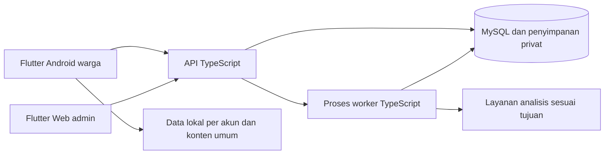

# SiagaBanjir — Functional Requirements Document (FRD)

> **Living document:** perbarui bersama setiap perubahan terkait menurut [aturan dokumentasi](../rules/documentation.md#living-documents).

## 1. Kontrol dokumen

| Elemen | Nilai |
|---|---|
| Versi / tanggal | v1.0.0 / 18 Oktober 2026 |
| Status | **APPROVED — baseline fungsional untuk SRS; FRD-APPROVAL-01** |
| Tahap | 3 dari BRD → PRD → FRD → SRS → Workspace Setup |
| Baseline | [BRD](BRD.md) v0.1.0 dan [PRD](PRD.md) v0.1.0 APPROVED |
| Owner / approver | Pengguna/pemilik proyek |
| Penyusun / reviewer teknis | Asisten menyusun; pemilik/backend/AI dan dua anggota Flutter mereview sesuai bidang |
| Otorisasi | [FRD-DLG-001 / FRD-APPROVAL-01](DECISIONS.md#frd-approval-01): pemilik mendelegasikan pilihan standar demo dan meminta FRD difinalkan serta disetujui |
| Bukti implementasi / UAT | **NOT_RUN**; semua AC/TC adalah skenario yang direncanakan |
| Register bersama | [DECISIONS](DECISIONS.md), [TRACEABILITY](TRACEABILITY.md#frd-traceability) |
| Riwayat discovery | [lampiran discovery FRD](FRD.md#frd-appendix); [putaran 1](DECISIONS.md#frd-round-1), [2](DECISIONS.md#frd-round-2), [3](DECISIONS.md#frd-round-3), [4](DECISIONS.md#frd-round-4), [5](DECISIONS.md#frd-round-5), [6](DECISIONS.md#frd-round-6), [7](DECISIONS.md#frd-round-7), [8](DECISIONS.md#frd-round-8) |

| Revisi | Isi | Status |
|---|---|---|
| v0.1.0 awal | Elaborasi baseline PRD, state/izin, kasus gagal, RTM dan backlog rincian | DRAFT |
| v0.1.1 discovery | Keputusan kuota/galeri/KTP/pemulihan/logout/inbox, kasus batas, riset primer dan penyelarasan skenario | DRAFT; rincian yang belum dijawab tetap terbuka |
| v0.1.2 konsolidasi | Satu FRD dengan lampiran discovery terintegrasi; keputusan kelompok/tingkat/penanda hapus; peta penutupan agenda dan audit ulang | DRAFT; bukan sign-off atau hasil uji produk |
| v0.1.3 kelanjutan sesi 4 | Q009-E–J dan Q010-B–E dipilih: rubrik/review/refresh/catatan serta konfirmasi hapus/pembersihan/audit/retensi; audit dan sumber sesi dipulihkan | DRAFT; 10 jawaban baru DEC-032–041; cadangan/cache dan agenda lain tetap terbuka |
| v1.0.0 final | Menutup rincian fungsi melalui 12 paket standar demo; mengeluarkan backup server dari syarat FRD; menyelaraskan FR/AC/TC, aturan dan RTM | APPROVED melalui delegasi eksplisit FRD-DLG-001; uji produk tetap NOT_RUN |

**Aturan baca final:** §1–29 dan FRD-STD-001–012 (§30.21–32) adalah baseline berlaku. §30.1–19 menyimpan riwayat discovery; label PROPOSED/TBD/pertanyaan pada bagian historis bukan pekerjaan fungsi yang masih menunggu jawaban. Keputusan eksplisit terdahulu tetap berlaku; standar final melengkapi rinciannya. §30.20 ditarik sesuai batas lingkup terbaru. Persetujuan ini berasal dari mandat finalisasi pemilik, bukan jawaban individual atau review putaran baru yang dikarang.

**Navigasi:** [katalog 68 FR](#functional-catalog) · [penutupan agenda](#frd-open) · [kesiapan menuju SRS](#frd-readiness) · [lampiran discovery](#frd-appendix). FRD ini menjadi satu-satunya spesifikasi fungsional. DECISIONS menyimpan bukti keputusan dan TRACEABILITY menyimpan keterlacakan/audit lintas tahap.

## 2. Ringkasan fungsional

SiagaBanjir adalah demo akademik konteks Padang. Warga mengirim bukti dugaan banjir; sistem membantu analisis dan pengelompokan; admin meninjau serta memberi tindak lanjut. Publik membaca ringkasan Pantau yang terbatas. Aplikasi juga menyediakan dokumen privat, profil keluarga, kesiapsiagaan dan inbox pesan admin.

Alur inti dimulai dengan akun dan KTP privat yang memenuhi pemeriksaan jenis/keterbacaan serta konfirmasi pemilik. KTP bukan verifikasi identitas resmi. Pengisian keluarga dari dokumen merupakan tujuan pilihan yang terpisah. Penerimaan laporan, hasil AI, tinjauan admin dan selesai kejadian mempunyai arti berbeda.

## 3. Tujuan, cakupan dan non-goals

Tujuan FRD adalah menguraikan tindakan, kondisi, hasil dan pengecualian untuk 57 kebutuhan F dan 10 batasan NF PRD, sebagai baseline perilaku yang sudah diputuskan untuk penyusunan kontrak teknis SRS. Seluruh fitur pendukung PRD tetap termasuk demo.

| Termasuk | Tidak termasuk / belum wajib |
|---|---|
| Flutter Android warga, Flutter Web admin; backend bersama | Platform warga iOS atau admin native belum diwajibkan |
| Laporan, analisis, kelompok, review, Pantau, galeri/kuota/reset/hapus | Sungai/TMA/sensor, shelter, dispatch/logistik, chat dan layanan darurat resmi keluar cakupan |
| Akun lokal, recovery code, dua admin setara; KTP sebelum kirim | Google Login, verifikasi email, hierarki admin dan hapus akun mandiri belum wajib |
| Vault, keluarga, tas, kontak, panduan, CMS, inbox | Push eksternal, targeting domisili, alert otomatis AI dan merge/split massal khusus belum wajib |
| Demo lokal dan spesimen | Setup/hosting, backup server, SLA dan RPO/RTO tidak menjadi syarat FRD; teknis menjalankan demo mengikuti tahap SRS/setup |

## 4. Referensi dan inventaris sumber

| ID | Sumber | Kedudukan dan batas |
|---|---|---|
| FRD-SRC-001 | BRD v0.1.0; PRD v0.1.0; register bersama | Baseline produk dan jejak keputusan; tidak membuktikan aplikasi berjalan |
| FRD-SRC-002 | `C:\Users\Pongo\Desktop\Belajar\prompting-setup\3.PROMPT_FRD.md` | Struktur 30 bagian, template granular, discovery, audit dan quality gates |
| FRD-SRC-003 | `C:\Users\Pongo\Desktop\Belajar\prompting-setup\2.PROMPT_PRD.md` | Penutupan PRD; prompt 1, 4, 5 tetap urutan acuan BRD/SRS/setup |
| FRD-SRC-004 | `C:\Users\Pongo\Desktop\kuliah\Semester 5\Pemrograman Berbasis Platform\Minggu 6\SIAGABANJIR-PAKET-PRA-CODING-v2.0` | Sumber historis: master, `SIAGABANJIR-PRECODING-v2.0`, `design(notfixbutthemewillbelikethis)`; angka/rumus lama bukan keputusan otomatis |
| FRD-SRC-005 | Ekspor bernomor `1.` dan `2.` di root workspace | Riwayat discovery dan pembacaan/audit terdahulu; bagian output yang terpotong tidak diklaim pulih |
| FRD-SRC-006 | Pesan persetujuan rencana/PRD | Bukti PRD-APPROVAL-01 kini juga termuat pada ekspor sesi 3; bukan approval FRD |
| FRD-SRC-007 | Ekspor sesi 3 (arsip lokal), terutama pesan User terakhir | Permintaan menggabungkan kedua berkas FRD dan memperbaikinya sebelum tahap berikut; jawaban lanjutan pada sesi aktif direkam terpisah |
| FRD-SRC-008 | Ekspor sesi 4 (arsip lokal) | Dua belas jawaban FRD-DEC-020–031, konsolidasi satu FRD dan audit PASS; tidak memuat jawaban Q009-E atau respons penutup yang sebelumnya direncanakan |
| FRD-SRC-009 | [Instruksi finalisasi pemilik](DECISIONS.md#frd-dlg-001), sesi 18 Oktober 2026 | Otoritas memilih standar demo, menutup FRD dan mencatat approval; bukan bukti implementasi/provider |

Inventaris awal 41 berkas sumber tetap historis; empat ekspor bernomor 1–4 dicatat terpisah sebagai bukti percakapan, bukan anggota tambahan paket sumber asli. Inventaris lengkap dan batas bahan hilang ada pada TRACEABILITY §2. Sumber asli tetap tidak diubah. Draf v0.1.0 tidak melakukan riset web baru; v0.1.1 menambahkan pemeriksaan dokumentasi resmi pada [register riset](TRACEABILITY.md#frd-research-1). Belum ada panggilan provider, pengujian perangkat atau UAT baru. Sesi 3 memuat 16 jawaban FRD terdahulu; jawaban setelah ekspor tersebut dicatat terpisah pada register keputusan.

## 5. Stakeholder, aktor dan peran

| Aktor | Tujuan / hak | Batas |
|---|---|---|
| Tamu | Baca Pantau, kontak umum, panduan | Fitur/data pribadi memerlukan login |
| Warga pemilik | Kelola akun, draf, dokumen, keluarga, tas/kontak lokal; kirim laporan; baca riwayat dan inbox | Laporan diterima read-only; data warga lain tidak terbuka |
| Admin | Review, koreksi, pindah laporan, tindak lanjut, selesai/hapus, konfigurasi dan konten/pesan | Dua akun setara; tidak membaca isi vault/keluarga warga |
| Proses sistem | Analisis, kelompok, sinkronisasi dan pekerjaan sesuai tujuan | Tidak menjadi sumber kepastian resmi; hasil usang/terhapus tidak boleh dihidupkan kembali |
| Tim | Pemilik: backend/AI/maintainer/review; dua teman: Flutter/UI/integrasi | Bukan role operasional baru; pembagian personal kedua teman belum ditetapkan |

## 6. Glosarium operasional

| Istilah | Makna |
|---|---|
| Draf | Teks/media lokal, belum terbukti diterima backend |
| Permintaan kirim | Warga sudah menekan Kirim; satu maksud bisnis yang dapat dicoba ulang |
| Diterima | Backend sudah mempunyai laporan; tidak berarti analisis/review selesai |
| Bukti layak dinilai | Bukti yang dapat dipakai menurut aturan penilaian; bukan jaminan kebenaran |
| Belum dinilai | Belum ada penilaian yang dapat dipakai; berbeda dari rendah |
| Prioritas | Urutan perhatian admin; berbeda dari indikasi tingkat pada Pantau |
| Ditinjau / perlu tinjauan ulang | Cakupan review terhadap bukti; bukti baru tidak otomatis ikut disahkan |
| Selesai kejadian | Tidak aktif di Pantau; berbeda dari penghapusan laporan |
| Privat | Akses isi hanya pemilik melalui layanan/aplikasi; pemrosesan bertujuan masih dimungkinkan |
| Unknown perangkat | Status tidak diketahui, tidak diartikan sebagai mode developer mati |
| Backup dokumen | Dokumen akun di backend; berbeda dari cadangan infrastruktur |
| TBD historis | Label discovery lama; fungsi telah ditutup pada STD-001–012, bukti aktual dijadwalkan terpisah |

## 7. Konteks dan batas sistem

Diagram menunjukkan pembagian tanggung jawab yang sudah dipilih, bukan kontrak queue/storage final. Klien menyajikan input/status; layanan menegakkan kepemilikan dan keputusan penerimaan; worker memproses tujuan tertentu; storage menjaga objek sesuai lifecycle. Laragon 6/MySQL wajib untuk demo lokal. Framework, transport pekerjaan, skema, versi runtime dan penyimpanan fisik dirinci SRS.

## 8. Asumsi, hipotesis, batasan dan dependensi

| ID | Pernyataan | Status dan tindak lanjut |
|---|---|---|
| FRD-A-001 | Status, aturan, input dan hasil fungsi pada FRD merupakan baseline | APPROVED; format API/SQL diturunkan di SRS |
| FRD-A-002 | Kelayakan provider media/KTP/keluarga belum dibuktikan pada akun/model yang dipakai | EVIDENCE_SCHEDULED; Q013/014 dan STD-006/012; fixture tidak menggantikan bukti provider |
| FRD-A-003 | Perangkat/build dapat berbeda dukungan sinyal lokasi dan suara | EVIDENCE_SCHEDULED; Q004; inventaris dan pengujian nyata sebelum klaim dukungan |
| FRD-A-004 | Pilihan angka dan perilaku tambahan adalah konfigurasi demo yang didelegasikan | DELEGATED_APPROVED, STD-001–012; bukan standar eksternal atau hasil pengukuran |
| FRD-A-005 | Cakupan dan teknologi BRD/PRD tetap berlaku | BRD/PRD APPROVED; server operasional tidak ditambahkan ke kewajiban FRD |
| FRD-A-006 | Approval dokumen tidak meluluskan produk | 38 jawaban historis tetap; satu mandat kolektif finalisasi dicatat terpisah; seluruh 156 TC NOT_RUN |

**Status persetujuan seluruh 68 FR: APPROVED v1.0.0.** Tidak ada pilihan fungsi yang masih membutuhkan jawaban pemilik. Empat agenda bukti dijadwalkan untuk SRS/implementasi dengan batas klaim yang jelas; satu agenda kontrak teknis dialokasikan SRS. Jika bukti kemudian menuntut perubahan perilaku, gunakan kendali perubahan, bukan default diam-diam.

## 9. Modul, prioritas dan dependensi

| Modul | Tujuan / owner | Dependensi / urutan |
|---|---|---|
| AUTH | Akses, akun, recovery, admin dan logout; backend + Flutter | M1; dasar semua fitur privat |
| KTP | Prasyarat akun untuk kirim; backend/AI + Flutter | M1; vault dan pemeriksaan khusus |
| REPORT | Media, lokasi, draf, kirim/retry, riwayat; Flutter + backend | M2; AUTH/KTP/CONTROL |
| AI | Analisis kecocokan dan kegagalan; backend/AI | M2; laporan diterima dan bukti provider |
| REVIEW | Kelompok, koreksi, tindak lanjut, selesai; backend + Flutter admin | M2/M3; REPORT/AI |
| CONTROL | Galeri, kuota/reset, penghapusan; backend + Flutter admin | M3; penerimaan laporan dan rekonsiliasi |
| MONITOR | Ringkasan publik; backend + Flutter | M3; kelompok/tingkat/review |
| VAULT | Penyimpanan privat lintas perangkat; backend + Flutter | Fondasi M1 untuk KTP; lengkap M4 |
| FAMILY | Bantuan isi, review, profil/merge; backend/AI + Flutter | M4; AUTH/VAULT; input manual tidak bergantung ekstraksi |
| READY | Tas/kontak/panduan/data lokal; Flutter | M4; katalog/CMS; profil untuk personalisasi |
| CONTENT | Konten umum/katalog admin; backend + Flutter admin | M4; sumber konten dan bundle |
| INBOX | Pesan admin, koreksi/cabut, baca; backend + Flutter | M4; AUTH |

Semua modul wajib dalam demo, bukan prioritas opsional baru. M5 adalah validasi seluruh alur. Tidak ada deadline numerik yang ditambahkan.

## 10. Alur end-to-end

| Alur / use case | Jalur utama | Alternatif / pengecualian / hasil |
|---|---|---|
| E2E-01 / UC-AUTH | Daftar → simpan kode → login → gunakan fitur privat → logout | Salah kredensial/kode tidak membuka akun; kehilangan sandi dan kode sekaligus tidak dapat dipulihkan; kode sah sekali pakai dan sesi lama dicabut saat reset berhasil |
| E2E-02 / UC-KTP | Upload KTP privat → periksa jenis/keterbacaan → pemilik konfirmasi → memenuhi syarat kirim | Draf boleh sebelum lolos; gagal/unknown bukan lolos; hapus KTP menahan kirim baru |
| E2E-03 / UC-REPORT | Buat draf → lengkapi → Kirim → periksa prasyarat → diterima → riwayat | Offline mempertahankan draf; Kirim yang terputus dilanjutkan saat aktif/online, satu laporan |
| E2E-04 / UC-AI, UC-REVIEW | Laporan → analisis → kelompok → review/koreksi → tindak lanjut → selesai kejadian | AI gagal tidak berarti rendah; ketidakcocokan disimpan untuk review; bukti baru perlu review lagi |
| E2E-05 / UC-CONTROL, UC-MONITOR | Admin ubah aturan/hapus → penerimaan/agregat menyesuaikan → Pantau sinkron | Hasil job terlambat tidak menghidupkan laporan; selesai kejadian tidak sama dengan hapus |
| E2E-06 / UC-VAULT, UC-FAMILY | Backup → pilih bantuan isi → persetujuan → proses → review/edit → pilih tambah/perbarui → terapkan | Backup tidak gagal hanya karena ekstraksi gagal; isi manual tersedia; hapus sumber tidak hapus profil |
| E2E-07 / UC-READY, UC-CONTENT | Admin kelola katalog/kontak/panduan → warga ambil pembaruan → gunakan tas/konten | Instalasi baru offline memiliki teks/kontak dasar; progres dan kontak pribadi tetap lokal |
| E2E-08 / UC-INBOX | Admin terbitkan → warga baca/tandai → admin koreksi/cabut → inbox sinkron | Akun baru mendapat semua pesan aktif; revisi judul/isi kembali belum dibaca; tanggal akhir opsional; dicabut/berakhir keluar inbox warga |

## 11. Kebutuhan fungsional terperinci

Ketentuan bersama untuk setiap record: **versi 1.0.0 / 18 Oktober 2026; status APPROVED; prioritas wajib demo; owner sesuai modul §9; FRD-APPROVAL-01.** Sumber BR/Q/DEC dan PRD ditelusuri melalui RTM. Jawaban literal terdahulu dipertahankan; rincian final STD-001–012 ditetapkan melalui mandat FRD-DLG-001.

Field input di bawah bersifat konseptual; tipe/validasi diketahui ada di §14. Template tiap record mengandung trigger/precondition, aturan/perilaku, output/postcondition/state, izin, alternatif/error, dependensi, audit/privasi, AC positif/negatif dan TC. ID `AC-<MODULE>-<NNN>-01/02` dan `TC-<MODULE>-<NNN>-01/02` stabil. Seluruh TC **NOT_RUN**. Oracle final mengikuti aturan keputusan dan STD-001–012. Contoh historis tidak mengalahkan konfigurasi final; hasil eksekusi belum tersedia.

**Aturan bersama perubahan admin:** pada record REVIEW/CONTROL/CONTENT/INBOX, jika dua admin mengubah versi objek yang sama, perubahan sah pertama berlaku; perubahan dari versi usang ditolak dan memerlukan muat ulang (FRD-DEC-018, RULE-024). Hasil race worker/bukti baru ditetapkan STD-010; mekanisme versi diturunkan pada SRS. Ini berlaku juga pada perubahan konfigurasi, bukan izin menimpa pembaruan admin lain secara diam-diam.

### FR-AUTH-001 — menyediakan bacaan umum tanpa registrasi dan meminta login untuk aksi pribadi

- **Sumber / tujuan:** [PRD-F-001](PRD.md#prd-f-001); tujuan produk mengikuti kebutuhan sumber, bukan scope baru.
- **Aktor / izin:** Tamu; batas objek mengikuti §16, platform mengikuti §9.
- **Trigger / precondition:** Membuka Pantau, kontak umum atau panduan tanpa sesi.
- **Input / validasi:** Pilihan halaman umum; kamus §14 dan aturan terkait §13. Batas dan kasus tepi normatif: [STD-002](#frd-std-002), [STD-003](#frd-std-003), [STD-005](#frd-std-005).
- **Requirement / alur sukses:** SISTEM HARUS menyediakan bacaan umum tanpa registrasi dan meminta login untuk aksi pribadi.
- **Output / postcondition / state:** Halaman umum terbaca; permintaan data pribadi belum diizinkan.
- **Alternatif / negatif / error / recovery:** Buka URL/detail pribadi langsung: data tetap tidak terbuka; jaringan gagal tidak dibuat seolah data terbaru.
- **Dependensi / data / audit / privasi:** UC-AUTH; state §15, antarmuka §18, event §19. Data hanya pada cakupan peran/tujuan; audit tidak menyalin rahasia atau isi privat.
- **Terbuka / risiko:** Fungsi APPROVED; rincian final [STD-002](#frd-std-002), [STD-003](#frd-std-003), [STD-005](#frd-std-005). Kontrak implementasi dialokasikan SRS; bukti perangkat/provider/UAT tetap NOT_RUN sesuai STD-012.
- **AC-AUTH-001-01 / TC-AUTH-001-01:** Given tamu, When membuka tiga bacaan umum, Then isi umum tersedia tanpa login. **NOT_RUN**.
- **AC-AUTH-001-02 / TC-AUTH-001-02:** Given tamu, When meminta riwayat akun, Then isi pribadi tidak terbuka. **NOT_RUN**.

### FR-AUTH-002 — membuat akun warga dari pendaftaran yang memenuhi aturan, tanpa kewajiban verifikasi email pada demo

- **Sumber / tujuan:** [PRD-F-002](PRD.md#prd-f-002); tujuan produk mengikuti kebutuhan sumber, bukan scope baru.
- **Aktor / izin:** Calon warga; batas objek mengikuti §16, platform mengikuti §9.
- **Trigger / precondition:** Mengirim pendaftaran email/sandi.
- **Input / validasi:** Nama tampilan 2–80 karakter, email sah/unik ≤254, sandi 12–128 tanpa trim; STD-002/003; kamus §14 dan aturan terkait §13. Batas dan kasus tepi normatif: [STD-002](#frd-std-002), [STD-003](#frd-std-003), [STD-005](#frd-std-005).
- **Requirement / alur sukses:** SISTEM HARUS membuat akun warga dari pendaftaran yang memenuhi aturan, tanpa kewajiban verifikasi email pada demo.
- **Output / postcondition / state:** Akun dapat dipakai login; tidak diberi role admin atau label email terverifikasi.
- **Alternatif / negatif / error / recovery:** Email duplikat, format/sandi tidak memenuhi aturan, atau respons terputus: tampilkan hasil yang benar; validasi STD-002/003 dan keunikan email ditegakkan; respons hilang meminta pemeriksaan/login sebelum membuat akun lain.
- **Dependensi / data / audit / privasi:** UC-AUTH; state §15, antarmuka §18, event §19. Data hanya pada cakupan peran/tujuan; audit tidak menyalin rahasia atau isi privat.
- **Terbuka / risiko:** Fungsi APPROVED; rincian final [STD-002](#frd-std-002), [STD-003](#frd-std-003), [STD-005](#frd-std-005). Kontrak implementasi dialokasikan SRS; bukti perangkat/provider/UAT tetap NOT_RUN sesuai STD-012.
- **AC-AUTH-002-01 / TC-AUTH-002-01:** Given input memenuhi aturan yang disahkan, When daftar, Then akun warga dapat login. **NOT_RUN**.
- **AC-AUTH-002-02 / TC-AUTH-002-02:** Given request menyisipkan role admin, When daftar, Then akun tidak mendapat hak admin. Varian batas: nama 1/2/80/81, sandi 11/12/128/129 karakter; email berbeda kapital tetap duplikat. Input gagal tetap dapat diperbaiki. **NOT_RUN**.

### FR-AUTH-003 — membatasi fitur pribadi kepada sesi sah pemilik

- **Sumber / tujuan:** [PRD-F-003](PRD.md#prd-f-003); tujuan produk mengikuti kebutuhan sumber, bukan scope baru.
- **Aktor / izin:** Warga; hak hanya akun yang diautentikasi; batas objek mengikuti §16, platform mengikuti §9.
- **Trigger / precondition:** Meminta sesi atau fitur privat.
- **Input / validasi:** Kredensial dan konteks sesi; kamus §14 dan aturan terkait §13. Batas dan kasus tepi normatif: [STD-002](#frd-std-002), [STD-003](#frd-std-003), [STD-005](#frd-std-005).
- **Requirement / alur sukses:** SISTEM HARUS membatasi fitur pribadi kepada sesi sah pemilik.
- **Output / postcondition / state:** Login sah membuka fitur sesuai peran; gagal tidak membuka data.
- **Alternatif / negatif / error / recovery:** Sandi salah atau sesi tidak lagi sah: akses ditolak; timeout tidak ditampilkan sebagai login berhasil; sesi maksimum 7 hari, pesan gagal umum dan batas percobaan STD-003.
- **Dependensi / data / audit / privasi:** UC-AUTH; state §15, antarmuka §18, event §19. Data hanya pada cakupan peran/tujuan; audit tidak menyalin rahasia atau isi privat.
- **Terbuka / risiko:** Fungsi APPROVED; rincian final [STD-002](#frd-std-002), [STD-003](#frd-std-003), [STD-005](#frd-std-005). Kontrak implementasi dialokasikan SRS; bukti perangkat/provider/UAT tetap NOT_RUN sesuai STD-012.
- **AC-AUTH-003-01 / TC-AUTH-003-01:** Given kredensial sah, When login, Then fitur pribadi akun tersedia. **NOT_RUN**.
- **AC-AUTH-003-02 / TC-AUTH-003-02:** Given kredensial salah, When login dan membuka objek privat, Then objek tidak terbaca. **NOT_RUN**.

### FR-AUTH-004 — menerapkan perubahan profil hanya pada akun pemilik yang sah

- **Sumber / tujuan:** [PRD-F-004](PRD.md#prd-f-004); tujuan produk mengikuti kebutuhan sumber, bukan scope baru.
- **Aktor / izin:** Pemilik akun; batas objek mengikuti §16, platform mengikuti §9.
- **Trigger / precondition:** Membuka atau menyimpan profil sendiri setelah login.
- **Input / validasi:** Nama tampilan; perubahan email/sandi wajib sandi saat ini dan mencabut sesi lama, STD-003; kamus §14 dan aturan terkait §13. Batas dan kasus tepi normatif: [STD-002](#frd-std-002), [STD-003](#frd-std-003), [STD-005](#frd-std-005).
- **Requirement / alur sukses:** SISTEM HARUS menerapkan perubahan profil hanya pada akun pemilik yang sah.
- **Output / postcondition / state:** Profil akun tersebut berubah setelah simpan berhasil; profil akun lain tetap.
- **Alternatif / negatif / error / recovery:** Field invalid atau target akun lain ditolak; saat gagal simpan jangan mengklaim data tersimpan; versi lama ditolak tanpa menimpa perubahan pertama, STD-010.
- **Dependensi / data / audit / privasi:** UC-AUTH; state §15, antarmuka §18, event §19. Data hanya pada cakupan peran/tujuan; audit tidak menyalin rahasia atau isi privat.
- **Terbuka / risiko:** Fungsi APPROVED; rincian final [STD-002](#frd-std-002), [STD-003](#frd-std-003), [STD-005](#frd-std-005). Kontrak implementasi dialokasikan SRS; bukti perangkat/provider/UAT tetap NOT_RUN sesuai STD-012.
- **AC-AUTH-004-01 / TC-AUTH-004-01:** Given A login, When menyimpan profil valid, Then perubahan milik A. **NOT_RUN**.
- **AC-AUTH-004-02 / TC-AUTH-004-02:** Given A login, When menargetkan profil B, Then B tidak berubah. **NOT_RUN**.

### FR-AUTH-005 — memberikan kode pemulihan kepada pemilik untuk disimpan sendiri

- **Sumber / tujuan:** [PRD-F-005](PRD.md#prd-f-005); tujuan produk mengikuti kebutuhan sumber, bukan scope baru.
- **Aktor / izin:** Warga pemilik saat pendaftaran; batas objek mengikuti §16, platform mengikuti §9.
- **Trigger / precondition:** Pendaftaran akun berhasil.
- **Input / validasi:** Identitas akun dan keluaran kode pemulihan privat; kamus §14 dan aturan terkait §13. Batas dan kasus tepi normatif: [STD-002](#frd-std-002), [STD-003](#frd-std-003), [STD-005](#frd-std-005).
- **Requirement / alur sukses:** SISTEM HARUS memberikan kode pemulihan kepada pemilik untuk disimpan sendiri.
- **Output / postcondition / state:** Pemilik memperoleh kode terkait akunnya; bukan publikasi ke admin atau akun lain.
- **Alternatif / negatif / error / recovery:** Kode sekali pakai dan pengganti setelah reset mengikuti FRD-DEC-013; pemilik dapat membuat kode pengganti dari sesi sah bila respons reset hilang. Sandi saat ini diperlukan untuk rotasi; format, batas percobaan dan respons signup hilang mengikuti STD-003. Kode tidak dicantumkan pada artefak publik.
- **Dependensi / data / audit / privasi:** UC-AUTH; state §15, antarmuka §18, event §19. Data hanya pada cakupan peran/tujuan; audit tidak menyalin rahasia atau isi privat.
- **Terbuka / risiko:** Fungsi APPROVED; rincian final [STD-002](#frd-std-002), [STD-003](#frd-std-003), [STD-005](#frd-std-005). Kontrak implementasi dialokasikan SRS; bukti perangkat/provider/UAT tetap NOT_RUN sesuai STD-012.
- **AC-AUTH-005-01 / TC-AUTH-005-01:** Given pendaftaran berhasil, When tahap kode ditampilkan, Then pemilik dapat menyimpan kode pribadinya. **NOT_RUN**.
- **AC-AUTH-005-02 / TC-AUTH-005-02:** Given B atau admin membuka data akun A, When meminta kode A, Then kode privat tidak tersedia. **NOT_RUN**.

### FR-AUTH-006 — mengizinkan penggantian sandi melalui kode pemulihan sah milik akun

- **Sumber / tujuan:** [PRD-F-005](PRD.md#prd-f-005); tujuan produk mengikuti kebutuhan sumber, bukan scope baru.
- **Aktor / izin:** Pemilik yang membuktikan kode sah; batas objek mengikuti §16, platform mengikuti §9.
- **Trigger / precondition:** Meminta pemulihan sandi.
- **Input / validasi:** Pengenal akun, kode, sandi baru; kode 32 karakter A–Z/2–7 sekali pakai; 5 kegagalan/15 menit ditahan 15 menit, STD-003; kamus §14 dan aturan terkait §13. Batas dan kasus tepi normatif: [STD-002](#frd-std-002), [STD-003](#frd-std-003), [STD-005](#frd-std-005).
- **Requirement / alur sukses:** SISTEM HARUS mengizinkan penggantian sandi melalui kode pemulihan sah milik akun.
- **Output / postcondition / state:** Pemulihan berhasil mengganti sandi, menghabiskan kode sekali pakai, mencabut sesi lama dan memberi kode pengganti (FRD-DEC-013).
- **Alternatif / negatif / error / recovery:** Kode salah/terpakai tidak memulihkan akun. Kehilangan sandi sekaligus kode tidak mempunyai jalur pemulihan aplikasi/admin; akun baru tidak mengambil data akun lama (FRD-DEC-005). Jika reset berhasil tetapi respons hilang, login memakai sandi baru memungkinkan pembuatan kode pengganti; rotasi meminta sandi saat ini menurut STD-003.
- **Dependensi / data / audit / privasi:** UC-AUTH; state §15, antarmuka §18, event §19. Data hanya pada cakupan peran/tujuan; audit tidak menyalin rahasia atau isi privat.
- **Terbuka / risiko:** Fungsi APPROVED; rincian final [STD-002](#frd-std-002), [STD-003](#frd-std-003), [STD-005](#frd-std-005). Kontrak implementasi dialokasikan SRS; bukti perangkat/provider/UAT tetap NOT_RUN sesuai STD-012.
- **AC-AUTH-006-01 / TC-AUTH-006-01:** Given kode sah A, When pemulihan berhasil, Then sandi baru berlaku, sesi lama dicabut, kode lama tidak berlaku dan kode pengganti tersedia; bila respons hilang, A dapat login dengan sandi baru dan membuat kode pengganti. **NOT_RUN**.
- **AC-AUTH-006-02 / TC-AUTH-006-02:** Given kode salah/terpakai atau sandi dan kode sama-sama hilang, When pemulihan dicoba, Then tidak membuka akun; admin tidak dapat menggantikan bukti pemulihan dan akun baru tidak mengambil data lama. Varian: percobaan salah kelima memulai tahan 15 menit; reset serentak memakai kode sama hanya satu berhasil; sesi lama ditolak sesudah reset. **NOT_RUN**.

### FR-AUTH-007 — memberikan hak admin setara kepada dua akun demo yang disiapkan tim

- **Sumber / tujuan:** [PRD-F-006](PRD.md#prd-f-006); tujuan produk mengikuti kebutuhan sumber, bukan scope baru.
- **Aktor / izin:** Dua admin disiapkan tim; batas objek mengikuti §16, platform mengikuti §9.
- **Trigger / precondition:** Admin login lalu meminta fungsi pengelolaan.
- **Input / validasi:** Akun admin hasil provisioning tim; kamus §14 dan aturan terkait §13. Batas dan kasus tepi normatif: [STD-002](#frd-std-002), [STD-003](#frd-std-003), [STD-005](#frd-std-005).
- **Requirement / alur sukses:** SISTEM HARUS memberikan hak admin setara kepada dua akun demo yang disiapkan tim.
- **Output / postcondition / state:** Kedua admin dapat menjalankan fungsi admin yang sama dalam batas izin.
- **Alternatif / negatif / error / recovery:** Warga yang mengubah tampilan/parameter role tidak mendapat hak admin; dua kredensial admin terpisah melalui seed; mekanisme provisioning pada SRS.
- **Dependensi / data / audit / privasi:** UC-AUTH; state §15, antarmuka §18, event §19. Data hanya pada cakupan peran/tujuan; audit tidak menyalin rahasia atau isi privat.
- **Terbuka / risiko:** Fungsi APPROVED; rincian final [STD-002](#frd-std-002), [STD-003](#frd-std-003), [STD-005](#frd-std-005). Kontrak implementasi dialokasikan SRS; bukti perangkat/provider/UAT tetap NOT_RUN sesuai STD-012.
- **AC-AUTH-007-01 / TC-AUTH-007-01:** Given dua admin demo, When menjalankan fungsi admin yang sama, Then hak keduanya setara. **NOT_RUN**.
- **AC-AUTH-007-02 / TC-AUTH-007-02:** Given warga, When meminta fungsi admin, Then tindakan ditolak. **NOT_RUN**.

### FR-AUTH-008 — mengakhiri akses sesi setelah logout serta mencegah pembukaan data akun lama oleh sesi lain

- **Sumber / tujuan:** [PRD-F-057](PRD.md#prd-f-057); tujuan produk mengikuti kebutuhan sumber, bukan scope baru.
- **Aktor / izin:** Pemilik sesi; batas objek mengikuti §16, platform mengikuti §9.
- **Trigger / precondition:** Memilih logout atau kemudian masuk sebagai akun lain.
- **Input / validasi:** Sesi aktif dan data privat lokal terkait akun; kamus §14 dan aturan terkait §13. Batas dan kasus tepi normatif: [STD-002](#frd-std-002), [STD-003](#frd-std-003), [STD-005](#frd-std-005).
- **Requirement / alur sukses:** SISTEM HARUS mengakhiri akses sesi setelah logout serta mencegah pembukaan data akun lama oleh sesi lain.
- **Output / postcondition / state:** Akses A berakhir; login B tidak memperlihatkan data A. Draf/checklist/item/progres/kontak lokal dipertahankan untuk login ulang A. Antrean lokal berhenti, sesi lokal dan cache pratinjau dokumen dibersihkan; pekerjaan yang telah diterima server boleh selesai untuk A (FRD-DEC-006/014).
- **Alternatif / negatif / error / recovery:** Callback A tidak boleh diterapkan ke B. Logout offline menutup akses lokal; pencabutan sesi server diantrekan secara terbatas sampai online menurut STD-005; mekanisme token SRS. Jangan mengklaim cache terhapus secara fisik hanya karena UI tertutup.
- **Dependensi / data / audit / privasi:** UC-AUTH; state §15, antarmuka §18, event §19. Data hanya pada cakupan peran/tujuan; audit tidak menyalin rahasia atau isi privat.
- **Terbuka / risiko:** Fungsi APPROVED; rincian final [STD-002](#frd-std-002), [STD-003](#frd-std-003), [STD-005](#frd-std-005). Kontrak implementasi dialokasikan SRS; bukti perangkat/provider/UAT tetap NOT_RUN sesuai STD-012.
- **AC-AUTH-008-01 / TC-AUTH-008-01:** Given A logout, When B login pada perangkat sama lalu A login kembali, Then B tidak melihat data A dan A kembali mendapat draf/checklist/kontak lokalnya; antrean A berhenti selama A logout. **NOT_RUN**.
- **AC-AUTH-008-02 / TC-AUTH-008-02:** Given A logout, When mencoba membuka kembali detail privat tanpa sesi, Then isi tidak tersedia. **NOT_RUN**.

### FR-REPORT-001 — memvalidasi jumlah dan jenis kombinasi media sesuai batas laporan

- **Sumber / tujuan:** [PRD-F-007](PRD.md#prd-f-007); tujuan produk mengikuti kebutuhan sumber, bukan scope baru.
- **Aktor / izin:** Warga pemilik draf; batas objek mengikuti §16, platform mengikuti §9.
- **Trigger / precondition:** Memilih media lalu mencoba kirim.
- **Input / validasi:** Satu atau dua foto ATAU satu video berdurasi paling lama 5 detik; kamus §14 dan aturan terkait §13. Batas dan kasus tepi normatif: [STD-002](#frd-std-002), [STD-004](#frd-std-004), [STD-005](#frd-std-005), [STD-010](#frd-std-010).
- **Requirement / alur sukses:** SISTEM HARUS memvalidasi jumlah dan jenis kombinasi media sesuai batas laporan.
- **Output / postcondition / state:** Media dalam batas dapat melanjutkan validasi; media melebihi batas tidak diterima sebagai laporan sah.
- **Alternatif / negatif / error / recovery:** Tiga foto, dua video, foto+video, video >5 detik atau media kosong gagal; draf dipertahankan; JPEG/PNG/WebP ≤10 MiB/foto atau MP4 H.264 ≤25 MiB dan ≤5 detik; isi diperiksa, decoder/probe ditetapkan SRS.
- **Dependensi / data / audit / privasi:** UC-REPORT; state §15, antarmuka §18, event §19. Data hanya pada cakupan peran/tujuan; audit tidak menyalin rahasia atau isi privat.
- **Terbuka / risiko:** Fungsi APPROVED; rincian final [STD-002](#frd-std-002), [STD-004](#frd-std-004), [STD-005](#frd-std-005), [STD-010](#frd-std-010). Kontrak implementasi dialokasikan SRS; bukti perangkat/provider/UAT tetap NOT_RUN sesuai STD-012.
- **AC-REPORT-001-01 / TC-REPORT-001-01:** Given satu video tepat 5 detik dengan prasyarat lain valid, When kirim, Then batas durasi tidak menolaknya. **NOT_RUN**.
- **AC-REPORT-001-02 / TC-REPORT-001-02:** Given video 5,1 detik atau foto+video, When kirim, Then ditolak tanpa kehilangan draf. Varian: foto tepat 10 MiB dan video tepat 25 MiB/5 detik lolos batas; +1 byte, durasi >5 detik atau isi rusak ditolak tanpa menghapus draf. **NOT_RUN**.

### FR-REPORT-002 — memerlukan tiga unsur wajib dan mencatat waktu kirim otomatis terpisah dari waktu kejadian

- **Sumber / tujuan:** [PRD-F-008](PRD.md#prd-f-008); tujuan produk mengikuti kebutuhan sumber, bukan scope baru.
- **Aktor / izin:** Warga pemilik draf; batas objek mengikuti §16, platform mengikuti §9.
- **Trigger / precondition:** Menekan Kirim setelah mengisi laporan.
- **Input / validasi:** Media, deskripsi, titik wajib; waktu kejadian opsional; kamus §14 dan aturan terkait §13. Batas dan kasus tepi normatif: [STD-002](#frd-std-002), [STD-004](#frd-std-004), [STD-005](#frd-std-005), [STD-010](#frd-std-010).
- **Requirement / alur sukses:** SISTEM HARUS memerlukan tiga unsur wajib dan mencatat waktu kirim otomatis terpisah dari waktu kejadian.
- **Output / postcondition / state:** Laporan memiliki keterangan, titik dan media; dua arti waktu tidak tertukar.
- **Alternatif / negatif / error / recovery:** Unsur kosong meminta pelengkapan; deskripsi 1–2.000 karakter, koordinat sah dan waktu opsional dari 30 hari lalu sampai 5 menit mendatang diperiksa menurut STD-002; gagal validasi bukan laporan diterima.
- **Dependensi / data / audit / privasi:** UC-REPORT; state §15, antarmuka §18, event §19. Data hanya pada cakupan peran/tujuan; audit tidak menyalin rahasia atau isi privat.
- **Terbuka / risiko:** Fungsi APPROVED; rincian final [STD-002](#frd-std-002), [STD-004](#frd-std-004), [STD-005](#frd-std-005), [STD-010](#frd-std-010). Kontrak implementasi dialokasikan SRS; bukti perangkat/provider/UAT tetap NOT_RUN sesuai STD-012.
- **AC-REPORT-002-01 / TC-REPORT-002-01:** Given tiga unsur lengkap dan waktu kejadian berbeda, When diterima, Then kedua waktu bermakna terpisah. **NOT_RUN**.
- **AC-REPORT-002-02 / TC-REPORT-002-02:** Given deskripsi atau titik kosong, When kirim, Then pelengkapan diminta dan draf tetap ada. Varian: koordinat tepat batas sah, di luar batas ditolak; waktu tepat −30 hari/+5 menit sah, di luar rentang meminta koreksi. **NOT_RUN**.

### FR-REPORT-003 — menerima pilihan titik manual termasuk lokasi lain serta membedakannya dari pengisian GPS

- **Sumber / tujuan:** [PRD-F-009](PRD.md#prd-f-009); tujuan produk mengikuti kebutuhan sumber, bukan scope baru.
- **Aktor / izin:** Warga pemilik draf; batas objek mengikuti §16, platform mengikuti §9.
- **Trigger / precondition:** Mengisi titik melalui GPS atau pilihan manual.
- **Input / validasi:** Titik kejadian dan sumber GPS/manual; kamus §14 dan aturan terkait §13. Batas dan kasus tepi normatif: [STD-002](#frd-std-002), [STD-004](#frd-std-004), [STD-005](#frd-std-005), [STD-010](#frd-std-010).
- **Requirement / alur sukses:** SISTEM HARUS menerima pilihan titik manual termasuk lokasi lain serta membedakannya dari pengisian GPS.
- **Output / postcondition / state:** Sumber titik terlihat pada pemeriksaan laporan; manual bukan bukti kehadiran.
- **Alternatif / negatif / error / recovery:** GPS ditolak/tidak tersedia tetap memungkinkan manual; manual tidak melewati blok perangkat; tidak ada geofence Padang; titik harus dipilih pengguna dalam rentang koordinat sah; kegagalan GPS menyediakan manual.
- **Dependensi / data / audit / privasi:** UC-REPORT; state §15, antarmuka §18, event §19. Data hanya pada cakupan peran/tujuan; audit tidak menyalin rahasia atau isi privat.
- **Terbuka / risiko:** Fungsi APPROVED; rincian final [STD-002](#frd-std-002), [STD-004](#frd-std-004), [STD-005](#frd-std-005), [STD-010](#frd-std-010). Kontrak implementasi dialokasikan SRS; bukti perangkat/provider/UAT tetap NOT_RUN sesuai STD-012.
- **AC-REPORT-003-01 / TC-REPORT-003-01:** Given GPS tidak tersedia, When memilih titik manual valid, Then penyusunan laporan dapat lanjut. **NOT_RUN**.
- **AC-REPORT-003-02 / TC-REPORT-003-02:** Given titik manual jauh dari perangkat, When detail ditinjau, Then tidak dilabeli bukti kehadiran pelapor. **NOT_RUN**.

### FR-REPORT-004 — menahan pengiriman saat kondisi terlarang terdeteksi, termasuk untuk titik manual

- **Sumber / tujuan:** [PRD-F-010](PRD.md#prd-f-010); tujuan produk mengikuti kebutuhan sumber, bukan scope baru.
- **Aktor / izin:** Warga pada APK demo; batas objek mengikuti §16, platform mengikuti §9.
- **Trigger / precondition:** Kirim atau retry dengan mock GPS/mode developer berhasil terdeteksi.
- **Input / validasi:** Sinyal perangkat, jenis build, sumber titik; kamus §14 dan aturan terkait §13. Batas dan kasus tepi normatif: [STD-002](#frd-std-002), [STD-004](#frd-std-004), [STD-005](#frd-std-005), [STD-010](#frd-std-010).
- **Requirement / alur sukses:** SISTEM HARUS menahan pengiriman saat kondisi terlarang terdeteksi, termasuk untuk titik manual.
- **Output / postcondition / state:** Kirim tertahan; draf/media dan bacaan umum tetap dapat digunakan.
- **Alternatif / negatif / error / recovery:** Perubahan kondisi dapat dicoba lagi; uji internal tidak meluluskan APK demo; cakupan deteksi belum teruji.
- **Dependensi / data / audit / privasi:** UC-REPORT; state §15, antarmuka §18, event §19. Data hanya pada cakupan peran/tujuan; audit tidak menyalin rahasia atau isi privat.
- **Terbuka / risiko:** Fungsi APPROVED; rincian final [STD-002](#frd-std-002), [STD-004](#frd-std-004), [STD-005](#frd-std-005), [STD-010](#frd-std-010). Kontrak implementasi dialokasikan SRS; bukti perangkat/provider/UAT tetap NOT_RUN sesuai STD-012.
- **AC-REPORT-004-01 / TC-REPORT-004-01:** Given mode developer aktif terdeteksi pada APK demo, When kirim, Then kirim tertahan dan draf utuh. **NOT_RUN**.
- **AC-REPORT-004-02 / TC-REPORT-004-02:** Given mock GPS terdeteksi dengan titik manual, When retry, Then manual tidak melewati blok. **NOT_RUN**.

### FR-REPORT-005 — mempertahankan arti unknown dan tidak memblokir kirim semata-mata karena unknown mode developer

- **Sumber / tujuan:** [PRD-F-010](PRD.md#prd-f-010); tujuan produk mengikuti kebutuhan sumber, bukan scope baru.
- **Aktor / izin:** Warga; sistem pemeriksa perangkat; batas objek mengikuti §16, platform mengikuti §9.
- **Trigger / precondition:** Status mode developer tidak dapat diperiksa.
- **Input / validasi:** Sinyal unknown serta kondisi larangan lain; kamus §14 dan aturan terkait §13. Batas dan kasus tepi normatif: [STD-002](#frd-std-002), [STD-004](#frd-std-004), [STD-005](#frd-std-005), [STD-010](#frd-std-010).
- **Requirement / alur sukses:** SISTEM HARUS mempertahankan arti unknown dan tidak memblokir kirim semata-mata karena unknown mode developer.
- **Output / postcondition / state:** Jika prasyarat lain lolos, pengiriman dapat lanjut tanpa label perangkat terverifikasi.
- **Alternatif / negatif / error / recovery:** Unknown tidak meniadakan mock yang benar-benar terdeteksi; status tidak diubah menjadi off; plugin dan minimum versi pada SRS; dukungan aktual harus dibuktikan menurut STD-012.
- **Dependensi / data / audit / privasi:** UC-REPORT; state §15, antarmuka §18, event §19. Data hanya pada cakupan peran/tujuan; audit tidak menyalin rahasia atau isi privat.
- **Terbuka / risiko:** Fungsi APPROVED; rincian final [STD-002](#frd-std-002), [STD-004](#frd-std-004), [STD-005](#frd-std-005), [STD-010](#frd-std-010). Kontrak implementasi dialokasikan SRS; bukti perangkat/provider/UAT tetap NOT_RUN sesuai STD-012.
- **AC-REPORT-005-01 / TC-REPORT-005-01:** Given developer unknown dan syarat lain lolos, When kirim, Then unknown sendiri tidak memblokir. **NOT_RUN**.
- **AC-REPORT-005-02 / TC-REPORT-005-02:** Given unknown developer tetapi mock terdeteksi, When kirim, Then blok mock tetap berlaku. **NOT_RUN**.

### FR-REPORT-006 — membatasi pengecualian internal hanya pada pemblokiran mode developer

- **Sumber / tujuan:** [PRD-F-010](PRD.md#prd-f-010); tujuan produk mengikuti kebutuhan sumber, bukan scope baru.
- **Aktor / izin:** Tim pengembang pada build internal; batas objek mengikuti §16, platform mengikuti §9.
- **Trigger / precondition:** Menjalankan alur kirim untuk pengembangan.
- **Input / validasi:** Identitas konfigurasi build internal/demo; kamus §14 dan aturan terkait §13. Batas dan kasus tepi normatif: [STD-002](#frd-std-002), [STD-004](#frd-std-004), [STD-005](#frd-std-005), [STD-010](#frd-std-010).
- **Requirement / alur sukses:** SISTEM HARUS membatasi pengecualian internal hanya pada pemblokiran mode developer.
- **Output / postcondition / state:** Build internal dapat mengembangkan alur; APK demo tetap memakai ketentuan blok yang disepakati.
- **Alternatif / negatif / error / recovery:** Pengecualian tidak berlaku untuk mock GPS atau syarat KTP/kuota; bukti build internal tidak mengganti uji demo.
- **Dependensi / data / audit / privasi:** UC-REPORT; state §15, antarmuka §18, event §19. Data hanya pada cakupan peran/tujuan; audit tidak menyalin rahasia atau isi privat.
- **Terbuka / risiko:** Fungsi APPROVED; rincian final [STD-002](#frd-std-002), [STD-004](#frd-std-004), [STD-005](#frd-std-005), [STD-010](#frd-std-010). Kontrak implementasi dialokasikan SRS; bukti perangkat/provider/UAT tetap NOT_RUN sesuai STD-012.
- **AC-REPORT-006-01 / TC-REPORT-006-01:** Given build internal dengan pengecualian developer, When kirim dengan syarat lain sah, Then blok developer dapat dilewati. **NOT_RUN**.
- **AC-REPORT-006-02 / TC-REPORT-006-02:** Given APK demo atau mock terdeteksi, When mengandalkan pengecualian internal, Then larangan yang relevan tetap ditegakkan. **NOT_RUN**.

### FR-KTP-001 — memerlukan KTP akun yang memenuhi syarat sebelum kirim, tanpa unggah ulang KTP per laporan

- **Sumber / tujuan:** [PRD-F-011](PRD.md#prd-f-011); tujuan produk mengikuti kebutuhan sumber, bukan scope baru.
- **Aktor / izin:** Warga pemilik; batas objek mengikuti §16, platform mengikuti §9.
- **Trigger / precondition:** Membuat draf atau mencoba pengiriman baru.
- **Input / validasi:** KTP privat akun dan status kelayakannya; kamus §14 dan aturan terkait §13. Batas dan kasus tepi normatif: [STD-002](#frd-std-002), [STD-005](#frd-std-005), [STD-006](#frd-std-006), [STD-010](#frd-std-010).
- **Requirement / alur sukses:** SISTEM HARUS memerlukan KTP akun yang memenuhi syarat sebelum kirim, tanpa unggah ulang KTP per laporan.
- **Output / postcondition / state:** Draf boleh dibuat sebelum terpenuhi; kirim berikutnya memakai status akun.
- **Alternatif / negatif / error / recovery:** Backup sembarang atau profil keluarga manual bukan pemenuhan KTP; tidak melampirkan KTP ke bukti laporan publik/admin.
- **Dependensi / data / audit / privasi:** UC-KTP; state §15, antarmuka §18, event §19. Data hanya pada cakupan peran/tujuan; audit tidak menyalin rahasia atau isi privat.
- **Terbuka / risiko:** Fungsi APPROVED; rincian final [STD-002](#frd-std-002), [STD-005](#frd-std-005), [STD-006](#frd-std-006), [STD-010](#frd-std-010). Kontrak implementasi dialokasikan SRS; bukti perangkat/provider/UAT tetap NOT_RUN sesuai STD-012.
- **AC-KTP-001-01 / TC-KTP-001-01:** Given KTP belum terpenuhi, When membuat draf lalu kirim, Then draf tersimpan dan kirim tertahan. **NOT_RUN**.
- **AC-KTP-001-02 / TC-KTP-001-02:** Given status KTP sudah terpenuhi, When mengirim laporan berikut, Then tidak diminta unggah KTP per laporan. **NOT_RUN**.

### FR-KTP-002 — memeriksa jenis/keterbacaan KTP dan menyajikan hasil kepada pemilik tanpa klaim verifikasi NIK resmi

- **Sumber / tujuan:** [PRD-F-012](PRD.md#prd-f-012); tujuan produk mengikuti kebutuhan sumber, bukan scope baru.
- **Aktor / izin:** Sistem untuk pemilik dokumen; batas objek mengikuti §16, platform mengikuti §9.
- **Trigger / precondition:** Pemilik menyerahkan KTP untuk pemeriksaan khusus.
- **Input / validasi:** Dokumen KTP privat dan persetujuan tujuan pemeriksaan; minimum jenis dikenali sebagai KTP dan nama pemilik terbaca. NIK tidak wajib terbaca (FRD-DEC-010); kamus §14 dan aturan terkait §13. Batas dan kasus tepi normatif: [STD-002](#frd-std-002), [STD-005](#frd-std-005), [STD-006](#frd-std-006), [STD-010](#frd-std-010).
- **Requirement / alur sukses:** SISTEM HARUS memeriksa jenis/keterbacaan KTP dan menyajikan hasil kepada pemilik tanpa klaim verifikasi NIK resmi.
- **Output / postcondition / state:** Hasil atau status gagal/menunggu tersedia hanya bagi pemilik sesuai kebutuhan proses.
- **Alternatif / negatif / error / recovery:** Jenis salah, nama tidak terbaca atau provider gagal tidak meluluskan dokumen baru; format mengikuti STD-002/006; kualitas/model dibuktikan melalui PoC STD-012. Jika ini penggantian dan KTP lama masih aktif, kelayakan lama tetap berlaku (FRD-DEC-011).
- **Dependensi / data / audit / privasi:** UC-KTP; state §15, antarmuka §18, event §19. Data hanya pada cakupan peran/tujuan; audit tidak menyalin rahasia atau isi privat.
- **Terbuka / risiko:** Fungsi APPROVED; rincian final [STD-002](#frd-std-002), [STD-005](#frd-std-005), [STD-006](#frd-std-006), [STD-010](#frd-std-010). Kontrak implementasi dialokasikan SRS; bukti perangkat/provider/UAT tetap NOT_RUN sesuai STD-012.
- **AC-KTP-002-01 / TC-KTP-002-01:** Given jenis KTP dikenali dan nama terbaca meskipun NIK tidak terbaca, When hasil tersedia, Then pemilik dapat meninjau dan melanjutkan konfirmasi tanpa kewajiban keterbacaan NIK. **NOT_RUN**.
- **AC-KTP-002-02 / TC-KTP-002-02:** Given dokumen baru salah jenis/nama tak terbaca atau proses gagal/belum selesai, When status diperiksa, Then dokumen baru belum memenuhi; KTP lama yang masih aktif tetap memberi kelayakan selama penggantian. **NOT_RUN**.

### FR-KTP-003 — memasukkan konfirmasi pemilik sebagai bagian pemenuhan prasyarat KTP

- **Sumber / tujuan:** [PRD-F-012](PRD.md#prd-f-012); tujuan produk mengikuti kebutuhan sumber, bukan scope baru.
- **Aktor / izin:** Pemilik dokumen; batas objek mengikuti §16, platform mengikuti §9.
- **Trigger / precondition:** Meninjau hasil pemeriksaan KTP lalu mengonfirmasi.
- **Input / validasi:** Hasil pemeriksaan yang layak dan konfirmasi pemilik; kamus §14 dan aturan terkait §13. Batas dan kasus tepi normatif: [STD-002](#frd-std-002), [STD-005](#frd-std-005), [STD-006](#frd-std-006), [STD-010](#frd-std-010).
- **Requirement / alur sukses:** SISTEM HARUS memasukkan konfirmasi pemilik sebagai bagian pemenuhan prasyarat KTP.
- **Output / postcondition / state:** KTP baru menjadi dasar kelayakan sesudah jenis/nama memenuhi aturan dan pemilik mengonfirmasi. Saat mengganti, kelayakan lama tetap berlaku sampai kedua syarat pengganti terpenuhi (FRD-DEC-010/011).
- **Alternatif / negatif / error / recovery:** Konfirmasi isi keluarga tidak menggantikan konfirmasi KTP; konfirmasi hasil gagal tidak meluluskan. Hapus KTP aktif menahan kirim baru; konfirmasi usang ditolak dan berkas lama tetap dokumen biasa sampai pemilik menghapus, STD-005/010.
- **Dependensi / data / audit / privasi:** UC-KTP; state §15, antarmuka §18, event §19. Data hanya pada cakupan peran/tujuan; audit tidak menyalin rahasia atau isi privat.
- **Terbuka / risiko:** Fungsi APPROVED; rincian final [STD-002](#frd-std-002), [STD-005](#frd-std-005), [STD-006](#frd-std-006), [STD-010](#frd-std-010). Kontrak implementasi dialokasikan SRS; bukti perangkat/provider/UAT tetap NOT_RUN sesuai STD-012.
- **AC-KTP-003-01 / TC-KTP-003-01:** Given hasil KTP baru memenuhi aturan jenis/nama, When pemilik mengonfirmasi, Then dokumen baru memenuhi prasyarat; bila mengganti KTP aktif, kelayakan lama berlaku sampai saat pergantian itu. **NOT_RUN**.
- **AC-KTP-003-02 / TC-KTP-003-02:** Given hanya hasil isi keluarga dikonfirmasi, When kirim memerlukan KTP, Then tidak otomatis dianggap lolos KTP. **NOT_RUN**.

### FR-KTP-004 — menahan pengiriman baru setelah KTP prasyarat dihapus

- **Sumber / tujuan:** [PRD-F-013](PRD.md#prd-f-013); tujuan produk mengikuti kebutuhan sumber, bukan scope baru.
- **Aktor / izin:** Pemilik KTP; batas objek mengikuti §16, platform mengikuti §9.
- **Trigger / precondition:** Menghapus KTP yang memenuhi syarat.
- **Input / validasi:** Dokumen prasyarat akun; kamus §14 dan aturan terkait §13. Batas dan kasus tepi normatif: [STD-002](#frd-std-002), [STD-005](#frd-std-005), [STD-006](#frd-std-006), [STD-010](#frd-std-010).
- **Requirement / alur sukses:** SISTEM HARUS menahan pengiriman baru setelah KTP prasyarat dihapus.
- **Output / postcondition / state:** Kelayakan tidak terpenuhi; riwayat laporan yang sudah diterima tetap tersedia.
- **Alternatif / negatif / error / recovery:** Hasil pemeriksaan terlambat tidak boleh membenarkan KTP yang sudah tidak ada; hasil race/delete/retry mengikuti STD-010.
- **Dependensi / data / audit / privasi:** UC-KTP; state §15, antarmuka §18, event §19. Data hanya pada cakupan peran/tujuan; audit tidak menyalin rahasia atau isi privat.
- **Terbuka / risiko:** Fungsi APPROVED; rincian final [STD-002](#frd-std-002), [STD-005](#frd-std-005), [STD-006](#frd-std-006), [STD-010](#frd-std-010). Kontrak implementasi dialokasikan SRS; bukti perangkat/provider/UAT tetap NOT_RUN sesuai STD-012.
- **AC-KTP-004-01 / TC-KTP-004-01:** Given KTP terpenuhi lalu dihapus, When kirim baru, Then tertahan sampai syarat dipenuhi kembali. **NOT_RUN**.
- **AC-KTP-004-02 / TC-KTP-004-02:** Given laporan lama sudah diterima, When KTP dihapus, Then laporan lama tetap ada pada riwayat. **NOT_RUN**.

### FR-REPORT-007 — mempertahankan draf beserta media lokal tanpa menyebutnya diterima backend

- **Sumber / tujuan:** [PRD-F-014](PRD.md#prd-f-014); tujuan produk mengikuti kebutuhan sumber, bukan scope baru.
- **Aktor / izin:** Warga pemilik draf; batas objek mengikuti §16, platform mengikuti §9.
- **Trigger / precondition:** Menyimpan draf saat offline atau syarat kirim belum lengkap.
- **Input / validasi:** Teks, media lokal, titik dan waktu yang sudah diisi; kamus §14 dan aturan terkait §13. Batas dan kasus tepi normatif: [STD-002](#frd-std-002), [STD-004](#frd-std-004), [STD-005](#frd-std-005), [STD-010](#frd-std-010).
- **Requirement / alur sukses:** SISTEM HARUS mempertahankan draf beserta media lokal tanpa menyebutnya diterima backend.
- **Output / postcondition / state:** Draf beserta media dipertahankan saat logout dan dapat dibuka kembali ketika akun yang sama login pada perangkat yang sama (FRD-DEC-006).
- **Alternatif / negatif / error / recovery:** Ruang simpan penuh atau file hilang tidak menghasilkan sukses palsu. Isi permintaan dengan hasil Kirim belum diketahui dikunci sampai rekonsiliasi; penolakan definitif sebelum diterima membolehkan koreksi draf (FRD-DEC-017). Maksimum 20 draf per akun/perangkat; revisi/rekonsiliasi mengikuti STD-004, isolasi lokal STD-005.
- **Dependensi / data / audit / privasi:** UC-REPORT; state §15, antarmuka §18, event §19. Data hanya pada cakupan peran/tujuan; audit tidak menyalin rahasia atau isi privat.
- **Terbuka / risiko:** Fungsi APPROVED; rincian final [STD-002](#frd-std-002), [STD-004](#frd-std-004), [STD-005](#frd-std-005), [STD-010](#frd-std-010). Kontrak implementasi dialokasikan SRS; bukti perangkat/provider/UAT tetap NOT_RUN sesuai STD-012.
- **AC-REPORT-007-01 / TC-REPORT-007-01:** Given offline, When menyimpan lalu membuka draf, Then teks dan media yang tersimpan tersedia. **NOT_RUN**.
- **AC-REPORT-007-02 / TC-REPORT-007-02:** Given belum ada konfirmasi backend, When status draf dilihat, Then tidak berlabel diterima. **NOT_RUN**.

### FR-REPORT-008 — melanjutkan pengiriman yang sebelumnya diminta saat aplikasi aktif dan online

- **Sumber / tujuan:** [PRD-F-015](PRD.md#prd-f-015); tujuan produk mengikuti kebutuhan sumber, bukan scope baru.
- **Aktor / izin:** Warga pemilik permintaan kirim; batas objek mengikuti §16, platform mengikuti §9.
- **Trigger / precondition:** Aplikasi aktif kembali dan online setelah Kirim terputus.
- **Input / validasi:** Permintaan Kirim tersimpan, akun dan prasyarat saat ini; kamus §14 dan aturan terkait §13. Batas dan kasus tepi normatif: [STD-002](#frd-std-002), [STD-004](#frd-std-004), [STD-005](#frd-std-005), [STD-010](#frd-std-010).
- **Requirement / alur sukses:** SISTEM HARUS melanjutkan pengiriman yang sebelumnya diminta saat aplikasi aktif dan online.
- **Output / postcondition / state:** Percobaan diterima atau tertahan dengan status nyata; draf biasa tidak ikut terkirim.
- **Alternatif / negatif / error / recovery:** Galeri OFF sebelum penerimaan menahan draf galeri dan meminta media kamera tanpa menghapus draf (FRD-DEC-008). Logout menghentikan antrean lokal sampai akun asal login kembali (FRD-DEC-014). Rekonsiliasi dan urutan prasyarat ditetapkan STD-004; bukan jaminan pengiriman saat app ditutup.
- **Dependensi / data / audit / privasi:** UC-REPORT; state §15, antarmuka §18, event §19. Data hanya pada cakupan peran/tujuan; audit tidak menyalin rahasia atau isi privat.
- **Terbuka / risiko:** Fungsi APPROVED; rincian final [STD-002](#frd-std-002), [STD-004](#frd-std-004), [STD-005](#frd-std-005), [STD-010](#frd-std-010). Kontrak implementasi dialokasikan SRS; bukti perangkat/provider/UAT tetap NOT_RUN sesuai STD-012.
- **AC-REPORT-008-01 / TC-REPORT-008-01:** Given Kirim pernah ditekan dan koneksi putus, When aktif serta online, Then permintaan dapat dilanjutkan. **NOT_RUN**.
- **AC-REPORT-008-02 / TC-REPORT-008-02:** Given draf belum pernah ditekan Kirim, When kembali online, Then draf tidak otomatis terkirim. **NOT_RUN**.

### FR-REPORT-009 — menyediakan tindakan kirim ulang manual dengan prasyarat yang tetap berlaku

- **Sumber / tujuan:** [PRD-F-015](PRD.md#prd-f-015); tujuan produk mengikuti kebutuhan sumber, bukan scope baru.
- **Aktor / izin:** Warga pemilik permintaan; batas objek mengikuti §16, platform mengikuti §9.
- **Trigger / precondition:** Memilih Coba lagi setelah pengiriman tertahan/gagal.
- **Input / validasi:** Permintaan yang sama dan status terakhir; kamus §14 dan aturan terkait §13. Batas dan kasus tepi normatif: [STD-002](#frd-std-002), [STD-004](#frd-std-004), [STD-005](#frd-std-005), [STD-010](#frd-std-010).
- **Requirement / alur sukses:** SISTEM HARUS menyediakan tindakan kirim ulang manual dengan prasyarat yang tetap berlaku.
- **Output / postcondition / state:** Hasil retry terlihat; draf tidak hilang jika masih tertahan.
- **Alternatif / negatif / error / recovery:** Retry tidak melewati prasyarat penerimaan baru; galeri OFF meminta kamera. Selama hasil penerimaan belum diketahui, isi dikunci sampai rekonsiliasi; penolakan definitif sebelum diterima membolehkan koreksi. Berhenti retry hanya lokal; revisi ditolak definitif ditutup sebelum koreksi dan permintaan lama ditolak, STD-004.
- **Dependensi / data / audit / privasi:** UC-REPORT; state §15, antarmuka §18, event §19. Data hanya pada cakupan peran/tujuan; audit tidak menyalin rahasia atau isi privat.
- **Terbuka / risiko:** Fungsi APPROVED; rincian final [STD-002](#frd-std-002), [STD-004](#frd-std-004), [STD-005](#frd-std-005), [STD-010](#frd-std-010). Kontrak implementasi dialokasikan SRS; bukti perangkat/provider/UAT tetap NOT_RUN sesuai STD-012.
- **AC-REPORT-009-01 / TC-REPORT-009-01:** Given kirim sebelumnya terputus, When memilih Coba lagi, Then ada percobaan untuk permintaan tersebut. **NOT_RUN**.
- **AC-REPORT-009-02 / TC-REPORT-009-02:** Given KTP sudah dihapus sebelum retry, When Coba lagi, Then tidak diterima sebagai kirim baru yang memenuhi syarat. **NOT_RUN**.

### FR-REPORT-010 — menghasilkan satu laporan bisnis untuk pengulangan permintaan Kirim yang sama

- **Sumber / tujuan:** [PRD-F-015](PRD.md#prd-f-015); tujuan produk mengikuti kebutuhan sumber, bukan scope baru.
- **Aktor / izin:** Warga dan sistem penerimaan; batas objek mengikuti §16, platform mengikuti §9.
- **Trigger / precondition:** Percobaan untuk maksud Kirim yang sama tiba berulang atau bersamaan.
- **Input / validasi:** Identitas permintaan yang sama; kontrak teknis SRS; kamus §14 dan aturan terkait §13. Batas dan kasus tepi normatif: [STD-002](#frd-std-002), [STD-004](#frd-std-004), [STD-005](#frd-std-005), [STD-010](#frd-std-010).
- **Requirement / alur sukses:** SISTEM HARUS menghasilkan satu laporan bisnis untuk pengulangan permintaan Kirim yang sama.
- **Output / postcondition / state:** Pengakuan penerimaan/retry menunjuk laporan yang sama; riwayat tidak berisi salinan ganda.
- **Alternatif / negatif / error / recovery:** Respons hilang/retry bersamaan tidak menggandakan laporan maupun kuota (FRD-DEC-004). Isi dikunci sampai status jelas; jika diterima, tampilkan laporan yang sama; jika ditolak definitif sebelum diterima, draf boleh diperbaiki (FRD-DEC-017). Identitas/revisi lama mengikuti STD-004/011; sumber terhapus tidak dibuat ulang.
- **Dependensi / data / audit / privasi:** UC-REPORT; state §15, antarmuka §18, event §19. Data hanya pada cakupan peran/tujuan; audit tidak menyalin rahasia atau isi privat.
- **Terbuka / risiko:** Fungsi APPROVED; rincian final [STD-002](#frd-std-002), [STD-004](#frd-std-004), [STD-005](#frd-std-005), [STD-010](#frd-std-010). Kontrak implementasi dialokasikan SRS; bukti perangkat/provider/UAT tetap NOT_RUN sesuai STD-012.
- **AC-REPORT-010-01 / TC-REPORT-010-01:** Given server menerima tetapi respons hilang, When request yang sama diulang, Then hanya satu laporan ada. **NOT_RUN**.
- **AC-REPORT-010-02 / TC-REPORT-010-02:** Given hasil Kirim belum diketahui dan retry bersamaan, When pengguna mencoba mengedit lalu rekonsiliasi selesai, Then isi terkunci selama status belum jelas; hasil diterima memakai laporan sama tanpa duplikasi, penolakan definitif sebelum diterima membolehkan koreksi draf. Varian: payload berbeda memakai identitas sama ditolak; ID laporan terhapus tidak menghasilkan laporan baru; timeout mempertahankan status belum pasti. **NOT_RUN**.

### FR-REPORT-011 — menyediakan riwayat/bukti milik sendiri sebagai baca saja bagi warga setelah diterima

- **Sumber / tujuan:** [PRD-F-016](PRD.md#prd-f-016); tujuan produk mengikuti kebutuhan sumber, bukan scope baru.
- **Aktor / izin:** Pemilik laporan; admin sesuai fungsi terpisah; batas objek mengikuti §16, platform mengikuti §9.
- **Trigger / precondition:** Membuka laporan yang telah diterima.
- **Input / validasi:** Pengenal laporan dan sesi pemilik; kamus §14 dan aturan terkait §13. Batas dan kasus tepi normatif: [STD-002](#frd-std-002), [STD-004](#frd-std-004), [STD-005](#frd-std-005), [STD-010](#frd-std-010).
- **Requirement / alur sukses:** SISTEM HARUS menyediakan riwayat/bukti milik sendiri sebagai baca saja bagi warga setelah diterima.
- **Output / postcondition / state:** Detail laporan aktif milik pemilik terbaca; setelah dihapus admin, riwayat pemilik hanya menampilkan penanda “Laporan dihapus admin” dan waktu hapus. Isi, media, analisis dan catatan tidak dapat dibuka (FRD-DEC-022/037/039). Retensi penanda 30 hari dan audit penghapusan 90 hari mengikuti DEC-041/RULE-044; tepat tenggat entri tidak lagi ditampilkan. Audit hanya tersedia bagi kedua admin.
- **Alternatif / negatif / error / recovery:** Akun lain atau manipulasi permintaan edit/hapus warga ditolak; draf masih mengikuti alur tersendiri.
- **Dependensi / data / audit / privasi:** UC-REPORT; state §15, antarmuka §18, event §19. Data hanya pada cakupan peran/tujuan; audit tidak menyalin rahasia atau isi privat.
- **Terbuka / risiko:** Fungsi APPROVED; rincian final [STD-002](#frd-std-002), [STD-004](#frd-std-004), [STD-005](#frd-std-005), [STD-010](#frd-std-010). Kontrak implementasi dialokasikan SRS; bukti perangkat/provider/UAT tetap NOT_RUN sesuai STD-012.
- **AC-REPORT-011-01 / TC-REPORT-011-01:** Given laporan diterima milik A, When A membuka detail, Then bukti/status aktif dapat dibaca; setelah penghapusan sah dan sinkron, hanya penanda serta waktu hapus yang terlihat tanpa akses isi/media/analisis (FRD-DEC-022). Varian batas retensi: sebelum 30 hari penanda pemilik ada, tepat/setelah 30 hari tidak ditampilkan; audit admin berakhir tepat 90 hari dari tindakannya. Kuota dan pekerjaan pembersihan tidak direset (DEC-041). **NOT_RUN**.
- **AC-REPORT-011-02 / TC-REPORT-011-02:** Given A mencoba mengedit laporan diterima atau B membaca laporan A, When request dijalankan, Then aksi yang dilarang tidak berhasil. **NOT_RUN**.

### FR-REPORT-012 — menampilkan keadaan proses dan hasil yang tersedia dengan pembedaan AI dan tinjauan admin

- **Sumber / tujuan:** [PRD-F-017](PRD.md#prd-f-017); tujuan produk mengikuti kebutuhan sumber, bukan scope baru.
- **Aktor / izin:** Pelapor pemilik; batas objek mengikuti §16, platform mengikuti §9.
- **Trigger / precondition:** Membuka perkembangan laporannya.
- **Input / validasi:** Status proses, ringkasan AI dan tinjauan admin yang tersedia; kamus §14 dan aturan terkait §13. Batas dan kasus tepi normatif: [STD-002](#frd-std-002), [STD-004](#frd-std-004), [STD-005](#frd-std-005), [STD-010](#frd-std-010).
- **Requirement / alur sukses:** SISTEM HARUS menampilkan keadaan proses dan hasil yang tersedia dengan pembedaan AI dan tinjauan admin.
- **Output / postcondition / state:** Pemilik memahami hasil atau alasan belum tersedia; tidak disajikan sebagai kepastian resmi.
- **Alternatif / negatif / error / recovery:** AI gagal tidak menjadi ringkasan berhasil; belum ada tindak lanjut tidak dibuat seolah bantuan datang; detail terbatas pada laporan pemilik, status/hasil sumber, tinjauan dan catatan yang boleh dibaca.
- **Dependensi / data / audit / privasi:** UC-REPORT; state §15, antarmuka §18, event §19. Data hanya pada cakupan peran/tujuan; audit tidak menyalin rahasia atau isi privat.
- **Terbuka / risiko:** Fungsi APPROVED; rincian final [STD-002](#frd-std-002), [STD-004](#frd-std-004), [STD-005](#frd-std-005), [STD-010](#frd-std-010). Kontrak implementasi dialokasikan SRS; bukti perangkat/provider/UAT tetap NOT_RUN sesuai STD-012.
- **AC-REPORT-012-01 / TC-REPORT-012-01:** Given ringkasan dan hasil admin tersedia, When pemilik membaca detail, Then asal keduanya dibedakan. **NOT_RUN**.
- **AC-REPORT-012-02 / TC-REPORT-012-02:** Given analisis belum selesai, When detail dibuka, Then status belum tersedia terlihat dan tidak disebut rendah. **NOT_RUN**.

### FR-AI-001 — menghasilkan bantuan penilaian kecocokan bukti dengan keterangan yang dapat ditelusuri ke sumbernya

- **Sumber / tujuan:** [PRD-F-018](PRD.md#prd-f-018); tujuan produk mengikuti kebutuhan sumber, bukan scope baru.
- **Aktor / izin:** Proses analisis; hasil untuk pemilik dan admin; batas objek mengikuti §16, platform mengikuti §9.
- **Trigger / precondition:** Laporan bermedia telah diterima dan dijadwalkan untuk analisis.
- **Input / validasi:** Media/foto/frame video dan keterangan dari laporan sumber; kamus §14 dan aturan terkait §13. Batas dan kasus tepi normatif: [STD-006](#frd-std-006), [STD-010](#frd-std-010), [STD-012](#frd-std-012).
- **Requirement / alur sukses:** SISTEM HARUS menghasilkan bantuan penilaian kecocokan bukti dengan keterangan yang dapat ditelusuri ke sumbernya.
- **Output / postcondition / state:** Status analisis dan hasil yang tersedia melekat pada laporan yang dianalisis. Penilaian tingkat memakai dasar dampak pada bukti/keterangan sesuai FRD-DEC-029; rubrik demo mengikuti FRD-DEC-032/§30.15 dan tidak diganti angka keyakinan model.
- **Alternatif / negatif / error / recovery:** Provider gagal/timeout/output invalid bukan hasil sah; pilihan demo 3 frame awal/tengah/akhir; timeout 60 detik dan maksimum 3 percobaan sesuai STD-006; resize/schema teknis di SRS; fixture berbeda dari panggilan nyata.
- **Dependensi / data / audit / privasi:** UC-AI; state §15, antarmuka §18, event §19. Data hanya pada cakupan peran/tujuan; audit tidak menyalin rahasia atau isi privat.
- **Terbuka / risiko:** Fungsi APPROVED; rincian final [STD-006](#frd-std-006), [STD-010](#frd-std-010), [STD-012](#frd-std-012). Kontrak implementasi dialokasikan SRS; bukti perangkat/provider/UAT tetap NOT_RUN sesuai STD-012.
- **AC-AI-001-01 / TC-AI-001-01:** Given laporan diterima, When analisis selesai dengan hasil sah, Then hasil terkait media dan keterangan sumber; untuk bukti layak, genangan lokal dengan informasi cukup menghasilkan Rendah, air masuk bangunan/akses terganggu Sedang, dan kebutuhan pertolongan/evakuasi yang didukung bukti Tinggi. Beberapa indikator memakai tingkat tertinggi yang didukung (FRD-DEC-032). **NOT_RUN**.
- **AC-AI-001-02 / TC-AI-001-02:** Given fixture menghasilkan ringkasan, When bukti pengujian dicatat, Then tidak diberi label panggilan provider nyata. **NOT_RUN**.

### FR-AI-002 — mempertahankan laporan tidak cocok untuk review dan mengecualikan buktinya dari penetapan bahaya sebelum ditinjau

- **Sumber / tujuan:** [PRD-F-019](PRD.md#prd-f-019); tujuan produk mengikuti kebutuhan sumber, bukan scope baru.
- **Aktor / izin:** Proses analisis dan admin peninjau; batas objek mengikuti §16, platform mengikuti §9.
- **Trigger / precondition:** Hasil analisis menilai bukti tidak cocok.
- **Input / validasi:** Laporan diterima dan hasil kecocokan; kamus §14 dan aturan terkait §13. Batas dan kasus tepi normatif: [STD-006](#frd-std-006), [STD-010](#frd-std-010), [STD-012](#frd-std-012).
- **Requirement / alur sukses:** SISTEM HARUS mempertahankan laporan tidak cocok untuk review dan mengecualikan buktinya dari penetapan bahaya sebelum ditinjau.
- **Output / postcondition / state:** Laporan tetap tersedia; perlu review; kelompok tanpa bukti layak menjadi belum dinilai.
- **Alternatif / negatif / error / recovery:** Ketidakcocokan tidak menjadi penolakan/hapus otomatis. Bukti kembali layak hanya setelah admin menetapkan relevansi, tingkat dan alasan (FRD-DEC-030); membuka laporan atau memberi catatan biasa tidak cukup. Jejak hasil AI awal tetap dipertahankan sesuai lifecycle sumber. Rubrik demo mengikuti FRD-DEC-032/§30.15.
- **Dependensi / data / audit / privasi:** UC-AI; state §15, antarmuka §18, event §19. Data hanya pada cakupan peran/tujuan; audit tidak menyalin rahasia atau isi privat.
- **Terbuka / risiko:** Fungsi APPROVED; rincian final [STD-006](#frd-std-006), [STD-010](#frd-std-010), [STD-012](#frd-std-012). Kontrak implementasi dialokasikan SRS; bukti perangkat/provider/UAT tetap NOT_RUN sesuai STD-012.
- **AC-AI-002-01 / TC-AI-002-01:** Given hasil tidak cocok, When hasil diproses, Then laporan masih dapat ditinjau admin; varian admin menetapkan relevansi, tingkat dan alasan membuat bukti kembali dihitung sesuai hasil review (FRD-DEC-030). **NOT_RUN**.
- **AC-AI-002-02 / TC-AI-002-02:** Given hanya bukti tidak cocok yang belum ditinjau, When Pantau dihitung, Then tingkat tetap Belum dinilai; membuka halaman atau memberi catatan biasa tidak membuat bukti layak (FRD-DEC-030). **NOT_RUN**.

### FR-AI-003 — membedakan penilaian belum tersedia dari tingkat rendah

- **Sumber / tujuan:** [PRD-F-020](PRD.md#prd-f-020); tujuan produk mengikuti kebutuhan sumber, bukan scope baru.
- **Aktor / izin:** Proses sistem; dibaca pelapor/admin/publik sesuai izin; batas objek mengikuti §16, platform mengikuti §9.
- **Trigger / precondition:** Analisis menunggu, gagal atau belum cukup untuk penilaian.
- **Input / validasi:** Status proses dan ketersediaan bukti layak; kamus §14 dan aturan terkait §13. Batas dan kasus tepi normatif: [STD-006](#frd-std-006), [STD-010](#frd-std-010), [STD-012](#frd-std-012).
- **Requirement / alur sukses:** SISTEM HARUS membedakan penilaian belum tersedia dari tingkat rendah.
- **Output / postcondition / state:** Keadaan belum dinilai terlihat pada konteks yang belum mempunyai penilaian; admin tetap dapat meninjau.
- **Alternatif / negatif / error / recovery:** Jika ada bukti lain yang layak, penilaian mengikuti agregasi tertinggi FRD-DEC-021. Informasi dampak yang belum cukup tetap Belum dinilai (FRD-DEC-029/032); kegagalan satu job tidak boleh direkayasa menjadi nilai rendah.
- **Dependensi / data / audit / privasi:** UC-AI; state §15, antarmuka §18, event §19. Data hanya pada cakupan peran/tujuan; audit tidak menyalin rahasia atau isi privat.
- **Terbuka / risiko:** Fungsi APPROVED; rincian final [STD-006](#frd-std-006), [STD-010](#frd-std-010), [STD-012](#frd-std-012). Kontrak implementasi dialokasikan SRS; bukti perangkat/provider/UAT tetap NOT_RUN sesuai STD-012.
- **AC-AI-003-01 / TC-AI-003-01:** Given kelompok tidak memiliki bukti layak, When analisis gagal, Then status tetap belum dinilai. **NOT_RUN**.
- **AC-AI-003-02 / TC-AI-003-02:** Given proses masih menunggu, When detail dibaca, Then tidak dinyatakan aman atau selesai dianalisis. **NOT_RUN**.

### FR-REVIEW-001 — mengelompokkan laporan terkait tanpa mengganti atau menghilangkan laporan individual

- **Sumber / tujuan:** [PRD-F-021](PRD.md#prd-f-021); tujuan produk mengikuti kebutuhan sumber, bukan scope baru.
- **Aktor / izin:** Sistem pengelompokan; admin pembaca bukti; batas objek mengikuti §16, platform mengikuti §9.
- **Trigger / precondition:** Laporan terkait diterima atau keanggotaan dievaluasi.
- **Input / validasi:** Lokasi/waktu dan laporan sumber; kedekatan antar laporan serta batas bentang seluruh kelompok wajib diperiksa (FRD-DEC-020), batas demo tetangga ≤1.500 m/≤6 jam dan seluruh kelompok ≤3.000 m/≤12 jam, tepat batas termasuk (FRD-DEC-023); waktu kejadian valid atau penerimaan jika kosong (FRD-DEC-024); kamus §14 dan aturan terkait §13. Batas dan kasus tepi normatif: [STD-002](#frd-std-002), [STD-008](#frd-std-008), [STD-010](#frd-std-010), [STD-011](#frd-std-011).
- **Requirement / alur sukses:** SISTEM HARUS mengelompokkan laporan terkait tanpa mengganti atau menghilangkan laporan individual.
- **Output / postcondition / state:** Kelompok mempunyai hubungan ke laporan yang tetap dapat dibuka oleh admin; penggabungan otomatis tidak boleh melampaui batas bentang kelompok hanya karena ada rantai tetangga (FRD-DEC-020).
- **Alternatif / negatif / error / recovery:** Jika A dekat B dan B dekat C tetapi A–C melewati batas bentang, ketiganya tidak otomatis menjadi satu kelompok. Bentang 3.001 m ditolak untuk penggabungan; tepat 3.000 m dapat diterima jika semua syarat lain lolos. Laporan terlambat mengikuti FRD-DEC-025 dan mendahulukan kandidat selesai. Kandidat dalam kelas yang sama dipilih menurut jarak anggota terdekat, lalu waktu pembuatan kelompok paling awal, lalu pengenal stabil (FRD-DEC-026). Tidak ada penggabungan beberapa kelompok otomatis hanya karena satu laporan cocok. Nama lokasi mengikuti DEC-027; koreksi manual DEC-028 melalui REVIEW-004. Metrik/presisi jarak dialokasikan SRS; hasil konflik mengikuti STD-010.
- **Dependensi / data / audit / privasi:** UC-REVIEW; state §15, antarmuka §18, event §19. Data hanya pada cakupan peran/tujuan; audit tidak menyalin rahasia atau isi privat.
- **Terbuka / risiko:** Fungsi APPROVED; rincian final [STD-002](#frd-std-002), [STD-008](#frd-std-008), [STD-010](#frd-std-010), [STD-011](#frd-std-011). Kontrak implementasi dialokasikan SRS; bukti perangkat/provider/UAT tetap NOT_RUN sesuai STD-012.
- **AC-REVIEW-001-01 / TC-REVIEW-001-01:** Given kelompok berisi beberapa laporan, When admin membuka sumber, Then setiap laporan tetap tersedia. **NOT_RUN**.
- **AC-REVIEW-001-02 / TC-REVIEW-001-02:** Given ringkasan kelompok berubah, When bukti individual diperiksa, Then ringkasan tidak menggantikan bukti; pada varian A–B–C yang gabungannya melewati batas bentang, sistem tidak otomatis menggabungkan ketiganya dan seluruh laporan tetap tersimpan (FRD-DEC-020). Varian beberapa kandidat memenuhi memilih anggota terdekat, lalu kelompok paling awal dan pengenal stabil tanpa merge otomatis. **NOT_RUN; metrik/presisi jarak dialokasikan SRS; hasil konflik STD-010**.

### FR-REVIEW-002 — menyajikan prioritas tinjauan dengan makna yang berbeda dari indikasi tingkat publik

- **Sumber / tujuan:** [PRD-F-022](PRD.md#prd-f-022); tujuan produk mengikuti kebutuhan sumber, bukan scope baru.
- **Aktor / izin:** Admin peninjau; batas objek mengikuti §16, platform mengikuti §9.
- **Trigger / precondition:** Membuka urutan perhatian laporan/kelompok.
- **Input / validasi:** Kelompok aktif yang perlu review, tingkat efektif atau Belum dinilai, waktu tunggu dan pengenal stabil (FRD-DEC-031); kamus §14 dan aturan terkait §13. Batas dan kasus tepi normatif: [STD-002](#frd-std-002), [STD-008](#frd-std-008), [STD-010](#frd-std-010), [STD-011](#frd-std-011).
- **Requirement / alur sukses:** SISTEM HARUS menyajikan prioritas tinjauan dengan makna yang berbeda dari indikasi tingkat publik.
- **Output / postcondition / state:** Antrean bernilai berurutan Tinggi → Sedang → Rendah, lalu kebutuhan review tertua yang masih terbuka dan pengenal stabil. Belum dinilai mempunyai antrean terpisah dengan urutan waktu/pengenal yang sama (FRD-DEC-031/034). Waktu awal untuk laporan baru ialah penerimaan server, bukan waktu kejadian. Kelompok aktif tanpa kebutuhan review terbuka keluar dari antrean kebutuhan review, bukan otomatis selesai kejadian atau hilang dari Pantau.
- **Alternatif / negatif / error / recovery:** Tambahan bukti tidak mereset kebutuhan lama. Setelah kebutuhan tertua selesai atau sumbernya dihapus, gunakan kebutuhan tersisa; sesudah semua selesai, bukti baru memulai tunggu baru. Hasil yang berubah setelah review mulai menunggu saat perubahan tersimpan (DEC-034). Refresh mengikuti DEC-035/§30.17; konflik pindah/worker/review mengikuti STD-010. Bobot mockup tidak menjadi formula tersembunyi.
- **Dependensi / data / audit / privasi:** UC-REVIEW; state §15, antarmuka §18, event §19. Data hanya pada cakupan peran/tujuan; audit tidak menyalin rahasia atau isi privat.
- **Terbuka / risiko:** Fungsi APPROVED; rincian final [STD-002](#frd-std-002), [STD-008](#frd-std-008), [STD-010](#frd-std-010), [STD-011](#frd-std-011). Kontrak implementasi dialokasikan SRS; bukti perangkat/provider/UAT tetap NOT_RUN sesuai STD-012.
- **AC-REVIEW-002-01 / TC-REVIEW-002-01:** Given dua kebutuhan pada tingkat sama diterima 08.00 dan 09.00, When keduanya masih terbuka, Then waktu tunggu memakai 08.00; setelah yang tertua direview/dihapus, gunakan 09.00. Urutan tingkat tetap DEC-031 dan Belum dinilai terpisah (DEC-034). **NOT_RUN**.
- **AC-REVIEW-002-02 / TC-REVIEW-002-02:** Given semua kebutuhan review selesai lalu bukti baru diterima 12.00, When antrean dihitung, Then awal tunggu 12.00; bukti baru tidak mereset kebutuhan lama bila masih ada. Kelompok tanpa tingkat tetap pada antrean Belum dinilai, bukan diberi Rendah (DEC-031/034). **NOT_RUN**.

### FR-REVIEW-003 — memungkinkan koreksi hasil AI oleh admin dan memperbarui hasil terkait sesuai koreksi sah

- **Sumber / tujuan:** [PRD-F-023](PRD.md#prd-f-023); tujuan produk mengikuti kebutuhan sumber, bukan scope baru.
- **Aktor / izin:** Admin; batas objek mengikuti §16, platform mengikuti §9.
- **Trigger / precondition:** Meninjau hasil analisis yang dinilai keliru.
- **Input / validasi:** Laporan, hasil AI, perubahan penilaian oleh admin menurut rubrik demo FRD-DEC-032/§30.15; untuk mengembalikan bukti tidak cocok menjadi layak wajib penetapan relevansi, tingkat dan alasan (FRD-DEC-030); kamus §14 dan aturan terkait §13. Batas dan kasus tepi normatif: [STD-002](#frd-std-002), [STD-008](#frd-std-008), [STD-010](#frd-std-010), [STD-011](#frd-std-011).
- **Requirement / alur sukses:** SISTEM HARUS memungkinkan koreksi hasil AI oleh admin dan memperbarui hasil terkait sesuai koreksi sah.
- **Output / postcondition / state:** Hasil yang berlaku mencerminkan koreksi admin. Review eksplisit mencatat laporan serta versi bukti/hasil yang diperiksa (DEC-033); status Ditinjau berbeda dari relevansi/kelayakan DEC-030. Akses vault tidak diberikan.
- **Alternatif / negatif / error / recovery:** Dua admin atau AI terlambat dapat bertabrakan; koreksi admin efektif tidak ditimpa hasil otomatis; versi usang ditolak menurut STD-010.
- **Dependensi / data / audit / privasi:** UC-REVIEW; state §15, antarmuka §18, event §19. Data hanya pada cakupan peran/tujuan; audit tidak menyalin rahasia atau isi privat.
- **Terbuka / risiko:** Fungsi APPROVED; rincian final [STD-002](#frd-std-002), [STD-008](#frd-std-008), [STD-010](#frd-std-010), [STD-011](#frd-std-011). Kontrak implementasi dialokasikan SRS; bukti perangkat/provider/UAT tetap NOT_RUN sesuai STD-012.
- **AC-REVIEW-003-01 / TC-REVIEW-003-01:** Given AI keliru dan admin mengoreksi, When simpan berhasil, Then hasil terkait berubah sesuai koreksi. **NOT_RUN**.
- **AC-REVIEW-003-02 / TC-REVIEW-003-02:** Given admin memiliki hak koreksi laporan, When membuka vault warga, Then isi tetap ditolak. **NOT_RUN**.

### FR-REVIEW-004 — memindahkan keanggotaan laporan ke kelompok pilihan admin tanpa menghilangkan sumber

- **Sumber / tujuan:** [PRD-F-024](PRD.md#prd-f-024); tujuan produk mengikuti kebutuhan sumber, bukan scope baru.
- **Aktor / izin:** Admin; batas objek mengikuti §16, platform mengikuti §9.
- **Trigger / precondition:** Menemukan laporan berada dalam kelompok salah.
- **Input / validasi:** Laporan dan kelompok tujuan yang ada atau baru; bila melampaui batas otomatis, alasan koreksi wajib (FRD-DEC-028); kamus §14 dan aturan terkait §13. Batas dan kasus tepi normatif: [STD-002](#frd-std-002), [STD-008](#frd-std-008), [STD-010](#frd-std-010), [STD-011](#frd-std-011).
- **Requirement / alur sukses:** SISTEM HARUS memindahkan keanggotaan laporan ke kelompok pilihan admin tanpa menghilangkan sumber.
- **Output / postcondition / state:** Keanggotaan dan ringkasan kelompok asal/tujuan diperbarui. Koreksi manual boleh melampaui batas otomatis dengan alasan dan audit; hasil koreksi tidak dibatalkan diam-diam oleh pengelompokan ulang otomatis (FRD-DEC-028).
- **Alternatif / negatif / error / recovery:** Pindah ke kelompok selesai tidak membuka kembali kejadian; tujuan tidak tersedia/versi usang ditolak dan kedua kelompok dihitung ulang, STD-010; tidak mewajibkan tool massal merge/split.
- **Dependensi / data / audit / privasi:** UC-REVIEW; state §15, antarmuka §18, event §19. Data hanya pada cakupan peran/tujuan; audit tidak menyalin rahasia atau isi privat.
- **Terbuka / risiko:** Fungsi APPROVED; rincian final [STD-002](#frd-std-002), [STD-008](#frd-std-008), [STD-010](#frd-std-010), [STD-011](#frd-std-011). Kontrak implementasi dialokasikan SRS; bukti perangkat/provider/UAT tetap NOT_RUN sesuai STD-012.
- **AC-REVIEW-004-01 / TC-REVIEW-004-01:** Given laporan salah kelompok, When dipindah ke kelompok baru, Then sumber tetap ada dan keanggotaan baru terlihat; varian melampaui batas otomatis memerlukan alasan dan audit, lalu tetap berlaku saat pemrosesan otomatis diulang (FRD-DEC-028). **NOT_RUN**.
- **AC-REVIEW-004-02 / TC-REVIEW-004-02:** Given kelompok asal kehilangan anggota, When ringkasan diperbarui, Then laporan tidak dihitung pada kedua kelompok; varian perpindahan melampaui batas tanpa alasan ditolak tanpa mengubah keanggotaan lama. **NOT_RUN**.

### FR-REVIEW-005 — menyediakan catatan tindak lanjut kepada admin dan pelapor terkait

- **Sumber / tujuan:** [PRD-F-025](PRD.md#prd-f-025); tujuan produk mengikuti kebutuhan sumber, bukan scope baru.
- **Aktor / izin:** Admin penulis; pelapor terkait pembaca; batas objek mengikuti §16, platform mengikuti §9.
- **Trigger / precondition:** Menyimpan catatan tindak lanjut sederhana.
- **Input / validasi:** Satu laporan tujuan, penulis admin, isi catatan; koreksi merujuk catatan terdahulu pada laporan yang sama (DEC-036/037). Panjang catatan 1–1.000 karakter dan alasan 1–500, STD-002; kamus §14. Batas dan kasus tepi normatif: [STD-002](#frd-std-002), [STD-008](#frd-std-008), [STD-010](#frd-std-010), [STD-011](#frd-std-011).
- **Requirement / alur sukses:** SISTEM HARUS menyediakan catatan tindak lanjut kepada admin dan pelapor terkait.
- **Output / postcondition / state:** Catatan melekat pada laporan dan dapat dibaca kedua admin serta pemilik laporan itu. Perpindahan kelompok mempertahankan catatan pada laporan tanpa memberi akses kepada pelapor lain. Catatan tersimpan tidak diedit/dihapus satu per satu; koreksi adalah catatan baru dengan rujukan, urutan dan waktu yang terlihat (DEC-036/037).
- **Alternatif / negatif / error / recovery:** Tamu/pemilik laporan lain termasuk anggota kelompok tidak dapat membaca catatan. Catatan bukan chat atau bukti dispatch. Hapus laporan menghilangkan akses isi catatan terkait; retensi/audit STD-011 dan konflik simpan/pindah/hapus STD-010 berlaku. Gagal simpan tidak ditampilkan sebagai catatan berhasil.
- **Dependensi / data / audit / privasi:** UC-REVIEW; state §15, antarmuka §18, event §19. Data hanya pada cakupan peran/tujuan; audit tidak menyalin rahasia atau isi privat.
- **Terbuka / risiko:** Fungsi APPROVED; rincian final [STD-002](#frd-std-002), [STD-008](#frd-std-008), [STD-010](#frd-std-010), [STD-011](#frd-std-011). Kontrak implementasi dialokasikan SRS; bukti perangkat/provider/UAT tetap NOT_RUN sesuai STD-012.
- **AC-REVIEW-005-01 / TC-REVIEW-005-01:** Given admin mencatat pada laporan milik A lalu menambahkan koreksi, When A membaca riwayat, Then catatan awal/koreksi, hubungan dan waktunya terlihat. Pindah kelompok tidak memutus catatan dari laporan (DEC-036/037). **NOT_RUN**.
- **AC-REVIEW-005-02 / TC-REVIEW-005-02:** Given laporan milik A dipindahkan ke kelompok berisi B, When B meminta catatan A, Then akses ditolak; pelapor baru juga tidak mewarisi catatan. Edit/hapus catatan individual tidak tersedia, dan penghapusan laporan menutup akses isi catatan terkait (DEC-036/037). **NOT_RUN; retensi STD-011 dan konflik STD-010**.

### FR-REVIEW-006 — menandai kebutuhan tinjauan ulang ketika bukti baru belum tercakup review sebelumnya

- **Sumber / tujuan:** [PRD-F-026](PRD.md#prd-f-026); tujuan produk mengikuti kebutuhan sumber, bukan scope baru.
- **Aktor / izin:** Sistem review; admin; batas objek mengikuti §16, platform mengikuti §9.
- **Trigger / precondition:** Bukti/laporan baru masuk ke kelompok yang sudah ditinjau.
- **Input / validasi:** Cakupan review per laporan/versi dan bukti/hasil terkini setiap anggota (DEC-033); kamus §14 dan aturan terkait §13. Batas dan kasus tepi normatif: [STD-002](#frd-std-002), [STD-008](#frd-std-008), [STD-010](#frd-std-010), [STD-011](#frd-std-011).
- **Requirement / alur sukses:** SISTEM HARUS menandai kebutuhan tinjauan ulang ketika bukti baru belum tercakup review sebelumnya.
- **Output / postcondition / state:** Kelompok Ditinjau hanya jika semua bukti/hasil terkini tercakup review eksplisit. Laporan tambahan atau hasil berubah memerlukan review bagian yang berubah; riwayat lama dipertahankan. Membuka halaman/menulis catatan tidak meluluskan review (DEC-033). Awal tunggu mengikuti DEC-034.
- **Alternatif / negatif / error / recovery:** Laporan baru tidak ikut tercakup review versi lama menurut STD-010; badge lama tidak mengesahkan bukti yang belum dilihat.
- **Dependensi / data / audit / privasi:** UC-REVIEW; state §15, antarmuka §18, event §19. Data hanya pada cakupan peran/tujuan; audit tidak menyalin rahasia atau isi privat.
- **Terbuka / risiko:** Fungsi APPROVED; rincian final [STD-002](#frd-std-002), [STD-008](#frd-std-008), [STD-010](#frd-std-010), [STD-011](#frd-std-011). Kontrak implementasi dialokasikan SRS; bukti perangkat/provider/UAT tetap NOT_RUN sesuai STD-012.
- **AC-REVIEW-006-01 / TC-REVIEW-006-01:** Given A sudah direview dan B belum pada kelompok aktif, When cakupan review dihitung, Then kelompok masih perlu review karena B. Setelah semua versi terkini tercakup, kelompok Ditinjau; laporan/hasil baru memerlukan review bagian baru (DEC-033). **NOT_RUN**.
- **AC-REVIEW-006-02 / TC-REVIEW-006-02:** Given review versi lama tersimpan, When bukti/hasil berubah, Then jejak lama tetap dan tidak mengesahkan versi baru. Membuka halaman/catatan biasa tidak meluluskan review; semua bukti yang sudah ditinjau tetapi tidak relevan tetap dapat menghasilkan Belum dinilai (DEC-030/033). **NOT_RUN**.

### FR-REVIEW-007 — mengeluarkan kejadian selesai dari Pantau aktif sambil mempertahankan riwayat laporan

- **Sumber / tujuan:** [PRD-F-027](PRD.md#prd-f-027); tujuan produk mengikuti kebutuhan sumber, bukan scope baru.
- **Aktor / izin:** Admin; batas objek mengikuti §16, platform mengikuti §9.
- **Trigger / precondition:** Menandai kejadian aktif sebagai selesai.
- **Input / validasi:** Kelompok kejadian aktif; kamus §14 dan aturan terkait §13. Batas dan kasus tepi normatif: [STD-002](#frd-std-002), [STD-008](#frd-std-008), [STD-010](#frd-std-010), [STD-011](#frd-std-011).
- **Requirement / alur sukses:** SISTEM HARUS mengeluarkan kejadian selesai dari Pantau aktif sambil mempertahankan riwayat laporan.
- **Output / postcondition / state:** Kejadian selesai; laporan sumber tetap ada sampai penghapusan tersendiri.
- **Alternatif / negatif / error / recovery:** Selesai bukan hapus media; laporan terlambat yang memenuhi FRD-DEC-025 dapat menambah riwayat tanpa membuka kembali Pantau. Konflik tindakan selesai mengikuti evaluasi ulang STD-010; pemilihan kandidat mengikuti FRD-DEC-026.
- **Dependensi / data / audit / privasi:** UC-REVIEW; state §15, antarmuka §18, event §19. Data hanya pada cakupan peran/tujuan; audit tidak menyalin rahasia atau isi privat.
- **Terbuka / risiko:** Fungsi APPROVED; rincian final [STD-002](#frd-std-002), [STD-008](#frd-std-008), [STD-010](#frd-std-010), [STD-011](#frd-std-011). Kontrak implementasi dialokasikan SRS; bukti perangkat/provider/UAT tetap NOT_RUN sesuai STD-012.
- **AC-REVIEW-007-01 / TC-REVIEW-007-01:** Given kejadian aktif, When admin menyelesaikan, Then tidak tampil di Pantau aktif. **NOT_RUN**.
- **AC-REVIEW-007-02 / TC-REVIEW-007-02:** Given laporan milik A pada kejadian selesai, When A membuka riwayat, Then laporan tetap dapat dibaca. **NOT_RUN**.

### FR-REVIEW-008 — mengarahkan kejadian baru ke kelompok aktif baru tanpa otomatis membuka kejadian lama

- **Sumber / tujuan:** [PRD-F-028](PRD.md#prd-f-028); tujuan produk mengikuti kebutuhan sumber, bukan scope baru.
- **Aktor / izin:** Sistem pengelompokan; batas objek mengikuti §16, platform mengikuti §9.
- **Trigger / precondition:** Laporan untuk kejadian baru diterima di lokasi kejadian lama yang selesai.
- **Input / validasi:** Laporan baru, waktu/lokasi dan riwayat kejadian; kamus §14 dan aturan terkait §13. Batas dan kasus tepi normatif: [STD-002](#frd-std-002), [STD-008](#frd-std-008), [STD-010](#frd-std-010), [STD-011](#frd-std-011).
- **Requirement / alur sukses:** SISTEM HARUS mengarahkan kejadian baru ke kelompok aktif baru tanpa otomatis membuka kejadian lama.
- **Output / postcondition / state:** Riwayat lama tetap selesai; proses kelompok kejadian baru berjalan. Laporan terlambat dengan waktu kejadian eksplisit di dalam interval kejadian kelompok selesai dan memenuhi batas lokasi ditautkan ke kelompok selesai tanpa mengaktifkannya kembali (FRD-DEC-025).
- **Alternatif / negatif / error / recovery:** Waktu pengelompokan memakai waktu kejadian valid, atau penerimaan server bila kosong (FRD-DEC-024). Waktu penerimaan saja tidak membuktikan keterlambatan. Kandidat ganda mengikuti FRD-DEC-026; tanpa waktu kejadian eksplisit, jalur otomatis ke kelompok selesai tidak terpenuhi. Koreksi manual mengikuti DEC-028. Validasi waktu STD-002 dan konflik selesai/penerimaan STD-010 berlaku.
- **Dependensi / data / audit / privasi:** UC-REVIEW; state §15, antarmuka §18, event §19. Data hanya pada cakupan peran/tujuan; audit tidak menyalin rahasia atau isi privat.
- **Terbuka / risiko:** Fungsi APPROVED; rincian final [STD-002](#frd-std-002), [STD-008](#frd-std-008), [STD-010](#frd-std-010), [STD-011](#frd-std-011). Kontrak implementasi dialokasikan SRS; bukti perangkat/provider/UAT tetap NOT_RUN sesuai STD-012.
- **AC-REVIEW-008-01 / TC-REVIEW-008-01:** Given kejadian lama selesai dan laporan kejadian baru, When dikelompokkan, Then kelompok aktif baru terbentuk. **NOT_RUN**.
- **AC-REVIEW-008-02 / TC-REVIEW-008-02:** Given kelompok kejadian 08.00–10.00 sudah selesai, When laporan kejadian 09.00 diterima 15.00 dan memenuhi batas lokasi, Then laporan masuk kelompok selesai dan tidak membuka Pantau kembali. Varian kejadian baru 15.00 tidak masuk kelompok lama hanya karena lokasi sama (FRD-DEC-025). **NOT_RUN**.

### FR-REVIEW-009 — mempertahankan jejak asal koreksi admin yang dapat ditelusuri

- **Sumber / tujuan:** [PRD-F-023](PRD.md#prd-f-023); tujuan produk mengikuti kebutuhan sumber, bukan scope baru.
- **Aktor / izin:** Admin dan sistem pencatat tindakan; batas objek mengikuti §16, platform mengikuti §9.
- **Trigger / precondition:** Koreksi penilaian berhasil.
- **Input / validasi:** Aktor tindakan, objek dan perubahan yang dibutuhkan untuk penelusuran; kamus §14 dan aturan terkait §13. Batas dan kasus tepi normatif: [STD-002](#frd-std-002), [STD-008](#frd-std-008), [STD-010](#frd-std-010), [STD-011](#frd-std-011).
- **Requirement / alur sukses:** SISTEM HARUS mempertahankan jejak asal koreksi admin yang dapat ditelusuri.
- **Output / postcondition / state:** Hasil koreksi dapat dibedakan dari keluaran AI dan dikaitkan dengan tindakan.
- **Alternatif / negatif / error / recovery:** Audit admin minimal dan retensi 90 hari mengikuti STD-011; jangan menyalin vault atau rahasia ke log; koreksi gagal tidak dicatat seolah berhasil.
- **Dependensi / data / audit / privasi:** UC-REVIEW; state §15, antarmuka §18, event §19. Data hanya pada cakupan peran/tujuan; audit tidak menyalin rahasia atau isi privat.
- **Terbuka / risiko:** Fungsi APPROVED; rincian final [STD-002](#frd-std-002), [STD-008](#frd-std-008), [STD-010](#frd-std-010), [STD-011](#frd-std-011). Kontrak implementasi dialokasikan SRS; bukti perangkat/provider/UAT tetap NOT_RUN sesuai STD-012.
- **AC-REVIEW-009-01 / TC-REVIEW-009-01:** Given koreksi tersimpan, When asal hasil diperiksa, Then tindakan admin dapat ditelusuri. **NOT_RUN**.
- **AC-REVIEW-009-02 / TC-REVIEW-009-02:** Given admin A dan B mengoreksi dari versi yang sama, When A tersimpan lebih dulu lalu B mengirim versi usang, Then B mendapat konflik dan wajib muat ulang; hasil A tetap, koreksi B tidak dicatat sebagai sukses. Kegagalan simpan lainnya juga tidak boleh tampil sukses. **NOT_RUN**.

### FR-CONTROL-001 — menerapkan pengaturan galeri pada jalur pengiriman yang relevan

- **Sumber / tujuan:** [PRD-F-029](PRD.md#prd-f-029); tujuan produk mengikuti kebutuhan sumber, bukan scope baru.
- **Aktor / izin:** Admin; warga terkena kebijakan saat kirim; batas objek mengikuti §16, platform mengikuti §9.
- **Trigger / precondition:** Admin mengubah pengaturan galeri global.
- **Input / validasi:** Status ON/OFF global; kamus §14 dan aturan terkait §13. Batas dan kasus tepi normatif: [STD-002](#frd-std-002), [STD-004](#frd-std-004), [STD-010](#frd-std-010), [STD-011](#frd-std-011).
- **Requirement / alur sukses:** SISTEM HARUS menerapkan pengaturan galeri pada jalur pengiriman yang relevan.
- **Output / postcondition / state:** Pengiriman dari jalur galeri terlarang tertahan; draf tidak hilang tanpa penjelasan.
- **Alternatif / negatif / error / recovery:** Draf galeri lama mengikuti aturan saat penerimaan baru; jika sudah OFF, kirim tertahan dan media harus diganti kamera, sementara draf tetap (FRD-DEC-008). Permintaan yang sudah diterima sebelum OFF tetap menghasilkan laporan yang sama, STD-004.
- **Dependensi / data / audit / privasi:** UC-CONTROL; state §15, antarmuka §18, event §19. Data hanya pada cakupan peran/tujuan; audit tidak menyalin rahasia atau isi privat.
- **Terbuka / risiko:** Fungsi APPROVED; rincian final [STD-002](#frd-std-002), [STD-004](#frd-std-004), [STD-010](#frd-std-010), [STD-011](#frd-std-011). Kontrak implementasi dialokasikan SRS; bukti perangkat/provider/UAT tetap NOT_RUN sesuai STD-012.
- **AC-CONTROL-001-01 / TC-CONTROL-001-01:** Given galeri OFF, When warga mencoba jalur galeri yang dilarang, Then kirim tertahan. **NOT_RUN**.
- **AC-CONTROL-001-02 / TC-CONTROL-001-02:** Given draf galeri dibuat saat ON dan belum diterima, When aturan OFF sebelum pengiriman diterima, Then kirim tertahan, diminta mengganti dengan kamera dan draf tetap tersimpan. **NOT_RUN**.

### FR-CONTROL-002 — memberlakukan aturan kuota global dengan pemakaian terpisah per akun

- **Sumber / tujuan:** [PRD-F-030](PRD.md#prd-f-030); tujuan produk mengikuti kebutuhan sumber, bukan scope baru.
- **Aktor / izin:** Admin pengatur; sistem penerimaan per akun; batas objek mengikuti §16, platform mengikuti §9.
- **Trigger / precondition:** Admin menetapkan N laporan per H jam; warga mencoba kirim.
- **Input / validasi:** N awal 3 laporan diterima per akun dalam H awal 6 jam terakhir (rolling); N 1–20 laporan dan H 1–24 jam, keduanya bilangan bulat, STD-002/004; kamus §14 dan aturan terkait §13. Batas dan kasus tepi normatif: [STD-002](#frd-std-002), [STD-004](#frd-std-004), [STD-010](#frd-std-010), [STD-011](#frd-std-011).
- **Requirement / alur sukses:** SISTEM HARUS memberlakukan aturan kuota global dengan pemakaian terpisah per akun.
- **Output / postcondition / state:** Kirim diterima/tertahan menurut aturan dan alasan dapat dipahami.
- **Alternatif / negatif / error / recovery:** Gagal sebelum diterima/retry sama tidak menambah; hapus tidak refund sampai keluar jendela/reset (FRD-DEC-004/007). Aturan baru berlaku untuk kiriman baru tanpa reset pemakaian atau membatalkan laporan lama (FRD-DEC-016). Tepat H jam keluar jendela; rentang STD-002 dan urutan reset/penerimaan STD-004/010 berlaku.
- **Dependensi / data / audit / privasi:** UC-CONTROL; state §15, antarmuka §18, event §19. Data hanya pada cakupan peran/tujuan; audit tidak menyalin rahasia atau isi privat.
- **Terbuka / risiko:** Fungsi APPROVED; rincian final [STD-002](#frd-std-002), [STD-004](#frd-std-004), [STD-010](#frd-std-010), [STD-011](#frd-std-011). Kontrak implementasi dialokasikan SRS; bukti perangkat/provider/UAT tetap NOT_RUN sesuai STD-012.
- **AC-CONTROL-002-01 / TC-CONTROL-002-01:** Given konfigurasi awal dan 3 laporan unik akun diterima dalam 6 jam terakhir, When mencoba laporan baru, Then tertahan dengan alasan kuota; gagal/retry sama tidak menambah hitungan dan menghapus satu laporan tidak membebaskan kuota. **NOT_RUN**.
- **AC-CONTROL-002-02 / TC-CONTROL-002-02:** Given A telah menerima 3 laporan dan B belum mengirim dalam jendela, When admin menurunkan batas dari 3 menjadi 2, Then laporan A tetap, kiriman baru A tertahan tanpa reset otomatis, dan kuota B tetap terpisah. Varian: penerimaan pukul 08.00 tidak lagi dihitung tepat 14.00 pada H=6; dua kirim berebut satu slot hanya satu diterima; N/H di luar rentang ditolak. **NOT_RUN**.

### FR-CONTROL-003 — mereset pemakaian kuota pada cakupan terpilih tanpa menghapus laporan

- **Sumber / tujuan:** [PRD-F-031](PRD.md#prd-f-031); tujuan produk mengikuti kebutuhan sumber, bukan scope baru.
- **Aktor / izin:** Admin; batas objek mengikuti §16, platform mengikuti §9.
- **Trigger / precondition:** Memilih reset pemakaian satu akun atau seluruh akun.
- **Input / validasi:** Cakupan reset dan pemakaian; kamus §14 dan aturan terkait §13. Batas dan kasus tepi normatif: [STD-002](#frd-std-002), [STD-004](#frd-std-004), [STD-010](#frd-std-010), [STD-011](#frd-std-011).
- **Requirement / alur sukses:** SISTEM HARUS mereset pemakaian kuota pada cakupan terpilih tanpa menghapus laporan.
- **Output / postcondition / state:** Pemakaian berubah; laporan/media/riwayat tetap ada.
- **Alternatif / negatif / error / recovery:** Konfirmasi menunjukkan satu akun atau semua warga; penerimaan setelah reset tetap terhitung, perubahan versi usang ditolak, STD-004/010.
- **Dependensi / data / audit / privasi:** UC-CONTROL; state §15, antarmuka §18, event §19. Data hanya pada cakupan peran/tujuan; audit tidak menyalin rahasia atau isi privat.
- **Terbuka / risiko:** Fungsi APPROVED; rincian final [STD-002](#frd-std-002), [STD-004](#frd-std-004), [STD-010](#frd-std-010), [STD-011](#frd-std-011). Kontrak implementasi dialokasikan SRS; bukti perangkat/provider/UAT tetap NOT_RUN sesuai STD-012.
- **AC-CONTROL-003-01 / TC-CONTROL-003-01:** Given A dan B punya pemakaian, When hanya A direset, Then cakupan perubahan hanya A. **NOT_RUN**.
- **AC-CONTROL-003-02 / TC-CONTROL-003-02:** Given reset semua, When riwayat dibuka, Then laporan dan media tidak dihapus oleh reset. **NOT_RUN**.

### FR-CONTROL-004 — menghapus isi laporan beserta media dari penyimpanan aktif secara permanen

- **Sumber / tujuan:** [PRD-F-032](PRD.md#prd-f-032); tujuan produk mengikuti kebutuhan sumber, bukan scope baru.
- **Aktor / izin:** Admin; batas objek mengikuti §16, platform mengikuti §9.
- **Trigger / precondition:** Menjalankan penghapusan sah atas laporan.
- **Input / validasi:** Laporan tujuan dan alasan singkat wajib tanpa menyalin isi/data pribadi. Dialog menjelaskan isi/media/analisis/catatan tidak dapat dibuka lagi, hitung ulang agregat, penanda/waktu, tanpa refund kuota dan tanpa pemulihan aplikasi; batal tidak mengubah data (DEC-038). Alasan 1–500 karakter; sesi admin sah dan konfirmasi dampak cukup, tanpa sandi ulang atau persetujuan admin kedua. Batas dan kasus tepi normatif: [STD-002](#frd-std-002), [STD-004](#frd-std-004), [STD-010](#frd-std-010), [STD-011](#frd-std-011).
- **Requirement / alur sukses:** SISTEM HARUS menghapus isi laporan beserta media dari penyimpanan aktif secara permanen.
- **Output / postcondition / state:** Setelah penghapusan sah tercatat, akses aktif isi/media/analisis/catatan dicabut dan sumber dikeluarkan dari agregat; pemilik melihat penanda “Laporan dihapus admin” dan waktu tindakan (DEC-022/039). Status pembersihan dipisahkan: tertunda/gagal/selesai; selesai penuh hanya setelah pembersihan aktif tuntas. Audit minimal tanpa isi untuk kedua admin mengikuti DEC-040. Kuota tidak kembali (DEC-007). Retensi penanda 30 hari dan audit penghapusan 90 hari mengikuti DEC-041/RULE-044; tepat tenggat entri tidak lagi ditampilkan.
- **Alternatif / negatif / error / recovery:** Jika pencatatan tindakan gagal, jangan mengklaim penghapusan berhasil. Setelah tercatat tetapi pembersihan sebagian gagal, akses tetap dicabut, admin melihat status dan dapat retry pekerjaan sama; data tidak diaktifkan kembali (DEC-039). Respons hilang direkonsiliasi dan versi usang ditolak, STD-010; cache/lifecycle STD-005/011. Selesai aktif bukan klaim retensi provider; backup server di luar syarat FRD.
- **Dependensi / data / audit / privasi:** UC-CONTROL; state §15, antarmuka §18, event §19. Data hanya pada cakupan peran/tujuan; audit tidak menyalin rahasia atau isi privat.
- **Terbuka / risiko:** Fungsi APPROVED; rincian final [STD-002](#frd-std-002), [STD-004](#frd-std-004), [STD-010](#frd-std-010), [STD-011](#frd-std-011). Kontrak implementasi dialokasikan SRS; bukti perangkat/provider/UAT tetap NOT_RUN sesuai STD-012.
- **AC-CONTROL-004-01 / TC-CONTROL-004-01:** Given hapus sah selesai, When laporan/media diminta melalui layanan aktif, Then isi/media/analisis/catatan tidak tersedia; pemilik hanya penanda/waktu, kuota tidak kembali. Varian batal pada dialog tidak mengubah data; alasan kosong menahan konfirmasi. Jika pencabutan sudah tercatat tetapi satu media gagal dibersihkan, akses tetap ditolak dan admin melihat Pembersihan tertunda/gagal, bukan sukses penuh (DEC-022/007/038/039). **NOT_RUN**.
- **AC-CONTROL-004-02 / TC-CONTROL-004-02:** Given audit penghapusan dibuka, When field diperiksa, Then hanya pengenal tindakan/laporan/admin, waktu, alasan tindakan dan hasil/status pembersihan tersedia bagi kedua admin. Isi media/deskripsi/analisis/catatan/dokumen/token/koordinat presisi tidak disalin; pemilik tidak memperoleh audit melalui akses riwayat (DEC-040). Varian batas retensi: sebelum 30 hari penanda pemilik ada, tepat/setelah 30 hari tidak ditampilkan; audit admin berakhir tepat 90 hari dari tindakannya. Kuota dan pekerjaan pembersihan tidak direset (DEC-041). **NOT_RUN**.

### FR-CONTROL-005 — merekonsiliasi turunan tanpa memunculkan laporan terhapus kembali

- **Sumber / tujuan:** [PRD-F-033](PRD.md#prd-f-033); tujuan produk mengikuti kebutuhan sumber, bukan scope baru.
- **Aktor / izin:** Sistem rekonsiliasi setelah tindakan admin; batas objek mengikuti §16, platform mengikuti §9.
- **Trigger / precondition:** Laporan sudah dihapus atau hasil worker untuknya tiba terlambat.
- **Input / validasi:** Objek terhapus dan turunan riwayat/kelompok/Pantau; kamus §14 dan aturan terkait §13. Batas dan kasus tepi normatif: [STD-002](#frd-std-002), [STD-004](#frd-std-004), [STD-010](#frd-std-010), [STD-011](#frd-std-011).
- **Requirement / alur sukses:** SISTEM HARUS merekonsiliasi turunan tanpa memunculkan laporan terhapus kembali.
- **Output / postcondition / state:** Riwayat pemilik menyisakan penanda/waktu tindakan; penanda bukan bukti/anggota kelompok. Sejak penghapusan sah tercatat, agregat hanya memakai sumber yang belum dicabut, termasuk saat pembersihan fisik masih tertunda (DEC-022/039). Kelompok tanpa sumber aktif keluar daftar; waktu penanda dan kuota tidak diubah oleh retry pembersihan.
- **Alternatif / negatif / error / recovery:** Worker/callback/refresh lama tidak boleh menghidupkan kembali sumber. Retry pembersihan melanjutkan pekerjaan yang sama tanpa membuat ulang komponen yang sudah hilang; status belum selesai tetap terlihat bagi admin (DEC-039). Mekanisme versi/transaksi SRS; retry, cache dan retensi STD-005/011; backup server bukan syarat FRD.
- **Dependensi / data / audit / privasi:** UC-CONTROL; state §15, antarmuka §18, event §19. Data hanya pada cakupan peran/tujuan; audit tidak menyalin rahasia atau isi privat.
- **Terbuka / risiko:** Fungsi APPROVED; rincian final [STD-002](#frd-std-002), [STD-004](#frd-std-004), [STD-010](#frd-std-010), [STD-011](#frd-std-011). Kontrak implementasi dialokasikan SRS; bukti perangkat/provider/UAT tetap NOT_RUN sesuai STD-012.
- **AC-CONTROL-005-01 / TC-CONTROL-005-01:** Given satu-satunya laporan kelompok dihapus, When tampilan sinkron, Then kelompok keluar dari daftar. **NOT_RUN**.
- **AC-CONTROL-005-02 / TC-CONTROL-005-02:** Given analisis selesai setelah laporan dihapus, When hasil tiba, Then laporan tetap tidak tersedia, termasuk saat pembersihan media tertunda; retry pekerjaan yang sama tidak membuat ulang sumber atau mengubah waktu penanda (DEC-039). **NOT_RUN**.

### FR-MONITOR-001 — membatasi Pantau publik pada ringkasan yang diizinkan

- **Sumber / tujuan:** [PRD-F-034](PRD.md#prd-f-034); tujuan produk mengikuti kebutuhan sumber, bukan scope baru.
- **Aktor / izin:** Tamu dan warga; admin lewat fungsi terpisah; batas objek mengikuti §16, platform mengikuti §9.
- **Trigger / precondition:** Membuka Pantau atau mencoba akses bukti dari ringkasan.
- **Input / validasi:** Nama lokasi, indikasi tingkat, waktu pembaruan, penanda tinjauan; kamus §14 dan aturan terkait §13. Batas dan kasus tepi normatif: [STD-008](#frd-std-008), [STD-010](#frd-std-010).
- **Requirement / alur sukses:** SISTEM HARUS membatasi Pantau publik pada ringkasan yang diizinkan.
- **Output / postcondition / state:** Tidak ada identitas/kontak pelapor atau foto/video individual warga lain pada keluaran publik. Nama wilayah berasal dari titik laporan paling awal diterima yang masih ada; jika tidak tersedia, gunakan “Lokasi laporan” dan kode kelompok tanpa identitas warga/koordinat presisi (FRD-DEC-027).
- **Alternatif / negatif / error / recovery:** Menyembunyikan tombol saja tidak cukup; request bukti langsung tetap dibatasi; nama wilayah yang tidak tersedia memakai label/kode; pemilihan layanan/nomenklatur wilayah masuk SRS, bukan sumber nama rekaan.
- **Dependensi / data / audit / privasi:** UC-MONITOR; state §15, antarmuka §18, event §19. Data hanya pada cakupan peran/tujuan; audit tidak menyalin rahasia atau isi privat.
- **Terbuka / risiko:** Fungsi APPROVED; rincian final [STD-008](#frd-std-008), [STD-010](#frd-std-010). Kontrak implementasi dialokasikan SRS; bukti perangkat/provider/UAT tetap NOT_RUN sesuai STD-012.
- **AC-MONITOR-001-01 / TC-MONITOR-001-01:** Given tamu membaca Pantau, When respons diperiksa, Then hanya field ringkasan yang diizinkan tersedia; varian nama wilayah tidak tersedia memakai label/kode tanpa membuka koordinat presisi atau identitas warga (FRD-DEC-027). **NOT_RUN**.
- **AC-MONITOR-001-02 / TC-MONITOR-001-02:** Given warga B menebak akses media A, When meminta media, Then akses pribadi ditolak. **NOT_RUN**.

### FR-MONITOR-002 — menampilkan lokasi berlaporan tanpa menunggu persetujuan review admin

- **Sumber / tujuan:** [PRD-F-035](PRD.md#prd-f-035); tujuan produk mengikuti kebutuhan sumber, bukan scope baru.
- **Aktor / izin:** Sistem publikasi; tamu/warga pembaca; batas objek mengikuti §16, platform mengikuti §9.
- **Trigger / precondition:** Kelompok aktif berlaporan tersedia.
- **Input / validasi:** Kelompok dengan sumber laporan yang masih ada; kamus §14 dan aturan terkait §13. Batas dan kasus tepi normatif: [STD-008](#frd-std-008), [STD-010](#frd-std-010).
- **Requirement / alur sukses:** SISTEM HARUS menampilkan lokasi berlaporan tanpa menunggu persetujuan review admin.
- **Output / postcondition / state:** Kelompok dapat tampil dengan status penilaian yang benar; lokasi tanpa laporan tidak dibuat seolah aman.
- **Alternatif / negatif / error / recovery:** Kejadian selesai/kelompok kosong tidak tampil aktif. Muat data saat dibuka/kembali aktif, secara manual, setelah aksi admin berhasil pada tampilan terkait, serta tiap 30 detik selama halaman terlihat dan online (DEC-035). Gagal refresh mempertahankan data terakhir beserta waktu dan penanda gagal/offline; tidak diartikan daftar kosong atau aman. Belum ditinjau bukan alasan meniadakan semua publikasi. Kebijakan cache privat/logout tetap berlaku; interval bukan jaminan latensi maksimum.
- **Dependensi / data / audit / privasi:** UC-MONITOR; state §15, antarmuka §18, event §19. Data hanya pada cakupan peran/tujuan; audit tidak menyalin rahasia atau isi privat.
- **Terbuka / risiko:** Fungsi APPROVED; rincian final [STD-008](#frd-std-008), [STD-010](#frd-std-010). Kontrak implementasi dialokasikan SRS; bukti perangkat/provider/UAT tetap NOT_RUN sesuai STD-012.
- **AC-MONITOR-002-01 / TC-MONITOR-002-01:** Given kelompok aktif belum ditinjau, When Pantau dibuka/kembali aktif atau muat ulang diminta, Then kelompok tetap dapat tampil; saat terlihat dan online permintaan pembaruan dilakukan tiap 30 detik. Aksi admin berhasil memperbarui tampilan terkait (DEC-035). **NOT_RUN**.
- **AC-MONITOR-002-02 / TC-MONITOR-002-02:** Given Pantau mempunyai data terakhir lalu refresh gagal/offline, When hasil disajikan, Then data/waktu terakhir dan penanda gagal/offline terlihat; tidak diubah menjadi daftar kosong atau aman. Lokasi yang memang tidak berlaporan tetap tidak diklaim aman (DEC-035). **NOT_RUN**.

### FR-MONITOR-003 — membedakan tiga tingkat indikasi dari bagian belum dinilai tanpa klaim status resmi

- **Sumber / tujuan:** [PRD-F-036](PRD.md#prd-f-036); tujuan produk mengikuti kebutuhan sumber, bukan scope baru.
- **Aktor / izin:** Tamu/warga pembaca; batas objek mengikuti §16, platform mengikuti §9.
- **Trigger / precondition:** Membaca kelompok yang sudah atau belum dapat dinilai.
- **Input / validasi:** Indikasi rendah/sedang/tinggi atau belum dinilai; kamus §14 dan aturan terkait §13. Batas dan kasus tepi normatif: [STD-008](#frd-std-008), [STD-010](#frd-std-010).
- **Requirement / alur sukses:** SISTEM HARUS membedakan tiga tingkat indikasi dari bagian belum dinilai tanpa klaim status resmi.
- **Output / postcondition / state:** Label tekstual menunjukkan tingkat tertinggi dari bukti layak dalam kelompok (rendah < sedang < tinggi); tanpa bukti layak tampil Belum dinilai. Satu bukti layak tinggi tidak diturunkan oleh banyak bukti rendah (FRD-DEC-021).
- **Alternatif / negatif / error / recovery:** Bukti tidak layak tidak dihitung. Setelah koreksi/pindah/hapus, hitung ulang dari bukti layak yang masih menjadi anggota kelompok; tanpa bukti layak kembali Belum dinilai. Dasar rubrik adalah dampak pada bukti/keterangan (FRD-DEC-029), batas tingkat demo mengikuti FRD-DEC-032/§30.15; kelayakan setelah review mengikuti DEC-030 dan urutan admin DEC-031; warna sendiri bukan satu-satunya pembeda status.
- **Dependensi / data / audit / privasi:** UC-MONITOR; state §15, antarmuka §18, event §19. Data hanya pada cakupan peran/tujuan; audit tidak menyalin rahasia atau isi privat.
- **Terbuka / risiko:** Fungsi APPROVED; rincian final [STD-008](#frd-std-008), [STD-010](#frd-std-010). Kontrak implementasi dialokasikan SRS; bukti perangkat/provider/UAT tetap NOT_RUN sesuai STD-012.
- **AC-MONITOR-003-01 / TC-MONITOR-003-01:** Given kelompok belum dapat dinilai, When Pantau disajikan, Then masuk bagian belum dinilai; foto buram atau keterangan tidak cukup tidak otomatis menghasilkan Rendah meskipun tidak terlihat indikator lebih tinggi (FRD-DEC-032). **NOT_RUN**.
- **AC-MONITOR-003-02 / TC-MONITOR-003-02:** Given satu bukti layak tinggi dan empat bukti layak rendah, When Pantau dihitung, Then tingkat kelompok Tinggi; jika satu-satunya bukti tinggi kemudian dihapus/tidak layak dan yang tersisa layak rendah, hasil menjadi Rendah. Label tetap bukan jaminan aman atau status instansi (FRD-DEC-021). **NOT_RUN**.

### FR-VAULT-001 — menyimpan dokumen yang memenuhi aturan sebagai backup privat milik akun pengunggah

- **Sumber / tujuan:** [PRD-F-037](PRD.md#prd-f-037); tujuan produk mengikuti kebutuhan sumber, bukan scope baru.
- **Aktor / izin:** Warga pemilik; batas objek mengikuti §16, platform mengikuti §9.
- **Trigger / precondition:** Mengunggah dokumen untuk backup privat.
- **Input / validasi:** Berkas dokumen dan konteks kepemilikan akun; kamus §14 dan aturan terkait §13. Batas dan kasus tepi normatif: [STD-002](#frd-std-002), [STD-005](#frd-std-005), [STD-006](#frd-std-006), [STD-011](#frd-std-011).
- **Requirement / alur sukses:** SISTEM HARUS menyimpan dokumen yang memenuhi aturan sebagai backup privat milik akun pengunggah.
- **Output / postcondition / state:** Keberhasilan backup dibedakan dari hasil pemeriksaan KTP atau ekstraksi keluarga.
- **Alternatif / negatif / error / recovery:** Format/ukuran invalid, upload terputus atau kapasitas 20 berkas/100 MiB terlampaui menahan unggahan; batas berkas STD-002; jangan klaim backup berhasil sebelum tersedia; admin tidak memperoleh isi.
- **Dependensi / data / audit / privasi:** UC-VAULT; state §15, antarmuka §18, event §19. Data hanya pada cakupan peran/tujuan; audit tidak menyalin rahasia atau isi privat.
- **Terbuka / risiko:** Fungsi APPROVED; rincian final [STD-002](#frd-std-002), [STD-005](#frd-std-005), [STD-006](#frd-std-006), [STD-011](#frd-std-011). Kontrak implementasi dialokasikan SRS; bukti perangkat/provider/UAT tetap NOT_RUN sesuai STD-012.
- **AC-VAULT-001-01 / TC-VAULT-001-01:** Given upload valid berhasil, When pemilik membuka daftar, Then backup dokumen tersedia. **NOT_RUN**.
- **AC-VAULT-001-02 / TC-VAULT-001-02:** Given hanya upload biasa, When tersimpan, Then tidak otomatis memindai seluruh vault untuk keluarga. **NOT_RUN**.

### FR-VAULT-002 — membatasi pembacaan isi backup dokumen kepada pemilik

- **Sumber / tujuan:** [PRD-F-037](PRD.md#prd-f-037); tujuan produk mengikuti kebutuhan sumber, bukan scope baru.
- **Aktor / izin:** Pemilik dokumen; batas objek mengikuti §16, platform mengikuti §9.
- **Trigger / precondition:** Membuka atau mengambil kembali dokumennya.
- **Input / validasi:** Identitas dokumen dan sesi pemilik; kamus §14 dan aturan terkait §13. Batas dan kasus tepi normatif: [STD-002](#frd-std-002), [STD-005](#frd-std-005), [STD-006](#frd-std-006), [STD-011](#frd-std-011).
- **Requirement / alur sukses:** SISTEM HARUS membatasi pembacaan isi backup dokumen kepada pemilik.
- **Output / postcondition / state:** Pemilik dapat memperoleh dokumen tersimpan; B/admin tidak dapat membaca isi.
- **Alternatif / negatif / error / recovery:** ID tebakan, URL tersalin atau sesi tidak sah tidak mengubah ownership; isi privat hanya pratinjau sesi; tidak disimpan sebagai cache offline persisten, STD-005.
- **Dependensi / data / audit / privasi:** UC-VAULT; state §15, antarmuka §18, event §19. Data hanya pada cakupan peran/tujuan; audit tidak menyalin rahasia atau isi privat.
- **Terbuka / risiko:** Fungsi APPROVED; rincian final [STD-002](#frd-std-002), [STD-005](#frd-std-005), [STD-006](#frd-std-006), [STD-011](#frd-std-011). Kontrak implementasi dialokasikan SRS; bukti perangkat/provider/UAT tetap NOT_RUN sesuai STD-012.
- **AC-VAULT-002-01 / TC-VAULT-002-01:** Given dokumen A dan sesi A, When diambil, Then isi tersedia bagi A. **NOT_RUN**.
- **AC-VAULT-002-02 / TC-VAULT-002-02:** Given B atau admin meminta dokumen A, When permintaan diproses, Then isi ditolak. **NOT_RUN**.

### FR-VAULT-003 — menyediakan penghapusan dokumen privat oleh pemilik

- **Sumber / tujuan:** [PRD-F-037](PRD.md#prd-f-037); tujuan produk mengikuti kebutuhan sumber, bukan scope baru.
- **Aktor / izin:** Pemilik dokumen; batas objek mengikuti §16, platform mengikuti §9.
- **Trigger / precondition:** Memilih hapus dokumen sendiri.
- **Input / validasi:** Dokumen milik sendiri dan konfirmasi dampak hapus/KTP/saran belum diterapkan, STD-005; kamus §14 dan aturan terkait §13. Batas dan kasus tepi normatif: [STD-002](#frd-std-002), [STD-005](#frd-std-005), [STD-006](#frd-std-006), [STD-011](#frd-std-011).
- **Requirement / alur sukses:** SISTEM HARUS menyediakan penghapusan dokumen privat oleh pemilik.
- **Output / postcondition / state:** Dokumen hilang dari akses aktif pemilik setelah penghapusan selesai; dampak KTP/keluarga mengikuti kebutuhan terkait.
- **Alternatif / negatif / error / recovery:** Admin/warga lain bukan pemilik tidak dapat menghapus melalui fungsi pemilik; job/saran sumber dibatalkan; status cleanup/retry hanya pemilik, STD-005/011; backup infrastruktur di luar syarat FRD.
- **Dependensi / data / audit / privasi:** UC-VAULT; state §15, antarmuka §18, event §19. Data hanya pada cakupan peran/tujuan; audit tidak menyalin rahasia atau isi privat.
- **Terbuka / risiko:** Fungsi APPROVED; rincian final [STD-002](#frd-std-002), [STD-005](#frd-std-005), [STD-006](#frd-std-006), [STD-011](#frd-std-011). Kontrak implementasi dialokasikan SRS; bukti perangkat/provider/UAT tetap NOT_RUN sesuai STD-012.
- **AC-VAULT-003-01 / TC-VAULT-003-01:** Given dokumen sendiri, When penghapusan berhasil, Then tidak lagi dapat diambil dari penyimpanan aktif. **NOT_RUN**.
- **AC-VAULT-003-02 / TC-VAULT-003-02:** Given B menargetkan dokumen A, When hapus diminta, Then dokumen A tidak terhapus. Varian: sumber terhapus membatalkan saran yang belum diterapkan; profil yang telah dikonfirmasi tetap; cleanup gagal tidak memulihkan akses. **NOT_RUN**.

### FR-VAULT-004 — menyediakan backup dokumen lintas perangkat untuk akun pemilik

- **Sumber / tujuan:** [PRD-F-038](PRD.md#prd-f-038); tujuan produk mengikuti kebutuhan sumber, bukan scope baru.
- **Aktor / izin:** Pemilik login pada perangkat lain; batas objek mengikuti §16, platform mengikuti §9.
- **Trigger / precondition:** Mengambil dokumen yang sudah tersimpan di backend.
- **Input / validasi:** Sesi sah akun yang sama dan identitas dokumen; kamus §14 dan aturan terkait §13. Batas dan kasus tepi normatif: [STD-002](#frd-std-002), [STD-005](#frd-std-005), [STD-006](#frd-std-006), [STD-011](#frd-std-011).
- **Requirement / alur sukses:** SISTEM HARUS menyediakan backup dokumen lintas perangkat untuk akun pemilik.
- **Output / postcondition / state:** Dokumen backend dapat diambil tanpa unggah ulang dari perangkat asal.
- **Alternatif / negatif / error / recovery:** Belum tersimpan backend atau jaringan gagal tidak diklaim tersedia offline lintas perangkat; akses tetap harus sah.
- **Dependensi / data / audit / privasi:** UC-VAULT; state §15, antarmuka §18, event §19. Data hanya pada cakupan peran/tujuan; audit tidak menyalin rahasia atau isi privat.
- **Terbuka / risiko:** Fungsi APPROVED; rincian final [STD-002](#frd-std-002), [STD-005](#frd-std-005), [STD-006](#frd-std-006), [STD-011](#frd-std-011). Kontrak implementasi dialokasikan SRS; bukti perangkat/provider/UAT tetap NOT_RUN sesuai STD-012.
- **AC-VAULT-004-01 / TC-VAULT-004-01:** Given backup A sudah tersimpan, When A login perangkat kedua, Then dapat mengambil dokumen. **NOT_RUN**.
- **AC-VAULT-004-02 / TC-VAULT-004-02:** Given B login perangkat kedua, When menargetkan dokumen A, Then dokumen tidak terbuka. **NOT_RUN**.

### FR-FAMILY-001 — memulai bantuan isi keluarga atas pilihan pemilik dengan penjelasan tujuan dan pemrosesan eksternal

- **Sumber / tujuan:** [PRD-F-039](PRD.md#prd-f-039); tujuan produk mengikuti kebutuhan sumber, bukan scope baru.
- **Aktor / izin:** Pemilik dokumen; batas objek mengikuti §16, platform mengikuti §9.
- **Trigger / precondition:** Memilih bantuan isi keluarga dari dokumen.
- **Input / validasi:** Dokumen terpilih dan persetujuan tujuan pemrosesan; kamus §14 dan aturan terkait §13. Batas dan kasus tepi normatif: [STD-002](#frd-std-002), [STD-005](#frd-std-005), [STD-006](#frd-std-006), [STD-007](#frd-std-007), [STD-010](#frd-std-010).
- **Requirement / alur sukses:** SISTEM HARUS memulai bantuan isi keluarga atas pilihan pemilik dengan penjelasan tujuan dan pemrosesan eksternal.
- **Output / postcondition / state:** Permintaan bertujuan tertentu diterima; UI utama menyebut manfaat tanpa jargon, keterangan privasi menjelaskan layanan eksternal.
- **Alternatif / negatif / error / recovery:** Menolak/tidak memilih bantuan tetap membolehkan backup; tidak ada pemindaian seluruh vault; naskah persetujuan dan minimum data mengikuti STD-006, lifecycle STD-011.
- **Dependensi / data / audit / privasi:** UC-FAMILY; state §15, antarmuka §18, event §19. Data hanya pada cakupan peran/tujuan; audit tidak menyalin rahasia atau isi privat.
- **Terbuka / risiko:** Fungsi APPROVED; rincian final [STD-002](#frd-std-002), [STD-005](#frd-std-005), [STD-006](#frd-std-006), [STD-007](#frd-std-007), [STD-010](#frd-std-010). Kontrak implementasi dialokasikan SRS; bukti perangkat/provider/UAT tetap NOT_RUN sesuai STD-012.
- **AC-FAMILY-001-01 / TC-FAMILY-001-01:** Given pengguna memilih bantuan dan menerima penjelasan, When meminta isi, Then proses terkait dokumen terpilih dimulai. **NOT_RUN**.
- **AC-FAMILY-001-02 / TC-FAMILY-001-02:** Given pengguna hanya menyimpan backup tanpa memilih bantuan, When upload selesai, Then profil tidak diekstrak otomatis. **NOT_RUN**.

### FR-FAMILY-002 — menyediakan status proses bertahap sambil memungkinkan pengguna memakai aplikasi

- **Sumber / tujuan:** [PRD-F-040](PRD.md#prd-f-040); tujuan produk mengikuti kebutuhan sumber, bukan scope baru.
- **Aktor / izin:** Sistem pemrosesan; pemilik pembaca status; batas objek mengikuti §16, platform mengikuti §9.
- **Trigger / precondition:** Permintaan bantuan isi diterima.
- **Input / validasi:** Dokumen terpilih dan identitas permintaan proses; kamus §14 dan aturan terkait §13. Batas dan kasus tepi normatif: [STD-002](#frd-std-002), [STD-005](#frd-std-005), [STD-006](#frd-std-006), [STD-007](#frd-std-007), [STD-010](#frd-std-010).
- **Requirement / alur sukses:** SISTEM HARUS menyediakan status proses bertahap sambil memungkinkan pengguna memakai aplikasi.
- **Output / postcondition / state:** Menunggu/gagal/hasil tersedia dibedakan; hasil belum diterapkan bukan profil tersimpan.
- **Alternatif / negatif / error / recovery:** Timeout 60 detik/3 percobaan STD-006; sumber dihapus membatalkan hasil/saran STD-010; meninggalkan layar tidak dipresentasikan sebagai keberhasilan.
- **Dependensi / data / audit / privasi:** UC-FAMILY; state §15, antarmuka §18, event §19. Data hanya pada cakupan peran/tujuan; audit tidak menyalin rahasia atau isi privat.
- **Terbuka / risiko:** Fungsi APPROVED; rincian final [STD-002](#frd-std-002), [STD-005](#frd-std-005), [STD-006](#frd-std-006), [STD-007](#frd-std-007), [STD-010](#frd-std-010). Kontrak implementasi dialokasikan SRS; bukti perangkat/provider/UAT tetap NOT_RUN sesuai STD-012.
- **AC-FAMILY-002-01 / TC-FAMILY-002-01:** Given proses belum selesai, When pengguna berpindah fitur, Then aplikasi tetap dapat digunakan dan status proses tersedia. **NOT_RUN**.
- **AC-FAMILY-002-02 / TC-FAMILY-002-02:** Given proses masih menunggu, When profil dibuka, Then saran belum diklaim sebagai profil yang sudah dikonfirmasi. **NOT_RUN**.

### FR-FAMILY-003 — meminta review dan memungkinkan koreksi saran sebelum penerapan ke profil

- **Sumber / tujuan:** [PRD-F-041](PRD.md#prd-f-041); tujuan produk mengikuti kebutuhan sumber, bukan scope baru.
- **Aktor / izin:** Pemilik hasil pengisian; batas objek mengikuti §16, platform mengikuti §9.
- **Trigger / precondition:** Membuka saran sebelum menerapkan.
- **Input / validasi:** Saran nama tampilan/kelompok usia yang didukung data; kamus §14 dan aturan terkait §13. Batas dan kasus tepi normatif: [STD-002](#frd-std-002), [STD-005](#frd-std-005), [STD-006](#frd-std-006), [STD-007](#frd-std-007), [STD-010](#frd-std-010).
- **Requirement / alur sukses:** SISTEM HARUS meminta review dan memungkinkan koreksi saran sebelum penerapan ke profil.
- **Output / postcondition / state:** Hanya hasil terkonfirmasi dapat diterapkan; nilai tidak diketahui tidak dikarang.
- **Alternatif / negatif / error / recovery:** Nama formal bukan bukti panggilan; usia tidak diisi tanpa data memadai; kebutuhan khusus tidak ditebak dari identitas.
- **Dependensi / data / audit / privasi:** UC-FAMILY; state §15, antarmuka §18, event §19. Data hanya pada cakupan peran/tujuan; audit tidak menyalin rahasia atau isi privat.
- **Terbuka / risiko:** Fungsi APPROVED; rincian final [STD-002](#frd-std-002), [STD-005](#frd-std-005), [STD-006](#frd-std-006), [STD-007](#frd-std-007), [STD-010](#frd-std-010). Kontrak implementasi dialokasikan SRS; bukti perangkat/provider/UAT tetap NOT_RUN sesuai STD-012.
- **AC-FAMILY-003-01 / TC-FAMILY-003-01:** Given hasil dengan nama keliru, When pemilik memperbaiki lalu mengonfirmasi, Then nilai koreksi yang dipakai. **NOT_RUN**.
- **AC-FAMILY-003-02 / TC-FAMILY-003-02:** Given dokumen tidak memuat dasar usia atau kebutuhan khusus, When saran dibuat, Then nilai sensitif/tidak diketahui tidak ditebak. **NOT_RUN**.

### FR-FAMILY-004 — menyediakan ulangi atau isi manual tanpa membatalkan backup yang sudah berhasil

- **Sumber / tujuan:** [PRD-F-042](PRD.md#prd-f-042); tujuan produk mengikuti kebutuhan sumber, bukan scope baru.
- **Aktor / izin:** Pemilik dokumen; batas objek mengikuti §16, platform mengikuti §9.
- **Trigger / precondition:** Pembacaan dokumen gagal/buram.
- **Input / validasi:** Status gagal dan dokumen yang sudah tersimpan; kamus §14 dan aturan terkait §13. Batas dan kasus tepi normatif: [STD-002](#frd-std-002), [STD-005](#frd-std-005), [STD-006](#frd-std-006), [STD-007](#frd-std-007), [STD-010](#frd-std-010).
- **Requirement / alur sukses:** SISTEM HARUS menyediakan ulangi atau isi manual tanpa membatalkan backup yang sudah berhasil.
- **Output / postcondition / state:** Pemilik dapat melanjutkan keluarga secara manual atau meminta ulang; dokumen tetap dapat diambil.
- **Alternatif / negatif / error / recovery:** Kegagalan ekstraksi bukan kelulusan KTP; maksimum 3 percobaan otomatis dengan jeda 5/15 detik, timeout tiap percobaan 60 detik, lalu ulang manual, STD-006; retry gagal tidak ditampilkan sukses.
- **Dependensi / data / audit / privasi:** UC-FAMILY; state §15, antarmuka §18, event §19. Data hanya pada cakupan peran/tujuan; audit tidak menyalin rahasia atau isi privat.
- **Terbuka / risiko:** Fungsi APPROVED; rincian final [STD-002](#frd-std-002), [STD-005](#frd-std-005), [STD-006](#frd-std-006), [STD-007](#frd-std-007), [STD-010](#frd-std-010). Kontrak implementasi dialokasikan SRS; bukti perangkat/provider/UAT tetap NOT_RUN sesuai STD-012.
- **AC-FAMILY-004-01 / TC-FAMILY-004-01:** Given backup berhasil tetapi ekstraksi gagal, When pemilik mengambil dokumen, Then dokumen tetap tersedia. **NOT_RUN**.
- **AC-FAMILY-004-02 / TC-FAMILY-004-02:** Given ekstraksi gagal, When memilih isi manual, Then pengelolaan profil tidak menunggu ekstraksi berhasil. **NOT_RUN**.

### FR-FAMILY-005 — menyimpan profil keluarga minimum yang dikelola pemilik di backend privat

- **Sumber / tujuan:** [PRD-F-043](PRD.md#prd-f-043); tujuan produk mengikuti kebutuhan sumber, bukan scope baru.
- **Aktor / izin:** Pemilik keluarga; batas objek mengikuti §16, platform mengikuti §9.
- **Trigger / precondition:** Membuat atau memperbarui daftar anggota secara manual atau dari hasil terkonfirmasi.
- **Input / validasi:** Nama panggilan/tampilan, kelompok usia, kebutuhan khusus opsional; kamus §14 dan aturan terkait §13. Batas dan kasus tepi normatif: [STD-002](#frd-std-002), [STD-005](#frd-std-005), [STD-006](#frd-std-006), [STD-007](#frd-std-007), [STD-010](#frd-std-010).
- **Requirement / alur sukses:** SISTEM HARUS menyimpan profil keluarga minimum yang dikelola pemilik di backend privat.
- **Output / postcondition / state:** Daftar milik akun tersimpan dan dapat diakses pemilik lintas perangkat.
- **Alternatif / negatif / error / recovery:** Admin/B tidak membaca; NIK/field identitas tambahan tidak ditambahkan hanya karena dokumen memuatnya; kategori/validasi STD-002/007 dan konflik versi STD-010 ditegakkan.
- **Dependensi / data / audit / privasi:** UC-FAMILY; state §15, antarmuka §18, event §19. Data hanya pada cakupan peran/tujuan; audit tidak menyalin rahasia atau isi privat.
- **Terbuka / risiko:** Fungsi APPROVED; rincian final [STD-002](#frd-std-002), [STD-005](#frd-std-005), [STD-006](#frd-std-006), [STD-007](#frd-std-007), [STD-010](#frd-std-010). Kontrak implementasi dialokasikan SRS; bukti perangkat/provider/UAT tetap NOT_RUN sesuai STD-012.
- **AC-FAMILY-005-01 / TC-FAMILY-005-01:** Given A menyimpan profil lalu login perangkat lain, When membukanya, Then profil A tersedia. **NOT_RUN**.
- **AC-FAMILY-005-02 / TC-FAMILY-005-02:** Given B atau admin meminta profil A, When dibaca, Then isi tidak terbuka. **NOT_RUN**.

### FR-FAMILY-006 — menerapkan pilihan tambah atau perbarui secara eksplisit tanpa menghapus anggota lama otomatis

- **Sumber / tujuan:** [PRD-F-044](PRD.md#prd-f-044); tujuan produk mengikuti kebutuhan sumber, bukan scope baru.
- **Aktor / izin:** Pemilik profil yang sudah terisi; batas objek mengikuti §16, platform mengikuti §9.
- **Trigger / precondition:** Menerapkan hasil pengisian berikutnya.
- **Input / validasi:** Saran anggota, pilihan tambah/perbarui dan target anggota; kamus §14 dan aturan terkait §13. Batas dan kasus tepi normatif: [STD-002](#frd-std-002), [STD-005](#frd-std-005), [STD-006](#frd-std-006), [STD-007](#frd-std-007), [STD-010](#frd-std-010).
- **Requirement / alur sukses:** SISTEM HARUS menerapkan pilihan tambah atau perbarui secara eksplisit tanpa menghapus anggota lama otomatis.
- **Output / postcondition / state:** Hanya perubahan terpilih diterapkan; anggota lain tetap.
- **Alternatif / negatif / error / recovery:** Nama sama bukan keputusan merge otomatis; hasil usang ditolak dan pemilik memuat versi terbaru menurut STD-010.
- **Dependensi / data / audit / privasi:** UC-FAMILY; state §15, antarmuka §18, event §19. Data hanya pada cakupan peran/tujuan; audit tidak menyalin rahasia atau isi privat.
- **Terbuka / risiko:** Fungsi APPROVED; rincian final [STD-002](#frd-std-002), [STD-005](#frd-std-005), [STD-006](#frd-std-006), [STD-007](#frd-std-007), [STD-010](#frd-std-010). Kontrak implementasi dialokasikan SRS; bukti perangkat/provider/UAT tetap NOT_RUN sesuai STD-012.
- **AC-FAMILY-006-01 / TC-FAMILY-006-01:** Given anggota lama dan saran baru, When hanya satu pembaruan dipilih, Then anggota lain tetap. **NOT_RUN**.
- **AC-FAMILY-006-02 / TC-FAMILY-006-02:** Given saran tidak menyebut anggota lama, When hasil diterapkan, Then anggota lama tidak otomatis dihapus. Varian: nama sama tidak otomatis digabung; pilihan update harus menunjuk ID anggota; versi profil lama ditolak dan tidak menghapus data terbaru. **NOT_RUN**.

### FR-FAMILY-007 — mempertahankan profil terkonfirmasi setelah dokumen sumber dihapus

- **Sumber / tujuan:** [PRD-F-045](PRD.md#prd-f-045); tujuan produk mengikuti kebutuhan sumber, bukan scope baru.
- **Aktor / izin:** Pemilik dokumen dan keluarga; batas objek mengikuti §16, platform mengikuti §9.
- **Trigger / precondition:** Menghapus dokumen sumber setelah profil dikonfirmasi.
- **Input / validasi:** Dokumen sumber dan profil hasil konfirmasi; kamus §14 dan aturan terkait §13. Batas dan kasus tepi normatif: [STD-002](#frd-std-002), [STD-005](#frd-std-005), [STD-006](#frd-std-006), [STD-007](#frd-std-007), [STD-010](#frd-std-010).
- **Requirement / alur sukses:** SISTEM HARUS mempertahankan profil terkonfirmasi setelah dokumen sumber dihapus.
- **Output / postcondition / state:** Profil dapat dikelola tersendiri; hak kirim mengikuti aturan KTP bila sumber itu KTP prasyarat.
- **Alternatif / negatif / error / recovery:** Saran belum diterapkan berbeda dari profil terkonfirmasi; saran berlaku 24 jam, dibatalkan saat sumber dihapus, STD-006/010.
- **Dependensi / data / audit / privasi:** UC-FAMILY; state §15, antarmuka §18, event §19. Data hanya pada cakupan peran/tujuan; audit tidak menyalin rahasia atau isi privat.
- **Terbuka / risiko:** Fungsi APPROVED; rincian final [STD-002](#frd-std-002), [STD-005](#frd-std-005), [STD-006](#frd-std-006), [STD-007](#frd-std-007), [STD-010](#frd-std-010). Kontrak implementasi dialokasikan SRS; bukti perangkat/provider/UAT tetap NOT_RUN sesuai STD-012.
- **AC-FAMILY-007-01 / TC-FAMILY-007-01:** Given profil telah diterapkan dari dokumen, When sumber dihapus, Then profil tetap ada. **NOT_RUN**.
- **AC-FAMILY-007-02 / TC-FAMILY-007-02:** Given sumber adalah KTP prasyarat, When dihapus, Then profil bertahan tetapi hak kirim baru tertahan. **NOT_RUN**.

### FR-READY-001 — menghasilkan saran tas yang dapat ditelusuri ke katalog dan kategori keluarga

- **Sumber / tujuan:** [PRD-F-046](PRD.md#prd-f-046); tujuan produk mengikuti kebutuhan sumber, bukan scope baru.
- **Aktor / izin:** Warga pemilik keluarga; batas objek mengikuti §16, platform mengikuti §9.
- **Trigger / precondition:** Membuka personalisasi tas.
- **Input / validasi:** Kategori keluarga dan katalog admin; kamus §14 dan aturan terkait §13. Batas dan kasus tepi normatif: [STD-002](#frd-std-002), [STD-005](#frd-std-005), [STD-007](#frd-std-007), [STD-008](#frd-std-008).
- **Requirement / alur sukses:** SISTEM HARUS menghasilkan saran tas yang dapat ditelusuri ke katalog dan kategori keluarga.
- **Output / postcondition / state:** Daftar rekomendasi berasal dari aturan katalog, bukan daftar bebas buatan AI.
- **Alternatif / negatif / error / recovery:** Profil kosong mendapat item umum per-rumah; unknown hanya pemicu umum; perubahan target mereset centang item terkait saja, STD-007.
- **Dependensi / data / audit / privasi:** UC-READY; state §15, antarmuka §18, event §19. Data hanya pada cakupan peran/tujuan; audit tidak menyalin rahasia atau isi privat.
- **Terbuka / risiko:** Fungsi APPROVED; rincian final [STD-002](#frd-std-002), [STD-005](#frd-std-005), [STD-007](#frd-std-007), [STD-008](#frd-std-008). Kontrak implementasi dialokasikan SRS; bukti perangkat/provider/UAT tetap NOT_RUN sesuai STD-012.
- **AC-READY-001-01 / TC-READY-001-01:** Given kategori keluarga dan aturan katalog disahkan, When tas dibuka, Then rekomendasi sesuai pemetaan kategori. Varian katalog demo: satu dewasa dan satu balita menghasilkan 1 senter per rumah, 2 wadah minum, 1 perlengkapan balita; dua pemicu pada satu anggota tidak menggandakan jumlah. **NOT_RUN**.
- **AC-READY-001-02 / TC-READY-001-02:** Given item rekomendasi ditinjau, When asalnya diperiksa, Then dapat ditelusuri ke katalog bukan hasil generasi bebas. **NOT_RUN**.

### FR-READY-002 — menyimpan perubahan tas pribadi secara lokal per akun dan perangkat

- **Sumber / tujuan:** [PRD-F-047](PRD.md#prd-f-047); tujuan produk mengikuti kebutuhan sumber, bukan scope baru.
- **Aktor / izin:** Warga pada akun/perangkat sendiri; batas objek mengikuti §16, platform mengikuti §9.
- **Trigger / precondition:** Menandai kesiapan barang atau menambah item sendiri.
- **Input / validasi:** Checklist, item tambahan dan progres; kamus §14 dan aturan terkait §13. Batas dan kasus tepi normatif: [STD-002](#frd-std-002), [STD-005](#frd-std-005), [STD-007](#frd-std-007), [STD-008](#frd-std-008).
- **Requirement / alur sukses:** SISTEM HARUS menyimpan perubahan tas pribadi secara lokal per akun dan perangkat.
- **Output / postcondition / state:** Perubahan tersedia saat kembali di perangkat sama; tidak disinkron ke backend.
- **Alternatif / negatif / error / recovery:** Ganti perangkat tidak membawa progres; batas item STD-002, isolasi/logout STD-005 dan rekonsiliasi target/progres STD-007 berlaku; gagal simpan tidak mengaku bertahan.
- **Dependensi / data / audit / privasi:** UC-READY; state §15, antarmuka §18, event §19. Data hanya pada cakupan peran/tujuan; audit tidak menyalin rahasia atau isi privat.
- **Terbuka / risiko:** Fungsi APPROVED; rincian final [STD-002](#frd-std-002), [STD-005](#frd-std-005), [STD-007](#frd-std-007), [STD-008](#frd-std-008). Kontrak implementasi dialokasikan SRS; bukti perangkat/provider/UAT tetap NOT_RUN sesuai STD-012.
- **AC-READY-002-01 / TC-READY-002-01:** Given item ditandai lalu aplikasi dibuka kembali pada akun/perangkat sama, When tas dibuka, Then progres tersimpan tersedia. **NOT_RUN**.
- **AC-READY-002-02 / TC-READY-002-02:** Given login perangkat lain, When tas dibuka, Then tidak mengklaim progres perangkat lama dipulihkan dari backend. Varian: nama item berubah mempertahankan centang; target jumlah berubah mereset hanya centang item itu; nol item menampilkan Belum ada item, bukan 100%. **NOT_RUN**.

### FR-READY-003 — menampilkan direktori sesuai konten yang diterbitkan dan status sumbernya

- **Sumber / tujuan:** [PRD-F-048](PRD.md#prd-f-048); tujuan produk mengikuti kebutuhan sumber, bukan scope baru.
- **Aktor / izin:** Tamu/warga; batas objek mengikuti §16, platform mengikuti §9.
- **Trigger / precondition:** Membuka direktori kontak umum.
- **Input / validasi:** Kontak publik dan informasi sumber; kamus §14 dan aturan terkait §13. Batas dan kasus tepi normatif: [STD-002](#frd-std-002), [STD-005](#frd-std-005), [STD-007](#frd-std-007), [STD-008](#frd-std-008).
- **Requirement / alur sukses:** SISTEM HARUS menampilkan direktori sesuai konten yang diterbitkan dan status sumbernya.
- **Output / postcondition / state:** Informasi kontak yang tersedia dapat dibaca; nomor contoh tidak diklaim resmi tanpa bukti.
- **Alternatif / negatif / error / recovery:** Nomor tidak valid/sumber belum diperiksa memerlukan review konten; Salin tersedia; Android membuka dialer atas tindakan pengguna dan web menyalin nomor; fixture tidak mengaktifkan panggilan, tidak melakukan panggilan otomatis.
- **Dependensi / data / audit / privasi:** UC-READY; state §15, antarmuka §18, event §19. Data hanya pada cakupan peran/tujuan; audit tidak menyalin rahasia atau isi privat.
- **Terbuka / risiko:** Fungsi APPROVED; rincian final [STD-002](#frd-std-002), [STD-005](#frd-std-005), [STD-007](#frd-std-007), [STD-008](#frd-std-008). Kontrak implementasi dialokasikan SRS; bukti perangkat/provider/UAT tetap NOT_RUN sesuai STD-012.
- **AC-READY-003-01 / TC-READY-003-01:** Given kontak dipublikasikan, When direktori dibuka, Then informasi sesuai konten dan status sumber. **NOT_RUN**.
- **AC-READY-003-02 / TC-READY-003-02:** Given nomor hanya berasal dari mockup, When data demo ditinjau, Then tidak dilabeli terverifikasi tanpa pemeriksaan. **NOT_RUN**.

### FR-READY-004 — menyimpan kontak pribadi lokal pada akun/perangkat pemilik tanpa mengunggah ke backend

- **Sumber / tujuan:** [PRD-F-049](PRD.md#prd-f-049); tujuan produk mengikuti kebutuhan sumber, bukan scope baru.
- **Aktor / izin:** Warga pemilik kontak; batas objek mengikuti §16, platform mengikuti §9.
- **Trigger / precondition:** Menambahkan atau mengelola kontak pribadi.
- **Input / validasi:** Nama 1–80, keterangan opsional ≤200, nomor 3–15 digit dengan + awal opsional; maksimal 100 kontak lokal, STD-002; kamus §14 dan aturan terkait §13. Batas dan kasus tepi normatif: [STD-002](#frd-std-002), [STD-005](#frd-std-005), [STD-007](#frd-std-007), [STD-008](#frd-std-008).
- **Requirement / alur sukses:** SISTEM HARUS menyimpan kontak pribadi lokal pada akun/perangkat pemilik tanpa mengunggah ke backend.
- **Output / postcondition / state:** Kontak tetap pribadi dan terpisah dari direktori umum.
- **Alternatif / negatif / error / recovery:** Pergantian akun tidak membocorkan kontak; mengelola keluarga backend tidak otomatis mengunggah kontak.
- **Dependensi / data / audit / privasi:** UC-READY; state §15, antarmuka §18, event §19. Data hanya pada cakupan peran/tujuan; audit tidak menyalin rahasia atau isi privat.
- **Terbuka / risiko:** Fungsi APPROVED; rincian final [STD-002](#frd-std-002), [STD-005](#frd-std-005), [STD-007](#frd-std-007), [STD-008](#frd-std-008). Kontrak implementasi dialokasikan SRS; bukti perangkat/provider/UAT tetap NOT_RUN sesuai STD-012.
- **AC-READY-004-01 / TC-READY-004-01:** Given A menambah kontak saudara, When simpan, Then data hanya lokal untuk A. **NOT_RUN**.
- **AC-READY-004-02 / TC-READY-004-02:** Given sinkronisasi keluarga atau konten umum berjalan, When arus data diperiksa, Then kontak pribadi tidak ikut diunggah. **NOT_RUN**.

### FR-READY-005 — memisahkan data lokal pribadi antar akun pada perangkat yang sama

- **Sumber / tujuan:** [PRD-F-050](PRD.md#prd-f-050); tujuan produk mengikuti kebutuhan sumber, bukan scope baru.
- **Aktor / izin:** Warga berganti akun pada satu perangkat; batas objek mengikuti §16, platform mengikuti §9.
- **Trigger / precondition:** B login setelah A menggunakan data lokal.
- **Input / validasi:** Ruang data pribadi masing-masing akun; kamus §14 dan aturan terkait §13. Batas dan kasus tepi normatif: [STD-002](#frd-std-002), [STD-005](#frd-std-005), [STD-007](#frd-std-007), [STD-008](#frd-std-008).
- **Requirement / alur sukses:** SISTEM HARUS memisahkan data lokal pribadi antar akun pada perangkat yang sama.
- **Output / postcondition / state:** Kontak, item tas dan progres A tidak tersedia bagi B; konten umum tetap dapat dibaca.
- **Alternatif / negatif / error / recovery:** Identitas akun tidak boleh hanya label tampilan. Data lokal A dipertahankan saat logout dan tersedia lagi saat A login; akun baru tidak mengambil data A hanya karena nama/email tampilannya mirip (FRD-DEC-006).
- **Dependensi / data / audit / privasi:** UC-READY; state §15, antarmuka §18, event §19. Data hanya pada cakupan peran/tujuan; audit tidak menyalin rahasia atau isi privat.
- **Terbuka / risiko:** Fungsi APPROVED; rincian final [STD-002](#frd-std-002), [STD-005](#frd-std-005), [STD-007](#frd-std-007), [STD-008](#frd-std-008). Kontrak implementasi dialokasikan SRS; bukti perangkat/provider/UAT tetap NOT_RUN sesuai STD-012.
- **AC-READY-005-01 / TC-READY-005-01:** Given A punya kontak/progres lalu B login, When B membuka fitur lokal, Then data A tidak muncul. **NOT_RUN**.
- **AC-READY-005-02 / TC-READY-005-02:** Given tidak ada sesi, When bacaan umum dibuka, Then isolasi pribadi tidak menghilangkan konten umum. **NOT_RUN**.

### FR-READY-006 — menyediakan pembacaan teks dan pemutaran suara sesuai dukungan perangkat

- **Sumber / tujuan:** [PRD-F-051](PRD.md#prd-f-051); tujuan produk mengikuti kebutuhan sumber, bukan scope baru.
- **Aktor / izin:** Tamu/warga pembaca panduan; batas objek mengikuti §16, platform mengikuti §9.
- **Trigger / precondition:** Memilih baca atau dengarkan panduan.
- **Input / validasi:** Teks panduan, kemampuan mesin/bahasa suara perangkat; kamus §14 dan aturan terkait §13. Batas dan kasus tepi normatif: [STD-002](#frd-std-002), [STD-005](#frd-std-005), [STD-007](#frd-std-007), [STD-008](#frd-std-008).
- **Requirement / alur sukses:** SISTEM HARUS menyediakan pembacaan teks dan pemutaran suara sesuai dukungan perangkat.
- **Output / postcondition / state:** Suara bekerja saat didukung; teks tetap tersedia jika suara offline tidak tersedia.
- **Alternatif / negatif / error / recovery:** Voice/bahasa tidak terpasang tidak menghalangi teks; Putar/Jeda/Lanjut/Hentikan mengikuti STD-008; dukungan perangkat wajib dibuktikan STD-012.
- **Dependensi / data / audit / privasi:** UC-READY; state §15, antarmuka §18, event §19. Data hanya pada cakupan peran/tujuan; audit tidak menyalin rahasia atau isi privat.
- **Terbuka / risiko:** Fungsi APPROVED; rincian final [STD-002](#frd-std-002), [STD-005](#frd-std-005), [STD-007](#frd-std-007), [STD-008](#frd-std-008). Kontrak implementasi dialokasikan SRS; bukti perangkat/provider/UAT tetap NOT_RUN sesuai STD-012.
- **AC-READY-006-01 / TC-READY-006-01:** Given suara offline didukung dan teks tersedia, When putar, Then panduan dapat didengarkan. **NOT_RUN**.
- **AC-READY-006-02 / TC-READY-006-02:** Given suara tidak tersedia, When panduan dibuka, Then teks tetap terbaca dan keterbatasan dijelaskan. **NOT_RUN**.

### FR-READY-007 — menyediakan kontak umum dan teks panduan dasar sejak instalasi pertama offline

- **Sumber / tujuan:** [PRD-F-052](PRD.md#prd-f-052); tujuan produk mengikuti kebutuhan sumber, bukan scope baru.
- **Aktor / izin:** Tamu/warga pada instalasi baru; batas objek mengikuti §16, platform mengikuti §9.
- **Trigger / precondition:** Membuka kontak umum atau panduan sebelum ada jaringan.
- **Input / validasi:** Bundle kontak dan teks dasar yang disiapkan tim; kamus §14 dan aturan terkait §13. Batas dan kasus tepi normatif: [STD-002](#frd-std-002), [STD-005](#frd-std-005), [STD-007](#frd-std-007), [STD-008](#frd-std-008).
- **Requirement / alur sukses:** SISTEM HARUS menyediakan kontak umum dan teks panduan dasar sejak instalasi pertama offline.
- **Output / postcondition / state:** Bacaan dasar tersedia tanpa login/jaringan.
- **Alternatif / negatif / error / recovery:** Tidak mencakup seluruh Pantau terbaru atau vault lintas perangkat offline; kegagalan suara tidak meniadakan teks.
- **Dependensi / data / audit / privasi:** UC-READY; state §15, antarmuka §18, event §19. Data hanya pada cakupan peran/tujuan; audit tidak menyalin rahasia atau isi privat.
- **Terbuka / risiko:** Fungsi APPROVED; rincian final [STD-002](#frd-std-002), [STD-005](#frd-std-005), [STD-007](#frd-std-007), [STD-008](#frd-std-008). Kontrak implementasi dialokasikan SRS; bukti perangkat/provider/UAT tetap NOT_RUN sesuai STD-012.
- **AC-READY-007-01 / TC-READY-007-01:** Given instalasi baru tanpa jaringan, When membuka kontak/panduan, Then isi dasar terbaca. **NOT_RUN**.
- **AC-READY-007-02 / TC-READY-007-02:** Given belum pernah sinkron online, When panduan dibuka, Then tidak bergantung pada unduhan pertama. **NOT_RUN**.

### FR-READY-008 — mengambil pembaruan konten umum ketika online dan menyediakannya untuk baca offline setelah berhasil

- **Sumber / tujuan:** [PRD-F-052](PRD.md#prd-f-052); tujuan produk mengikuti kebutuhan sumber, bukan scope baru.
- **Aktor / izin:** Sistem pembaruan konten; tamu/warga; batas objek mengikuti §16, platform mengikuti §9.
- **Trigger / precondition:** Online setelah admin memperbarui kontak/panduan.
- **Input / validasi:** Paket konten terbit dan versi lokal; pembaruan lengkap diganti atomik setelah valid, STD-008; kamus §14 dan aturan terkait §13. Batas dan kasus tepi normatif: [STD-002](#frd-std-002), [STD-005](#frd-std-005), [STD-007](#frd-std-007), [STD-008](#frd-std-008).
- **Requirement / alur sukses:** SISTEM HARUS mengambil pembaruan konten umum ketika online dan menyediakannya untuk baca offline setelah berhasil.
- **Output / postcondition / state:** Konten hasil pembaruan yang berhasil tetap terbaca offline.
- **Alternatif / negatif / error / recovery:** Unduhan gagal/parsial tidak disebut versi baru lengkap; paket lengkap diganti atomik setelah valid; versi lama tetap saat gagal, STD-008.
- **Dependensi / data / audit / privasi:** UC-READY; state §15, antarmuka §18, event §19. Data hanya pada cakupan peran/tujuan; audit tidak menyalin rahasia atau isi privat.
- **Terbuka / risiko:** Fungsi APPROVED; rincian final [STD-002](#frd-std-002), [STD-005](#frd-std-005), [STD-007](#frd-std-007), [STD-008](#frd-std-008). Kontrak implementasi dialokasikan SRS; bukti perangkat/provider/UAT tetap NOT_RUN sesuai STD-012.
- **AC-READY-008-01 / TC-READY-008-01:** Given update online berhasil, When perangkat kembali offline, Then versi yang diperoleh masih terbaca. **NOT_RUN**.
- **AC-READY-008-02 / TC-READY-008-02:** Given pembaruan gagal sebelum lengkap, When status ditampilkan, Then tidak mengklaim pembaruan sukses. **NOT_RUN**.

### FR-CONTENT-001 — memungkinkan admin mengelola konten umum untuk diperoleh warga

- **Sumber / tujuan:** [PRD-F-053](PRD.md#prd-f-053); tujuan produk mengikuti kebutuhan sumber, bukan scope baru.
- **Aktor / izin:** Admin web; batas objek mengikuti §16, platform mengikuti §9.
- **Trigger / precondition:** Mengelola dan menerbitkan kontak umum, panduan atau katalog tas.
- **Input / validasi:** Kontak/panduan/katalog valid dengan sumber/label fixture, pratinjau lalu Terbitkan versi baru, STD-002/007/008; kamus §14 dan aturan terkait §13. Batas dan kasus tepi normatif: [STD-002](#frd-std-002), [STD-007](#frd-std-007), [STD-008](#frd-std-008), [STD-010](#frd-std-010).
- **Requirement / alur sukses:** SISTEM HARUS memungkinkan admin mengelola konten umum untuk diperoleh warga.
- **Output / postcondition / state:** Pembaruan dipublikasikan sesuai alur; fitur pribadi bukan objek editor admin.
- **Alternatif / negatif / error / recovery:** Dua admin dari versi sama mengikuti STD-010; konten memenuhi STD-002/008, sumber aktual harus diverifikasi sebelum diberi label terverifikasi.
- **Dependensi / data / audit / privasi:** UC-CONTENT; state §15, antarmuka §18, event §19. Data hanya pada cakupan peran/tujuan; audit tidak menyalin rahasia atau isi privat.
- **Terbuka / risiko:** Fungsi APPROVED; rincian final [STD-002](#frd-std-002), [STD-007](#frd-std-007), [STD-008](#frd-std-008), [STD-010](#frd-std-010). Kontrak implementasi dialokasikan SRS; bukti perangkat/provider/UAT tetap NOT_RUN sesuai STD-012.
- **AC-CONTENT-001-01 / TC-CONTENT-001-01:** Given perubahan konten valid dipublikasikan, When warga memperbarui konten, Then perubahan tersedia. **NOT_RUN**.
- **AC-CONTENT-001-02 / TC-CONTENT-001-02:** Given admin membuka editor konten, When menargetkan kontak pribadi/profil warga, Then data tersebut bukan objek yang dapat dikelola. **NOT_RUN**.

### FR-INBOX-001 — menyediakan pesan terbit di inbox warga tanpa ketergantungan push eksternal

- **Sumber / tujuan:** [PRD-F-054](PRD.md#prd-f-054); tujuan produk mengikuti kebutuhan sumber, bukan scope baru.
- **Aktor / izin:** Admin penerbit; seluruh warga penerima sesuai aturan publikasi; batas objek mengikuti §16, platform mengikuti §9.
- **Trigger / precondition:** Menerbitkan pesan peringatan.
- **Input / validasi:** Judul/isi pesan dan publikasi, tanggal akhir opsional; judul 1–120 dan isi 1–3.000 karakter, STD-002/009; kamus §14 dan aturan terkait §13. Batas dan kasus tepi normatif: [STD-002](#frd-std-002), [STD-009](#frd-std-009), [STD-010](#frd-std-010).
- **Requirement / alur sukses:** SISTEM HARUS menyediakan pesan terbit di inbox warga tanpa ketergantungan push eksternal.
- **Output / postcondition / state:** Seluruh warga termasuk akun baru mendapat semua pesan yang masih aktif, sekalipun terbit sebelum akun dibuat (FRD-DEC-009). Tanpa tanggal akhir, pesan aktif sampai dicabut; berakhir/dicabut keluar inbox warga, catatan tetap tersedia bagi admin (FRD-DEC-015).
- **Alternatif / negatif / error / recovery:** Publikasi ganda tidak membuat pesan baru; akhir/versi/read/retensi 90 hari mengikuti STD-009 dan konflik STD-010; tidak ada targeting domisili/alert AI otomatis yang diwajibkan.
- **Dependensi / data / audit / privasi:** UC-INBOX; state §15, antarmuka §18, event §19. Data hanya pada cakupan peran/tujuan; audit tidak menyalin rahasia atau isi privat.
- **Terbuka / risiko:** Fungsi APPROVED; rincian final [STD-002](#frd-std-002), [STD-009](#frd-std-009), [STD-010](#frd-std-010). Kontrak implementasi dialokasikan SRS; bukti perangkat/provider/UAT tetap NOT_RUN sesuai STD-012.
- **AC-INBOX-001-01 / TC-INBOX-001-01:** Given pesan aktif terbit sebelum akun warga dibuat, When akun baru membuka inbox online, Then pesan tersedia; tanpa tanggal akhir pesan tetap aktif sampai dicabut. **NOT_RUN**.
- **AC-INBOX-001-02 / TC-INBOX-001-02:** Given push eksternal tidak tersedia, When inbox disinkron, Then pesan tetap dapat diperoleh. **NOT_RUN**.

### FR-INBOX-002 — memperlihatkan koreksi pesan pada inbox setelah sinkronisasi

- **Sumber / tujuan:** [PRD-F-055](PRD.md#prd-f-055); tujuan produk mengikuti kebutuhan sumber, bukan scope baru.
- **Aktor / izin:** Admin; batas objek mengikuti §16, platform mengikuti §9.
- **Trigger / precondition:** Memperbaiki pesan yang sudah terbit.
- **Input / validasi:** Pesan dan revisi isi; kamus §14 dan aturan terkait §13. Batas dan kasus tepi normatif: [STD-002](#frd-std-002), [STD-009](#frd-std-009), [STD-010](#frd-std-010).
- **Requirement / alur sukses:** SISTEM HARUS memperlihatkan koreksi pesan pada inbox setelah sinkronisasi.
- **Output / postcondition / state:** Revisi judul atau isi menampilkan keadaan terbaru dengan tanda diperbarui dan kembali belum dibaca per akun (FRD-DEC-012).
- **Alternatif / negatif / error / recovery:** Edit bersamaan mengikuti STD-010; cache hanya sesi dan hasil revisi STD-009; jangan menyebut klien offline sudah menerima koreksi.
- **Dependensi / data / audit / privasi:** UC-INBOX; state §15, antarmuka §18, event §19. Data hanya pada cakupan peran/tujuan; audit tidak menyalin rahasia atau isi privat.
- **Terbuka / risiko:** Fungsi APPROVED; rincian final [STD-002](#frd-std-002), [STD-009](#frd-std-009), [STD-010](#frd-std-010). Kontrak implementasi dialokasikan SRS; bukti perangkat/provider/UAT tetap NOT_RUN sesuai STD-012.
- **AC-INBOX-002-01 / TC-INBOX-002-01:** Given pesan telah dibaca dan admin mengubah judul atau isi, When inbox tersinkron, Then revisi terlihat dengan tanda diperbarui dan kembali belum dibaca pada setiap akun. **NOT_RUN**.
- **AC-INBOX-002-02 / TC-INBOX-002-02:** Given klien masih offline dengan cache lama, When bukti sinkron diperiksa, Then tidak diklaim sudah menerima revisi. Varian: perubahan akhir saja tidak mereset baca; pesan berakhir/cabut tidak diaktifkan kembali lewat edit; pesan baru memakai ID baru. **NOT_RUN**.

### FR-INBOX-003 — menampilkan status pencabutan setelah inbox tersinkron agar pesan lama tidak dianggap berlaku

- **Sumber / tujuan:** [PRD-F-055](PRD.md#prd-f-055); tujuan produk mengikuti kebutuhan sumber, bukan scope baru.
- **Aktor / izin:** Admin; batas objek mengikuti §16, platform mengikuti §9.
- **Trigger / precondition:** Mencabut pesan terbit.
- **Input / validasi:** Pesan target dan tindakan cabut; kamus §14 dan aturan terkait §13. Batas dan kasus tepi normatif: [STD-002](#frd-std-002), [STD-009](#frd-std-009), [STD-010](#frd-std-010).
- **Requirement / alur sukses:** SISTEM HARUS menampilkan status pencabutan setelah inbox tersinkron agar pesan lama tidak dianggap berlaku.
- **Output / postcondition / state:** Pesan dicabut/berakhir keluar dari inbox warga setelah sinkron; jika detail lama sedang dibuka, tampilkan bahwa pesan tidak lagi berlaku. Admin tetap dapat melihat catatan pesan (FRD-DEC-015).
- **Alternatif / negatif / error / recovery:** Cache lama tidak boleh tetap diperlakukan aktif setelah sinkron. Catatan admin 90 hari setelah berakhir/cabut; metadata akhir tidak mereset baca dan pesan berakhir tidak diaktifkan lewat edit, STD-009; tidak menambahkan riwayat isi pesan dicabut di inbox warga.
- **Dependensi / data / audit / privasi:** UC-INBOX; state §15, antarmuka §18, event §19. Data hanya pada cakupan peran/tujuan; audit tidak menyalin rahasia atau isi privat.
- **Terbuka / risiko:** Fungsi APPROVED; rincian final [STD-002](#frd-std-002), [STD-009](#frd-std-009), [STD-010](#frd-std-010). Kontrak implementasi dialokasikan SRS; bukti perangkat/provider/UAT tetap NOT_RUN sesuai STD-012.
- **AC-INBOX-003-01 / TC-INBOX-003-01:** Given pesan dicabut/berakhir, When inbox tersinkron, Then pesan keluar dari inbox warga, detail lama menyatakan tidak lagi berlaku dan catatan tersedia bagi admin. **NOT_RUN**.
- **AC-INBOX-003-02 / TC-INBOX-003-02:** Given pesan lama tersimpan lokal, When sinkron berhasil, Then tidak tetap ditampilkan sebagai pesan aktif. **NOT_RUN**.

### FR-INBOX-004 — mencatat status dibaca untuk akun yang melakukan tindakan

- **Sumber / tujuan:** [PRD-F-056](PRD.md#prd-f-056); tujuan produk mengikuti kebutuhan sumber, bukan scope baru.
- **Aktor / izin:** Warga pemilik inbox; batas objek mengikuti §16, platform mengikuti §9.
- **Trigger / precondition:** Membaca lalu menandai pesan sudah dibaca.
- **Input / validasi:** Pesan, akun penerima dan penanda baca; kamus §14 dan aturan terkait §13. Batas dan kasus tepi normatif: [STD-002](#frd-std-002), [STD-009](#frd-std-009), [STD-010](#frd-std-010).
- **Requirement / alur sukses:** SISTEM HARUS mencatat status dibaca untuk akun yang melakukan tindakan.
- **Output / postcondition / state:** Status baca hanya berubah untuk akun dan versi isi yang benar-benar dibaca.
- **Alternatif / negatif / error / recovery:** Membaca versi lama saat offline tidak menandai revisi judul/isi baru sudah dibaca (FRD-DEC-012); pergantian akun dan konflik admin mengikuti STD-005/010.
- **Dependensi / data / audit / privasi:** UC-INBOX; state §15, antarmuka §18, event §19. Data hanya pada cakupan peran/tujuan; audit tidak menyalin rahasia atau isi privat.
- **Terbuka / risiko:** Fungsi APPROVED; rincian final [STD-002](#frd-std-002), [STD-009](#frd-std-009), [STD-010](#frd-std-010). Kontrak implementasi dialokasikan SRS; bukti perangkat/provider/UAT tetap NOT_RUN sesuai STD-012.
- **AC-INBOX-004-01 / TC-INBOX-004-01:** Given A dan B menerima pesan, When A menandai dibaca, Then status A berubah. **NOT_RUN**.
- **AC-INBOX-004-02 / TC-INBOX-004-02:** Given A menandai dibaca, When B membuka inbox, Then status B tidak berubah karena tindakan A. **NOT_RUN**.

## 12. Use case dan interaksi pengguna–sistem

Use case berikut melengkapi trigger/input/output setiap FR; bukan pengganti detail record. Setiap use case memiliki keadaan sukses yang dapat diamati dan keadaan gagal yang tidak boleh disamakan dengan sukses. Seluruh precondition mencakup izin objek pada §16.

| ID | Aktor / precondition | Interaksi utama | Alternatif / exception | Postcondition / rujukan |
|---|---|---|---|---|
| UC-AUTH | Tamu/calon warga/pemilik/admin | Buka umum atau daftar → kode → login → profil → logout | Kredensial/kode salah; sesi habis; akun lain; sandi+kode hilang tidak dapat dipulihkan | Sesi/akses sesuai aktor; AUTH-001–008 |
| UC-KTP | Pemilik akun, dokumen privat | Unggah → periksa jenis/nama → pemilik konfirmasi → status akun | KTP lama tetap aktif selama penggantian; hapus KTP aktif menahan kirim; hasil/konfirmasi dari sumber terhapus atau versi usang ditolak, STD-005/010 | Terpenuhi hanya dengan kondisi sah; KTP-001–004 |
| UC-REPORT | Pemilik draf; KTP belum diperlukan untuk membuat draf | Pilih media → deskripsi/titik → simpan → Kirim → hasil penerimaan → riwayat | Offline; GPS gagal/manual; perangkat terblokir; kuota/galeri berubah; respons hilang | Draf tertahan atau satu laporan diterima; REPORT-001–012 |
| UC-AI | Laporan diterima dan tersedia | Ambil bukti sesuai tujuan → analisis → validasi hasil → kaitkan status/hasil | Provider gagal; hasil tidak cukup/tidak cocok; laporan dihapus saat proses | Hasil/status jujur, bukti tidak hilang; AI-001–003 |
| UC-REVIEW | Admin; laporan/kelompok tersedia | Buka sumber → review/koreksi → pindah bila perlu → catatan → selesai | Dua admin; bukti baru; pekerjaan AI terlambat; tujuan kelompok berubah | Jejak dan agregat konsisten; REVIEW-001–009 |
| UC-CONTROL | Admin; target/config yang sah | Ubah galeri/kuota atau reset/hapus → periksa hasil | Request warga bersamaan; hapus sebagian; worker terlambat | Aturan/pemakaian/objek berubah sesuai aksi; CONTROL-001–005 |
| UC-MONITOR | Tamu/warga | Ambil ringkasan aktif → baca tingkat dan tinjauan | Kosong, belum dinilai, offline atau stale; detail privat ditolak | Ringkasan terbatas; MONITOR-001–003 |
| UC-VAULT | Pemilik login | Upload → periksa backup → buka/ambil di perangkat lain → hapus | Upload terputus; akses B/admin; hapus KTP atau sumber ekstraksi | Dokumen privat dikelola, dampak terpisah; VAULT-001–004 |
| UC-FAMILY | Pemilik, dokumen tersedia bila memilih bantuan | Pilih bantuan/consent → tunggu → review/edit → pilih tambah/perbarui → terapkan | Isi manual; hasil gagal; nama sama; profil berubah di perangkat lain | Profil hanya dari pilihan pemilik; FAMILY-001–007 |
| UC-READY | Pembaca umum atau pemilik data lokal | Baca konten dasar → personalisasi tas → checklist/kontak sendiri → suara bila tersedia | Offline instalasi baru; voice tidak tersedia; ganti akun; update gagal | Konten tersedia sesuai batas; data pribadi lokal terisolasi; READY-001–008 |
| UC-CONTENT | Admin | Edit konten umum → validasi sumber/isi → publikasi | Sumber nomor belum terverifikasi; dua admin; perubahan kategori katalog | Konten dapat diperoleh klien; CONTENT-001 |
| UC-INBOX | Admin penerbit; warga penerima | Terbit → sinkron → baca/tandai → koreksi/cabut → sinkron lagi | Offline, akun baru, expiry, revisi/read bersamaan | Status pesan dan baca sesuai akun; INBOX-001–004 |

## 13. Katalog aturan bisnis

`RULE` mengekspresikan baseline PRD, keputusan eksplisit dan standar final. Kolom penutupan menunjukkan aturan pelengkap; rujukan Q bukan pertanyaan tertunda.

| ID | Aturan / hasil yang diwajibkan | Dasar | Penutupan / rujukan final |
|---|---|---|---|
| RULE-001 | Tamu hanya bacaan umum; akses pribadi sesuai kepemilikan; admin dua akun setara tanpa signup publik | PRD-F-001–006, PRD-NF-005 | [STD-002](#frd-std-002), [STD-003](#frd-std-003) |
| RULE-002 | Laporan maksimum 2 foto ATAU 1 video ≤5 detik; media/deskripsi/titik wajib; waktu kirim otomatis terpisah | PRD-F-007/008 | [STD-002](#frd-std-002) |
| RULE-003 | Titik GPS/manual termasuk remote sah; sumber dibedakan; manual bukan bukti kehadiran | PRD-F-009 | [STD-002](#frd-std-002), [STD-012](#frd-std-012) |
| RULE-004 | Mock/developer terdeteksi menahan kirim; developer unknown tidak sendirian menahan; pengecualian internal hanya developer | PRD-F-010 | [STD-012](#frd-std-012) |
| RULE-005 | Jenis KTP dikenali, nama terbaca + konfirmasi; NIK tidak wajib terbaca; draf boleh; KTP lama berlaku sampai pengganti lolos/dikonfirmasi; hapus aktif menahan kirim | PRD-F-011–013; FRD-DEC-010/011 | [STD-005](#frd-std-005), [STD-006](#frd-std-006), [STD-010](#frd-std-010) |
| RULE-006 | Hanya Kirim yang pernah diminta dilanjutkan saat aktif+online; tersedia retry manual; satu laporan bisnis | PRD-F-014/015 | [STD-004](#frd-std-004), [STD-005](#frd-std-005) |
| RULE-007 | Laporan diterima read-only warga, bukti/status milik sendiri; admin mempunyai jalur koreksi/hapus terpisah | PRD-F-016/017/023/032 | [STD-005](#frd-std-005), [STD-011](#frd-std-011) |
| RULE-008 | Tidak cocok tetap diterima untuk review; belum layak tidak menentukan bahaya; tidak ada bukti layak berarti belum dinilai | PRD-F-018–020 | [STD-006](#frd-std-006) |
| RULE-009 | Kelompok mempertahankan sumber; prioritas review berbeda dari indikasi; pindah memperbarui kelompok terkait | PRD-F-021–024 | [STD-010](#frd-std-010) |
| RULE-010 | Catatan hanya admin/pelapor terkait; bukti baru perlu review ulang; selesai bukan hapus; kejadian baru bukan reopen otomatis | PRD-F-025–028 | [STD-010](#frd-std-010), [STD-011](#frd-std-011) |
| RULE-011 | Galeri global saat penerimaan baru berlaku bagi draf lama; OFF meminta kamera dan menjaga draf. Kuota awal 3 penerimaan unik per akun dalam 6 jam berjalan; gagal/retry sama tidak menambah; hapus tidak refund; reset terpisah | PRD-F-029–031; FRD-DEC-004/007/008 | [STD-002](#frd-std-002), [STD-004](#frd-std-004) |
| RULE-012 | Hapus laporan menghilangkan isi/media aktif, meninggalkan audit minimal tanpa isi; turunan konsisten; job tidak membangkitkan data | PRD-F-032/033 | [STD-010](#frd-std-010), [STD-011](#frd-std-011) |
| RULE-013 | Pantau otomatis untuk lokasi berlaporan aktif, hanya empat kelompok field publik; tidak tampil bukan aman | PRD-F-034–036 | [STD-008](#frd-std-008) |
| RULE-014 | Backup dokumen dan keluarga backend hanya pemilik lintas perangkat; admin tidak membaca isi | PRD-F-037/038/043 | [STD-002](#frd-std-002), [STD-005](#frd-std-005) |
| RULE-015 | Bantuan isi pilihan terpisah; persetujuan tujuan; review sebelum apply; fallback manual; backup independen | PRD-F-039–042 | [STD-006](#frd-std-006) |
| RULE-016 | Nama tampilan/usia berdasarkan informasi cukup; kebutuhan khusus tidak ditebak; merge atas pilihan; hapus sumber tidak hapus profil | PRD-F-041/043–045 | [STD-007](#frd-std-007), [STD-010](#frd-std-010) |
| RULE-017 | Tas dari katalog; draf/progres/item/kontak lokal per akun/perangkat dipertahankan saat logout, tersedia saat akun asal login kembali; tidak disinkron sebagai data keluarga | PRD-F-046/047/049/050/057; FRD-DEC-006/014 | [STD-005](#frd-std-005), [STD-007](#frd-std-007) |
| RULE-018 | Kontak/teks dasar dibundel; pembaruan online; teks tersedia saat suara tidak didukung; CMS hanya konten umum | PRD-F-048/051–053 | [STD-008](#frd-std-008) |
| RULE-019 | Semua pesan aktif untuk seluruh warga termasuk akun baru; edit judul/isi kembali belum dibaca, read versi lama tidak meluluskan versi baru; expiry opsional, cabut/berakhir keluar inbox warga dengan catatan admin | PRD-F-054–056; FRD-DEC-009/012/015 | [STD-009](#frd-std-009), [STD-010](#frd-std-010) |
| RULE-020 | Sandi dan kode sama-sama hilang: tidak ada pemulihan aplikasi/admin. Kode sah sekali pakai; reset mencabut sesi lama, memberi sandi/kode baru; respons hilang dapat dipulihkan lewat login sandi baru | PRD-F-005; FRD-DEC-005/013 | [STD-003](#frd-std-003) |
| RULE-021 | Logout menutup akses pribadi, membersihkan sesi/cache pratinjau dan menghentikan antrean lokal hingga akun asal kembali; tugas diterima server boleh selesai untuk pemilik asal | PRD-F-057; FRD-DEC-006/014 | [STD-005](#frd-std-005), [STD-010](#frd-std-010) |
| RULE-022 | Ubah aturan kuota berlaku untuk penerimaan baru tanpa reset pemakaian atau membatalkan laporan lama | PRD-F-030/031; FRD-DEC-016 | [STD-004](#frd-std-004) |
| RULE-023 | Hasil Kirim belum diketahui mengunci isi sampai rekonsiliasi; sudah diterima memakai laporan sama, penolakan definitif sebelum diterima membolehkan koreksi draf | PRD-F-014/015; FRD-DEC-017 | [STD-004](#frd-std-004) |
| RULE-024 | Perubahan pertama yang sah pada versi objek berlaku; admin yang mengirim perubahan dari versi usang mendapat konflik dan wajib muat ulang | PRD-F-023/029/030/053/055; FRD-DEC-018 | [STD-010](#frd-std-010) |
| RULE-025 | Tetangga memenuhi ≤1.500 m dan ≤6 jam; seluruh kelompok memenuhi ≤3.000 m dan ≤12 jam, tepat batas termasuk. Waktu kejadian valid dipakai, jika kosong waktu penerimaan server; rantai tidak melampaui batas total | PRD-F-021/024/028; FRD-DEC-020/023/024 | [STD-002](#frd-std-002), [STD-010](#frd-std-010), [STD-012](#frd-std-012) |
| RULE-026 | Tingkat Pantau memakai tingkat tertinggi dari bukti layak; bukti tidak layak tidak dihitung, tanpa bukti layak Belum dinilai; hitung ulang setelah sumber efektif berubah | PRD-F-019/020/023/036; FRD-DEC-021 | [STD-006](#frd-std-006), [STD-010](#frd-std-010) |
| RULE-027 | Hapus laporan menyisakan penanda dan waktu hapus pada riwayat pemilik; isi/media/analisis tidak terbuka, penanda tidak ikut agregat dan tidak refund kuota | PRD-F-016/032/033; FRD-DEC-022/007 | [STD-005](#frd-std-005), [STD-011](#frd-std-011) |
| RULE-028 | Laporan terlambat dengan waktu kejadian eksplisit di dalam interval kelompok selesai dan lokasi memenuhi dapat masuk kelompok selesai tanpa membuka kembali Pantau; admin dapat mengoreksi keanggotaan | PRD-F-024/027/028; FRD-DEC-025 | [STD-002](#frd-std-002), [STD-010](#frd-std-010) |
| RULE-029 | Laporan terlambat yang memenuhi mendahulukan kandidat selesai; selebihnya kandidat aktif. Dalam kelas kandidat yang sama, pilih anggota terdekat, lalu kelompok paling awal dibuat, lalu pengenal stabil; jangan merge otomatis beberapa kelompok | FRD-DEC-026 | [STD-010](#frd-std-010), [STD-012](#frd-std-012) |
| RULE-030 | Nama lokasi dari titik laporan paling awal diterima yang masih ada; bila nama wilayah tidak tersedia gunakan label dan kode kelompok, tanpa identitas warga/koordinat presisi publik | FRD-DEC-027 | [STD-008](#frd-std-008), [STD-012](#frd-std-012) |
| RULE-031 | Admin boleh memindahkan laporan melampaui batas otomatis dengan alasan wajib/audit; hitung ulang kedua kelompok, jangan otomatis membatalkan koreksi, dan jangan membuka kembali kejadian selesai | FRD-DEC-028; PRD-F-024/027 | [STD-002](#frd-std-002), [STD-010](#frd-std-010), [STD-011](#frd-std-011) |
| RULE-032 | Dasar penilaian tingkat tiap bukti memakai dampak yang ditunjukkan bukti/keterangan; informasi tidak cukup tetap Belum dinilai | FRD-DEC-029 | [STD-006](#frd-std-006), [STD-012](#frd-std-012) |
| RULE-033 | Bukti tidak cocok kembali layak hanya setelah admin menetapkan relevansi, tingkat dan alasan; membuka halaman/catatan biasa tidak cukup | FRD-DEC-030 | [STD-002](#frd-std-002), [STD-010](#frd-std-010), [STD-011](#frd-std-011) |
| RULE-034 | Antrean review bernilai: Tinggi → Sedang → Rendah, lalu tunggu terlama dan pengenal stabil; Belum dinilai terpisah menurut tunggu terlama dan pengenal stabil | FRD-DEC-031 | [STD-008](#frd-std-008), [STD-010](#frd-std-010) |
| RULE-035 | Rubrik demo: genangan lokal dengan informasi cukup = Rendah; air masuk bangunan/akses terganggu = Sedang; orang terjebak/perlu pertolongan atau evakuasi yang didukung bukti = Tinggi. Informasi tidak cukup = Belum dinilai; beberapa indikator menggunakan tingkat tertinggi yang didukung | FRD-DEC-032 | [STD-006](#frd-std-006), [STD-012](#frd-std-012) |
| RULE-036 | Review eksplisit per laporan dan versi bukti/hasil yang dilihat. Kelompok Ditinjau hanya jika semua bukti terkini tercakup; membuka halaman atau menulis catatan tidak cukup. Ditinjau tidak otomatis berarti relevan/layak dihitung. | FRD-DEC-033 | [STD-010](#frd-std-010), [STD-011](#frd-std-011) |
| RULE-037 | Awal tunggu adalah kebutuhan review tertua yang masih terbuka: penerimaan server untuk laporan baru, waktu perubahan tersimpan untuk hasil yang berubah sesudah review. Tambahan bukti tidak mereset kebutuhan lama; selesai/hapus kebutuhan tertua memilih kebutuhan tersisa. Semua selesai keluar antrean; bukti baru mulai siklus baru. | FRD-DEC-034 | [STD-010](#frd-std-010), [STD-011](#frd-std-011) |
| RULE-038 | Pantau/antrean review diperbarui saat dibuka/kembali aktif, muat ulang manual, setelah aksi admin berhasil, dan tiap 30 detik selama terlihat serta online. Gagal mempertahankan data terakhir beserta waktu dan penanda gagal/offline. Form yang diketik tidak ditimpa; perubahan sumber diberitahukan dan konflik diperiksa saat simpan. | FRD-DEC-035 | [STD-005](#frd-std-005), [STD-008](#frd-std-008), [STD-010](#frd-std-010) |
| RULE-039 | Catatan melekat pada satu laporan dan hanya terbaca kedua admin serta pemiliknya. Pindah kelompok mempertahankan catatan pada laporan; anggota kelompok lama/baru dan pelapor baru tidak memperoleh akses catatan itu. | FRD-DEC-036 | [STD-010](#frd-std-010), [STD-011](#frd-std-011) |
| RULE-040 | Catatan tersimpan tidak diedit/dihapus satu per satu; koreksi berupa catatan baru yang merujuk catatan lama. Pelapor/admin melihat urutan dan waktu koreksi. Hapus laporan tetap menghilangkan akses isi catatan terkait; retensi/audit mengikuti STD-011. | FRD-DEC-037 | [STD-010](#frd-std-010), [STD-011](#frd-std-011) |
| RULE-041 | Konfirmasi sebelum hapus menjelaskan hilangnya akses isi/media/analisis/catatan, hitung ulang agregat, penanda/waktu hapus, tanpa refund kuota dan tanpa pemulihan aplikasi. Alasan singkat wajib tanpa menyalin isi/data pribadi; batal tidak mengubah data. | FRD-DEC-038 | [STD-002](#frd-std-002), [STD-010](#frd-std-010), [STD-011](#frd-std-011) |
| RULE-042 | Setelah penghapusan sah tercatat, akses laporan/turunan tetap dicabut dan sumber tidak dihitung meski pembersihan fisik gagal sebagian. Pemilik melihat penanda; admin melihat Pembersihan tertunda/gagal dan dapat retry pekerjaan sama. Selesai penuh hanya setelah pembersihan aktif tuntas; hasil AI terlambat tidak memulihkan sumber. | FRD-DEC-039 | [STD-010](#frd-std-010), [STD-011](#frd-std-011) |
| RULE-043 | Audit penghapusan hanya untuk kedua admin. Field: pengenal tindakan/laporan/admin, waktu, alasan tindakan dan hasil/status pembersihan. Tidak menyalin media, deskripsi, analisis, isi catatan/dokumen, token atau koordinat presisi. Pemilik hanya penanda/waktu; retensi 90 hari mengikuti DEC-041. | FRD-DEC-040 | [STD-011](#frd-std-011) |
| RULE-044 | Penanda riwayat terlihat 30 hari sejak penghapusan sah tercatat; audit penghapusan disimpan 90 hari sejak tindakan dicatat. Tepat tenggat entri tidak ditampilkan lagi. Kedaluwarsa tidak menghentikan pembersihan atau mereset kuota/pencegahan resurrection. Cadangan/provider tidak tercakup. | FRD-DEC-041 | [STD-001](#frd-std-001), [STD-005](#frd-std-005), [STD-011](#frd-std-011) |

**Prioritas evaluasi:** draf boleh sebelum prasyarat lengkap. Rekonsiliasi penerimaan lama mendahului pemeriksaan penerimaan baru; urutan auth/identitas/input/KTP/perangkat/galeri/kuota menurut STD-004. Analisis gagal tidak membatalkan penerimaan atau mengembalikan kuota. Hapus mengalahkan hasil terlambat; koreksi efektif admin tidak ditimpa AI, STD-010.

| Aturan tambahan | Perilaku final | Otoritas |
|---|---|---|
| RULE-045 | Batas demo dan penutupan pembahasan server; ketentuan normatif [FRD-STD-001](#frd-std-001) | FRD-DLG-001; APPROVED v1.0.0 |
| RULE-046 | Validasi dan batas masukan demo; ketentuan normatif [FRD-STD-002](#frd-std-002) | FRD-DLG-001; APPROVED v1.0.0 |
| RULE-047 | Akun, sesi dan pemulihan; ketentuan normatif [FRD-STD-003](#frd-std-003) | FRD-DLG-001; APPROVED v1.0.0 |
| RULE-048 | Kuota, kirim, rekonsiliasi dan pembatalan lokal; ketentuan normatif [FRD-STD-004](#frd-std-004) | FRD-DLG-001; APPROVED v1.0.0 |
| RULE-049 | Dokumen, KTP, logout dan cache pribadi; ketentuan normatif [FRD-STD-005](#frd-std-005) | FRD-DLG-001; APPROVED v1.0.0 |
| RULE-050 | Analisis, tujuan pemrosesan dan hasil sementara; ketentuan normatif [FRD-STD-006](#frd-std-006) | FRD-DLG-001; APPROVED v1.0.0 |
| RULE-051 | Keluarga, katalog tas dan progres lokal; ketentuan normatif [FRD-STD-007](#frd-std-007) | FRD-DLG-001; APPROVED v1.0.0 |
| RULE-052 | Konten umum, daftar dan suara; ketentuan normatif [FRD-STD-008](#frd-std-008) | FRD-DLG-001; APPROVED v1.0.0 |
| RULE-053 | Publikasi pesan, revisi dan akhir masa berlaku; ketentuan normatif [FRD-STD-009](#frd-std-009) | FRD-DLG-001; APPROVED v1.0.0 |
| RULE-054 | Hasil konflik dan perubahan bersamaan; ketentuan normatif [FRD-STD-010](#frd-std-010) | FRD-DLG-001; APPROVED v1.0.0 |
| RULE-055 | Lifecycle data dan audit aplikasi sederhana; ketentuan normatif [FRD-STD-011](#frd-std-011) | FRD-DLG-001; APPROVED v1.0.0 |
| RULE-056 | Batas bukti, manifest demo dan masukan SRS; ketentuan normatif [FRD-STD-012](#frd-std-012) | FRD-DLG-001; APPROVED v1.0.0 |

## 14. Kebutuhan data dan kamus konseptual

W berarti wajib, O opsional. Ini tipe domain; nama field wire, tipe SQL, ID dan indeks dialokasikan SRS. Seluruh panjang, ukuran, enum, kapasitas dan batas waktu wajib mengikuti [STD-002](#frd-std-002); tidak ada validasi fungsi yang ditinggalkan untuk ditebak implementer.

| Objek | Data dan hubungan | Validasi / lifecycle final |
|---|---|---|
| Akun/sesi/pemulihan | ID akun/peran W; nama/email/sandi masukan W; sesi terikat akun; verifier kode privat | STD-002/003; warga signup, dua admin seed; email unik; sesi 7 hari; kode 32 karakter sekali pakai; logout bukan hapus akun |
| Draf/pengiriman | Pemilik, revisi dan identitas Kirim; media/teks/titik bertahap | STD-004/005; draf lokal maksimum 20; hasil belum pasti mengunci isi; retry tidak menambah penerimaan |
| Laporan/media | Pemilik W; 1–2 foto atau 1 video W; deskripsi/titik/sumber titik W; penerimaan server W; waktu kejadian O | STD-002/004; setelah diterima warga hanya membaca; pemilik/admin sesuai izin; hapus mencabut semua turunan |
| KTP aktif | Rujukan dokumen/versi, hasil jenis/nama dan konfirmasi pemilik W | STD-005/006; satu aktif; NIK tidak wajib; dokumen lama tetap sampai dihapus pemilik; konfirmasi stale ditolak |
| Analisis | Sumber/versi/status W; kecocokan, tingkat dan keterangan bila tersedia | STD-006/010; Tidak cocok/Informasi kurang bukan Rendah; hasil invalid tidak dipublikasikan sebagai sah |
| Kelompok | ID, anggota, aktif/selesai, nama lokasi, waktu beserta asalnya | Keputusan DEC-020/023–028 tetap; tetangga 1.500 m/6 jam dan bentang 3.000 m/12 jam inklusif; pindah manual dengan alasan |
| Tinjauan/catatan | Laporan/versi, admin/waktu, hasil; isi catatan; rujukan koreksi sebelumnya | DEC-033–037; review per versi, catatan per laporan hanya admin/pemilik, koreksi append-only; STD-002/010/011 |
| Konfigurasi/kuota | Galeri boolean; N/H global; ledger penerimaan/reset per akun | Default 3/6, rentang 1–20/1–24; interval (t−H,t]; ledger 24 jam; reset tidak menghapus laporan; STD-004 |
| Ringkasan Pantau | Nama lokasi, tingkat/belum dinilai, waktu update, penanda review | Hanya proyeksi publik sumber aktif; tidak memuat identitas/kontak/media/koordinat presisi privat; DEC-035 dan STD-008 |
| Dokumen | Pemilik, nama tampilan, berkas/format/ukuran W | Maksimum 20 berkas/100 MiB; tiap berkas ≤10 MiB, PDF ≤10 halaman; privat lintas perangkat; STD-002/005 |
| Bantuan keluarga | Dokumen/versi terpilih, persetujuan tujuan, status, saran sementara | STD-006; saran 24 jam sejak tersedia, bukan profil; sumber terhapus membatalkan yang belum diterapkan |
| Anggota keluarga | ID, nama tampilan, enum usia W; kebutuhan pilihan O | STD-007; maksimal 20; tanpa NIK/tanggal lahir/alamat; unknown eksplisit; update menunjuk ID/versi |
| Katalog/tas | ID/versi/nama/unit/jumlah/mode/pemetaan; snapshot rekomendasi lokal, item tambahan dan centang | STD-007; per rumah atau anggota unik; jumlah berubah mereset centang item terkait; data pribadi lokal per akun/perangkat |
| Kontak/panduan | Nama/nomor atau judul/teks; sumber/label/tanggal/versi untuk umum | STD-002/008; kontak pribadi lokal maksimal 100; bundle umum dapat offline; fixture nomor tidak untuk panggilan |
| Pesan/baca | ID, judul/isi, versi, waktu publikasi, akhir O, status; tanda baca per akun/versi | STD-009; revisi isi kembali unread; expiry tepat tenggat; catatan admin 90 hari setelah berakhir/cabut |
| Penghapusan/cleanup | ID tindakan/objek, waktu, status pekerjaan; penanda riwayat pemilik | DEC-038–041; penanda 30 hari, akses langsung dicabut, cleanup tertunda tidak menghidupkan isi; STD-011 |
| Audit/data kendali | ID tindakan/aktor/objek, versi, waktu, alasan aman, hasil | Admin audit 90 hari; tidak menyimpan ulang isi privat; metadata idempotensi minimal sesuai kebutuhan akun; STD-011 |

Null/unknown mempunyai arti tersendiri: belum dinilai bukan Rendah, waktu kejadian kosong bukan kejadian yang ditebak, kebutuhan khusus tidak dipilih bukan diagnosis, dokumen tersimpan bukan otomatis KTP aktif. Model null/empty pada wire tetap harus mempertahankan perbedaan ini di SRS.

## 15. Model status dan transisi

Nama status di tabel ini adalah **model perilaku final**, bukan nama enum wire. Semua transisi mengikuti keputusan dan STD-001–012; rujukan Q mengarah disposisi final §27. Laporan dapat sekaligus diterima, analisis gagal, dan belum ditinjau karena ketiga dimensi terpisah.

| Objek / dimensi | Dari → ke | Pemicu / guard / aktor | Efek dan pengecualian |
|---|---|---|---|
| Pengiriman lokal | Draf → permintaan kirim | Pemilik menekan Kirim | Menandai maksud pengiriman; tidak berarti server menerima |
| Pengiriman lokal | Permintaan kirim → tertahan | Prasyarat tidak terpenuhi | Draf/media tetap; urutan error STD-004 |
| Pengiriman lokal | Permintaan kirim → menunggu koneksi | Offline atau respons tidak diketahui | Perlu rekonsiliasi; tidak boleh menciptakan maksud bisnis baru |
| Isi permintaan | Dapat diedit → terkunci sampai status diketahui | Kirim terputus dan hasil penerimaan belum diketahui | Hasil diterima membuka laporan read-only yang sama; ditolak definitif sebelum diterima membuka koreksi draf |
| Pengiriman lokal | Menunggu/tertahan → mencoba lagi | Aktif+online atau retry manual dengan syarat berlaku | Rekonsiliasi hasil lama dahulu; payload berbeda dengan ID sama ditolak, STD-004 |
| Pengiriman lokal | Mencoba → diterima | Penerimaan backend dapat dibuktikan | Satu laporan; warga read-only; identitas/revisi STD-004/011 |
| Analisis laporan | Menunggu → hasil tersedia / gagal | Pekerjaan analisis memberikan hasil sah atau gagal | Gagal bukan rendah; timeout 60 detik/3 percobaan dengan jeda 5/15 detik, STD-006 |
| Kelayakan bukti | Tidak cocok → perlu review | Hasil AI tidak cocok | Tetap ada, belum dipakai menentukan bahaya |
| Kelayakan bukti | Perlu review → hasil tinjauan | Admin meninjau | Relevansi, tingkat dan alasan wajib FRD-DEC-030; rubrik demo FRD-DEC-032 |
| Review kelompok | Belum ditinjau → ditinjau | Admin menyelesaikan tinjauan cakupan bukti | Semua versi bukti/hasil terkini tercakup per laporan DEC-033; konflik STD-010 |
| Review kelompok | Ditinjau → perlu tinjauan ulang | Bukti baru belum tercakup | Review lama tetap; tidak mengesahkan bukti baru |
| Kejadian | Aktif → selesai | Admin menandai selesai | Keluar Pantau aktif; riwayat tetap |
| Kejadian | Selesai → tetap selesai; kejadian baru aktif terpisah | Laporan kejadian baru atau laporan terlambat di lokasi sama | Kejadian baru tetap terpisah; laporan terlambat dalam interval/lokasi yang memenuhi dapat masuk kelompok selesai tanpa reopen (FRD-DEC-025); tanpa waktu kejadian eksplisit tidak masuk jalur selesai; validasi STD-002 dan konflik STD-010 |
| Laporan aktif | Ada → dihapus; penanda riwayat pemilik tersisa | Admin menjalankan hapus sah | Isi/media/analisis tidak tersedia; penanda dan waktu hapus tanpa isi, audit minimal dan turunan direkonsiliasi (FRD-DEC-022) |
| Pembersihan sumber terhapus | Tertunda/gagal → dicoba ulang → selesai | Penghapusan sudah tercatat; admin retry pekerjaan yang sama | Akses tetap dicabut sepanjang proses; status admin bukan selesai penuh sebelum komponen aktif tuntas; tidak refund kuota (DEC-039) |
| Penanda/audit hapus | Tersedia → kedaluwarsa | Tenggat server 30 hari dari penghapusan untuk penanda; 90 hari dari tindakan untuk audit | Entri tidak lagi ditampilkan; pekerjaan pembersihan, kuota dan kendali anti-resurrection tidak direset (DEC-041) |
| Job laporan | Berjalan → hasil tidak berlaku untuk objek terhapus | Sumber telah dihapus | Tidak memunculkan kembali data; mekanisme SRS |
| KTP | Belum terpenuhi → pemeriksaan → menunggu konfirmasi → terpenuhi | Hasil memenuhi kriteria + pemilik konfirmasi | Tidak boleh lolos karena ekstraksi keluarga; dokumen/versi aktif yang sah, STD-005 |
| KTP | Terpenuhi → belum terpenuhi | Pemilik menghapus dokumen prasyarat | Kirim baru tertahan; laporan lama tetap |
| KTP pengganti | Pemeriksaan/menunggu konfirmasi → pengganti aktif | Jenis KTP/nama lolos dan pemilik konfirmasi | KTP lama tetap menjadi dasar kelayakan sampai pengganti sah; gagal pengganti tidak membatalkan KTP lama |
| Backup dokumen | Upload → tersimpan / gagal | Penyimpanan selesai/gagal | Terpisah dari status ekstraksi |
| Isi keluarga | Diminta → menunggu/proses → saran tersedia / gagal | Pilihan + persetujuan pemilik, proses backend | Pemilik boleh memakai fitur lain; retry/manual tersedia |
| Isi keluarga | Saran → diterapkan | Pemilik review/edit dan pilih perubahan | Tidak hapus anggota lama otomatis; konflik stale STD-010 |
| Isi keluarga | Sumber dihapus saat proses/saran | Pemilik hapus sumber | Profil terkonfirmasi tetap; saran belum diterapkan dibatalkan dan hasil terlambat ditolak, STD-010 |
| Pesan | Belum terbit → terbit → dikoreksi / dicabut / berakhir | Admin mengubah/cabut atau tanggal akhir tercapai | Akhir opsional; berakhir/cabut keluar inbox warga setelah sinkron, catatan tetap bagi admin |
| Status baca | Belum dibaca → dibaca; dibaca → belum dibaca pada revisi | Akun membaca versi terkait; admin mengubah judul/isi | Read versi lama offline tidak meluluskan versi baru; akun terisolasi |
| Akses sesi | Sah → berakhir | Logout/sesi tak sah | Logout membersihkan sesi/cache pratinjau, menghentikan antrean lokal; data lokal pilihan tetap; server boleh menuntaskan tugas diterima |

## 16. Matriks hak akses

`Milik sendiri` selalu berarti server dan klien mengevaluasi akun pemilik; mengetahui ID bukan izin. Hak proses sistem hanya untuk tujuan terkait, bukan role pembaca umum. Akses operator infrastruktur dibahas SRS, tidak diklaim mustahil secara teknis di FRD.

| Resource / aksi | Tamu | Warga pemilik | Warga lain | Admin |
|---|---|---|---|---|
| Pantau/kontak umum/panduan baca | Ya | Ya | Ya | Ya |
| Profil akun baca/ubah | Tidak | Ya | Tidak | Tidak melalui fungsi profil warga; provisioning admin terpisah |
| Draf lokal/media kelola | Tidak | Ya | Tidak | Tidak |
| Laporan diterima/media/status baca | Tidak | Ya | Tidak | Ya untuk review |
| Laporan diterima edit/hapus langsung | Tidak | Tidak | Tidak | Koreksi/hapus melalui aksi admin sesuai fungsi |
| Kelompok/review/tindak lanjut tulis | Tidak | Tidak | Tidak | Ya |
| Catatan tindak lanjut baca | Tidak | Pemilik laporan tujuan | Tidak, termasuk anggota kelompok lain | Kedua admin |
| KTP/vault/hasil ekstraksi isi baca | Tidak | Ya | Tidak | Tidak |
| KTP/vault hapus melalui fitur pemilik | Tidak | Ya | Tidak | Tidak |
| Keluarga baca/ubah | Tidak | Ya | Tidak | Tidak |
| Kontak/checklist/item/progres lokal | Tidak | Akun/perangkat sendiri | Tidak | Tidak |
| Galeri/kuota/reset/konten umum kelola | Tidak | Tidak | Tidak | Ya |
| Pesan terbit/koreksi/cabut | Tidak | Tidak | Tidak | Ya |
| Inbox baca/tandai | Tidak | Inbox/status sendiri | Status masing-masing | Pengelolaan pesan saja; tidak ada daftar status baca per warga, STD-009 |
| Penanda penghapusan riwayat | Tidak | Pemilik laporan saja | Tidak | Audit tindakan mengikuti izin audit terpisah |
| Audit penghapusan baca | Tidak | Hanya penanda/waktu pada riwayat, bukan audit | Tidak | Kedua admin; field minimum DEC-040, bukan isi privat |
| Audit tindakan lain baca | Tidak | Tampilan hasil terkait sesuai PRD | Tidak | Audit admin minimal, retensi 90 hari, STD-011 |

Administrasi kuota menampilkan ID/nama tampilan akun dan pemakaian/aturan kuota; tidak menampilkan dokumen, nama hasil KTP, keluarga atau recovery code. Status internal kelayakan KTP dipakai layanan untuk penerimaan, bukan daftar isi privat admin.

## 17. Perilaku UI dan aksesibilitas

| Konteks | Perilaku wajib |
|---|---|
| Navigasi | Umum tanpa login; aksi pribadi meminta sesi. Tema biru, kartu, navigasi bawah warga/sidebar admin mengikuti PRD; jumlah layar tidak dikunci SVG historis |
| Form | Error field ditampilkan bersama, masukan tetap; urutan prasyarat STD-004; status draf/terkirim belum pasti/diterima dibedakan; refresh tidak menimpa ketikan |
| Status | Teks dan ikon menyertai warna; loading/kosong/gagal/offline/belum dinilai dibedakan; data terakhir memuat waktu dan penanda gagal |
| Pantau/antrean | Buka/kembali aktif/manual/aksi admin berhasil dan tiap 30 detik selama terlihat/online; jangan kosongkan daftar saat refresh gagal; DEC-035 |
| Dokumen/KTP/keluarga | Label tujuan penyimpanan, syarat kirim dan bantuan isi dipisahkan; penjelasan pemrosesan eksternal STD-006; review sebelum penerapan |
| Hapus/reset | Konfirmasi cakupan/dampak; hapus laporan wajib alasan; batal tidak mengubah data; tidak ada persetujuan admin kedua |
| Data lokal | Jelas per akun/perangkat; gagal simpan tidak disebut berhasil; logout mengisolasi cache/antrean menurut STD-005 |
| Konten/suara | Teks tetap tersedia; kontrol Play/Pause/Resume/Stop dan fallback STD-008; keyboard web dan pembesaran teks harus dapat dipakai, dibuktikan pada UAT |
| Inbox | Versi/read/expiry mengikuti STD-009; isi privat tidak dipersistenkan untuk offline |

Detail komponen, ukuran dan tata letak diturunkan pada SRS/desain tanpa mengubah hasil fungsi. Tidak mengklaim telah lulus standar aksesibilitas atau uji perangkat.

## 18. Integrasi dan antarmuka fungsional

| Batas | Masukan → keluaran dan kegagalan final |
|---|---|
| Flutter ↔ layanan akun | Kredensial/profil/kode → sesi/hasil sesuai STD-002/003; invalid/expired ditolak, tidak membuka akun lain |
| Android ↔ penerimaan | Identitas Kirim/revisi/media/titik/keterangan → satu penerimaan atau alasan tertahan menurut STD-004; unknown direkonsiliasi |
| Layanan ↔ worker | Referensi sumber/versi/tujuan → hasil sah terkait sumber; retry/timeout STD-006; delete/manual override/versi STD-010 |
| Worker ↔ provider | Data minimum dan persetujuan sesuai STD-006 → hasil tervalidasi atau gagal; kemampuan nyata dibuktikan STD-012 |
| Admin ↔ pengelolaan | Versi objek/koreksi/catatan/pindah/selesai/aturan/reset/hapus → hasil tersimpan dan turunan konsisten; konflik STD-010 |
| Klien ↔ vault/keluarga | Identitas akun/objek/consent/apply → data privat pemilik saja; hasil stale atau sumber terhapus ditolak, STD-005/007 |
| Klien ↔ konten/inbox | Versi paket dan baca per akun/versi → konten umum atomik atau pesan aktif sesuai STD-008/009 |
| Android ↔ perangkat | Izin lokasi, sinyal diketahui, penyimpanan dan voice → manual/unknown/fallback jujur; hasil dukungan STD-012 |

Endpoint, schema wire, kode HTTP, model provider, queue, token dan migrasi database dialokasikan SRS. Tidak menambahkan webhook, email/SMS pemulihan atau API instansi resmi. Kontrak teknis harus menunjuk FR dan tidak mengubah batas izin/hasil yang telah disetujui.

## 19. Event, pekerjaan asinkron dan pemberitahuan

| Event | Pemicu dan efek yang wajib |
|---|---|
| EV-01 Kirim diminta | Antrean lokal hanya untuk permintaan yang sudah diminta pemilik; online/aktif/akun asal; 3 percobaan jeda 5/15 detik lalu manual, STD-004 |
| EV-02 Laporan diterima | Satu laporan/pemakaian; mulai analisis/pengelompokan tanpa menduplikasi sumber |
| EV-03 Hasil analisis | Validasi sumber/versi dan manual override; timeout 60 detik/3 percobaan, status gagal tetap jujur, STD-006/010 |
| EV-04 Bukti/anggota berubah | Hitung ulang kelompok, tingkat dan cakupan review; waktu tunggu lama tidak direset oleh bukti baru |
| EV-05 Kejadian selesai | Keluar Pantau aktif; laporan terlambat yang memenuhi aturan dapat masuk riwayat tanpa reopen; STD-010 |
| EV-06 Laporan dihapus | Akses dicabut dan sumber dikeluarkan dari agregat; cleanup 3 percobaan 5/15 detik lalu retry admin, tetap tertunda sampai tuntas |
| EV-07 KTP dihapus | Penerimaan baru tertahan; hasil/konfirmasi usang ditolak; yang telah diterima tidak dibatalkan |
| EV-08 Isi keluarga diminta | Consent per tujuan/sumber; saran bukan profil; sumber terhapus membatalkan hasil yang belum diterapkan |
| EV-09 Saran diterapkan | Hanya pilihan tambah/update pemilik dan versi sah; permintaan ganda tidak menggandakan anggota |
| EV-10 Konten/pesan berubah | Versi paket umum atomik; inbox/read/expiry STD-009; offline tidak diklaim telah menerima pencabutan |

Nama event konseptual; mekanisme worker/jadwal pembersihan di SRS harus memenuhi tenggat STD-006/011. Tidak menjanjikan retry Android ketika aplikasi tertutup. Notifikasi wajib berupa inbox dan status aplikasi; push eksternal, reminder, penjadwalan pesan atau alert otomatis AI tidak ditambahkan.

## 20. Pencarian, daftar, pelaporan dan audit

Halaman berisi 20 item dengan muat berikutnya; teks pencarian ≤100 karakter, filter tanggal sah. Urutan dan tie-break deterministik mengikuti [STD-008](#frd-std-008). Riwayat/inbox terbaru dahulu, direktori alfabetis; antrean review mengikuti tingkat dan kebutuhan review tertua, Belum dinilai terpisah. Pantau bernilai Tinggi/Sedang/Rendah lalu pembaruan terbaru dan ID, Belum dinilai terpisah.

Pencarian riwayat hanya milik sendiri; admin mencari laporan yang memang boleh ditinjau melalui kode/deskripsi, status dan tanggal. Filter tidak memperluas hak baca. Konten umum dapat dicari dari judul/nama. Audit minimal kedua admin mengikuti [STD-011](#frd-std-011), termasuk pembatasan isi dan retensi 90 hari.

Ekspor massal laporan dan analytics bukan kewajiban demo. Mengambil kembali dokumen sendiri tetap wajib; tidak menambahkan dashboard atau rumus metrik lapangan yang belum dibuktikan.

## 21. Kesalahan, exception dan pemulihan

| ID / kondisi | Hasil dan jalur pemulihan |
|---|---|
| ERR-01 Kredensial/sesi salah | Pesan umum, akses ditolak; 5 kegagalan/15 menit ditahan 15 menit; login/reset sah STD-003 |
| ERR-02 Input invalid | Tidak menerima sebagai valid; alasan per field dan isi tetap tersedia, STD-002 |
| ERR-03 Prasyarat menahan | Urutan KTP/perangkat/galeri/kuota STD-004; draf tetap; retry bukan bypass |
| ERR-04 Respons hilang | Status belum pasti, isi terkunci, rekonsiliasi permintaan yang sama; tidak menganggap timeout sebagai penolakan |
| ERR-05 AI gagal/tidak cocok | Bukti tetap; hasil tidak sah tidak menjadi Rendah; retry terbatas lalu manual/review, STD-006 |
| ERR-06 Hapus parsial/job terlambat | Tetap cabut akses; pekerjaan sama dapat diulang; tidak mengaku bersih penuh atau menghidupkan isi, STD-011 |
| ERR-07 Simpan dokumen sukses, ekstraksi gagal | Dokumen tetap; isi manual atau ulangi analisis, bukan kelulusan KTP |
| ERR-08 Saran/profil stale | Reload versi terbaru; pemilik memilih ulang, tidak menimpa diam-diam; sumber terhapus membatalkan saran |
| ERR-09 Konten/voice gagal | Paket lama/teks dasar tetap; audio gagal menyediakan teks; status update tidak dibuat berhasil |
| ERR-10 Pesan belum sinkron | Status data terakhir jujur; baca versi lama tidak meluluskan versi baru; expiry diketahui tetap ditegakkan |
| ERR-11 Ganti akun saat job aktif | Antrean A berhenti; hasil server tetap milik A; callback tidak menerapkan isi ke B; STD-005/010 |

Konflik seluruh operasi mengikuti [STD-010](#frd-std-010). Percobaan otomatis terbatas, retry manual tetap pekerjaan yang sama untuk cleanup; idempotensi mencegah pengulangan efek. Kegagalan tulis tidak ditampilkan sebagai sukses; detail transaksi dan kompensasi teknis SRS.

## 22. Keamanan, privasi dan perilaku pemrosesan

Izin §16 ditegakkan layanan serta tampilan. Uji harus mencoba ID/URL langsung sebagai A/B/admin/tamu. Admin boleh membaca laporan untuk review tetapi tidak vault/keluarga. [STD-006](#frd-std-006) menetapkan naskah tujuan, consent dan data minimum tiap proses: menyimpan dokumen tidak otomatis mengirimkannya ke AI; KTP dan bantuan keluarga memiliki pilihan/konfirmasi tersendiri; laporan memakai bukti/keterangan tanpa mengirim profil/KTP/keluarga/kontak/koordinat presisi.

Pratinjau privat hanya selama sesi, dibersihkan saat tutup/logout; tidak ada cache offline persisten untuk vault, profil keluarga, riwayat/media laporan atau inbox. Data lokal yang disetujui tetap per akun/perangkat menurut [STD-005](#frd-std-005). Berkas yang sengaja diunduh pemilik ke luar aplikasi tidak dapat ditarik kembali oleh aplikasi.

Kode pemulihan/kredensial/dokumen/isi keluarga tidak masuk log/audit/artefak demo publik. Retensi hasil sementara, pembersihan aktif, penanda, audit dan data kendali mengikuti [STD-011](#frd-std-011). Retensi provider belum terbukti; gunakan data sintetis pada PoC dan verifikasi ketentuan provider sebelum data pribadi nyata. Backup server tidak menjadi syarat FRD.

Hash, token, kunci, perlindungan storage dan transport ditetapkan SRS sesuai perilaku ini. Tidak mengklaim enkripsi end-to-end, sertifikasi, kepatuhan hukum atau validasi identitas instansi.

## 23. Batasan nonfungsional yang memengaruhi perilaku

| Sumber PRD | Implikasi FRD / cakupan | Tes rencana |
|---|---|---|
| PRD-NF-001 | Warga Android dan admin Web Flutter memakai data/backend bersama; versi perangkat/browser Q004 | TC-NF-001: Given build tersedia, When alur lintas Android/Web dijalankan, Then perubahan pada backend yang sama terlihat sesuai izin. NOT_RUN |
| PRD-NF-002 | Demo Laragon 6/MySQL; API dan worker TS satu codebase/proses terpisah; detail Q018 | TC-NF-002: Given setup tersedia, When proses dijalankan, Then runtime/database dan pemisahan proses dapat dibuktikan. NOT_RUN |
| PRD-NF-003 | DeepSeek/kredit, arah 3–4 frame dan efisiensi terukur; kemampuan dan kontrak Q013/014 | TC-NF-003: Given PoC nyata, When tiap tujuan diuji, Then input/output, penggunaan, kualitas dan kegagalan tercatat terpisah dari fixture. NOT_RUN |
| PRD-NF-004 | Tidak menambah langganan wajib tersembunyi; auth lokal/recovery tanpa email | TC-NF-004: Given daftar dependency, When biaya ditinjau, Then tidak ada layanan wajib baru yang belum dinilai. NOT_RUN |
| PRD-NF-005 | Ownership di layanan; privasi vault/keluarga; lokal tidak diunggah | TC-NF-005: Given akun A/B/admin, When akses langsung/arus jaringan diuji, Then batas objek/transfer dipenuhi. NOT_RUN |
| PRD-NF-006 | Status jujur, idempotensi, konsistensi setelah koreksi/hapus | TC-NF-006: Given retry/kegagalan/job terlambat, When keadaan diperiksa, Then tidak ada sukses palsu/ganda/bangkit kembali. NOT_RUN |
| PRD-NF-007 | Tema sumber, teks/status terbaca, konten bersumber; batas ukuran Q016 | TC-NF-007: Given build/konten, When dibandingkan scope/sumber dan tanpa audio/warna, Then makna status tetap dapat dibaca. NOT_RUN |
| PRD-NF-008 | Semua fitur wajib masuk milestone; tim tiga orang, alur PR; lokal/portabilitas tahap 5 | TC-NF-008: Given petunjuk kerja kelak dibuat, When roadmap/setup ditinjau, Then pembagian, milestone dan cara demo sesuai batas. NOT_RUN |
| PRD-NF-009 | Manifest 2 admin/6 warga/12 laporan/8 spesimen; 6 KTP+2 KK; bukti nyata Q019 | TC-NF-009: Given paket demo tersedia, When inventaris/UAT diaudit, Then jumlah, asal dan hasil aktual dapat ditelusuri. NOT_RUN |
| PRD-NF-010 | Urutan tahap dan exclusions tetap; keputusan versi mempunyai bukti | TC-NF-010: Given rilis ditinjau, When dibandingkan baseline, Then fitur keluar cakupan tidak ditambahkan dan fitur wajib tidak dihilangkan diam-diam. NOT_RUN |

Semua TC-NF mewarisi acceptance criteria PRD dengan suffix sama; tidak mengganti 10 AC-NF approved. Batas input/volume demo dan perilaku aksesibilitas ditetapkan STD-002/008. Performa, biaya dan mutu aktual diukur dalam PoC/UAT STD-012; bukan klaim sudah tercapai. SLA, RPO/RTO dan backup server tidak menjadi syarat FRD (STD-001).

## 24. Acceptance criteria dan skenario uji lintas fitur

Setiap 68 record §11 mempunyai dua AC/TC (136 pasangan). Sepuluh TC-NF di §23 dan sepuluh TC-X di bawah melengkapinya menjadi **156 skenario rencana**, seluruhnya **NOT_RUN**. Oracle fungsi menggunakan keputusan terdahulu dan STD-001–012; kontrak teknis/test harness disusun pada SRS. Contoh bukan hasil eksekusi.

| ID | Given / When / Then | Hubungan / tujuan | Status |
|---|---|---|---|
| TC-X-001 | Given server menerima Kirim tetapi respons hilang, When retry manual dan otomatis bersamaan, Then hanya satu laporan dan satu pemakaian kuota; hapus laporan tidak refund kuota | REPORT-008–010; CONTROL-002; FRD-DEC-004/007 | NOT_RUN; hasil fungsi final STD-004/005/010 |
| TC-X-002 | Given draf pernah Kirim offline, When KTP dihapus/galeri OFF/kuota berubah sebelum online, Then draf tetap dan hasil mengikuti prasyarat berlaku tanpa bypass | KTP-004; CONTROL-001/002; Q002/020 | NOT_RUN; hasil fungsi final STD-004/005/010 |
| TC-X-003 | Given job A masih berjalan lalu logout dan login B, When respons A datang, Then hasil/data A tidak diterapkan pada B; antrean lokal A berhenti, sesi/cache pratinjau dibersihkan, tugas server sah boleh selesai untuk A; data lokal tetap untuk A | AUTH-008; READY-005; FRD-DEC-006/014; Q007/020 | NOT_RUN; hasil fungsi final STD-004/005/010 |
| TC-X-004 | Given laporan dihapus saat analisis berjalan, When hasil worker terlambat, Then isi/media/kelompok kosong tidak bangkit kembali | CONTROL-004/005; AI-001 | NOT_RUN |
| TC-X-005 | Given kelompok ditinjau, When bukti baru masuk bersamaan admin menyimpan review, Then badge tidak mengesahkan bukti yang belum tercakup | REVIEW-003/006; Q020 | NOT_RUN; hasil fungsi final STD-004/005/010 |
| TC-X-006 | Given kejadian lama selesai, When kejadian baru dilaporkan di tempat sama, Then sejarah lama selesai dan kelompok baru aktif; varian kejadian 09.00 diterima 15.00 pada kelompok selesai 08.00–10.00 yang memenuhi lokasi masuk kelompok selesai tanpa reopen | REVIEW-007/008; FRD-DEC-024/025; Q008/020 | NOT_RUN; hasil fungsi final STD-004/005/010 |
| TC-X-007 | Given backup berhasil dan isi keluarga gagal, When pengguna memilih manual, Then backup dapat diambil dan profil manual dapat disimpan tanpa meluluskan KTP yang gagal | VAULT; FAMILY-004/005; KTP | NOT_RUN |
| TC-X-008 | Given profil terkonfirmasi dari dokumen, When sumber dihapus saat job lain berjalan, Then profil tetap dan kirim tertahan bila KTP; saran belum diterapkan dibatalkan dan hasil terlambat ditolak menurut STD-006/010 | FAMILY-007; KTP-004 | NOT_RUN; hasil fungsi final STD-004/005/010 |
| TC-X-009 | Given pesan terbit lalu warga membaca versi lama offline, When admin mengubah judul/isi dan klien sinkron, Then revisi baru belum dibaca; pada varian dicabut/berakhir, pesan keluar inbox warga dan catatan tetap bagi admin | INBOX-001–004; FRD-DEC-012/015; Q012/020 | NOT_RUN; aturan read/revisi dikonfirmasi, kontrak konflik teknis tersisa |
| TC-X-010 | Given A punya laporan/vault/keluarga/kontak, When B/admin/tamu menebak ID atau URL serta jaringan diperiksa, Then hanya akses yang diizinkan berhasil dan data lokal tidak terunggah | §16; MONITOR; VAULT; FAMILY; READY | NOT_RUN |

Rencana pembuktian membedakan empat kelas: pemeriksaan dokumen, fixture terkontrol, panggilan provider nyata, dan UAT perangkat/build. Setiap eksekusi kelak mencatat build/versi, perangkat/browser, data/asal, langkah, expected/actual, hasil, waktu, penguji dan bukti yang aman dibagikan. Dokumen/specimen sintetis diberi label. Tidak menjalankan telepon darurat nyata sebagai uji tanpa kebutuhan dan otorisasi tersendiri.

## 25. Keterlacakan dan cakupan

RTM pada [TRACEABILITY](TRACEABILITY.md#frd-traceability) memetakan seluruh 57 PRD-F ke 68 FR dan masing-masing 2 AC/TC, serta 10 PRD-NF ke TC-NF. Sepuluh TC-X mencakup interaksi lintas fitur. ID tetap sama dengan draf; hasil audit dokumen tidak mengubah status uji produk.

Setiap FR merujuk aturan final yang relevan; [register finalisasi](TRACEABILITY.md#frd-finalization-trace) menghubungkan 12 paket standar dan 20 agenda ke sumber mandat. 38 jawaban historis dipertahankan verbatim; tidak ada jawaban individual baru yang dibuat untuk mengisi kekosongan.

## 26. Prioritas, rilis dan dependensi

| Tahap | Hasil / keadaan |
|---|---|
| BRD/PRD | APPROVED v0.1.0, tetap tanpa perubahan |
| FRD tahap 3 | APPROVED v1.0.0: keputusan fungsi ditutup, aturan demo dan kasus batas ditetapkan; audit dokumentasi selesai |
| SRS tahap 4 | READY: kontrak endpoint/schema/error, data/relasi/versi/transaksi, auth, worker, adapter AI, plugin dan strategi uji berdasarkan FRD |
| Bukti kelayakan | Perangkat/provider/konten/fixture dibuktikan pada SRS/implementasi; belum ada hasil PASS aplikasi |
| Setup/implementasi tahap 5 | Sesuai urutan dan milestone PRD; tidak dikerjakan pada finalisasi FRD; tidak menambah kebutuhan operasi server |

Fitur pendukung PRD tetap wajib. Tidak ada migrasi sistem produksi/cutover karena belum ada sistem lama yang ditetapkan. Seed demo tetap pekerjaan implementasi. Perubahan fungsi berikutnya harus menyebut FR/rule/AC/TC terdampak dan alasan.

## 27. Penutupan agenda, risiko dan pekerjaan SRS

Semua pilihan fungsi selesai melalui keputusan eksplisit terdahulu dan mandat FRD-DLG-001. **15 agenda FUNCTION_BASELINED, 4 EVIDENCE_SCHEDULED, 1 ALLOCATED_SRS.** Tidak ada pertanyaan pemilik yang masih diperlukan untuk approval. Istilah BLOCKER/PARTIALLY_CONFIRMED/NOT_ASKED pada riwayat adalah keadaan draf sebelumnya.

| Agenda | Cakupan | Disposisi final | Rujukan penutupan |
|---|---|---|---|
| FRD-Q001 | Kuota dan reset | FUNCTION_BASELINED | [STD-002](#frd-std-002), [STD-004](#frd-std-004) |
| FRD-Q002 | Kirim, retry dan revisi | FUNCTION_BASELINED | [STD-002](#frd-std-002), [STD-004](#frd-std-004), [STD-010](#frd-std-010) |
| FRD-Q003 | KTP aktif dan penggantian | FUNCTION_BASELINED | [STD-005](#frd-std-005), [STD-006](#frd-std-006), [STD-010](#frd-std-010) |
| FRD-Q004 | Bukti perangkat/browser | EVIDENCE_SCHEDULED | [STD-012](#frd-std-012) |
| FRD-Q005 | Akun, profil dan sesi | FUNCTION_BASELINED | [STD-002](#frd-std-002), [STD-003](#frd-std-003) |
| FRD-Q006 | Kode pemulihan | FUNCTION_BASELINED | [STD-003](#frd-std-003) |
| FRD-Q007 | Logout dan data lokal | FUNCTION_BASELINED | [STD-005](#frd-std-005), [STD-010](#frd-std-010) |
| FRD-Q008 | Pengelompokan | FUNCTION_BASELINED | [STD-002](#frd-std-002), [STD-010](#frd-std-010) |
| FRD-Q009 | Tingkat, review, refresh dan catatan | FUNCTION_BASELINED | [STD-008](#frd-std-008), [STD-010](#frd-std-010) |
| FRD-Q010 | Penghapusan, retensi dan audit | FUNCTION_BASELINED | [STD-001](#frd-std-001), [STD-011](#frd-std-011) |
| FRD-Q011 | Keluarga dan rumus tas | FUNCTION_BASELINED | [STD-002](#frd-std-002), [STD-007](#frd-std-007) |
| FRD-Q012 | Inbox dan baca | FUNCTION_BASELINED | [STD-009](#frd-std-009) |
| FRD-Q013 | Bukti analisis media | EVIDENCE_SCHEDULED | [STD-006](#frd-std-006), [STD-012](#frd-std-012) |
| FRD-Q014 | Bukti KTP/keluarga | EVIDENCE_SCHEDULED | [STD-006](#frd-std-006), [STD-012](#frd-std-012) |
| FRD-Q015 | Tujuan, consent dan privasi | FUNCTION_BASELINED | [STD-005](#frd-std-005), [STD-006](#frd-std-006), [STD-011](#frd-std-011) |
| FRD-Q016 | Konten dan suara | FUNCTION_BASELINED | [STD-008](#frd-std-008) |
| FRD-Q017 | Validasi seluruh objek | FUNCTION_BASELINED | [STD-002](#frd-std-002) |
| FRD-Q018 | Kontrak teknis | ALLOCATED_SRS | [STD-012](#frd-std-012) |
| FRD-Q019 | Manifest demo/UAT | EVIDENCE_SCHEDULED | [STD-012](#frd-std-012) |
| FRD-Q020 | Konflik antarproses | FUNCTION_BASELINED | [STD-010](#frd-std-010) |

### 27.1 Risiko bukti yang diterima untuk tahap dokumen

| Risiko | Batas dan tindakan | Penanggung jawab |
|---|---|---|
| Provider tidak mendukung input/model yang dibutuhkan | Uji media/KTP/keluarga sintetis; output invalid/gagal tetap jujur. Jika tidak layak, evaluasi adapter/model melalui kendali perubahan; jangan melabel fixture sebagai AI nyata | Backend/AI; STD-006/012 |
| Plugin/sinyal/voice berbeda per perangkat | Inventaris build/Android/browser, uji mock/developer/unknown/GPS/manual/audio; dukungan aktual belum diklaim | Flutter; Q004 |
| Sumber kontak/aset belum diverifikasi | Label contoh, nonaktifkan panggilan nomor fixture; manifest asal/izin dan verifikasi sebelum konten aktif | Tim konten; STD-008/012 |
| Implementasi tidak mempertahankan atomicity/ownership | Uji batas/race langsung lintas akun, bukan hanya tombol UI; hasil bisnis STD-010 wajib | Backend/Flutter; TC-X |

Risiko ini tidak membatalkan approval spesifikasi. Klaim produk selesai atau provider/perangkat didukung baru boleh dibuat setelah bukti aktual. Tidak ada tugas setup server/backup operasional yang tersisa pada FRD.

## 28. Keputusan dan bukti konfirmasi

| Otoritas | Makna dan batas |
|---|---|
| BRD/PRD approval | Cakupan produk dan teknologi yang telah disetujui; sumber tidak diubah |
| FRD-DEC-004–041 | 38 jawaban literal: 37 pilihan produk dan 1 keterangan bukti perangkat belum tersedia; seluruhnya dipertahankan pada register |
| [FRD-DLG-001](DECISIONS.md#frd-dlg-001) | Instruksi terbaru pemilik memilih standar demo dan menyelesaikan FRD sampai fix/approved; mencabut pembahasan setup server sebagai syarat |
| FRD-STD-001–012 | Pilihan asisten dalam mandat tersebut, dinyatakan eksplisit dan reviewable; bukan jawaban pengguna per pertanyaan |
| [FRD-APPROVAL-01](DECISIONS.md#frd-approval-01) | APPROVED v1.0.0 melalui delegasi finalisasi; tidak mengarang sign-off terpisah setelah dokumen ditulis |

Riwayat pertanyaan/rencana/riset tetap tersimpan. Q010-F backup server ditarik, bukan disetujui 7 atau 30 hari. Setelah baseline ini, perubahan substantif dicatat sebagai revisi beserta dampak, bukan menimpa bukti keputusan lama.

## 29. Review, quality gates dan status persetujuan

| Gate dokumen | Hasil | Bukti / batas |
|---|---|---|
| G-01 Sumber | PASS | BRD/PRD dan ekspor dilindungi; mandat finalisasi dicatat literal |
| G-02 Scope | PASS | Semua fitur wajib PRD terpetakan; operasional server tidak ditambahkan |
| G-03 Aktor | PASS | Hak §16 dan sesi/ownership STD-003/005/011 eksplisit |
| G-04 Perilaku | PASS | 68 FR dengan trigger/input/output/error, 136 AC; validasi STD-002 |
| G-05 Aturan bisnis | PASS | Keputusan terdahulu dipertahankan; STD-001–012 dan RULE-045–056 menutup rincian |
| G-06 Kegagalan | PASS | Timeout/retry/unknown/stale/delete dan kasus konflik memiliki hasil teramati |
| G-07 Data/integrasi | PASS untuk spesifikasi | Kontrak fungsional jelas; model wire/SQL/provider aktual di SRS dan PoC |
| G-08 Keterlacakan | PASS | [Audit final](TRACEABILITY.md#frd-audit-v100); ID dan sumber tetap |
| G-09 Otoritas | PASS | Mandat pemilik eksplisit, 38 jawaban historis tetap; tanpa konfirmasi fiktif |
| G-10 Konsistensi | PASS untuk dokumen | Hasil konflik STD-010, referensi normatif final dan riwayat dibedakan |
| G-11 Approval FRD | APPROVED | FRD-APPROVAL-01 berdasarkan delegasi pemilik, v1.0.0 |
| G-12 Kendali perubahan | PASS | Register bersama, ID stabil dan riwayat draf dipertahankan |

**Status final: FRD v1.0.0 APPROVED.** Semua uji aplikasi/provider/perangkat/UAT tetap **NOT_RUN**. PASS di atas adalah pemeriksaan spesifikasi dan otoritas, bukan hasil menjalankan aplikasi.

### 29.1 Serah ke SRS

Baseline siap untuk tahap 4. Turunkan FR/aturan ke kontrak API/data/security/jobs/adapter/plugin dan strategi pengujian sesuai STD-012. Tidak perlu mengulang persetujuan BRD/PRD/FRD atau menanyakan kembali pilihan standar yang sudah didelegasikan. Jangan mulai hosting/deployment atau memperluas lingkup operasi server.

### 29.2 Walkthrough logika spesifikasi

| Kasus | Hasil final | Jejak |
|---|---|---|
| A–B/B–C dekat tetapi bentang 3.001 m | Tidak digabung otomatis; batas tepat 3.000 m/12 jam inklusif | DEC-020/023; TC-REVIEW-001-02 |
| Satu Tinggi layak dan empat Rendah | Tinggi; setelah satu sumber Tinggi dihapus menjadi Rendah | DEC-021/032; TC-MONITOR-003-02 |
| Kelompok selesai 08.00–10.00; kejadian 09.00 diterima 15.00 sesuai lokasi | Masuk sejarah selesai tanpa reopen; waktu kejadian kosong tidak mengarang keterlambatan | DEC-024/025; TC-X-006 |
| A sudah direview lalu B masuk | Hanya A tercakup; kelompok tetap perlu review, waktu tunggu dari kebutuhan terbuka | DEC-033/034; TC-X-005 |
| Respons kirim hilang dan retry bersamaan | Satu laporan/satu konsumsi; payload berbeda ditolak; tepat H jam keluar jendela | STD-004; TC-X-001 |
| Hapus sah tetapi cleanup gagal | Akses tetap dicabut, agregat dihitung ulang, status tertunda; hasil worker tidak membangkitkan isi | DEC-039; STD-010/011; TC-X-004 |
| Sumber keluarga dihapus | Profil terkonfirmasi tetap, saran belum diterapkan batal; KTP aktif terhapus menahan kirim baru | STD-005/010; TC-X-008 |
| Satu dewasa + satu balita | Fixture katalog menghasilkan senter 1, wadah minum 2, perlengkapan balita 1; bukan rekomendasi medis | STD-007; TC-READY-001-01 |
| Pesan versi 1 dibaca, isi versi 2 terbit | Versi 2 unread; perubahan akhir saja tidak mereset; berakhir/cabut keluar inbox | STD-009; TC-X-009 |
| Logout A lalu login B, hasil A datang | Data tetap terikat A; tidak diterapkan ke B; data lokal A kembali hanya saat A login | STD-005/010; TC-X-003 |

Walkthrough memeriksa konsistensi aturan tertulis; bukan eksekusi perangkat atau perhitungan geografis nyata.

## 30. Lampiran dan kendali perubahan

**Kedudukan lampiran:** §30.1–19 adalah riwayat discovery sampai v0.1.3. Usulan, TBD dan status draf di sana tidak mengalahkan baseline final §1–29 serta STD-001–012 di §30.21–32. Bagian §30.20 ditarik. Nilai yang telah dipilih eksplisit pada DEC-004–041 tetap berlaku; rincian pelengkap final memakai mandat FRD-DLG-001.

Pemetaan desain/41 sumber historis tetap di TRACEABILITY. Tidak ada contoh payload JSON, SQL, endpoint atau diagram ER baru yang diperlakukan sebagai kontrak final. Diagram konteks dan state di dokumen ini cukup untuk pembahasan perilaku; pilihan implementasi masuk SRS.

Setiap revisi substantif menggunakan catatan `Change ID | permintaan/sumber | sebelum | sesudah | alasan | dampak FR/UC/rule/data/state/izin/AC/TC | owner | status keputusan | versi target`. ID yang dipecah tidak dipakai ulang; relasi parent/anak dicatat. Editorial dan koreksi tautan dapat dicatat tanpa meminta persetujuan keputusan produk yang sama lagi. Perubahan scope/aturan baru dibedakan dari perapian editorial.

**Paket serah tahap ini:** BRD/PRD approved, satu FRD v0.1.3 draft beserta lampiran di bawah, DECISIONS, TRACEABILITY dan catatan kelanjutan sesi. Status penutupan agenda ada di §27; kesiapan tahap berikut ada di §29.1. Berkas FRD-DETAILS.md telah digabungkan ke §30.1–30.11; tidak dipelihara sebagai spesifikasi kedua.

**Lampiran discovery terintegrasi.** Seluruh sebelas bagian rincian sebelumnya dipindahkan ke dokumen ini, dengan ID keputusan, label USULAN dan batas bukti tetap dipertahankan. Contoh adalah hasil yang diharapkan dalam rancangan; pengujian aplikasi/provider/perangkat tetap NOT_RUN. Penomoran §30.x menggantikan nomor bagian berkas rincian lama.

### 30.1. Keputusan yang sudah diterima

| ID keputusan | Agenda | Keputusan eksplisit | Batas yang masih terbuka |
|---|---|---|---|
| FRD-DEC-004 | Q001 | Awal 3 laporan berhasil diterima per akun dalam 6 jam terakhir; jendela berjalan; gagal/retry sama tidak menambah hitungan; admin dapat ubah/reset | Rentang nilai konfigurasi, batas waktu tepat, perubahan H dan operasi bersamaan; aturan tanpa reset sudah DEC-016 |
| FRD-DEC-005 | Q006 | Kehilangan sandi dan kode sekaligus tidak mempunyai jalur pemulihan; akun baru tidak otomatis mendapatkan data akun lama | Format/percobaan/autentikasi ulang; rotasi dan sesi diperinci DEC-013 |
| FRD-DEC-006 | Q007 | Logout mempertahankan draf, checklist/item/progres dan kontak lokal, terpisah per akun; tersedia saat akun yang sama login kembali | Logout server offline/storage/rekonsiliasi; cache/tugas diperinci DEC-014 |
| FRD-DEC-007 | Q001 | Hapus laporan tidak mengembalikan kuota; kuota keluar dari jendela waktu atau direset admin | Ledger minimal, retensi dan race hapus/reset/kirim |
| FRD-DEC-008 | Q002 | Draf galeri mengikuti aturan saat pengiriman; jika galeri OFF sebelum diterima, kirim tertahan dan media perlu diganti kamera; draf tetap | Rekonsiliasi request yang sudah diterima, edit/batal payload dan urutan evaluasi |
| FRD-DEC-009 | Q012 | Akun baru membaca semua pesan yang masih berlaku, termasuk terbit sebelum akun dibuat; pesan dicabut/kedaluwarsa bukan aktif | Retensi/metadata/konflik; revisi dan expiry diperinci DEC-012/015 |
| FRD-DEC-010 | Q003 | Jenis dokumen dikenali sebagai KTP dan nama pemilik terbaca, kemudian pemilik mengonfirmasi; NIK tidak wajib terbaca | Format, kualitas pembacaan nyata dan persetujuan provider |
| FRD-DEC-011 | Q003 | KTP lama tetap memenuhi prasyarat sampai pengganti lolos dan dikonfirmasi; menghapus KTP aktif langsung menahan kirim baru | Job/konfirmasi usang dan penyimpanan dokumen lama setelah pergantian |
| FRD-DEC-012 | Q012 | Perubahan judul atau isi menampilkan tanda diperbarui dan kembali belum dibaca per akun; membaca versi lama offline tidak meluluskan versi baru | Perubahan metadata, konflik edit admin dan retensi versi |
| FRD-DEC-013 | Q006 | Kode sekali pakai; reset berhasil mengganti sandi, mencabut sesi lama dan memberi kode pengganti; jika respons hilang, login dengan sandi baru memungkinkan pembuatan kode pengganti | Format kode, percobaan, autentikasi ulang dan kontrak transaksi |
| FRD-DEC-014 | Q007 | Logout menghentikan antrean lokal sampai akun asal login lagi; server boleh menuntaskan tugas diterima; sesi lokal/cache pratinjau dokumen dibersihkan | Logout offline terhadap sesi server, perlindungan storage dan callback |
| FRD-DEC-015 | Q012 | Tanggal akhir opsional; tanpa tanggal akhir aktif sampai dicabut; berakhir/dicabut keluar inbox warga dan tetap mempunyai catatan bagi admin | Masa simpan catatan, perubahan tanggal akhir dan konflik admin |
| FRD-DEC-016 | Q001 | Aturan kuota baru berlaku untuk kiriman baru tanpa reset pemakaian; laporan lama tetap | Boundary waktu, rentang dan reset/kirim bersamaan |
| FRD-DEC-017 | Q002 | Hasil Kirim tidak diketahui mengunci isi sampai rekonsiliasi; diterima membuka laporan yang sama; penolakan definitif membolehkan koreksi draf | Penutupan revisi lama, timeout dan pembatalan |
| FRD-DEC-018 | Q020 | Perubahan pertama yang sah tersimpan berlaku; perubahan admin dari versi usang ditolak dan perlu muat ulang | Race worker/bukti baru/keluarga dan mekanisme versi SRS |
| FRD-DEC-019 | Q004 | Inventaris perangkat/browser uji dicatat sebagai kebutuhan belum tersedia | Model HP, Android, browser, build dan seluruh bukti uji perangkat |
| FRD-DEC-020 | Q008 | Batasi bentang seluruh kelompok; A–B dan B–C dekat tidak cukup jika A–C melewati batas | Nilai/waktu/laporan terlambat kemudian diperinci DEC-023–025; kandidat ganda, nama lokasi, kasus ambigu dan koreksi admin tersisa |
| FRD-DEC-021 | Q009 | Tingkat tertinggi dari bukti layak; tanpa bukti layak Belum dinilai | Dasar/kelayakan/urutan/rubrik DEC-029–032; review/waktu tunggu/refresh/catatan kemudian DEC-033–037 |
| FRD-DEC-022 | Q010 | Penanda “Laporan dihapus admin” dan waktu hapus dalam riwayat pemilik; tanpa isi/media/analisis | Konfirmasi/pembersihan/audit hapus DEC-038–040; retensi penanda/audit hapus DEC-041; cadangan/cache masih terbuka |
| FRD-DEC-023 | Q008 | Tetangga ≤1.500 m/≤6 jam; bentang kelompok ≤3.000 m/≤12 jam; batas inklusif | Metrik/presisi jarak SRS; kandidat dan koreksi sudah DEC-026/028 |
| FRD-DEC-024 | Q008 | Waktu kejadian valid; jika kosong gunakan penerimaan server. Kuota tetap memakai penerimaan | Validasi waktu Q017 dan kasus ambigu |
| FRD-DEC-025 | Q008 | Laporan terlambat yang sesuai masuk kelompok selesai tanpa membuka kembali Pantau | Kandidat/koreksi sudah DEC-026/028; tanpa waktu kejadian eksplisit tidak otomatis masuk selesai; race selesai Q020 |
| FRD-DEC-026 | Q008 | Prioritaskan kandidat selesai untuk laporan terlambat yang memenuhi DEC-025; selebihnya kandidat aktif. Dalam kelas kandidat yang sama, pilih anggota terdekat, lalu kelompok paling awal dibuat, lalu pengenal stabil; tidak merge otomatis beberapa kelompok. | CONFIRMED_R1 untuk pemilihan/tie-break; metrik jarak/pengenal teknis SRS, konflik proses Q020. |
| FRD-DEC-027 | Q008 | Nama wilayah dari titik laporan paling awal diterima yang masih ada; bila tidak tersedia gunakan label “Lokasi laporan” dan kode kelompok tanpa identitas warga/koordinat presisi. Sumber yang dihapus/dipindah tidak terus menjadi dasar ringkasan. | CONFIRMED_R1 dengan fallback; pilihan layanan/nomenklatur nama SRS, format/panjang label Q017. Tidak menambah aksi rename admin. |
| FRD-DEC-028 | Q008 | Koreksi manual admin boleh melampaui batas otomatis dengan alasan wajib/audit; kedua kelompok dihitung ulang dan koreksi tidak dibatalkan diam-diam oleh proses otomatis. Pemindahan tidak otomatis membuka kelompok selesai. | CONFIRMED_R1 untuk pengecualian manual dan pemeriksaan batas otomatis DEC-020/023; validasi alasan Q017, retensi audit Q010, race Q020. |
| FRD-DEC-029 | Q009 | Dasar rubrik tingkat tiap bukti pada demo memakai dampak yang ditunjukkan bukti/keterangan. Informasi tidak cukup tetap Belum dinilai. | CONFIRMED_R1 untuk dasar, bukan batas tiap tingkat atau akurasi AI; rubrik kemudian dipilih DEC-032; PoC Q013 belum dijalankan. |
| FRD-DEC-030 | Q009 | Bukti yang semula tidak cocok kembali layak dihitung hanya setelah admin menetapkan relevansi, tingkat dan alasan. Membuka laporan/catatan biasa tidak cukup; jejak AI awal tetap dipertahankan sesuai lifecycle. | CONFIRMED_R1 dengan batas tindakan biasa; rubrik tingkat DEC-032, audit/validasi/konflik Q010/017/020. |
| FRD-DEC-031 | Q009 | Antrean review yang punya tingkat berurutan Tinggi → Sedang → Rendah, lalu tunggu terlama dan pengenal stabil. Belum dinilai mempunyai antrean terpisah menurut tunggu terlama dan pengenal stabil. | CONFIRMED_R1 untuk urutan/tie-break dan pemisahan Belum dinilai; review/waktu tunggu/refresh kemudian DEC-033–035; konflik Q020 tetap terbuka. |
| FRD-DEC-032 | Q009 | Rubrik dampak demo Rendah/Sedang/Tinggi sesuai §30.15; informasi tidak cukup Belum dinilai; pilih tingkat tertinggi yang didukung | CONFIRMED_R1 dengan batas informasi cukup dan bukan status resmi; pembuktian mutu Q013/019 tetap NOT_RUN |
| FRD-DEC-033 | Q009 | Review eksplisit per laporan dan versi bukti/hasil yang dilihat. Kelompok Ditinjau hanya jika semua bukti terkini tercakup; membuka halaman atau menulis catatan tidak cukup. Ditinjau tidak otomatis berarti relevan/layak dihitung. | CONFIRMED_R1; lifecycle/validasi/konflik dan bukti aktual tetap agenda terkait |
| FRD-DEC-034 | Q009 | Awal tunggu adalah kebutuhan review tertua yang masih terbuka: penerimaan server untuk laporan baru, waktu perubahan tersimpan untuk hasil yang berubah sesudah review. Tambahan bukti tidak mereset kebutuhan lama; selesai/hapus kebutuhan tertua memilih kebutuhan tersisa. Semua selesai keluar antrean; bukti baru mulai siklus baru. | CONFIRMED_R1; lifecycle/validasi/konflik dan bukti aktual tetap agenda terkait |
| FRD-DEC-035 | Q009 | Pantau/antrean review diperbarui saat dibuka/kembali aktif, muat ulang manual, setelah aksi admin berhasil, dan tiap 30 detik selama terlihat serta online. Gagal mempertahankan data terakhir beserta waktu dan penanda gagal/offline. Form yang diketik tidak ditimpa; perubahan sumber diberitahukan dan konflik diperiksa saat simpan. | CONFIRMED_R1; lifecycle/validasi/konflik dan bukti aktual tetap agenda terkait |
| FRD-DEC-036 | Q009 | Catatan melekat pada satu laporan dan hanya terbaca kedua admin serta pemiliknya. Pindah kelompok mempertahankan catatan pada laporan; anggota kelompok lama/baru dan pelapor baru tidak memperoleh akses catatan itu. | CONFIRMED_R1; lifecycle/validasi/konflik dan bukti aktual tetap agenda terkait |
| FRD-DEC-037 | Q009 | Catatan tersimpan tidak diedit/dihapus satu per satu; koreksi berupa catatan baru yang merujuk catatan lama. Pelapor/admin melihat urutan dan waktu koreksi. Hapus laporan tetap menghilangkan akses isi catatan terkait; retensi/audit dibahas Q010/015. | CONFIRMED_R1; lifecycle/validasi/konflik dan bukti aktual tetap agenda terkait |
| FRD-DEC-038 | Q010 | Konfirmasi sebelum hapus menjelaskan hilangnya akses isi/media/analisis/catatan, hitung ulang agregat, penanda/waktu hapus, tanpa refund kuota dan tanpa pemulihan aplikasi. Alasan singkat wajib tanpa menyalin isi/data pribadi; batal tidak mengubah data. | CONFIRMED_R1; retensi/cadangan/cache dan konflik belum ditutup |
| FRD-DEC-039 | Q010 | Setelah penghapusan sah tercatat, akses laporan/turunan tetap dicabut dan sumber tidak dihitung meski pembersihan fisik gagal sebagian. Pemilik melihat penanda; admin melihat Pembersihan tertunda/gagal dan dapat retry pekerjaan sama. Selesai penuh hanya setelah pembersihan aktif tuntas; hasil AI terlambat tidak memulihkan sumber. | CONFIRMED_R1; retensi/cadangan/cache dan konflik belum ditutup |
| FRD-DEC-040 | Q010 | Audit penghapusan hanya untuk kedua admin. Field: pengenal tindakan/laporan/admin, waktu, alasan tindakan dan hasil/status pembersihan. Tidak menyalin media, deskripsi, analisis, isi catatan/dokumen, token atau koordinat presisi. Pemilik hanya penanda/waktu. | CONFIRMED_R1; retensi kemudian DEC-041; cadangan/cache dan konflik belum ditutup |
| FRD-DEC-041 | Q010 | Penanda riwayat terlihat 30 hari sejak penghapusan sah tercatat; audit penghapusan disimpan 90 hari sejak tindakan dicatat. Tepat tenggat entri tidak ditampilkan lagi. Kedaluwarsa tidak menghentikan pembersihan atau mereset kuota/pencegahan resurrection. Cadangan/provider tidak tercakup. | CONFIRMED_R1; cadangan/cache/provider dan data kendali belum ditutup |

Keputusan di atas mempunyai bukti jawaban pengguna. Bagian berlabel **USULAN** di bawah belum disetujui hanya karena berada pada dokumen yang sama. Tidak ada pertanyaan yang dianggap terjawab penuh bila baru satu subkeputusan ditutup.

### 30.2. Kuota dan penghitungan — dasar dikonfirmasi, batas teknis usulan

**Berlaku dari keputusan:** N awal 3; H awal 6 jam; aturan global, pemakaian per akun. Hanya penerimaan laporan bisnis baru yang mengonsumsi satu kuota. Analisis gagal setelah diterima tidak mengembalikan kuota. Retry untuk penerimaan yang sama tidak mengonsumsi lagi. Penghapusan laporan adalah tindakan terpisah dari reset kuota.

**USULAN Q001/Q020 — rumusan batas:** gunakan waktu penerimaan layanan, bukan jam perangkat atau waktu kejadian. Pada waktu `t`, hitung penerimaan setelah reset terakhir yang berada pada interval `(t − H, t]`. Penerimaan tepat H jam lalu sudah keluar dari jendela. Permintaan baru boleh diterima hanya jika pemakaian sebelum penerimaan lebih kecil dari N; konsumsi dan penerimaan terjadi sebagai satu keputusan yang tidak dapat dilampaui dua request bersamaan. Mekanisme transaksi ditetapkan SRS.

| Kasus contoh | Hasil yang diharapkan | Status dasar |
|---|---|---|
| A menerima R1 08.00, R2 09.00, R3 10.00; mencoba R4 11.00 | R4 tertahan karena ada 3 penerimaan dalam 6 jam | CONFIRMED untuk nilai/jendela |
| R3 diulang karena respons pertama hilang | Tetap 3 penerimaan; hasil merujuk R3, bukan R4 | CONFIRMED; kontrak identitas USULAN §30.3 |
| Admin menghapus R2 pada 11.30 | Pemakaian masih 3 sampai penerimaan terkait keluar jendela atau reset | CONFIRMED — FRD-DEC-007 |
| R4 dicoba tepat 14.00 | R1 pada 08.00 tidak dihitung lagi; R4 dapat diterima jika syarat lain lolos | USULAN boundary tepat H |
| B belum pernah mengirim pada periode itu | Pemakaian A tidak memblokir B | Baseline PRD |
| Dua request baru tiba saat A tinggal satu kuota | Maksimum satu diterima; yang lain tertahan | USULAN concurrency, turunan kewajiban kuota |

**Berlaku — FRD-DEC-016:** perubahan aturan kuota berlaku pada penerimaan baru, tidak membatalkan laporan terdahulu dan tidak otomatis mereset pemakaian. Saat N diturunkan di bawah pemakaian saat ini, penerimaan baru tertahan sampai tersedia kuota atau reset terpisah. **Rincian usulan tersisa:** penghitungan saat H diperbesar memerlukan ledger yang cukup untuk jendela baru; rentang H/N, boundary tepat H dan mekanisme transaksi belum dipilih. Nilai admin positif merupakan usulan validasi; batas akhir mengikuti Q017, bukan default tersembunyi.

**USULAN reset:** reset satu akun hanya membebaskan pemakaian sebelum tindakan reset akun itu; reset semua berlaku untuk seluruh warga pada batas tindakan yang sama. Penerimaan yang terjadi sesudah reset tetap dihitung. UI memperlihatkan cakupan sebelum konfirmasi. Audit mencatat siapa/cakupan/waktu; tidak menghapus laporan. Jangan menghapus ledger secara fisik bila masih diperlukan untuk idempotensi/audit; rincian retensi mengikuti Q010/015.

### 30.3. Penerimaan, galeri dan idempotensi — sebagian dikonfirmasi

**Berlaku:** galeri OFF menahan draf galeri yang belum diterima dan meminta penggantian media kamera, tanpa menghapus draf. Hasil lama yang sudah diterima tetap laporan read-only sesuai PRD. Satu maksud Kirim tetap satu laporan bisnis.

**USULAN Q002/Q020 — urutan keputusan layanan:**

1. Pastikan sesi dan kepemilikan permintaan. Akun B tidak boleh mengetahui hasil permintaan A.
2. Periksa apakah maksud Kirim itu sudah diterima. Jika sudah dan isi permintaan sesuai, kembalikan status laporan yang sama; tidak mengevaluasinya sebagai penerimaan baru atau mengonsumsi kuota lagi.
3. Jika laporan hasil permintaan tersebut telah dihapus, kembalikan keadaan bahwa hasilnya sudah tidak tersedia; jangan membuat laporan pengganti dari retry lama. Detail respons dan retensi identitas masuk SRS.
4. Untuk penerimaan baru, periksa media/deskripsi/titik, status KTP, sinyal perangkat sesuai batas platform, aturan galeri terbaru dan kuota. Galeri yang berubah setelah draft dibuat tetap berlaku.
5. Terima sumber laporan, tetapkan waktu penerimaan dan konsumsi kuota sebagai satu hasil bisnis. Jadwal analisis bukan syarat bahwa penerimaan sudah terjadi.
6. Gagal validasi mempertahankan draf dan menampilkan tindakan perbaikan. Respons tidak diketahui memicu rekonsiliasi, bukan membuat identitas Kirim baru.

**Berlaku — FRD-DEC-017:** selama status penerimaan belum diketahui, isi permintaan dikunci sampai rekonsiliasi. Jika sudah diterima, tampilkan laporan yang sama; jika ditolak definitif sebelum diterima, pemilik boleh memperbaiki draf. Draf yang belum pernah Kirim tetap boleh diedit. **Rincian usulan tersisa:** menutup revisi lama sebelum revisi baru dikirim agar request terlambat tidak ikut diterima; kontrak pembatalan, retry dan timeout belum ditetapkan. Tombol menghentikan retry lokal tidak menjanjikan membatalkan laporan yang mungkin sudah diterima server.

| Kondisi | Hasil konkret | Status |
|---|---|---|
| Draf galeri dibuat ON; aturan OFF sebelum diterima | Tertahan, tawarkan penggantian dengan kamera; draf tetap | CONFIRMED |
| Laporan diterima saat ON; respons hilang; kemudian OFF | Rekonsiliasi menunjukkan laporan diterima yang sama | CONFIRMED FRD-DEC-017; kontrak rekonsiliasi SRS |
| KTP dihapus setelah penerimaan tetapi sebelum respons sampai | Riwayat laporan tetap; permintaan sama tidak dijadikan kiriman baru | USULAN rekonsiliasi, sejalan PRD |
| KTP dihapus sebelum penerimaan baru | Kirim tertahan | Baseline PRD |
| Identitas request sama tetapi media/deskripsi berubah | Tolak konflik payload; jangan menimpa laporan lama | USULAN |
| Admin menghapus laporan kemudian request lama diulang | Hasil tetap terhapus; tidak membangkitkan laporan | Baseline larangan resurrection; kontrak USULAN |

### 30.4. Pemeriksaan KTP — rancangan konkret untuk Q003

**Berlaku — FRD-DEC-010/011:** dokumen dikenali sebagai KTP, nama pemilik terbaca dan pemilik mengonfirmasi dokumen tersebut. NIK tidak wajib terbaca dan tidak diverifikasi ke instansi. Saat mengganti KTP yang masih memenuhi prasyarat, KTP lama tetap berlaku sampai pengganti lolos dan dikonfirmasi. Jika KTP aktif dihapus, kirim baru langsung tertahan sampai syarat dipenuhi kembali. Riwayat laporan tetap ada.

**USULAN operasional yang masih perlu ditutup:** satu dokumen dirujuk sebagai KTP prasyarat aktif; vault dapat berisi dokumen lain. Sistem menyajikan hasil/keterbatasan kepada pemilik. Skor keyakinan model bukan satu-satunya bukti lolos. Pembacaan minimum yang sudah dipilih tidak menambah kewajiban field KTP lain atau ekstraksi keluarga. Format berkas, bukti kualitas pembacaan, penanganan hasil usang dan nasib berkas lama setelah penggantian masih Q003/014/017/020.

| Keadaan konseptual | Tindakan pemilik/sistem | Hasil |
|---|---|---|
| Belum ada KTP yang memenuhi | Pilih/upload KTP sendiri | Pemeriksaan diminta; draf boleh, kirim belum |
| Pemeriksaan pertama berjalan | Pemilik memakai fitur lain | Belum memenuhi; draf tetap boleh |
| Pemeriksaan pengganti berjalan/gagal; KTP lama masih aktif | Pemilik memperbaiki atau mengulang pengganti | Kelayakan dari KTP lama tetap berlaku |
| Pengganti lolos dan dikonfirmasi | Ganti rujukan KTP prasyarat | Pengganti menjadi dasar kelayakan |
| Jenis tidak sesuai / tak terbaca / proses gagal | Ambil ulang, pilih dokumen lain atau ulang sesuai kegagalan | Tidak lolos; kegagalan provider tidak menjadi penolakan identitas resmi |
| Hasil dapat ditinjau | Pemilik membaca ringkasan dan konfirmasi bahwa dokumen miliknya | Kelayakan hanya berubah jika semua syarat pemeriksaan terpenuhi |
| KTP aktif dihapus | Prasyarat dicabut | Kirim baru tertahan; laporan lama tetap |
| Hasil job datang setelah sumber dihapus/diganti | Abaikan sebagai hasil yang tidak lagi berlaku untuk kelayakan | Tidak mengaktifkan kembali KTP lama |

Usulan guard penting: konfirmasi harus mengacu pada dokumen dan hasil pemeriksaan yang sama. Konfirmasi yang dibuka sebelum sumber diganti tidak boleh meluluskan sumber baru. Admin tidak menjadi pemeriksa isi KTP. Ketidakberhasilan KTP tidak dapat dilompati dengan mengisi profil keluarga manual.

### 30.5. Akun dan pemulihan — batas kehilangan dikonfirmasi

**Berlaku:** email/sandi lokal; tidak wajib verifikasi email/Google; kode privat saat daftar. Jika sandi dan kode sama-sama hilang, tidak ada pemulihan melalui aplikasi atau jalur admin. Membuat akun baru tidak mengambil alih data akun lama, termasuk data lokal yang tetap terikat identitas akun lama.

**Berlaku — FRD-DEC-013:** pemulihan memakai kode sah sekali pakai dan sandi baru. Setelah berhasil, kode lama tidak berlaku; pemilik memperoleh kode pengganti dan sesi lama dicabut. Jika operasi berhasil tetapi respons hilang, pemilik dapat login dengan sandi baru lalu membuat kode pengganti dari sesi itu. Kode tidak dapat dibaca admin atau dicantumkan dalam log. Pembuatan kode pengganti menginvalidasi kode pemulihan sebelumnya; jangan membiarkan kode yang hasil penerbitannya tidak diketahui tetap menjadi jalur paralel.

**Rincian terbuka Q005/006/017/SRS:** format/panjang, limit percobaan, masa berlaku kode belum dipilih. Autentikasi ulang sebelum menerbitkan pengganti, pencabutan lintas perangkat, dan atomisitas reset perlu kontrak teknis. Jika hasil reset belum diketahui, UI tidak mengaku sukses; pengguna dapat mencoba sandi baru, lalu mengulang pemulihan dengan kode lama hanya jika transaksi belum berhasil. Perubahan email/profil/sandi pada sesi aktif masih Q005. Tidak ada pengecualian pemulihan ketika sandi dan kode sama-sama hilang.

### 30.6. Logout, data lokal dan tugas tertunda — retensi dasar dikonfirmasi

**Berlaku:** logout mempertahankan draf, checklist/item/progres dan kontak pribadi pada perangkat untuk akun yang sama. Data tidak terbuka bagi tamu atau akun lain. Akun baru dengan nama/email tampilan mirip tidak otomatis memperoleh ruang data akun lama. Kehilangan perangkat/uninstall tidak dijanjikan dapat memulihkan data lokal dari backend.

**Berlaku — FRD-DEC-014; detail callback/rekonsiliasi masih Q020:**

- Logout menghentikan penjadwalan retry milik akun A di perangkat tersebut dan menutup tampilan pribadi. Callback A yang sudah terlanjur berjalan tidak boleh menulis ke ruang B.
- Saat A login kembali, muat ruang data A, lalu rekonsiliasi permintaan yang sebelumnya sudah ditekan Kirim. Draf biasa tetap tidak dikirim otomatis.
- Pekerjaan server yang sudah sah diterima sebelum logout boleh selesai untuk pemilik aslinya; hasil tidak ditampilkan kepada akun aktif lain.
- Pratinjau unduhan KTP/vault dan sesi lokal dibersihkan saat logout, tanpa menghapus backup backend. Detail unduhan yang sengaja disimpan pengguna perlu dibedakan dari cache aplikasi; tidak mengklaim dapat menarik kembali salinan di luar kendali aplikasi.
- Logout offline segera menutup akses lokal; pencabutan sesi server membutuhkan konektivitas. Aplikasi harus jujur mengenai tindakan lokal yang berhasil dan penarikan server yang belum terkonfirmasi. Kebijakan lifetime/pencabutan akhir ditentukan SRS setelah Q005.

Tidak menambahkan tombol hapus akun, sinkronisasi checklist, atau penghapusan draf otomatis berdasarkan umur tanpa keputusan baru.

### 30.7. Inbox — audience akun baru dikonfirmasi

**Berlaku:** saat akun baru membuka inbox, pesan lama yang masih berlaku ikut tersedia. Pesan dicabut atau kedaluwarsa tidak dianggap aktif. Status baca tetap milik tiap akun. Perubahan judul atau isi membuat pesan bertanda diperbarui dan kembali belum dibaca bagi setiap akun. Membaca versi lama saat offline tidak menandai revisi baru sebagai dibaca (FRD-DEC-009/012).

**Berlaku — FRD-DEC-015:** tanggal akhir opsional. Tanpa tanggal akhir, pesan aktif sampai dicabut. Saat berakhir atau dicabut, pesan keluar dari inbox warga setelah sinkron; admin tetap dapat melihat catatan pesan tersebut. Klien offline tidak diklaim mengetahui pencabutan yang belum diterimanya.

**USULAN Q012:** perubahan metadata administratif tanpa perubahan judul/isi tidak mengatur ulang status baca. Penanganan perubahan tanggal akhir terhadap pesan yang sudah berakhir, batas validasi, penanda waktu dan retensi catatan masih terbuka.

Konflik offline: tindakan dibaca menyebut versi yang dibaca. Jika server sudah mempunyai revisi lebih baru, membaca versi lama tidak otomatis menandai versi baru dibaca. Pencabutan berlaku setelah sinkron. Pesan berakhir/dicabut tidak menjadi riwayat inbox warga; masa simpan catatan admin masih Q012/015. Tidak menambahkan push, chat atau targeting domisili.

### 30.8. Konflik proses dan penghapusan — usulan perilaku yang dapat diuji

Hasil di tabel ini adalah **USULAN Q010/Q020**, kecuali konflik dua admin yang dikonfirmasi FRD-DEC-018, read versi lama oleh FRD-DEC-012, dan invariant PRD seperti larangan memunculkan laporan terhapus kembali. Pilihan penyimpanan/locking tetap SRS.

| Perlombaan | Usulan hasil | Alasan / invariant |
|---|---|---|
| Dua admin mengubah objek sama dari versi lama | Perubahan pertama sah tersimpan; perubahan kedua dari versi usang ditolak dan harus memuat ulang sebelum mengubah lagi | CONFIRMED FRD-DEC-018; tidak menimpa perubahan tanpa diketahui |
| Review disimpan saat bukti baru masuk | Review hanya mencakup bukti yang dilihat; bukti baru tetap memerlukan review | Badge lama tidak mengesahkan bukti baru |
| AI selesai setelah admin mengoreksi | Hasil AI disimpan sebagai keluaran terkait versi sumber bila masih sah, tidak menimpa koreksi efektif tanpa review | Asal AI dan keputusan admin tetap dibedakan |
| Laporan dihapus saat AI berjalan | Tolak penerapan hasil pada objek terhapus; bersihkan turunan sesuai lifecycle | Larangan resurrection dari PRD |
| Hapus media sebagian gagal | Tutup akses ke objek yang sudah dicabut; tampilkan pekerjaan pembersihan belum selesai; retry pembersihan dapat diulang | Jangan melaporkan selesai penuh jika blob masih harus dihapus |
| Reset kuota bersamaan penerimaan baru | Urutkan sebagai dua tindakan sah; penerimaan sesudah reset tetap dihitung | Tidak ada celah dua penerimaan untuk satu sisa kuota |
| Hapus KTP saat pemeriksaan | Hasil lama tidak memenuhi akun; kirim baru memerlukan dokumen aktif yang sah | Hapus KTP mencabut prasyarat |
| Apply saran keluarga saat profil berubah di perangkat lain | Tampilkan konflik dan pilihan ulang terhadap profil terbaru | Tidak menimpa anggota lain tanpa keputusan pemilik |
| Sumber dokumen dihapus sebelum saran diterapkan | Usulan membatalkan saran/job terkait; profil yang sudah dikonfirmasi tetap ada | Memisahkan saran sementara dari profil |
| Read pesan lama bersamaan revisi | Status baca hanya berlaku pada versi yang benar-benar dibaca | Versi baru tidak dianggap telah diketahui |

**USULAN audit minimal:** aktor, jenis tindakan, pengenal objek yang tidak memuat isi, waktu, hasil dan alasan bila diperlukan. Tidak menyalin media/deskripsi laporan, NIK, isi dokumen, kode atau token. Retensi audit, cadangan dan hasil sementara belum dipilih; tidak menyebut penghapusan aktif sebagai penghapusan seluruh cadangan.

### 30.9. Hasil riset dan rancangan pembuktian

Ringkasan berikut berasal dari sumber primer yang diperiksa 18 Oktober 2026. Pengetahuan dokumentasi tidak sama dengan ketersediaan akses akun, mutu data nyata atau test PASS. Bukti dan URL lengkap ada pada register TRACEABILITY.

| ID riset | Temuan | Dampak / keterbatasan |
|---|---|---|
| FRD-RES-001 | Panduan resmi menyatakan `deepseek-flash` menerima gambar; format JPEG/PNG/GIF/WebP dan masukan base64 didokumentasikan | Kandidat PoC media/KTP/keluarga mempunyai dasar dokumentasi; belum diuji dengan akun pengguna. [DeepSeek Vision](https://api-docs.deepseek.com/guides/vision/) |
| FRD-RES-002 | Panduan JSON menyebut keluaran kadang kosong walau mode JSON dipakai | Validasi keluaran dan jalur gagal diperlukan; JSON yang dapat diparse tetap perlu validasi makna/field. [DeepSeek JSON Output](https://api-docs.deepseek.com/guides/json_mode/) |
| FRD-RES-003 | Dokumentasi Android menyatakan pembacaan `DEVELOPMENT_SETTINGS_ENABLED` mengembalikan 0 untuk aplikasi pihak ketiga | Inferensi rancangan: pembacaan tersebut tidak cukup untuk menyebut mode developer mati; gunakan unknown jika tidak ada sinyal sah lain. [Settings.Global](https://developer.android.com/reference/android/provider/Settings.Global#DEVELOPMENT_SETTINGS_ENABLED) |
| FRD-RES-004 | `Location.isMock()` mengenali lokasi yang ditandai mock; tersedia mulai API 31, API lama berbeda | Bukan jaminan mendeteksi semua manipulasi/lokasi manual; butuh matriks perangkat. [Android Location](https://developer.android.com/reference/android/location/Location#isMock()) |
| FRD-RES-005 | TTS Voice menyediakan informasi kebutuhan jaringan | Uji suara yang terpasang dan bahasa; tidak menjamin suara Indonesia offline pada semua perangkat. [Android Voice](https://developer.android.com/reference/android/speech/tts/Voice#isNetworkConnectionRequired()) |

**Inventaris lokal read-only:** Node `v24.15.0`, ffprobe `9.0.2` ditemukan; `flutter`, `dart`, `adb` tidak ditemukan pada PATH proses ini. Itu tidak membuktikan SDK belum terpasang di lokasi lain atau tidak tersedia pada laptop anggota tim. Belum ada perangkat uji yang diidentifikasi, build Flutter, atau panggilan API AI pada putaran ini. Kredensial dan isi dokumen privat tidak dicari atau ditampilkan.

**Jawaban pemilik FRD-DEC-019:** inventaris perangkat/browser dicatat sebagai kebutuhan uji yang belum tersedia. Status ini tidak menutup Q004 atau memblokir penulisan perilaku; pengujian GPS/mock/developer, TTS dan APK tetap NOT_RUN sampai perangkat/build tersedia.

#### 30.9.1 Protokol PoC yang disiapkan — belum dijalankan

| Tujuan | Input sintetis / kasus | Bukti yang harus dicatat | Hasil yang tidak boleh diklaim |
|---|---|---|---|
| Media laporan | Foto sesuai/tidak sesuai, 2 foto berbeda, video ≤5 detik dengan frame; job invalid/timeout | Model/endpoint aktual, konfigurasi frame, ukuran, ringkasan input, output tervalidasi, penggunaan, waktu, hasil manual pembanding | Foto diproses bukan bukti tinggi air sentimeter atau kejadian nyata terverifikasi |
| KTP | Spesimen jelas, buram, jenis salah, sebagian terpotong | Hasil jenis/keterbacaan, field minimum yang disepakati, konfirmasi pemilik, false accept/reject | Lolos bukan verifikasi NIK/keaslian instansi |
| Keluarga | Spesimen KTP/KK, nama sama, usia kurang informasi, hasil parsial | Saran yang tidak mengarang, kebutuhan khusus kosong, koreksi pengguna, pilihan merge | Nilai formal bukan bukti nama panggilan; ekstraksi tidak langsung apply |
| Perangkat | GPS/manual, mock terdeteksi, developer unknown, internal/demo | Model perangkat/API/build, metode, hasil aktual per kasus | SDK/hasil emulator tidak meluluskan semua perangkat atau APK demo |
| TTS | Bahasa/voice tersedia dan tidak tersedia, mode pesawat | Voice, kebutuhan jaringan, hasil suara/teks aktual | Kemampuan satu mesin bukan dukungan universal |

Video tetap diperlakukan sebagai sumber frame sesuai PRD; tidak mengasumsikan unggahan video langsung ke model. **USULAN awal PoC:** bandingkan 3 frame dan 4 frame pada input sama; kualitas baca dokumen diuji terpisah dari resize foto banjir. Angka terbaik belum dipilih tanpa hasil. Base64 melalui backend merupakan kandidat untuk menghindari URL publik permanen pada data privat; bukan jaminan retensi provider nol.

### 30.10. Hubungan perubahan ke FR dan skenario

| Keputusan / usulan | FR terdampak | Skenario dasar | Status penutupan agenda |
|---|---|---|---|
| Kuota awal, gagal/retry, hapus tidak refund, ubah aturan tanpa reset | FR-CONTROL-002/003/004, FR-REPORT-010 | TC-CONTROL-002-01/02; TC-X-001 | Q001 PARTIALLY_CONFIRMED; boundary/rentang/reset bersamaan tersisa |
| Galeri draf mengikuti aturan kirim; edit menunggu status penerimaan jelas | FR-CONTROL-001, FR-REPORT-007/008/009/010 | TC-CONTROL-001-01/02; TC-X-001/002 | Q002 PARTIALLY_CONFIRMED; kontrak revisi/rekonsiliasi/batal tersisa |
| Tanpa pemulihan bila sandi+kode hilang; kode sah sekali pakai dan sesi lama dicabut | FR-AUTH-005/006 | TC-AUTH-006-01/02 | Q006 PARTIALLY_CONFIRMED; format/percobaan/autentikasi ulang tersisa |
| Retensi lokal; antrean berhenti; cache pratinjau/sesi dibersihkan; server boleh selesai | FR-AUTH-008, FR-REPORT-007/008, FR-READY-002/004/005 | TC-AUTH-008-01/02; TC-X-003 | Q007 PARTIALLY_CONFIRMED; server offline/storage/callback tersisa |
| KTP dikenali dan nama terbaca; penggantian menjaga kelayakan lama | FR-KTP-002/003/004 | TC-KTP-002-01/02; TC-KTP-003-01/02; TC-KTP-004-01/02 | Q003 PARTIALLY_CONFIRMED; hasil usang/format/retensi tersisa |
| Akun baru menerima pesan aktif; revisi judul/isi kembali belum dibaca; expiry opsional | FR-INBOX-001/002/003/004 | TC-INBOX-001-01/02; TC-INBOX-002-01/02; TC-X-009 | Q012 PARTIALLY_CONFIRMED; metadata/retensi/konflik tersisa |
| Concurrency, audit/delete dan PoC | AI, REVIEW, CONTROL, VAULT, FAMILY, INBOX sesuai tabel di atas | TC-X-001–010 dan NF terkait | PROPOSED / RESEARCH_SUPPORTED; bukan jawaban pengguna atau hasil uji |
| Dua admin mengubah versi sama | FR-REVIEW-003/009, FR-CONTROL-001/002, FR-CONTENT-001, FR-INBOX-002/003 | TC-REVIEW-009-02 dan kasus konflik §30.8 | Q020 PARTIALLY_CONFIRMED; race lain dan mekanisme SRS tersisa |

Rincian ini mempertajam expected result skenario yang sudah ada, bukan menambah jumlah TC secara diam-diam. Versi FRD tetap DRAFT sampai seluruh kebijakan kritis dan batas bukti dinyatakan cukup untuk review. Rencana uji belum menjadi uji yang dijalankan.

### 30.11. Keputusan gelombang 2 — kelompok, tingkat dan riwayat hapus

Ketiganya semula usulan pada penutupan 16 jawaban pertama, lalu dijawab pada sesi kelanjutan: FRD-DEC-020/021/022. Tabel berikut menyimpan pilihan yang berlaku, alternatif yang tidak dipilih, dan sisa keputusan. Pertanyaan/jawaban literal ada di [putaran 2](TRACEABILITY.md#frd-qa-round-2).

| Agenda | Keputusan dan contoh batas | Alternatif yang tidak dipilih / implikasi | Dampak |
|---|---|---|---|
| Q008 / FRD-DEC-020 | Batasi kedekatan antar laporan sekaligus bentang jarak/waktu seluruh kelompok. A dekat B dan B dekat C tidak cukup bila gabungan melewati batas bentang. Nilai demo kemudian dipilih pada FRD-DEC-023, dirinci §30.12. | Hubungan bertetangga tanpa batas total dapat membentuk rantai panjang; semua laporan tetap disimpan pada kedua opsi. Koreksi admin tetap tersedia. | REVIEW-001/004/008; grouping/Pantau; fixture rantai, singleton dan kejadian lama/baru |
| Q009 / FRD-DEC-021 | Tingkat kelompok adalah tingkat tertinggi di antara bukti yang layak dipakai. Bukti tidak sesuai yang belum direview dikecualikan; tanpa bukti layak tetap Belum dinilai. | Mayoritas bukti layak dapat menghasilkan tingkat rendah meskipun ada satu bukti tinggi. Pilihan agregasi tidak menetapkan rubrik tingkat tiap bukti, status resmi atau prioritas review. | AI-002/003; REVIEW-002/003; MONITOR-001/003; recalculation setelah koreksi/hapus |
| Q010 / FRD-DEC-022 | Sesudah hapus, riwayat pelapor menyisakan penanda Laporan dihapus admin dan waktu penghapusan; isi/media/analisis tidak bisa dibuka. | Menghilangkan seluruh entri membuat riwayat lebih ringkas tetapi tidak menjelaskan penghapusan. Penanda bukan salinan isi atau pemulihan media; kuota tetap mengikuti keputusan sebelumnya. | REPORT-011/012; CONTROL-004/005; audit tanpa isi dan kontrak retry hasil terhapus |

Angka historis Q008 semula hanya kandidat. Pemilik kini memilih 1.500 m/3.000 m serta 6/12 jam melalui FRD-DEC-023 sebagai konfigurasi demo; pilihan ini bukan bukti akurasi pengelompokan atau batas banjir nyata. Q009 telah memilih agregasi tertinggi dan rubrik demo DEC-032; kualitas hasil masih perlu pembuktian, tanpa klaim indikator keselamatan resmi. Q010 telah memilih penanda dan waktu hapus; retensi penanda dan audit masih perlu keputusan.

### 30.12. Batas pengelompokan yang dipilih untuk demo

**CONFIRMED untuk cakupan FRD-DEC-023/024/025.** Setelah membaca usulan, pemilik memilih angka demo, waktu acuan dan laporan terlambat melalui tiga jawaban eksplisit. [Bukti literal](TRACEABILITY.md#frd-qa-round-3). Kolom sisa detail tetap terbuka; tidak ada klaim algoritma telah diuji.

| Subpertanyaan | Keputusan yang berlaku | Contoh penerimaan / penolakan | Sisa detail |
|---|---|---|---|
| Q008-B | Konfigurasi demo dari kandidat historis: jarak tetangga maksimum 1.500 m dan selisih waktu maksimum 6 jam; bentang seluruh kelompok maksimum 3.000 m dan rentang waktu maksimum 12 jam. Tepat batas masih memenuhi. Kedekatan berarti ada anggota yang memenuhi kedua batas tetangga; gabungan tetap harus memenuhi kedua batas seluruh kelompok. | A–B dan B–C masing-masing memenuhi, tetapi bentang A–C 3.001 m: tidak menjadi satu kelompok otomatis. Tepat 3.000 m dapat masuk jika syarat lain lolos. Laporan di luar batas tetap tersimpan dan dapat membentuk kelompok lain. | Angka ini konfigurasi demo yang dipilih, bukan batas banjir terukur atau konfigurasi yang sudah terbukti akurat. Cara hitung jarak/format waktu/presisi masuk SRS; pemilihan kandidat/koreksi manual sudah DEC-026/028. |
| Q008-C | Waktu pengelompokan memakai waktu kejadian bila diisi valid; jika kosong, gunakan waktu penerimaan server. Asal waktu disimpan agar dapat dibedakan. Kuota selalu memakai penerimaan server, bukan waktu kejadian. | Kejadian 08.00 dikirim 13.00 memakai 08.00 untuk kelompok jika field valid, tetapi 13.00 untuk kuota. Field kosong memakai 13.00 dengan penanda asal penerimaan. | Validasi waktu masa depan/batas usia laporan masih Q017; waktu dari warga bukan bukti waktu kejadian telah diverifikasi. |
| Q008-D | Laporan dengan waktu kejadian eksplisit yang berada dalam interval kejadian kelompok selesai dan memenuhi batas jarak/bentang dapat ditautkan ke kelompok selesai tanpa membukanya kembali. Admin tetap dapat mengoreksi keanggotaan. | Kelompok selesai berisi waktu kejadian 08.00–10.00; laporan diterima 15.00 dengan kejadian 09.00 memenuhi syarat: riwayat bertambah, kelompok tetap selesai dan tidak kembali ke Pantau aktif. Kejadian baru pukul 15.00 tidak masuk kelompok lama hanya karena lokasi sama. | Kandidat mengikuti DEC-026 dan koreksi manual DEC-028; tanpa waktu kejadian eksplisit jalur otomatis ke kelompok selesai tidak terpenuhi. Konflik bersamaan masih Q020. |

Ketiga jawaban dipetakan ke FR-REVIEW-001/004/007/008, RULE-025/028, state kejadian dan TC-REVIEW-001-02/TC-REVIEW-008-02/TC-X-006. Tidak ada format API, algoritma jarak atau mekanisme locking yang ditetapkan melalui pilihan ini.

### 30.13. Pemilihan kandidat, nama lokasi dan koreksi manual

**CONFIRMED melalui FRD-DEC-026/027/028.** Pemilik memilih aturan kandidat, nama lokasi dan koreksi manual pada [putaran 4](TRACEABILITY.md#frd-qa-round-4). Hasil yang berubah karena dua tindakan bersamaan tetap Q020; format API, metrik jarak dan layanan nama tetap SRS. Kontrak fungsi Q008 selesai dikonfirmasi; ini bukan persetujuan FRD secara keseluruhan.

| Subpertanyaan | Keputusan berlaku | Batas / alternatif yang tidak dipilih |
|---|---|---|
| Q008-E | Laporan terlambat yang memenuhi DEC-025 mendahulukan kandidat kelompok selesai; selebihnya cari kandidat aktif yang memenuhi batas. Jika beberapa kandidat dalam kelas tersebut cocok, pilih yang jaraknya paling dekat ke salah satu laporan anggotanya. Jika sama, pilih kelompok yang lebih dahulu dibuat; jika tetap sama, urutkan pengenal internal secara stabil. Jangan menggabungkan beberapa kelompok hanya karena satu laporan cocok dengan semuanya. | Alternatif: pilih kelompok yang paling baru dibuat di antara kandidat yang memenuhi. Aturan pemilihan tidak menghapus syarat bentang/jarak/waktu; laporan tetap satu keanggotaan efektif. |
| Q008-F | Nama lokasi publik diambil dari nama wilayah titik laporan paling awal diterima yang masih ada dalam kelompok, bila informasi nama tersedia. Jika tidak tersedia, tampilkan “Lokasi laporan” disertai kode kelompok yang tidak memuat identitas warga. Perubahan sumber setelah hapus/pindah menyesuaikan ringkasan; tidak menampilkan koordinat presisi sebagai fallback publik. | Alternatif: selalu gunakan label generik dan kode kelompok. Layanan/nomenklatur wilayah dan cara memperoleh nama masuk SRS; tidak menambahkan hak mengubah nama secara manual melalui keputusan ini. |
| Q008-G | Batas otomatis tidak melarang admin memindahkan laporan sebagai koreksi manual. Jika hasil perpindahan melampaui batas otomatis, tampilkan dampaknya dan wajibkan alasan; simpan jejak koreksi, hitung ulang kedua kelompok dan jangan diam-diam membatalkan koreksi melalui pengelompokan ulang otomatis. | Alternatif: perpindahan manual juga wajib memenuhi seluruh batas otomatis. Pemindahan ke kelompok selesai tetap tidak membuka kembali kejadian; konflik versi mengikuti DEC-018 dan Q020. |

Tanpa waktu kejadian eksplisit, jalur otomatis ke kelompok selesai pada DEC-025 tidak dapat dianggap terpenuhi; waktu penerimaan tetap dapat dipakai untuk mencari kelompok aktif sesuai DEC-024. Ini konsekuensi dari dua keputusan yang sudah ada, bukan tebakan waktu kejadian. Validasi waktu kejadian tetap Q017.

### 30.14. Dasar penilaian bukti dan urutan review

**Dasar dikonfirmasi melalui FRD-DEC-029/030/031.** Pemilik memilih dasar dampak, kelayakan setelah review eksplisit dan urutan antrean. Rubrik rinci kemudian dipilih melalui DEC-032 pada §30.15. Cakupan review, awal waktu tunggu/refresh dan catatan kemudian dipilih DEC-033–037; Q009 FUNCTION_CONFIRMED dengan dependensi lintas agenda tetap terbuka. Agregasi tertinggi tetap DEC-021 dan bobot/threshold historis tidak otomatis dipakai.

| Subpertanyaan | Keputusan dasar | Alternatif yang tidak dipilih / batas |
|---|---|---|
| Q009-B | Dasar rubrik demo memakai dampak yang dapat ditunjukkan oleh bukti/keterangan, misalnya genangan, gangguan akses/bangunan dan orang yang membutuhkan bantuan. Hasil yang tidak cukup untuk menentukan tingkat tetap Belum dinilai. | Alternatif dasar: perkiraan ketinggian air. Memilih dasar dampak belum mengesahkan batas Rendah/Sedang/Tinggi atau akurasi AI; tabel indikator dan contoh berlabel harus dibahas sesudah pilihan ini. Tidak menyebut salah satu dasar sebagai standar keselamatan resmi. |
| Q009-C | Bukti yang semula tidak cocok hanya kembali dihitung setelah admin menyatakan bukti relevan, menetapkan tingkat dan mencatat alasan. Hasil AI awal tetap mempunyai jejak; membuka halaman atau memberi catatan saja tidak mengubah kelayakan. | Alternatif: bukti yang ditandai tidak cocok tetap dikecualikan meskipun sudah direview. Rubrik tingkat tetap Q009-B dan turunannya; hasil admin tidak memberi hak membaca dokumen privat. |
| Q009-D | Antrean kelompok aktif yang sudah mempunyai tingkat diurutkan Tinggi → Sedang → Rendah; pada tingkat sama, kebutuhan review yang paling lama menunggu didahulukan, kemudian pengenal stabil. Kelompok Belum dinilai berada pada antrean tersendiri dengan yang paling lama menunggu di atas. | Alternatif: seluruh kebutuhan review diurutkan waktu tunggu saja. Kedua opsi tidak memberi nilai Rendah kepada Belum dinilai. Prioritas ini urutan kerja admin, bukan status resmi atau perintah evakuasi. Makna awal waktu tunggu/refresh tetap perlu dirinci. |

Dampak yang diterapkan: FR-AI-001/002/003, FR-REVIEW-002/003/006 dan FR-MONITOR-003, katalog aturan serta skenario penilaian/review. Pemilihan dasar rubrik tidak dicatat sebagai penutupan seluruh Q009.

### 30.15. Rubrik dampak untuk demo — keputusan Q009-E

**CONFIRMED_R1 melalui FRD-DEC-032.** Jawaban pemilik: “Gunakan rubrik tersebut untuk demo (disarankan)”. [Bukti pertanyaan dan jawaban](TRACEABILITY.md#frd-rubric-question). Dasarnya adalah FRD-DEC-029, bukan standar tingkat bahaya resmi. Tabel ini mengklasifikasikan indikasi yang didukung laporan, bukan membuktikan kondisi keselamatan lapangan. Ketiadaan indikator yang terlihat tidak membuktikan daerah aman.

| Hasil | Indikator yang dipilih | Contoh fixture untuk review |
|---|---|---|
| Rendah | Genangan lokal pada area luar/jalan yang terlihat dan sesuai keterangan, tanpa indikator Sedang/Tinggi yang didukung pada bukti tersebut | Foto genangan lokal dan keterangan yang selaras; tidak memakai label Rendah jika informasi untuk memahami dampaknya belum cukup |
| Sedang | Ada bukti yang mendukung air masuk bangunan atau akses lokasi terganggu | Foto dan keterangan mendukung air masuk ruang bangunan; tidak mengira semua jalan berair pasti terputus |
| Tinggi | Ada bukti yang mendukung orang terjebak atau kebutuhan pertolongan/evakuasi akibat kejadian | Media dan keterangan mendukung adanya orang yang memerlukan pertolongan; klaim yang bertentangan dengan bukti tidak langsung dipakai |
| Belum dinilai | Informasi dampak tidak cukup atau hasil penilaian belum dapat dipakai | Media buram/tidak informatif, keluaran analisis invalid atau bukti belum layak; bukan otomatis Rendah |

Jika lebih dari satu indikator pada satu bukti didukung, gunakan tingkat tertinggi yang didukung; antar bukti tetap mengikuti DEC-021. Kelayakan bukti dan koreksi admin mengikuti DEC-030. Kriteria keluaran model/PoC tetap Q013; tidak ada angka kedalaman, arus atau keyakinan AI yang disahkan lewat tabel ini. Pilihan rubrik tidak sekaligus menetapkan review/waktu tunggu/refresh/catatan; rincian tersebut kemudian dipilih DEC-033–037 pada §30.16–30.17.

### 30.16. Cakupan review dan waktu tunggu — keputusan Q009-F/G

**CONFIRMED_R1 melalui FRD-DEC-033/034.** [Jawaban literal](TRACEABILITY.md#frd-review-lifecycle-questions). Dasar: PRD-F-023/026 dan FRD-DEC-030/031. Bukti baru tidak boleh dianggap telah diperiksa hanya karena kelompok pernah ditinjau. Keputusan berikut memperjelas batas tersebut; tidak menambah aksi review massal khusus atau menentukan schema/API.

| Subpertanyaan | Keputusan yang dipilih | Alternatif yang tidak dipilih dan konsekuensi |
|---|---|---|
| Q009-F | Admin menandai review secara eksplisit per laporan, mencakup bukti dan hasil penilaian versi yang dilihat. Kelompok ditandai Ditinjau hanya jika seluruh bukti/hasil terkini anggotanya tercakup; tambahan laporan atau perubahan hasil memerlukan review pada bagian yang berubah, tanpa menghapus jejak review sebelumnya. Membuka halaman atau menulis catatan tidak meluluskan review. | Satu tindakan review mencakup semua anggota pada versi kelompok yang ditampilkan. Opsi ini membutuhkan batas cakupan dan pemeriksaan agar bukti yang belum diperiksa tidak ikut diluluskan. Pada kedua opsi, Ditinjau berbeda dari layak dihitung: bukti yang dinyatakan tidak relevan tetap dikecualikan meski telah ditinjau. |
| Q009-G | Urutan dalam tingkat yang sama memakai waktu paling awal dari kebutuhan review yang masih terbuka. Laporan baru mulai menunggu saat diterima server; hasil penilaian yang berubah setelah direview mulai menunggu saat perubahan tersimpan. Tambahan bukti tidak mereset kebutuhan lama. Setelah kebutuhan tertua selesai atau sumbernya dihapus, gunakan kebutuhan tersisa berikutnya. Bila semuanya selesai, kelompok keluar antrean kebutuhan review. | Selalu memakai waktu pembuatan kelompok. Lebih sederhana, tetapi kelompok lama yang seluruhnya pernah ditinjau selalu didahulukan saat muncul satu bukti baru. Waktu kejadian warga tetap hanya untuk pengelompokan; bukan awal waktu tunggu review. |

| Walkthrough keputusan | Hasil sesuai keputusan | Jejak rencana uji |
|---|---|---|
| Admin mereview A; B sudah ada tetapi belum direview | A tercakup; kelompok tetap perlu review karena B. Bukti B tidak ikut disahkan | TC-REVIEW-006-01/02 |
| Admin membuka A versi lama; hasil berubah sebelum simpan | Versi baru tidak ikut direview oleh tindakan dari layar lama; perilaku konflik rinci tetap Q020 | TC-REVIEW-009-02; TC-X-005 |
| A dinyatakan tidak relevan secara eksplisit; semua anggota sudah ditinjau | Kelompok boleh Ditinjau tetapi tanpa bukti layak tetap Belum dinilai. Dua status mengukur hal berbeda | TC-AI-002-01/02; TC-MONITOR-003-01 |
| A diterima 08.00; B diterima 09.00; keduanya belum direview | Awal tunggu 08.00; kedatangan B tidak mengganti menjadi 09.00 | TC-REVIEW-002-01/02 |
| Review A selesai; B masih menunggu | Awal tunggu menjadi 09.00. Selesainya A tidak mereset B ke waktu sekarang | TC-REVIEW-002-01/02 |
| Semua kebutuhan selesai 10.00; bukti baru diterima 12.00 | Awal tunggu 12.00, bukan waktu awal kelompok. Kejadian selesai tetap mengikuti DEC-025 dan tidak dibuka otomatis | TC-REVIEW-006-01/02; TC-X-006 |

Semua baris di atas merupakan perincian keputusan ke skenario yang masih NOT_RUN; jumlah ID TC tetap. Penanganan perpindahan anggota, review vs hasil AI terlambat dan tindakan selesai bersamaan tetap Q020. Refresh dan cakupan/koreksi catatan kemudian dipilih melalui DEC-035–037/§30.17; retensi/pembersihan tetap Q010/015.

### 30.17. Pembaruan tampilan dan catatan tindak lanjut — keputusan Q009-H/I/J

**CONFIRMED_R1 melalui FRD-DEC-035/036/037.** Ketiga pilihan telah dijawab eksplisit melalui async; [bukti literal](TRACEABILITY.md#frd-refresh-notes-questions). Sumber: PRD-F-025/034–036, FR-REVIEW-005 dan FR-MONITOR-001/002. Status pengajuan/jawaban terbaru mengikuti register TRACEABILITY. Penetapan cara transport, endpoint dan timer teknis tetap SRS.

| Subpertanyaan | Keputusan yang dipilih | Alternatif yang tidak dipilih dan batas |
|---|---|---|
| Q009-H | Pantau dan antrean review memuat data saat halaman dibuka/kembali aktif, saat pengguna meminta muat ulang, serta tiap 30 detik selama halaman terlihat dan online. Aksi admin yang berhasil memperbarui tampilan terkait. Tampilkan waktu data terakhir berhasil diperoleh; gagal refresh mempertahankan data lama dengan penanda belum diperbarui/offline, bukan mengubahnya menjadi daftar kosong atau status aman. Form yang belum disimpan tidak ditimpa oleh refresh; bila sumber berubah, beri tahu dan gunakan aturan konflik saat simpan. | Hanya saat halaman dibuka atau muat ulang manual, tanpa pembaruan berkala. Nilai 30 detik adalah interval permintaan yang dipilih, bukan jaminan keterlambatan maksimum atau SLA. Realtime/push tidak diwajibkan. Data privat dan logout tetap mengikuti aturan akses/cache yang sudah berlaku. |
| Q009-I | Catatan ditautkan ke satu laporan; kedua admin dan pemilik laporan itu dapat membaca. Memindahkan laporan ke kelompok lain mempertahankan catatannya; pemilik laporan lain, termasuk anggota kelompok tujuan, tidak mendapat akses. Laporan baru dalam kelompok juga tidak mewarisi catatan laporan lain. | Catatan tingkat kelompok dengan daftar penerima yang ditetapkan saat disimpan. Pilihan ini membutuhkan batas perubahan keanggotaan dan pemeriksaan penerima tambahan. Cakupan yang dipilih tidak mengubah catatan menjadi chat atau klaim bantuan telah dikirim. |
| Q009-J | Catatan yang sudah tersimpan tidak diedit/dihapus satu per satu; kesalahan diperbaiki dengan catatan baru yang merujuk catatan sebelumnya. Admin dan pelapor dapat melihat urutan serta waktu koreksi. Hapus laporan tetap menghilangkan akses isi catatan terkait sesuai lifecycle sumber; audit/retensi ditetapkan Q010/015. | Izinkan revisi catatan dengan histori perubahan yang terlihat oleh admin/pelapor. Pilihan revisi memerlukan aturan versi, hak pengubah dan konflik tambahan. Catatan baru bukan retensi tanpa batas; masa simpan tetap Q010/015. |

| Kasus batas | Hasil menurut keputusan | Skenario terkait, seluruhnya NOT_RUN |
|---|---|---|
| Halaman masih terlihat, koneksi putus sebelum refresh | Data terakhir tetap mempunyai waktu/keterangan gagal pembaruan; kegagalan tidak diartikan tidak ada laporan | TC-MONITOR-002-01/02; TC-REVIEW-002-01/02 |
| Admin sedang mengetik, ada perubahan server | Isi form tidak hilang; tampilan memberitahukan perubahan. Menyimpan dari versi usang mengikuti DEC-018; mekanisme Q020/SRS | TC-REVIEW-009-02 |
| Catatan untuk laporan milik A; laporan dipindah ke kelompok berisi B | A dan admin tetap dapat membaca; B tidak memperoleh isi catatan | TC-REVIEW-005-01/02 |
| Admin keliru menulis catatan lalu menambahkan koreksi | Pelapor melihat catatan awal dan koreksi yang terhubung; riwayat tidak ditimpa diam-diam | TC-REVIEW-005-01 |
| Laporan beserta isi dihapus admin | Penanda riwayat mengikuti DEC-022; catatan bukan jalan lain membaca isi yang telah dihapus. Pembersihan sebagian DEC-039; retensi Q010 | TC-CONTROL-004-01; TC-REPORT-011-01 |

Validasi panjang/isi catatan tetap Q017. Pembaruan berulang, gagal simpan dengan respons hilang, perpindahan bersamaan penulisan catatan dan hasil worker terlambat tetap Q020. Tabel ini tidak menambah ID FR/AC/TC atau memperluas pembaca yang diizinkan baseline.

### 30.18. Penghapusan, gagal sebagian dan audit — keputusan Q010-B/C/D

**CONFIRMED_R1 melalui FRD-DEC-038/039/040.** [Pertanyaan dan jawaban literal](TRACEABILITY.md#frd-delete-questions). Dasar: PRD-F-032/033, FRD-DEC-007/022/037 dan usulan §30.8. Penanda riwayat, tidak refund kuota, larangan menghidupkan kembali sumber terhapus serta terputusnya akses catatan terkait sudah dipilih; pertanyaan berikut hanya memperinci tindakan dan hasil kegagalan. Tidak ada penghapusan data aplikasi yang dijalankan dalam pekerjaan dokumentasi ini.

| Subpertanyaan | Keputusan yang dipilih | Alternatif yang tidak dipilih dan batas |
|---|---|---|
| Q010-B | Sebelum admin menghapus, tampilkan konfirmasi dengan pengenal laporan dan dampak: isi/media/analisis/catatan tidak dapat dibuka lagi, agregat dihitung ulang, penanda dan waktu hapus tersisa, kuota tidak kembali. Admin wajib memberi alasan singkat tanpa menyalin isi laporan/data pribadi, lalu menekan konfirmasi. Membatalkan tidak mengubah data. Tidak ada pemulihan melalui aplikasi setelah penghapusan diterima. | Konfirmasi dampak yang sama, alasan opsional. Aksi selesai kejadian tetap terpisah dari hapus. Validasi alasan Q017 dan kebutuhan autentikasi ulang aksi sensitif Q005/006 tidak ditetapkan diam-diam. |
| Q010-C | Begitu penghapusan sah tercatat, cabut akses aktif atas laporan/turunannya, keluarkan sumber dari agregat dan tampilkan penanda pemilik dengan waktu tindakan. Jika pembersihan fisik media/turunan gagal sebagian, admin melihat Pembersihan tertunda/gagal dan dapat mencoba ulang pekerjaan yang sama. Jangan nyatakan selesai penuh sampai semua komponen aktif yang diwajibkan sudah bersih. Hasil AI terlambat tidak menghidupkan sumber kembali. | Kegagalan pembersihan membatalkan seluruh tindakan dan sumber kembali aktif. Opsi itu membuat hasil tindakan bergantung pada ketersediaan media dan berpotensi membuka lagi sumber yang tadi diminta dihapus. Cadangan/provider di luar penyimpanan aktif tetap memerlukan kebijakan terpisah. |
| Q010-D | Audit penghapusan dibaca kedua admin; pemilik hanya melihat penanda/waktu pada riwayat. Field audit minimum: pengenal tindakan/laporan/admin, waktu, alasan tindakan dan hasil termasuk status pembersihan. Tidak menyalin media, deskripsi, analisis, isi catatan, data dokumen, token atau koordinat presisi. | Audit minimum yang sama juga tersedia kepada pemilik laporan. Tidak ada opsi membuka audit kepada warga lain/tamu. Memilih field/akses tidak menetapkan masa simpan audit, penanda, cadangan atau hasil sementara. |

| Walkthrough keputusan | Expected result sesuai keputusan | Skenario terkait, NOT_RUN |
|---|---|---|
| Admin batal pada dialog konfirmasi | Laporan, catatan, kuota dan agregat tidak berubah | TC-CONTROL-004-01 |
| Sistem gagal mencatat tindakan penghapusan | Tampilkan gagal; jangan tampilkan penanda atau sukses yang belum tercatat. Respons tidak diketahui direkonsiliasi sebagai tindakan yang sama | TC-CONTROL-004-01; Q020 |
| Penghapusan tercatat, satu berkas media gagal dibersihkan | Akses layanan aktif ditolak; sumber tidak dihitung; pemilik melihat penanda; admin melihat pembersihan belum selesai dan dapat retry | TC-CONTROL-004-01; TC-CONTROL-005-01/02 |
| Retry pembersihan setelah beberapa komponen sudah hilang | Komponen yang sudah hilang tidak dibuat lagi; waktu tindakan/penanda tidak berubah dan kuota tidak refund | TC-CONTROL-004-01; TC-CONTROL-005-02 |
| Hasil AI/catatan baru datang setelah sumber dicabut | Tidak menerapkan perubahan pada sumber terhapus atau memulihkan akses. Hasil sementara mengikuti lifecycle; konflik rinci Q020 | TC-CONTROL-005-02 |
| Warga lain menebak ID audit; pemilik mencoba membuka isi terhapus | Tidak memperoleh audit/isi yang tidak diizinkan | TC-CONTROL-004-02; TC-REPORT-011-01 |

Keputusan pencabutan akses tidak mengklaim dapat menarik berkas yang sudah diunduh di luar aplikasi atau langsung menghapus cadangan/provider. Kontrak cache, cadangan, retensi penanda/audit, batas retry dan tanggung jawab pembersihan masih Q010/015/018/020. Retensi penanda/audit hapus kemudian dipilih DEC-041 pada §30.19; cadangan/cache dan rincian lainnya masih terbuka. Ketiga pilihan ini tidak menutup Q010 seluruhnya.

### 30.19. Masa simpan penanda dan audit penghapusan — keputusan Q010-E

**CONFIRMED_R1 melalui FRD-DEC-041.** [Jawaban literal](TRACEABILITY.md#frd-retention-question). Setelah isi tidak dapat diakses, penanda riwayat pemilik dan audit minimum admin masih mempunyai tujuan berbeda. Konfigurasi demo yang dipilih: penanda terlihat selama **30 hari sejak penghapusan sah tercatat**, sedangkan audit penghapusan disimpan **90 hari sejak tindakan dicatat**. Tepat tenggat, entri kedaluwarsa tidak lagi ditampilkan melalui layanan; pembersihan fisiknya mengikuti lifecycle yang harus dirinci. Angka ini keputusan konfigurasi demo, bukan kewajiban hukum atau klaim kemampuan provider.

| Kasus | Hasil menurut keputusan | Alternatif / batas |
|---|---|---|
| Sebelum 30 hari dari penghapusan | Pemilik melihat penanda/waktu tanpa isi; tidak ada pemulihan laporan | Alternatif durasi dapat diberikan pengguna |
| Tepat/setelah 30 hari | Penanda keluar dari riwayat pemilik; audit minimum masih dapat dibaca admin sampai tenggatnya | Bukan penghapusan laporan baru, reset kuota atau pembatalan pembersihan |
| Tepat/setelah 90 hari dari pencatatan audit | Entri audit kedaluwarsa tidak tersedia melalui tampilan/API audit | Tidak dianggap membuktikan seluruh salinan cadangan/provider telah hilang |
| Media belum selesai dibersihkan saat penanda/audit kedaluwarsa | Pekerjaan pembersihan tetap dilanjutkan; hilangnya penanda bukan alasan mengaktifkan ulang sumber | Data kendali minimum untuk job/idempotensi/kuota dan larangan resurrection mempunyai lifecycle teknis tersendiri pada Q010/018/020; tidak memuat kembali isi laporan |

Alternatif yang disajikan tetapi tidak dipilih: penanda **7 hari**, audit **30 hari**, dengan aturan tenggat yang sama. Pemilik memilih 30/90 hari melalui jawaban eksplisit; tidak memilih alternatif 7/30 hari. Masa simpan cadangan server, cache dan data provider belum dicakup Q010-E; jangan mengubah pilihan penanda/audit menjadi janji penghapusan cadangan. Durasi dihitung dari waktu server, bukan tanggal kalender lokal atau waktu kejadian warga; representasi waktu SRS. Ini perincian calon varian TC-REPORT-011-01 dan TC-CONTROL-004-02; semuanya NOT_RUN.

### 30.20. Usulan cadangan server ditarik

**WITHDRAWN_BY_USER — FRD-DLG-001.** Pertanyaan Q010-F tentang cadangan 7/30 hari tidak diteruskan dan tidak dijawab dengan durasi mana pun. Pemilik meminta standar demo dan menolak pembahasan setup server. Backup infrastruktur/restore operasional bukan syarat FRD; fitur Dokumen privat warga tetap sesuai PRD. Riwayat usulan tersedia pada register dan snapshot v0.1.3, bukan kewajiban implementasi.

### 30.21. Batas demo dan penutupan pembahasan server

**FRD-STD-001 — DELEGATED_APPROVED; FRD-DLG-001 / FRD-APPROVAL-01.** Pilihan asisten dalam mandat standar demo, bukan jawaban individual pengguna yang dikarang.
Semua 57 kebutuhan fungsional dan 10 kebutuhan nonfungsional PRD tetap dicakup melalui 68 FR. Targetnya demo akademik lokal: aplikasi warga Android dan web admin Flutter, API/worker TypeScript satu codebase dengan proses terpisah, Laragon 6/MySQL sesuai baseline. Tidak menambah layanan berlangganan wajib.

**Setup server, hosting/deployment, cadangan infrastruktur, jadwal backup, restore operasional, SLA dan RPO/RTO tidak menjadi kewajiban atau penghalang approval FRD.** Q010-F tentang 7/30 hari cadangan server ditarik, bukan dijawab dengan salah satu durasi. Fitur Dokumen privat lintas perangkat tetap wajib; itu penyimpanan dokumen warga pada aplikasi, bukan fitur cadangan server yang dipersoalkan pengguna.

Perubahan teknologi/runtime, struktur repo, Docker/portabilitas dan cara menjalankan demo dibahas pada SRS/setup sesuai tahap. Tidak ada server, akun layanan, deployment atau implementasi yang dibuat lewat finalisasi dokumen ini. Sungai/sensor/shelter/dispatch/chat, push eksternal dan hierarki admin tetap di luar kewajiban demo.

### 30.22. Validasi dan batas masukan demo

**FRD-STD-002 — DELEGATED_APPROVED; FRD-DLG-001 / FRD-APPROVAL-01.** Pilihan asisten dalam mandat standar demo, bukan jawaban individual pengguna yang dikarang.
Semua batas berikut **pilihan konfigurasi demo berdasarkan delegasi**, bukan kutipan standar eksternal atau bukti kapasitas perangkat. Validasi yang sama berlaku pada klien dan layanan; layanan menjadi penentu penerimaan. Nilai maksimum inklusif; tepat batas diterima bila syarat lain lolos, melebihi batas ditolak dengan alasan dan masukan tetap tersedia untuk diperbaiki. String dihitung sebagai karakter Unicode, bukan byte; trim tepi untuk teks biasa, bukan sandi. String wajib tidak boleh kosong setelah trim, angka harus berhingga, field yang tidak dikenal tidak memberi hak/role tambahan.

| Objek/field | Aturan final |
|---|---|
| Signup/profil | Nama tampilan wajib 2–80 karakter; email wajib ≤254 karakter dengan satu alamat berformat sah, trim dan perbandingan tidak peka huruf besar/kecil untuk keunikan; sandi 12–128 karakter tanpa pemotongan/trim diam-diam. Tidak mewajibkan NIK, alamat, telepon atau tanggal lahir profil akun |
| Deskripsi laporan | Wajib 1–2.000 karakter; media dan titik wajib. Tidak menambah field judul/kategori laporan wajib |
| Foto laporan | 1–2 foto JPEG/PNG/WebP, masing-masing ≤10 MiB; isi berkas harus cocok format dan dapat didekode. Ekstensi saja tidak cukup |
| Video laporan | 1 MP4 dengan video H.264 dan audio opsional AAC, ≤25 MiB, durasi >0 dan ≤5 detik. Foto dan video tidak dicampur. Format tak didukung meminta konversi/pengambilan ulang tanpa menghilangkan draf |
| Lokasi | Latitude −90 sampai 90 dan longitude −180 sampai 180; wajib dipilih GPS/manual, bukan koordinat bawaan yang dianggap sudah dikonfirmasi. Titik manual jarak jauh sah; tidak ada geofence pemblokir di luar Padang |
| Waktu kejadian | Opsional; bila ada, antara waktu penerimaan server dikurangi 30 hari dan ditambah 5 menit, kedua batas inklusif. Di luar batas meminta koreksi, tidak diam-diam mengganti nilainya. Kosong memakai penerimaan untuk pengelompokan. UI Asia/Jakarta, pertukaran timestamp/offset SRS |
| Draf lokal | Maksimum 20 draf per akun/perangkat; tidak dihapus otomatis karena usia. Batas tercapai meminta pengguna menghapus draf atau menyelesaikan pengiriman; gagal simpan/ruang habis tidak ditampilkan berhasil |
| Dokumen privat | Nama tampilan 1–120 karakter; JPEG/PNG/WebP/PDF ≤10 MiB per berkas; PDF ≤10 halaman dan tidak berkunci sandi. Maksimum 20 dokumen dan total 100 MiB per akun. Batas berlaku pada upload baru; dokumen lama tidak dihapus otomatis |
| KTP aktif | Satu rujukan dokumen yang memenuhi syarat dan dikonfirmasi; dokumen lain boleh tetap tersimpan. KTP lama yang digantikan tetap sebagai dokumen biasa sampai pemilik menghapusnya |
| Anggota keluarga | Maksimum 20 anggota; nama tampilan 1–80 karakter; kelompok usia salah satu enum §30.27, termasuk Belum diketahui; kebutuhan khusus opsional dari enum yang dipilih pemilik. Tidak menyimpan NIK/tanggal lahir/alamat hasil ekstraksi sebagai field keluarga |
| Catatan/alasan admin | Catatan 1–1.000 karakter; alasan koreksi/pindah/hapus 1–500 karakter. Alasan tindakan tidak menyalin isi privat ke audit; target laporan/koreksi terdahulu harus sah dan berada pada cakupan yang sama |
| Kuota yang dapat diubah admin | N bilangan bulat 1–20 laporan, H bilangan bulat 1–24 jam; default tetap 3/6. Perubahan tidak otomatis mereset pemakaian |
| Pesan inbox | Judul 1–120, isi 1–3.000 karakter; akhir opsional harus lebih besar dari waktu publikasi saat diterbitkan. Tidak ada penjadwalan terbit masa depan |
| Kontak | Nama 1–80, keterangan opsional ≤200, nomor 3–15 digit dengan tanda + hanya di awal setelah spasi/tanda pemisah tampilan diabaikan. Kontak pribadi maksimal 100 per akun/perangkat. Valid secara sintaks bukan bukti nomor resmi/aktif |
| Panduan | Judul 1–120, isi teks 1–20.000 karakter; sumber/label konten dan versi wajib pada konten terbit |
| Katalog/tas | Nama item 1–120, unit 1–30 karakter; jumlah katalog bulat 1–99; jenis per-rumah atau per-anggota dan pemetaan kategori wajib. Maksimum 200 item tambahan lokal per akun/perangkat, tanpa membatasi jumlah katalog yang dapat dibaca melalui halaman |
| Daftar dan pencarian | Halaman 20 item, muat halaman berikut; pencarian teks ≤100 karakter. Filter tanggal awal tidak boleh melebihi akhir; rentang tanggal tidak memperluas hak baca |

Ukuran MiB berarti 1.048.576 byte. Waktu server menjadi acuan tenggat/kuota; ketelitian timestamp dan decoder/probe ditetapkan SRS. Uji batas meliputi minimum−1/minimum/maksimum/maksimum+1, input kosong/rusak, kombinasi media dan dua upload yang bersaing mengisi slot terakhir. Validasi isi dan kuota kapasitas diperiksa sebelum menyatakan simpan berhasil.

### 30.23. Akun, sesi dan pemulihan

**FRD-STD-003 — DELEGATED_APPROVED; FRD-DLG-001 / FRD-APPROVAL-01.** Pilihan asisten dalam mandat standar demo, bukan jawaban individual pengguna yang dikarang.
Signup selalu membuat warga. Tim menyiapkan dua admin setara melalui seed/setup, dengan kredensial terpisah; tidak ada kredensial nyata atau sandi bawaan bersama dalam FRD. Email belum diverifikasi. Nama tampilan dapat diubah pemilik; email dan sandi dapat diganti hanya setelah sandi saat ini benar. Email baru harus unik. Perubahan email/sandi mencabut sesi lama dan meminta login kembali dengan kredensial baru; data tetap terkait ID akun yang sama. Tidak ada pemindahan data ke akun baru hanya karena email/nama mirip.

Sesi boleh ada pada beberapa perangkat. Masa berlaku sesi maksimum **7 hari sejak login**, setelah itu login lagi. Logout mengakhiri sesi perangkat tersebut; pemulihan/perubahan kredensial mencabut seluruh sesi lama. Login/pemulihan salah memakai pesan umum tanpa mengungkap keberadaan akun. Setelah **5 kegagalan dalam 15 menit** pada kombinasi akun dan sumber permintaan, percobaan terkait ditahan **15 menit**; pemeriksaan sumber tambahan tidak boleh membuka data akun. Mekanisme token/hash/pembatasan teknis SRS.

Kode pemulihan adalah **32 karakter acak alfabet A–Z/2–7**, dapat ditampilkan dalam empat kelompok untuk dibaca. Spasi/tanda pemisah diabaikan saat memasukkan kode. Kode ditampilkan hanya saat diterbitkan, dapat disalin/disimpan pemilik, tidak dapat dibaca ulang oleh admin atau layanan tampilan. Nilai rahasia tidak dicatat dalam log; cara penyimpanan verifier SRS. Kode berlaku sampai dipakai atau diganti, bukan berulang pakai. Menerbitkan pengganti dari sesi aktif memerlukan sandi saat ini dan langsung membatalkan kode lama; kegagalan tidak boleh membatalkan kode tanpa menyediakan hasil transaksi yang jelas.

Reset sah mengganti sandi, menghabiskan kode, mencabut sesi lama dan menerbitkan kode pengganti sebagai satu tindakan; kode pengganti ditampilkan sekali pada hasil sukses. Bila respons hilang, pemilik mencoba login sandi baru; dari sesi itu dapat membuat kode pengganti lagi dengan sandi baru. Jika belum berhasil, kode lama masih mengikuti hasil transaksi sebenarnya. Signup juga menerbitkan kode awal; jika tampilan kode terputus setelah akun berhasil dibuat, login dengan sandi pendaftaran lalu terbitkan pengganti, tanpa membuat akun kedua. Sandi+kode sama-sama hilang tetap **tidak mempunyai pemulihan aplikasi/admin**; tidak menambah jalur dukungan palsu.

Kasus penerimaan: dua akun mendaftarkan email yang sama hanya satu berhasil; pemulihan serentak dengan kode sama hanya satu transaksi menghabiskan kode; sesi lama setelah reset ditolak; mengubah nama tidak mengubah hak atau data keluarga. Aksi admin hapus/reset kuota memakai konfirmasi dampak yang sudah dipilih, tanpa menambah persetujuan admin kedua.

### 30.24. Kuota, kirim, rekonsiliasi dan pembatalan lokal

**FRD-STD-004 — DELEGATED_APPROVED; FRD-DLG-001 / FRD-APPROVAL-01.** Pilihan asisten dalam mandat standar demo, bukan jawaban individual pengguna yang dikarang.
Pada waktu penerimaan `t`, hitung laporan unik setelah reset terakhir yang berada dalam interval **(t−H, t]**. Tepat H jam lalu sudah keluar jendela. Sebelum menerima laporan baru, pemakaian harus <N; penerimaan dan pemakaian terjadi sebagai satu hasil bisnis. Dua permintaan untuk satu sisa kuota menghasilkan paling banyak satu penerimaan. Ledger waktu penerimaan dipertahankan untuk batas H maksimum 24 jam sehingga pembesaran H dapat menghitung ulang pemakaian yang relevan, termasuk sumber laporan yang sudah dihapus. Hapus laporan tidak refund.

Reset satu akun hanya membebaskan penerimaan sebelum tindakan reset akun itu. Reset seluruh warga menetapkan batas yang sama pada tindakan global; penerimaan sesudah reset tetap dihitung. UI menunjukkan cakupan dan meminta konfirmasi. Reset tidak menghapus laporan. Ubah N/H tidak mereset otomatis, tidak membatalkan laporan lama; bila batas baru lebih kecil dari pemakaian, kirim tertahan sampai ruang tersedia.

Urutan penerimaan: (1) sesi dan pemilik permintaan; (2) rekonsiliasi identitas Kirim yang sama; (3) validitas media/deskripsi/titik/waktu; (4) KTP aktif; (5) sinyal perangkat yang dapat diketahui; (6) aturan galeri terbaru; (7) kuota/kapasitas; (8) simpan satu laporan dan pemakaian, lalu proses analisis. Kesalahan field ditampilkan bersama; penghalang prasyarat ditampilkan menurut urutan tersebut. Kecocokan AI bukan syarat menerima laporan.

Identitas Kirim mengacu satu akun dan revisi isi. Retry permintaan sama mengembalikan hasil sama tanpa konsumsi tambahan, meskipun galeri/KTP/kuota berubah sesudah penerimaan. Payload berbeda dengan identitas sama ditolak sebagai konflik. Hasil terhapus tetap tidak tersedia, tidak dibuat lagi. Identitas/versi lama yang telah ditutup tidak boleh menjadi permintaan baru akibat pembersihan metadata; rancangan idempotensi SRS harus menjamin ini.

Draf belum pernah Kirim boleh diedit/dihapus. Setelah Kirim dengan hasil belum diketahui, isi terkunci sampai rekonsiliasi; menghentikan retry lokal **bukan pembatalan penerimaan**. Tidak ada tombol membatalkan laporan yang sudah diterima. Penolakan definitif sebelum penerimaan menutup revisi lama sebelum pengguna memperbaiki dan mengirim revisi baru. Permintaan terlambat pada revisi tertutup ditolak. Media/draf hilang di perangkat tidak dibuat seolah sudah dikirim.

Retry lokal hanya saat aplikasi aktif, online dan akun asal login. Satu rangkaian maksimal 3 percobaan dengan jeda 5 lalu 15 detik; gagal berikutnya berhenti otomatis dan menyediakan Coba lagi. Membuka aplikasi kembali lebih dahulu memeriksa hasil permintaan yang sudah dikirim. Draf biasa tidak otomatis dikirim. Timeout komunikasi tidak membuktikan penolakan backend.

Contoh uji: penerimaan 08.00 keluar dari jendela 6 jam tepat 14.00; retry R3 tidak menjadi R4; reset sebelum penerimaan baru tidak menghapus konsumsi baru; OFF galeri sebelum penerimaan menahan media galeri dan mempertahankan draf.

### 30.25. Dokumen, KTP, logout dan cache pribadi

**FRD-STD-005 — DELEGATED_APPROVED; FRD-DLG-001 / FRD-APPROVAL-01.** Pilihan asisten dalam mandat standar demo, bukan jawaban individual pengguna yang dikarang.
Hanya satu dokumen menjadi KTP aktif. Pemeriksaan menilai jenis KTP dan keterbacaan nama, kemudian pemilik mengonfirmasi hasil untuk dokumen/versi yang sama. NIK tidak wajib terbaca dan tidak diverifikasi ke instansi. Nama profil akun tidak dipakai sebagai verifikasi identitas resmi. KTP lama tetap berlaku selama pengganti diproses; pengganti yang gagal tidak membatalkan KTP lama. Sesudah pengganti lolos/dikonfirmasi, berkas lama tetap dokumen biasa, bukan dihapus diam-diam.

Hasil/konfirmasi dari dokumen terhapus atau versi lama tidak meluluskan syarat baru. Menghapus KTP aktif segera menahan penerimaan baru, tetapi tidak membatalkan laporan yang sudah diterima. Admin tidak membaca KTP/vault/keluarga. Upload yang belum selesai tidak disebut backup berhasil; kegagalan analisis tidak membatalkan dokumen yang sudah tersimpan. Melebihi kapasitas menolak upload baru tanpa menghapus berkas lama.

Hapus dokumen oleh pemilik memerlukan dialog dampak: hilang dari akses aktif, efek pada KTP, saran belum diterapkan dibatalkan, profil keluarga terkonfirmasi tetap. Setelah pencatatan sah, akses dicabut; jika pembersihan fisik gagal, status belum tuntas terlihat dan pekerjaan sama dapat diulang. Tidak tersedia pemulihan isi melalui aplikasi. Ini fitur Dokumen, bukan backup infrastruktur.

Data privat yang berasal dari layanan (vault, keluarga, riwayat/media laporan dan inbox) **tidak disimpan sebagai cache persisten offline** pada demo; pratinjau sementara dibersihkan saat ditutup/logout. Data di memori hanya selama sesi sah dan dibuang ketika diketahui dihapus/akses dicabut. Memperoleh data privat pada perangkat lain memerlukan koneksi. Salinan yang sengaja diunduh ke luar aplikasi tidak dijanjikan bisa ditarik kembali.

Draf, media draf, checklist/item/progres dan kontak pribadi yang memang lokal tetap per akun/perangkat setelah logout; tidak diunggah otomatis dan tidak dipangkas berdasarkan umur. Gagal simpan lokal menampilkan kegagalan, mempertahankan masukan yang masih di memori dan menyediakan ulang/simpan setelah ruang tersedia. Tidak menjanjikan pemulihan data lokal sesudah uninstall/kehilangan perangkat.

Logout offline langsung menutup akses lokal, menghentikan retry akun asal dan membersihkan token yang dapat digunakan aplikasi. Antrean pencabutan sesi yang hanya dapat mencabut sesi tersebut dikirim ketika online; sampai terkonfirmasi UI tidak mengklaim pencabutan server selesai. Sesi juga mempunyai batas 7 hari. Respons/job akun A tidak pernah diterapkan ke ruang akun B; tugas yang sudah diterima dapat selesai bagi A. Detail token/revokasi dan penyimpanan lokal aman SRS.

### 30.26. Analisis, tujuan pemrosesan dan hasil sementara

**FRD-STD-006 — DELEGATED_APPROVED; FRD-DLG-001 / FRD-APPROVAL-01.** Pilihan asisten dalam mandat standar demo, bukan jawaban individual pengguna yang dikarang.
DeepSeek tetap arah provider PRD; model/endpoint aktual dan kemampuan akun harus dibuktikan pada SRS/PoC. Demo memakai spesimen sintetis berlabel. Tidak ada klaim provider sudah menerima gambar, hasil selalu tepat atau retensi provider nol hanya karena FRD disetujui. Jika model yang dipilih tidak mendukung input, status gagal/fitur tidak tersedia diperlihatkan dan kontrak provider diselesaikan sebelum demo fitur dinyatakan lulus; fixture tidak menggantikan bukti panggilan nyata.

| Tujuan | Data minimum yang dikirim | Penjelasan fungsi sebelum tindakan |
|---|---|---|
| Simpan Dokumen | Berkas pilihan ke penyimpanan aplikasi milik akun; tidak otomatis dikirim ke AI | “Simpan dokumen secara privat agar dapat dibuka dari perangkat lain. Menyimpan tidak otomatis membaca dokumen untuk profil keluarga.” |
| Periksa KTP | Hanya dokumen KTP yang dipilih ke layanan analisis eksternal; hasil minimum jenis/keterbacaan nama | “Periksa jenis dan keterbacaan KTP sebagai syarat melapor. Dokumen diproses layanan analisis eksternal; ini bukan verifikasi NIK atau keaslian resmi. Anda akan diminta memeriksa hasilnya.” |
| Bantu isi keluarga | Hanya KTP/KK yang dipilih dan instruksi ekstraksi minimum; tanpa seluruh vault | “Bantu isi keluarga dari dokumen pilihan melalui layanan analisis eksternal. Hasil masih berupa saran yang dapat Anda ubah sebelum disimpan. Isi manual tetap tersedia.” |
| Analisis laporan | Foto atau frame video dan deskripsi laporan; tanpa KTP, email, data keluarga/kontak, atau koordinat presisi | “Bukti dan keterangan diproses untuk membantu penilaian laporan. Hasil dapat keliru dan dapat ditinjau admin.” |

Pilihan bantuan keluarga terpisah dari simpan dokumen dan pemeriksaan KTP; tidak dicentang otomatis. Menolak bantuan tetap mengizinkan backup/manual. Pemeriksaan KTP tetap prasyarat kirim dan memerlukan tindakan khusus yang menjelaskan pemrosesannya. Persetujuan/tindakan dicatat per tujuan, dokumen/versi dan waktu. Penjelasan rinci menyebut provider; UI utama memakai bahasa manfaat.

Masukan video menjadi **3 frame** tersebar pada awal/tengah/akhir; tidak mengirim video langsung tanpa kontrak yang terbukti. Ini konfigurasi awal demo dalam arah 3–4 frame PRD, bukan bukti kualitas. Resize/encoding/render PDF dan model/schema wire dipilih pada SRS; tidak boleh mengubah isi secara menyesatkan atau memproses seluruh vault.

Hasil laporan minimum: kecocokan (sesuai/tidak sesuai/informasi tidak cukup), tingkat (Rendah/Sedang/Tinggi/Belum dinilai), penjelasan singkat terkait sumber dan status proses. Tingkat mengikuti rubrik DEC-032; tidak cocok/tidak cukup tidak menjadi bukti layak hanya karena model memberi angka tingkat. Keluaran kosong, field tidak sah atau tidak terkait sumber menjadi gagal/tidak dapat dipakai, bukan Rendah. Hasil awal AI dan keputusan admin dapat dibedakan; koreksi admin efektif tidak ditimpa hasil otomatis terlambat.

Setiap upaya panggilan mempunyai batas **60 detik** sejak dimulai; maksimal **3 upaya otomatis total**, jeda 5 lalu 15 detik hanya untuk gangguan sementara. Input/izin invalid tidak dicoba ulang otomatis. Setelah habis, status Gagal dengan tindakan ulang manual; pengguna dapat memakai fitur lain saat menunggu. Angka merupakan batas konfigurasi, bukan SLA antrean atau bukti performa. Retry manual memakai sumber sah dan tidak mengulang penerimaan/kuota laporan.

Ekstraksi keluarga hanya menyarankan nama tampilan dan kelompok usia jika datanya cukup; tanggal lahir boleh digunakan sementara untuk menyarankan kategori, tidak disalin menjadi field profil. Kebutuhan khusus tidak ditebak. Saran belum diterapkan berlaku **24 jam sejak tersedia**; sesudahnya meminta proses ulang/manual. Hapus sumber membatalkan saran/job terkait. Salinan kerja/frame dibersihkan setelah proses selesai/gagal; batas maksimum 24 jam, dengan akses dicabut segera saat sumber dihapus. Hasil keluarga yang sudah dikonfirmasi tetap profil mandiri. Kebijakan provider aktual harus diverifikasi sebelum memakai data pribadi nyata; tidak menjadi pekerjaan setup server pada FRD.

### 30.27. Keluarga, katalog tas dan progres lokal

**FRD-STD-007 — DELEGATED_APPROVED; FRD-DLG-001 / FRD-APPROVAL-01.** Pilihan asisten dalam mandat standar demo, bukan jawaban individual pengguna yang dikarang.
Kategori usia demo: **Balita 0–4**, **Anak 5–11**, **Remaja 12–17**, **Dewasa 18–59**, **Lansia ≥60**, atau **Belum diketahui**. Ini kategori aplikasi yang dipilih, bukan standar medis. Pemilik memilih kategori; nilai kosong tidak ditebak. Kategori kebutuhan khusus opsional: bantuan mobilitas, kebutuhan penglihatan/pendengaran, kebutuhan perawatan pribadi, atau lainnya. Isian ini pilihan pemilik, bukan diagnosis; tidak menyimpan daftar penyakit atau dosis obat.

Tambah/perbarui/hapus anggota memerlukan tindakan pemilik. Nama sama hanya menandai kemungkinan duplikat; tidak menggabungkan otomatis. Hasil ekstraksi menawarkan pilihan tambah baru atau perbarui target tertentu, per anggota; yang tidak dipilih tidak berubah. Perubahan diterapkan pada versi profil yang dibaca. Konflik dua perangkat menolak versi usang dan meminta review ulang; anggota lama tidak dihapus oleh hasil ekstraksi baru. Hapus sumber tidak menghapus profil terkonfirmasi.

Setiap item katalog mempunyai ID stabil, nama, unit, jumlah dasar `q`, mode **per-rumah** atau **per-anggota**, serta kategori pemicu. Item umum berlaku tanpa kategori khusus. Pada mode per-rumah, target `q` bila pemicu terpenuhi; pada per-anggota, target `q × jumlah anggota yang cocok`. Jika satu anggota cocok pada beberapa pemicu item yang sama, ia dihitung sekali. Item berbeda tidak digabung hanya karena namanya sama. Profil kosong tetap menampilkan item umum per-rumah; kategori Belum diketahui hanya ikut item umum, bukan pemicu usia khusus.

Contoh fixture, bukan rekomendasi keselamatan resmi: katalog memiliki senter 1 per-rumah, wadah minum 1 per-anggota umum, dan perlengkapan balita 1 per-anggota Balita. Satu Dewasa+satu Balita menghasilkan target 1/2/1. Perubahan menjadi dua Dewasa menghasilkan 1/2/tanpa pemicu balita. Tidak ada perhitungan dosis, kebutuhan air medis atau daftar bebas AI.

Checklist menggunakan tanda siap per item dan target jumlah yang ditampilkan. Progres = item aktif bertanda siap dibagi jumlah item aktif, ×100%; nol item tampil “Belum ada item”, bukan 100%. Perubahan nama/keterangan saja mempertahankan tanda siap; perubahan target jumlah/reset kategori pada item meminta ditinjau ulang dan menghapus tanda siap **item itu saja**. Item lain dan item tambahan pribadi tetap. Item katalog yang tidak lagi direkomendasikan disimpan sebagai arsip lokal tidak aktif, tidak ikut penyebut progres, dan dapat dihapus pemilik; tidak menghapus data lokal diam-diam.

Tambah/edit/hapus item pribadi dan checklist lokal dapat dilakukan offline. Item pribadi mempunyai ID sendiri dan tidak tertimpa penerbitan katalog. Personalisation memakai snapshot profil/katalog terakhir yang sudah diperoleh dalam sesi; yang disimpan persisten adalah daftar tas turunannya, bukan salinan profil keluarga privat. Jika profil terbaru belum dapat diambil, tandai tas belum diperbarui; jangan mengklaim sudah menghitung data terbaru. Seluruh progres/item tetap per akun/perangkat, tidak disinkron ke backend.

### 30.28. Konten umum, daftar dan suara

**FRD-STD-008 — DELEGATED_APPROVED; FRD-DLG-001 / FRD-APPROVAL-01.** Pilihan asisten dalam mandat standar demo, bukan jawaban individual pengguna yang dikarang.
Admin mengelola kontak umum, panduan dan katalog melalui edit/pratinjau lalu **Terbitkan**. Perubahan yang belum diterbitkan tidak mengganti versi publik; publikasi sah menaikkan versi. Sumber/jenis konten, tanggal pemeriksaan sumber dan status contoh/terverifikasi dicatat. Materi sintetis diberi label contoh; nomor contoh tidak menyediakan aksi panggilan. Nomor aktif/rujukan keselamatan belum dinyatakan terverifikasi tanpa pemeriksaan tim atas sumber resminya. Aset memakai milik tim atau izin yang dapat dicatat pada manifest; tidak mengklaim lisensi sumber yang belum diperiksa.

Kontak dan teks panduan dasar ikut bundle instalasi pertama. Ketika online saat halaman dibuka atau pengguna memuat ulang, ambil versi terbit terbaru. Paket unduhan/validasi gagal mempertahankan versi lengkap terakhir; hanya setelah seluruh paket sah tersedia versi lokal diganti. Hapus/tarik konten tidak membuat perangkat offline mengetahui perubahan yang belum diterimanya; tampilkan versi/waktu konten yang tersedia. Tidak menambah layanan push.

Kontak pribadi menyediakan tambah/edit/hapus/salin. Android membuka aplikasi dialer setelah tindakan pengguna untuk nomor sah, tidak menelepon otomatis; web menyediakan salin nomor. Kontak umum menyediakan salin/dialer hanya pada nomor yang memang dipublikasikan sebagai aktif. Data pribadi tidak menjadi objek editor admin atau diunggah dari perangkat.

TTS memakai bahasa Indonesia jika voice perangkat tersedia; kontrol Putar, Jeda/Lanjut dan Hentikan, satu panduan pada satu waktu, kecepatan normal bawaan. Pergi dari halaman/logout menghentikan suara. Voice yang membutuhkan jaringan harus menjelaskan kebutuhan tersebut; saat offline/voice tidak ada, teks tetap terbaca dan aksi suara memberi penjelasan. Tidak mengunduh voice, membayar layanan atau menjanjikan suara offline universal.

Riwayat laporan dan inbox diurut terbaru menurut waktu penerimaan/publikasi lalu ID stabil; daftar kerja review mengikuti DEC-031/034, Belum dinilai terpisah. Pantau memakai Tinggi→Sedang→Rendah, kemudian pembaruan sumber terbaru dan ID stabil; Belum dinilai terpisah. Direktori/panduan/katalog diurut nama/judul lalu ID. Semua daftar memakai 20 item per halaman; pencarian teks hanya pada data yang boleh dibaca aktor, tidak memperluas akses.

Admin dapat memfilter laporan berdasarkan status dan rentang waktu serta mencari kode/keterangan laporan yang dapat dibacanya. Warga mencari riwayat sendiri; konten umum dapat dicari nama/judul. Tidak menambah pencarian NIK, vault warga lain, dashboard analytics atau ekspor massal. Status dibedakan dengan teks/ikon selain warna, fokus keyboard web tersedia, error di dekat field, teks dapat diperbesar tanpa kehilangan tindakan penting. Uji keterbacaan/perangkat tetap pada implementasi.

### 30.29. Publikasi pesan, revisi dan akhir masa berlaku

**FRD-STD-009 — DELEGATED_APPROVED; FRD-DLG-001 / FRD-APPROVAL-01.** Pilihan asisten dalam mandat standar demo, bukan jawaban individual pengguna yang dikarang.
Admin menulis judul/isi, melihat pratinjau lalu menerbitkan sekarang kepada seluruh warga. Akun baru mendapat semua pesan aktif. Akhir opsional; tanpa akhir tetap aktif sampai dicabut. Saat terbit, akhir yang diisi harus berada sesudah waktu publikasi; tepat tenggat pesan menjadi berakhir dan tidak ditampilkan sebagai aktif. Klien yang masih menampilkan data sesi terakhir wajib menyembunyikan pesan saat tenggat yang telah diketahui tercapai, meski belum sinkron; pencabutan atau perubahan akhir yang belum diterima tidak diklaim sudah diketahui.

Edit judul/isi pesan aktif membuat versi isi baru, label Diperbarui dan kembali belum dibaca per akun. Perubahan tanggal akhir/metadata saja tidak mereset status baca. Memendekkan akhir hingga sekarang pada pesan aktif harus diperlakukan sebagai akhiri pesan dengan konfirmasi, bukan tanggal publikasi invalid yang diterima diam-diam. Memperpanjang pesan yang masih aktif boleh; pesan yang sudah berakhir/dicabut tidak aktif kembali melalui edit tanggal. Untuk menyampaikan lagi, admin membuat pesan baru.

Warga menandai versi yang benar-benar dibaca. Read versi lama tidak meluluskan revisi baru. Setelah dicabut/berakhir, pesan keluar inbox warga ketika perubahan diketahui; riwayat administratif tetap **90 hari sejak berakhir/dicabut** lalu tidak tersedia pada daftar admin. Pesan aktif tidak dihapus berdasarkan umur. Penanda baca mengikuti lifecycle pesan dan akun, tanpa membuka status baca warga lain; admin mengelola pesan tanpa daftar siapa saja yang membaca.

Inbox dimuat saat dibuka/kembali aktif, manual, dan tiap 30 detik selama terlihat/online. Gagal mempertahankan tampilan sesi terakhir dengan penanda belum diperbarui; tidak menyimpan cache privat persisten. Logout membersihkannya. Dua admin dari versi sama mengikuti keputusan pertama sah/versi usang ditolak. Publikasi/retry tindakan sama tidak membuat pesan ganda; mekanisme versi/idempotensi SRS.

### 30.30. Hasil konflik dan perubahan bersamaan

**FRD-STD-010 — DELEGATED_APPROVED; FRD-DLG-001 / FRD-APPROVAL-01.** Pilihan asisten dalam mandat standar demo, bukan jawaban individual pengguna yang dikarang.
Aturan ini menentukan hasil yang harus diamati, tanpa memilih database lock, endpoint atau queue tertentu. Satu tindakan bisnis berhasil lengkap atau ditampilkan belum selesai/gagal; kegagalan bukan sukses diam-diam. Pengulangan tindakan yang sama tidak menambah laporan, kuota, catatan, pesan atau perubahan profil ganda.

| Perubahan bersaing | Hasil final yang wajib |
|---|---|
| Dua admin mengubah objek dari versi sama | Perubahan sah pertama berlaku; yang kedua ditolak karena versi usang, form tetap untuk dibandingkan setelah muat ulang |
| Review A saat B masuk kelompok | Review hanya mencakup A/versi yang dilihat; B tetap menunggu. Review A tidak perlu dibatalkan hanya karena B masuk bila objek A tidak berubah |
| Hasil A berubah saat review A disimpan | Simpan dari versi A usang ditolak; versi baru tidak ikut ditinjau |
| AI selesai sesudah koreksi admin | Hasil AI untuk sumber yang masih sah dapat disimpan sebagai jejak, tetapi tidak menimpa relevansi/tingkat efektif admin. Hasil dari sumber/job yang sudah usang diabaikan |
| Hapus bersamaan AI/catatan/review | Jika hapus sudah tercatat lebih dahulu, aksi isi berikut ditolak; jika isi lebih dahulu tersimpan, hapus tetap mencabutnya. Tidak memunculkan isi kembali |
| Dua perpindahan anggota sama | Perpindahan sah pertama berlaku, versi lama kedua ditolak; satu laporan hanya satu keanggotaan efektif, kedua kelompok dihitung ulang |
| Pindah anggota yang masih menunggu review | Waktu kebutuhan review laporan tetap, tidak direset. Perubahan keanggotaan tercatat; kelompok tujuan tidak dianggap meninjau bukti yang belum dicakup |
| Pindah anggota yang sudah ditinjau | Review versi laporan tetap terkait laporan, tetapi perubahan komposisi harus terlihat; badge kelompok diturunkan dari cakupan seluruh anggota terkini. Tingkat/nama/antrean kedua kelompok dihitung ulang |
| Selesai kejadian bersamaan laporan baru | Evaluasi ulang terhadap keadaan sah saat penerimaan/penempatan; yang memenuhi aturan terlambat masuk selesai tanpa reopen, kejadian baru masuk kelompok aktif lain. Status selesai tidak dibatalkan oleh worker lama |
| Reset kuota bersamaan penerimaan | Urutkan sebagai dua tindakan sah; penerimaan sesudah reset tetap mengonsumsi kuota; tidak melewati N |
| Ganti/hapus KTP saat pemeriksaan atau konfirmasi | Hasil/konfirmasi mengacu dokumen+versi yang sama; sumber terhapus tidak meluluskan. Hak kirim baru ditentukan keadaan aktif saat penerimaan, bukan draf |
| Apply keluarga setelah profil berubah | Tolak versi usang, muat profil baru dan minta pemilik memilih lagi; tidak menimpa perubahan perangkat lain |
| Hapus dokumen saat saran belum diterapkan | Batalkan saran/job; hasil terlambat tidak diterapkan. Profil yang sudah dikonfirmasi sebelumnya tetap |
| Logout A, login B, callback A tiba | Tidak membuka/menulis ruang B. Tugas diterima tetap milik A; A login lagi melakukan rekonsiliasi |
| Read lama bersamaan revisi/cabut pesan | Read hanya versi lama; versi baru belum dibaca, pesan dicabut tidak muncul aktif |

Refresh tidak menimpa form yang sedang diketik. Perubahan tingkat/keanggotaan yang sah memperbarui hasil terkait sebelum tindakan dinyatakan selesai, atau memperlihatkan pembaruan tertunda tanpa menampilkan hasil lama seolah terkini. Sesudah simpan berhasil, pelaku memperoleh keadaan hasil tindakannya; klien lain memperoleh perubahan menurut aturan refresh. Mekanisme transaksi, status proses dan kontrak API untuk menjamin hasil ini merupakan keluaran SRS.

### 30.31. Lifecycle data dan audit aplikasi sederhana

**FRD-STD-011 — DELEGATED_APPROVED; FRD-DLG-001 / FRD-APPROVAL-01.** Pilihan asisten dalam mandat standar demo, bukan jawaban individual pengguna yang dikarang.
Laporan diterima tetap tersimpan sampai admin menghapus; dokumen/profil keluarga tetap sampai pemilik menghapus. Tidak ada penghapusan akun mandiri baru. Data lokal wajib yang dipertahankan mengikuti pilihan sebelumnya, bukan kedaluwarsa otomatis.

Konfirmasi hapus laporan, alasan wajib, pencabutan akses saat pembersihan gagal, audit hapus hanya kedua admin, penanda 30 hari dan audit hapus 90 hari tetap mengikuti DEC-038–041. Catatan ikut lifecycle laporan. Tepat tenggat penanda/audit tidak ditampilkan lagi dan masuk pembersihan penyimpanan aktif, maksimal 24 jam setelah tenggat; hanya metadata kendali minimum boleh tetap jika masih diperlukan untuk pekerjaan belum tuntas atau menolak retry lama. Kegagalan pembersihan tetap terlihat dan dapat dicoba ulang oleh admin; tidak mengembalikan isi atau kuota. Pembersihan dijadwalkan maksimum 3 percobaan otomatis dengan jeda 5/15 detik, kemudian status memerlukan retry manual tetap tersedia. Memilih batas percobaan tidak menganggap pembersihan sudah tuntas. Jika target pembersihan 24 jam terlewati, tetap cabut akses, tandai terlambat/gagal dan lanjutkan penyelesaian; jangan menyatakan batas berhasil dipenuhi. Penghapusan dokumen privat menggunakan pola yang sama, dengan retry/status bagi pemilik dokumen; admin tidak memperoleh isi atau tindakan atas dokumen privat.

Audit aplikasi juga mencatat koreksi/pindah/selesai kejadian, perubahan kuota/galeri/reset, serta publikasi/revisi/cabut konten/pesan: aktor, jenis tindakan, ID objek, waktu, hasil, versi dan alasan bila diwajibkan. Retensi **90 hari sejak tindakan**, akses kedua admin. Tidak menyalin media/deskripsi, isi catatan, dokumen/keluarga, sandi, kode/token atau koordinat presisi. Riwayat hasil koreksi yang memang perlu ditunjukkan pada laporan milik pelapor tetap terikat laporan, berbeda dari akses log audit administratif.

Peristiwa akun/KTP/dokumen/keluarga hanya menghasilkan metadata proses minimum untuk layanan/pemilik, bukan layar admin yang membuka isi privat. Salinan kerja/frame/saran mengikuti batas 24 jam §30.26; hasil terkonfirmasi dan penanda status bukan salinan dokumen lengkap. Data kendali penerimaan/idempotensi berupa referensi/status/digest tanpa isi dipertahankan selama diperlukan oleh akun/lifecycle permintaan; masa simpan penanda publik tidak boleh menjadikan retry lama sebagai laporan baru. SRS memilih bentuk kendali dan penolakannya untuk permintaan kedaluwarsa. Ledger kuota selalu cukup untuk H maksimum 24 jam.

Cache privat hanya sementara seperti §30.25. Konten umum versi lengkap terakhir boleh tetap offline dengan waktu/versi yang jelas. Penyimpanan log/rahasia/berkas secara teknis masuk SRS; tidak mengklaim enkripsi ujung-ke-ujung, sertifikasi hukum atau retensi provider nol.

Cadangan/restore infrastruktur dan setup server **dikeluarkan dari kewajiban FRD**, sesuai arahan pengguna. Tidak ada pilihan 7/30 hari cadangan server yang disahkan. Aturan aplikasi tetap melarang menghidupkan kembali sumber terhapus, tetapi tidak mewajibkan pembangunan sistem backup produksi agar demo atau FRD selesai.

### 30.32. Batas bukti, manifest demo dan masukan SRS

**FRD-STD-012 — DELEGATED_APPROVED; FRD-DLG-001 / FRD-APPROVAL-01.** Pilihan asisten dalam mandat standar demo, bukan jawaban individual pengguna yang dikarang.
Approval FRD menetapkan perilaku dan pilihan demo; **bukan hasil pengujian aplikasi, provider, perangkat atau UAT**. Empat agenda bukti Q004/013/014/019 dialokasikan ke SRS/PoC/implementasi dengan status NOT_RUN/EVIDENCE_PENDING yang diterima sebagai batas dokumen. Tidak membuat model HP, versi browser, akses API, biaya, akurasi atau lisensi aset rekaan.

| Paket bukti yang wajib disiapkan pada tahap berikut | Isi minimum dan gate |
|---|---|
| Perangkat/build | Inventaris satu atau lebih Android nyata dan browser admin yang tersedia, versi OS/browser/build serta hasil GPS/manual/mock/developer unknown, internal versus demo dan TTS. Pilih minimum SDK/browser berdasarkan dependency dan perangkat aktual pada SRS; jangan menganggap semuanya didukung |
| Provider media | Model/endpoint aktual, 3 frame dari video demo, foto sesuai/tidak sesuai/buram, output sah/invalid/timeout, penggunaan/waktu aktual dan pembanding penilaian manual. Bila kemampuan gagal, perbaiki integrasi sebelum fitur dinyatakan lulus |
| Provider KTP/keluarga | Enam KTP + dua KK sintetis berlabel, kasus jelas/buram/salah jenis/parsial, hasil minimum dan koreksi pengguna. Simpan bukti tanpa membuka data nyata; fixture deterministik ditandai terpisah dari provider nyata |
| Manifest akun/data | Dua admin setara, enam warga, dua belas laporan, enam KTP dan dua KK. ID fixture, pemilik sintetis, sumber/izin aset, kondisi yang disimulasikan, expected result, langkah, actual result, build dan penguji wajib dicatat |
| Distribusi 12 laporan | Cakup foto valid, dua foto, video ≤5 detik, media tidak cocok, informasi kurang, retry respons hilang, batas kuota, bentang kelompok, laporan terlambat, koreksi admin, sumber dihapus/job terlambat, dan kejadian baru. Satu fixture boleh memiliki beberapa varian; tidak menggandakan laporan bisnis akibat retry |
| UAT | Seluruh 156 ID skenario tetap rencana NOT_RUN; isi expected/actual dan bukti hanya setelah dijalankan. Akses A/B/admin/tamu, batas validasi, konflik dan offline harus dibuktikan; audit dokumen tidak meluluskan UAT |

**Serah ke SRS:** turunkan FR/rule/validasi ke endpoint/schema/error, model data/relasi/enum, autentikasi/hash/token, ID/versi/transaksi, worker/retry/timeout, adapter AI/frame/PDF, plugin lokasi/TTS/storage, versi dependency, minimum perangkat, serta strategi pengujian/manifest. Pilih implementasi sederhana yang memenuhi kontrak, tanpa menambah hosting, backup produksi, monitoring kompleks atau layanan berbayar baru. Target kinerja/biaya/akurasi diukur lewat PoC; bila memerlukan perubahan perilaku yang disetujui, catat change request.

Tahap aktif ditutup sebagai FRD v1.0.0 APPROVED melalui mandat pemilik. Tahap berikut adalah **SRS**, bukan setup/deployment. Rencana teknis boleh disusun dari baseline ini; kemampuan yang belum terbukti tetap harus dibuktikan sebelum klaim demo lulus.
