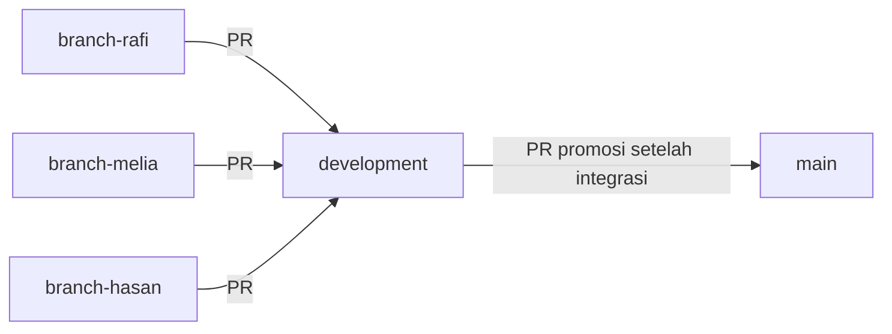

# Panduan pengembangan dan publikasi GitHub

> **Living document:** perbarui bersama setiap perubahan terkait menurut [aturan dokumentasi](../rules/documentation.md#living-documents).

Untuk perintah ringkas dengan **main lokal**, gunakan [GIT-CEPAT.md](GIT-CEPAT.md).
Clone branch anggota lalu rename lokal menjadi main; upstream tetap
`origin/branch-melia`, `origin/branch-hasan`, atau `origin/branch-rafi`.
Push memakai refspec eksplisit, misalnya `git push origin main:branch-melia`.
Nama branch dalam alur PR merujuk branch **GitHub**; main/development remote
tetap menerima perubahan melalui PR. Langkah panjang di bawah adalah alternatif
dengan nama branch lokal sama dengan branch anggota; pilih satu alur, jangan campur.

[](https://github.com/muhammadrafifatihulihsan/siagabanjir/actions/workflows/ci.yml)

Repository: [muhammadrafifatihulihsan/siagabanjir](https://github.com/muhammadrafifatihulihsan/siagabanjir).
Default branch tetap main; kontribusi melalui branch anggota → development → main. Repository berisi spesifikasi dan workspace demo
akademik; backend serta Flutter diinisialisasi tim.

Status versi, struktur, dan dukungan OS/IDE ada di [WORKSPACE](WORKSPACE.md).
[Indeks dokumentasi](INDEX.md) memetakan spesifikasi dan panduan aktif;
[README aplikasi](../apps/README.md) menetapkan tanggung jawab inisialisasi tim.
Agent mengikuti [AGENTS](../AGENTS.md), menuntaskan
[bacaan lengkap](../rules/workflow.md#baca-lengkap), lalu memakai prosedur dari
[katalog delapan skill](../SKILL.md) sesuai tugas. Setiap perubahan menyelaraskan
[dokumen yang terdampak](../rules/documentation.md#living-documents).

<a id="mulai-untuk-tim"></a>

## Mulai di sini untuk anggota tim baru

Untuk mengikuti langkah berurutan dalam satu dokumen, gunakan
[panduan praktik Git dari clone sampai PR berikutnya](GIT-UNTUK-PEMULA.md).
Panduan tersebut membedakan setup pertama dari rutinitas harian; kebijakan dan
versi alat tetap bersumber pada dokumen ini.

| Istilah | Arti praktis |
|---|---|
| Git | Alat pencatat riwayat perubahan di komputer sendiri |
| GitHub | Tempat berbagi repository dan meninjau pekerjaan tim secara online |
| Git Bash | Terminal di Windows untuk menjalankan perintah Git |
| Repository / repo | Folder proyek beserta riwayat Git di dalamnya |
| Branch | Jalur riwayat permanen; branch anggota untuk bekerja, development untuk integrasi, main untuk hasil stabil |
| Stage | Memilih perubahan yang akan masuk commit berikutnya |
| Commit | Titik riwayat lokal dengan pesan dan ID/SHA; dapat dibuat tanpa internet |
| Push | Mengirim commit lokal ke GitHub; menyimpan file saja belum mengirim perubahan |
| Pull request / PR | Permintaan agar perubahan branch ditinjau dan digabung ke branch tujuan |
| Working tree bersih | Perubahan file sudah tercatat; masih mungkin ada commit lokal yang belum dipush |

### Menyiapkan komputer pertama kali

1. Pastikan Git tersedia dengan `git --version`, dan gunakan akun GitHub milik
   sendiri yang mendapat akses repository. Instalasi Git/SDK dan perubahan
   konfigurasi pribadi dilakukan pemilik komputer; AI tidak mengarang identitas.
2. Bila belum mempunyai clone, buka Git Bash di folder induk yang dipilih, lalu:

   ```bash
   git clone https://github.com/muhammadrafifatihulihsan/siagabanjir.git
   cd siagabanjir
   ```

   Bila folder proyek sudah ada, periksa dulu apakah merupakan clone yang benar.
   Jangan clone di dalam clone, menjalankan git init pada unduhan ZIP, atau
   mengganti remote untuk mengatasi salah folder.
3. Buka root siagabanjir di editor. `git rev-parse --show-toplevel` menunjukkan
   root yang sedang dipakai; `git remote -v` menunjukkan tujuan repository.
4. Periksa `git config --get user.name` dan `git config --get user.email`.
   Identitas commit berbeda dari login GitHub. Jika belum ada, AI meminta
   nama/email yang dipilih pemilik dan persetujuan perubahan konfigurasi
   khusus repository; tidak memakai identitas teman atau mengubah global config.
5. Saat push pertama memerlukan autentikasi, selesaikan login melalui mekanisme
   Git yang tersedia pada komputer tersebut. Jangan menaruh token, kata sandi,
   atau credential di chat, berkas proyek, maupun pesan commit.

### Meminta bantuan AI

Buka root proyek dan berikan tugas yang konkret, misalnya:

> Baca AGENTS.md dan seluruh sumber wajib. Perbaiki tautan panduan tas siaga.
> Jalankan pemeriksaan yang relevan, commit lokal tiap unit perubahan sesuai
> aturan proyek, dan akhiri dengan working tree bersih. Laporkan branch dan SHA.
> Untuk tugas ini simpan commit secara lokal saja.

Pengingat dalam contoh membantu anggota baru; kewajiban commit tetap berlaku
meskipun pengguna hanya meminta perbaikan kecil. Untuk mengirim hasil, cukup
beri instruksi terpisah seperti “push branch anggota saya dan buat PR menuju development”.
Instruksi push yang sudah ada dalam tugas tidak perlu diminta ulang.
Aturan lengkap AI berada pada [commit lokal](../rules/workflow.md#commit-lokal).

### Lima branch permanen dan alur tim

| Branch | Fungsi / penanggung jawab | Tujuan PR |
|---|---|---|
| main | Stabil/demo; Rafi memutuskan merge | Hanya menerima development dari repo ini |
| development | Integrasi; Rafi memutuskan merge | main setelah pemeriksaan integrasi |
| branch-rafi | Pekerjaan Rafi | development |
| branch-melia | Pekerjaan Melia | development |
| branch-hasan | Pekerjaan Hasan | development |



Semua anggota clone repository yang sama. Jangan fork, membuat branch per fitur,
mengganti nama, atau menghapus lima branch permanen untuk alur normal.
Satu PR aktif per branch anggota; hindari pekerjaan baru yang belum siap masuk
ke PR tersebut. PR dapat digabung bertahap sesuai dependensi, tidak harus serentak.
Nama branch adalah pembagian tugas; bukan bukti identitas pelaku push.

### Memulai dan menyinkronkan pekerjaan

Sesudah clone, jalankan `git fetch origin` dan `git branch -a`. Contoh Melia:

```bash
git status --short --branch
git fetch origin
git switch branch-melia
git pull --ff-only origin branch-melia
```

Hasan mengganti branch-melia dengan branch-hasan; Rafi memakai branch-rafi.
Jika branch belum ada lokal tetapi origin/branch-melia ada, gunakan
`git switch --track origin/branch-melia`. Jangan membuat ulang branch remote.
Selesaikan perubahan lokal terlebih dahulu; jangan membawa perubahan antarbranch
tanpa memeriksa kepemilikannya. Pull dari branch sendiri belum menyinkronkan
basis development.

Preferensi tim adalah **Create a merge commit**, yang tersedia pada audit
21 Oktober 2026. Sesudah PR sebelumnya sudah merged dan semua commit branch
anggota tercakup development, dengan tree bersih dan sedang di branch anggota:

```bash
git fetch origin
git merge --ff-only origin/development
git push origin branch-melia
```

Fast-forward hanya memajukan pointer tanpa menulis ulang riwayat. Jika gagal,
berhenti dan kirim hasil `git status` serta
`git log --graph --oneline --decorate -20` kepada Rafi. Jangan reset, rebase,
atau force push. Pekerjaan baru yang sudah dimulai diselesaikan/disimpan sebagai
commit aman pada branch sendiri; WIP tidak dipromosikan. Bila PR ternyata memakai
squash/rebase, commit asal bisa belum menjadi ancestor development: Rafi meninjau
diff/graph, lalu bila sesuai menggabungkan development ke branch anggota dengan
merge biasa, menyelesaikan konflik dan menguji hasil. Jangan mengulang perubahan
atau menganggap ff-only pasti bisa berjalan.

Hindari dua editor/agent menulis index atau worktree yang sama bersamaan.

## Sebelum mengubah berkas

1. Buka root repository dan ikuti [alur kerja](../rules/workflow.md).
2. Periksa branch, perubahan lokal, dan remote tujuan:

   ```bash
   git status --short --branch
   git status --porcelain=v1 --untracked-files=all
   git remote -v
   git diff --stat
   git diff --cached
   ```

3. Pertahankan perubahan milik rekan kerja sesuai [aturan commit](../rules/workflow.md#commit-lokal).
   Sinkronisasi dari remote hanya dilakukan setelah kondisi lokal dipahami;
   jangan memakai force push untuk
   menyelesaikan perbedaan riwayat.
4. Gunakan branch anggota yang sudah ditetapkan. Main dan development diperbarui
   melalui PR; mandat push biasa tidak mencakup direct push ke keduanya.

Jangan mengubah identitas Git, konfigurasi global, atau remote yang sudah benar.

<a id="otomatisasi-cicd"></a>

## Validasi lokal dan CI

[CI](../.github/workflows/ci.yml) memeriksa dokumentasi, format, dan kontrak pada
push ke kelima branch permanen dan pull request menuju main/development. Pemeriksaan memakai Python 3.10+ (CI: 3.12),
Node 24, dan EditorConfig Checker 4.0.2.

Pasang dependensi Python dalam environment terisolasi. Perintah berikut
dijalankan dari root repository; dependensinya hanya untuk pemeriksaan workspace.

```bash
python -m venv .venv
source .venv/Scripts/activate  # Git Bash Windows; macOS/Linux: source .venv/bin/activate
python -m pip install -r .github/requirements-validation.txt
python -B -X utf8 .github/scripts/validate_links.py
python -B -X utf8 .github/scripts/validate_skills.py
python -B -X utf8 .github/scripts/validate_contracts.py
python -B -X utf8 -m unittest discover -s .github/scripts -p 'test_*.py'
npx -y markdownlint-cli2@0.17.2 --config .markdownlint.json '**/*.md' '#**/codex-session-*.md' '#archive/**'
npx -y @redocly/cli@2.64.1 lint docs/openapi.json --config .redocly.yaml
editorconfig-checker
git diff --check
```

Lint Markdown dan validator tautan mengecualikan ekspor lokal
`codex-session-*.md` serta arsip privat. [Handoff aktif](SESSION-HANDOFF.md)
tetap diperiksa seperti dokumentasi lainnya.

EditorConfig Checker tersedia dari [rilis resmi v4.0.2](https://github.com/editorconfig-checker/editorconfig-checker/releases/tag/v4.0.2).
Pemeriksaan default mencakup berkas tracked; periksa berkas baru setelah staging
atau berikan path-nya secara eksplisit. Redocly menggunakan
[konfigurasi proyek](../.redocly.yaml) untuk menemukan kesalahan kontrak dan komponen
yang tidak dirujuk. Validasi skema tidak menggantikan tes perilaku aplikasi.

XML di `apps/app/android/` tidak dipaksa memiliki ukuran indentasi tertentu:
komentar template Flutter memakai spasi untuk menyelaraskan teks. Aturan
encoding, EOL, newline akhir, indentasi spasi dan trailing whitespace tetap
diperiksa melalui `.editorconfig`; file Dart dan job CI lain tetap diperiksa.
Untuk melihat path/baris error dalam log biasa, jalankan
`editorconfig-checker -format default` dari root repository.

## Pemeriksaan dan commit

Untuk setiap unit perubahan, jalankan pemeriksaan sesuai
[dampak](../rules/quality.md#pemeriksaan-sesuai-dampak), lalu tinjau diff dan
dokumentasi. Sebelum push, tuntaskan seluruh [gate workspace](#otomatisasi-cicd)
dan pemeriksaan aplikasi terdampak yang tersedia. Tidak perlu mengulang hasil
yang masih berlaku jika tidak ada perubahan terkait. Kontrak dalam docs ikut Git;
rahasia, data pribadi, dependensi, artefak build, dan arsip percakapan lokal
mengikuti .gitignore.

Stage hanya path yang sudah diperiksa, kemudian tinjau hasil staging:

```bash
git add -- path/yang-sudah-ditinjau
git diff --cached --stat
git diff --cached
git diff --cached --check
git commit -m "docs: jelaskan perubahan yang dilakukan"
git status --porcelain=v1 --untracked-files=all
git log -1 --oneline
```

Ganti contoh path dan pesan dengan perubahan aktual. Pesan commit menjelaskan
hasil konkret; perubahan yang saling bergantung disertakan dalam commit yang sama.
Berkas baru juga harus tercakup pemeriksaan format.

AI langsung menjalankan commit lokal sesudah pemeriksaan, tanpa bertanya
“boleh commit?”. Sebelum unit berikut atau penutupan, perintah status harus
berhasil tanpa keluaran. Jika masih ada perubahan, ikuti
[gerbang bersih dan checkpoint](../rules/workflow.md#commit-lokal).
Contoh pesan: `docs: perjelas langkah pelaporan`, `fix: perbaiki tautan panduan`.
Pesan seperti “update”, “fix lagi”, atau “final” tidak cukup menjelaskan tujuan.

Untuk melihat hasil tersimpan, gunakan `git log -5 --oneline` dan
`git show --stat HEAD`. Commit biasa mencatat isi yang sudah staged; perubahan
sesudah staging harus ditinjau dan distage lagi. Detail perilaku:
[git commit](https://git-scm.com/docs/git-commit).

## Push, review dan promosi

Setelah satu tugas diperiksa dan dicommit, push branch sendiri dalam mandat:

```bash
git status --short --branch
git push origin branch-melia
git rev-parse HEAD
git ls-remote origin refs/heads/branch-melia
```

Ganti nama branch sesuai anggota dan cocokkan SHA. Buka PR di repository ini:
**base development, compare branch-melia** (atau branch anggota lainnya).
Gunakan [template PR](../.github/pull_request_template.md) dan satu PR aktif.
Rafi meninjau seluruh diff, hasil pemeriksaan, dependensi serta dokumentasi;
perubahan workflow/script/dependensi perlu ditinjau khusus karena bisa mengubah
checks itu sendiri. Tambahan commit ke branch otomatis memperbarui PR.

Empat nama job CI: **Validasi Arah PR**, **Validasi Dokumentasi**,
**Validasi Kontrak API**, **Cek Format EditorConfig**. Check arah PR menolak
pasangan base/head yang salah dan fork walau nama branch sama. Pada push, job
hanya memeriksa event branch permanen dan menyatakan arah PR tidak diuji.
Tidak ada paths filter; retarget PR memicu pemeriksaan lewat event edited.
CI memakai contents: read, tanpa pull_request_target atau secret aplikasi.
Check ini tidak membatasi siapa yang bisa push, membuka PR atau menekan Merge;
required checks harus diaktifkan tersendiri sesudah run nyata berhasil.

Rafi memakai Create a merge commit setelah review dan CI SHA terbaru lulus.
Jangan delete branch anggota sesudah merge. Sesudah integrasi di development,
Rafi membuka **base main, compare development** pada repo yang sama. Checklist:

- Diff dan keputusan/kontrak/dokumentasi selaras; konflik diselesaikan.
- Seluruh job CI pada revisi PR terbaru sukses; review diperbarui bila isi berubah.
- Bukti integrasi warga/admin/backend tersedia ketika aplikasinya sudah ada.
  Scaffold Flutter sudah tersedia; pengujian aplikasi tetap NOT_RUN sampai
  dijalankan dan dicatat pada build yang bersangkutan.
- Rafi memutuskan penerimaan; merge tidak diotorisasi hanya oleh instruksi push.
- Periksa CI sesudah merge, lalu sinkronkan branch anggota. Rilis/tag memerlukan
  mandat terpisah dan mengikuti [versioning](VERSIONING.md).

### Keamanan dan status penerapan

Audit 21 Oktober 2026 menemukan repository publik milik akun pribadi, hanya
akun Rafi tercatat sebagai collaborator/admin, rulesets kosong, dan proteksi
klasik main/development tidak ditemukan. **Hanya-owner-merge belum ditegakkan.**
Detail bukti, matriks hak akses, rancangan ruleset dan migrasi ada pada
[laporan audit](GITHUB-AUDIT.md). Dokumen ini menetapkan SOP; tidak mengaktifkan
Settings. Collaborator write tidak otomatis dibatasi ke branch namanya.

Usulan kontrol: ruleset otorisasi Restrict updates dengan bypass Repository
admins PR-only, ditambah ruleset kualitas tanpa bypass untuk PR/checks, larangan
force push/hapus dan penyelesaian percakapan. PR-only bypass dapat melewati aturan
dalam ruleset yang sama. Jangan tambahkan Write sebagai bypass, linear history
yang menolak merge commit, atau required CODEOWNERS Rafi sebagai reviewer tunggal
tanpa menyelesaikan kasus PR buatan Rafi. CODEOWNERS mengatur review, bukan hak merge.

Settings dan uji lintas akun menunggu persetujuan tersendiri. Jangan mengundang
anggota dengan klaim proteksi sudah aktif. Pengujian negatif dilakukan pada
lingkungan aman yang disetujui, tidak dengan mencoba merusak branch utama.

<a id="kondisi-git"></a>

## Kondisi yang sering ditemui dan tindakan yang benar

| Kondisi | Tindakan AI / anggota tim |
|---|---|
| Hanya mengubah satu kata atau satu tautan | Tinjau dan periksa sesuai dampak, lalu commit lokal; tidak menunggu konfirmasi atau tugas besar selesai. |
| Tugas hanya membaca/review dan tidak ada diff | Laporkan hasil serta status tree; tidak membuat commit kosong. |
| File berubah sebelum AI mulai atau sudah ada staged changes | Periksa diff awal dan kepemilikan. Sertakan hanya bagian yang memang dalam mandat; perubahan lain tidak ikut commit atau dihapus. Bila menghalangi clean, laporkan BLOCKED. |
| File baru muncul sebagai ?? | Tinjau apakah source tugas atau artefak lokal; stage hanya source yang diperlukan. Jangan mengabaikan file source hanya supaya bersih. |
| Token, .env, dokumen pribadi, atau file rahasia terlihat | Jangan tampilkan isinya atau commit. Ikuti kebijakan ignore yang benar; jika sudah tracked/tercommit, hentikan publikasi dan koordinasikan penanganan dengan pemilik, termasuk penggantian credential bila diperlukan. |
| Formatter atau handoff mengubah file setelah commit | Review perubahan, jalankan pemeriksaan terdampak, commit lanjutan, lalu cek bersih kembali. |
| Tes gagal atau tool yang dibutuhkan belum tersedia | Perbaiki dalam unit yang sama; bila terhalang, catat FAIL/BLOCKED/NOT_RUN. Gunakan checkpoint lokal WIP hanya sesuai aturan workflow, bukan klaim selesai atau siap push. |
| Git belum tersedia / folder bukan repository | Periksa lokasi dan clone; jangan membuat repository baru atau memasang tool global diam-diam. Laporkan prasyarat yang perlu disiapkan pemilik. |
| Nama/email commit belum ada atau signing/hook gagal | Minta informasi/akses yang benar bila diperlukan. Jangan mengarang identitas, melewati hook dengan --no-verify, atau mematikan signing untuk memaksakan commit. |
| Git meminta login atau internet mati saat push | Commit lokal tetap tersimpan. Laporkan push belum berhasil; login/perbaiki koneksi melalui mekanisme yang sah, lalu ulangi push bila mandat masih berlaku. |
| Branch ahead | Ada commit lokal yang belum ada di upstream terakhir diketahui; tree bisa tetap bersih. Push hanya jika diminta; tidak perlu commit ulang. |
| Branch behind tanpa commit lokal tambahan | Dengan tree bersih dan branch tujuan benar, fetch lalu fast-forward dari upstream yang dimaksud; contoh branch anggota ada di bagian awal. |
| Push ditolak non-fast-forward / branch diverged | Jangan force push. Fetch dan periksa riwayat lokal/remote; gabungkan riwayat pada branch anggota sesuai mandat, selesaikan konflik, jalankan pemeriksaan, commit hasil, lalu push ulang. |
| Konflik merge atau rebase sudah berlangsung | Periksa status dan kedua perubahan; jangan memilih semua ours/theirs tanpa membaca. Selesaikan bagian yang jelas, tanyakan hanya konflik makna yang belum diputuskan; jangan memulai tugas baru atau menyatakan clean saat konflik masih ada. |
| Tidak berada di branch (detached HEAD) atau branch salah | Identifikasi commit/perubahan yang harus dipertahankan; pilih branch anggota yang tepat setelah memastikan commit/perubahan tetap tersimpan. Jangan reset atau menimpa branch yang sudah ada. |
| Perubahan sudah tercommit tetapi salah | Buat commit koreksi. Pembatalan menyeluruh dapat memakai revert setelah meninjau dampak dan mandat; jangan otomatis amend, squash, rebase atau force push. |
| Push ditolak karena izin / branch dilindungi | Gunakan branch anggota dan PR jika diizinkan; bila akses tidak ada, laporkan kebutuhan akses. Jangan menonaktifkan proteksi atau mengganti remote tanpa mandat. |
| PR tertinggal dari base | Fetch dan periksa graph. Rafi membantu merge development ke branch anggota bila perlu; uji konflik sebelum push. Jangan menulis ulang riwayat bersama. |
| Salah base PR | Kontribusi anggota harus ke development, promosi ke main harus dari development. Ubah base, periksa ulang seluruh diff dan CI; jangan menganggap approval lama masih cukup. |
| Email commit keliru | Identitas commit berbeda dari login. Koordinasikan koreksi konfigurasi lokal dengan pemilik; jangan rewrite commit bersama tanpa mandat. |
| CI gagal setelah push | Baca kegagalan pada SHA terkait, perbaiki, commit baru, push dalam mandat, dan periksa CI terbaru. Push sukses saja tidak menutup tugas publikasi. |
| Izin sandbox menolak git add/commit/push | Gunakan mekanisme izin alat sesuai tindakan yang sudah diotorisasi; jangan mengubah permission/global config. Jika tetap ditolak, laporkan aksi dan kendalanya. |
| Ada index.lock atau dua agent mengedit bersamaan | Periksa apakah proses Git masih berjalan dan tunda penulisan AI pada worktree yang bertabrakan. Jangan langsung menghapus lock, mematikan proses rekan, atau merekam perubahan agent lain. |

Status M berarti perubahan, A penambahan staged, D penghapusan, ?? file belum
tracked; dua kolom status membedakan index dan working tree. Pemeriksaan bersih
memakai `git status --porcelain=v1 --untracked-files=all`, bukan hanya melihat
branch atau badge CI. File ignored tidak tercakup hasil biasa. Lihat
[git status](https://git-scm.com/docs/git-status).

Informasi ahead/behind memakai keadaan upstream terakhir diketahui. Sebelum
menyatakan sinkron dengan GitHub, lakukan fetch atau periksa SHA remote dengan
koneksi yang berhasil. `git pull --ff-only` menolak riwayat yang bercabang;
penolakan itu perlu ditangani, bukan diganti force push.
Rujukan: [git pull](https://git-scm.com/docs/git-pull) dan
[git merge](https://git-scm.com/docs/git-merge).

## Git Bash dan lintas OS

Di Windows, jalankan perintah Git di Git Bash yang terpasang. Gunakan path
repository yang nyata dan kutip path yang mengandung spasi. Pada macOS/Linux,
perintah Git yang sama dapat dijalankan melalui shell setempat.

Jika Git menolak ownership pada lingkungan sandbox, periksa bahwa path tersebut
benar-benar repository yang dimaksud. Pengecualian dapat dibatasi pada satu
perintah, tanpa mengubah konfigurasi global:

```bash
git -c safe.directory="$(pwd -W)" status --short --branch
```

Contoh pwd -W khusus Git Bash Windows. Terapkan pengecualian yang sama pada
perintah terkait hanya bila diperlukan. Jika sandbox menolak operasi Git atau
jaringan, gunakan mekanisme izin alat; jangan mengubah permission workspace.

## Kriteria publikasi selesai

- Diff, kandidat commit, dan living documents telah ditinjau.
- Setiap unit sudah dicommit dan pemeriksaan tree bersih berhasil tanpa keluaran.
- Pemeriksaan lokal dan seluruh pekerjaan CI berhasil pada commit yang dipush.
- SHA branch lokal dan remote sesuai.
- Untuk rilis, tag menunjuk commit yang telah lolos CI dan halaman Release
  memuat catatan versi yang benar.
- Hasil aplikasi, perangkat, provider, atau UAT hanya dilaporkan jika dijalankan.

Untuk tugas lokal tanpa mandat push, selesai berarti perubahan sudah dicommit,
pemeriksaan terkait lulus dan tree bersih; laporkan bahwa commit belum dipush.
Untuk kendala yang belum selesai, laporkan BLOCKED beserta penyebab dan path,
bukan mengklaim clean atau menghapus perubahan. Aturan ini membimbing AI yang
membaca instruksi; tidak memasang hook auto-commit atau membuktikan kepatuhan
semua IDE. Referensi Git/GitHub ditinjau kembali 21 Oktober 2026; bukti kontrol GitHub ada pada laporan audit.
