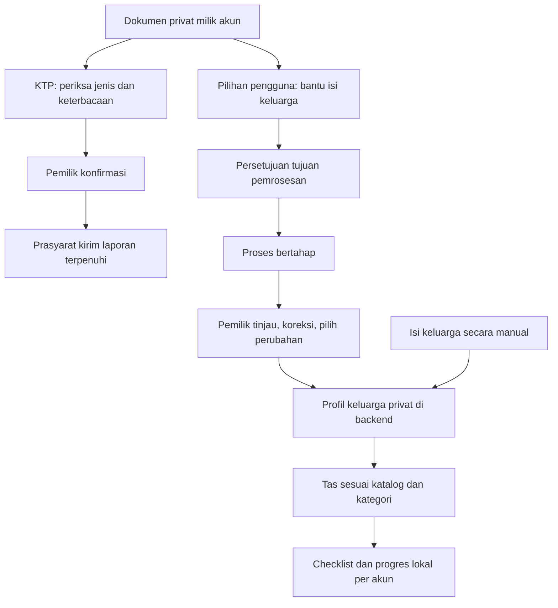

# SiagaBanjir — Product Requirements Document (PRD)

> **Living document:** perbarui bersama setiap perubahan terkait menurut [aturan dokumentasi](../rules/documentation.md#living-documents).

| Kontrol dokumen | Nilai |
|---|---|
| Versi | `v0.1.0` |
| Tanggal | 18 Oktober 2026 |
| Status | **APPROVED — v0.1.0; penjabaran FRD/SRS v1.0.0 juga APPROVED** |
| Tahap | Nomor 2 dari urutan BRD → PRD → FRD → SRS → Workspace Setup |
| Baseline bisnis | [BRD v0.1.0](BRD.md), **APPROVED** |
| Dasar discovery | 43 jawaban PRD; [register pertanyaan dan sumber](TRACEABILITY.md), [register keputusan](DECISIONS.md) |
| Otoritas persetujuan | Pemilik proyek/pengguna |
| Otorisasi saat ini | Audit/publikasi workspace; penutupan FRD/SRS telah dicatat pada register keputusan |
| Kesiapan | Baseline produk disetujui; rincian perilaku/teknis diteruskan ke FRD/SRS |
| Status implementasi / UAT | **NOT_RUN** — dokumen ini bukan bukti aplikasi sudah dibuat atau diuji |

BRD-APPROVAL menetapkan persetujuan BRD dan kelanjutan tahap PRD. PRD-Q043 serta PRD-IMPLEMENT mengotorisasi penyusunan draf; persetujuan final PRD v0.1.0 dicatat terpisah pada [PRD-APPROVAL-01](DECISIONS.md#prd-approval-01). Persetujuan mencakup baseline produk dan agenda detail yang diteruskan, tanpa menetapkan nilai yang belum diputuskan atau mengesahkan FRD pada saat itu.

## 1. Tujuan dokumen dan cara membaca

PRD menerjemahkan BRD menjadi perilaku produk yang dapat ditinjau dan diuji. Dokumen ini menetapkan aktor, kebutuhan, batas akses, alur utama, kegagalan penting, cakupan demo, dan kriteria penerimaan. FRD berikutnya merinci alur/validasi; SRS menetapkan kontrak teknis dan ukuran pengujian. Workspace Setup tetap tahap 5.

`PRD-F-001`–`PRD-F-057` adalah 57 kebutuhan fungsional. `PRD-NF-001`–`PRD-NF-010` adalah 10 kebutuhan kualitas dan batasan, bukan klaim seluruh target nonfungsional sudah terukur. Setiap kebutuhan mempunyai kriteria `PRD-AC-F-...` atau `PRD-AC-NF-...` dengan suffix sama. “Given / When / Then” menyatakan kondisi / tindakan / hasil yang diharapkan.

Semua kriteria adalah target, **belum hasil uji**. Rujukan BR mengarah ke baseline [BRD](BRD.md); rujukan Q mengarah ke jawaban pengguna. RTM dua arah dan source claim berada di [TRACEABILITY](TRACEABILITY.md). Register [DECISIONS](DECISIONS.md) menyimpan alasan, delegasi, perubahan, risiko, dan detail terbuka sehingga tidak perlu menduplikasi seluruh riwayat di sini.

## 2. Masalah, tujuan, dan batas hasil produk

Warga membutuhkan alur sederhana untuk melaporkan dugaan banjir beserta bukti, melihat keadaan lokasi yang dilaporkan, dan mengakses bahan kesiapsiagaan. Admin membutuhkan cara meninjau laporan terkait tanpa kehilangan bukti individual, melihat prioritas perhatian, serta menyampaikan hasil tindak lanjut dan peringatan.

SiagaBanjir pada tahap ini merupakan **demo akademik di sekitar Kota Padang**. Kebutuhan berasal dari pemilik proyek dan bahan perencanaan; belum diklaim telah divalidasi oleh BPBD, warga lapangan, atau layanan kedaruratan. Android warga dan web admin sama-sama Flutter sesuai kebutuhan mata kuliah. Tidak ada janji bantuan lapangan benar-benar dikirim.

| Tujuan produk | Bukti keberhasilan yang direncanakan |
|---|---|
| Laporan dapat ditelusuri dari pengiriman sampai hasil tinjauan | Skenario warga → backend → analisis → admin → riwayat pemilik dijalankan dengan bukti aktual |
| Admin dapat menilai laporan berkaitan | Laporan tetap dapat dibuka individual, pengelompokan dapat dikoreksi, perubahan hasil tercermin di tampilan terkait |
| Pantau memberi ringkasan yang jujur | Belum dinilai berbeda dari rendah; sumber/tinjauan jelas; identitas dan bukti pribadi tidak terbuka |
| Fitur pendukung siap digunakan dalam demo | Dokumen, keluarga, tas, kontak, panduan, dan inbox mempunyai alur yang dapat dijalankan |
| Gangguan koneksi/analisis tidak menghasilkan sukses palsu | Draf dan media bertahan; retry tidak menggandakan laporan; kegagalan AI tetap terlihat |
| Privasi sesuai pilihan pengguna | Uji pemilik/akun lain/admin dan inspeksi arus data membuktikan batas akses serta data lokal |

Tidak ditetapkan target adopsi, akurasi AI, waktu respons, atau tingkat keberhasilan numerik tanpa baseline pengujian. Ukuran tersebut perlu data dan keputusan SRS/PoC; ketidakadaan angka tidak membatalkan kewajiban menguji perilaku di atas.

## 3. Pengguna, peran, dan pekerjaan utama

| Aktor | Pekerjaan yang ingin diselesaikan | Batas peran |
|---|---|---|
| Tamu | Membaca Pantau, kontak umum, dan panduan | Tidak membuka laporan, dokumen, profil, inbox, atau fitur pribadi |
| Warga/pemilik akun | Melapor, mengikuti hasil, menyimpan dokumen, mengelola keluarga/kesiapsiagaan, membaca pesan | Hanya mengakses data pribadi sendiri; laporan diterima backend tidak dapat diedit/dihapus langsung |
| Admin | Meninjau bukti/kelompok, memperbaiki hasil, mencatat tindak lanjut, mengatur pelaporan, konten, dan pesan | Dua akun setara disiapkan tim; tidak membaca isi dokumen atau profil keluarga warga |
| Tim pengembang | Menyiapkan akun demo, spesimen, build, dan bukti uji | Bukan role aplikasi baru; pemilik proyek menangani backend/AI/review, dua teman Flutter dan integrasi API |
| Layanan analisis | Membantu pemeriksaan laporan dan pengisian dari dokumen sesuai tujuan | Bukan penentu kebenaran mutlak atau aktor yang boleh membuka seluruh data pribadi |

Pemisahan dua tugas teman belum ditentukan per orang. Peran admin setara tidak berarti admin mendapatkan seluruh isi database melalui aplikasi.

## 4. Cakupan demo dan perubahan dari baseline

Semua kebutuhan F/NF di dokumen ini berada dalam cakupan demo, dengan detail yang secara terbuka dialokasikan ke FRD/SRS. Urutan pembangunan mendahulukan dependensi dan alur inti; fitur pendukung tetap wajib, bukan dibuang menjadi opsional karena dikerjakan belakangan.

| Kelompok | Cakupan wajib |
|---|---|
| Akses dan identitas akun | Baca umum tanpa login; email/sandi lokal; kode pemulihan; profil/logout; dua admin setara |
| Prasyarat melapor | KTP privat satu per akun, pemeriksaan jenis/keterbacaan dan konfirmasi; pemeriksaan perangkat sebatas sinyal yang dapat diketahui |
| Laporan | Media/deskripsi/titik/waktu, GPS atau manual, draf offline, kirim ulang tanpa duplikasi, riwayat pribadi |
| Analisis dan kerja admin | Kecocokan bukti, kelompok, prioritas, koreksi/tinjauan, pindah kelompok, tindak lanjut, selesai |
| Kontrol pelaporan dan Pantau | Galeri, kuota/reset, penghapusan aktif, ringkasan lokasi publik dan penanda tinjauan |
| Dokumen dan keluarga | Backup privat lintas perangkat; pengisian otomatis pilihan pengguna; review/merge; profil keluarga privat |
| Kesiapsiagaan | Tas dari katalog dan kategori keluarga, progres/item lokal, kontak umum/pribadi, panduan dan suara sesuai dukungan perangkat |
| Komunikasi | Admin membuat/memperbaiki/mencabut pesan; inbox seluruh warga; penanda dibaca |

| Perubahan/penajaman tahap 2 | Dasar dan implikasi |
|---|---|
| Akses umum tanpa login; fitur pribadi login | PRD-Q001/Q002/Q034; registrasi lokal tidak sama dengan verifikasi kepemilikan email |
| KTP sebelum kirim pertama | PRD-Q034/Q037–Q039; prasyarat inti harus dibangun sebelum alur laporan dapat didemokan |
| Pembacaan dokumen untuk keluarga bersifat pilihan | PRD-Q022–Q030; proses ini berbeda dari pemeriksaan KTP untuk hak kirim |
| Keluarga mengikuti akun; progres tas/kontak pribadi tetap lokal | PRD-Q020/Q021/Q024/Q028; menghindari janji sinkronisasi yang tidak dipilih |
| Data seed dokumen berubah dari 6 menjadi 8 | PRD-Q042: **6 KTP + 2 KK**; 2 admin, 6 warga, 12 laporan tetap |
| Alur offline dibatasi saat aplikasi aktif kembali | PRD-Q012; tidak menjanjikan pengiriman latar belakang saat aplikasi ditutup |
| Peringatan dapat dikoreksi/dicabut dan mempunyai status baca | PRD-Q040; perubahan pesan perlu terlihat di inbox |

BRD mempertahankan riwayat baseline; penajaman di atas ditelusuri melalui keputusan PRD, bukan disisipkan sebagai jawaban BRD yang seolah sudah ada sejak awal.

**Tidak termasuk cakupan demo:** pantauan sungai/TMA/sensor, shelter, dispatch/logistik petugas, chat warga-admin, layanan kedaruratan resmi. **Belum wajib:** Google Login, verifikasi email, penghapusan akun mandiri, push di luar aplikasi, hierarki admin, aksi massal gabung/pisah kelompok khusus, deployment publik. Autentikasi lokal tetap wajib meski email tidak diverifikasi. Docker/kemudahan hosting tetap direncanakan pada tahap setup; belum ada pilihan hosting.

## 5. Batas akses dan penyimpanan

| Informasi/aksi | Tamu | Pemilik warga | Warga lain | Admin | Penyimpanan yang disepakati |
|---|---|---|---|---|---|
| Pantau, kontak umum, panduan | Baca | Baca | Baca | Baca/kelola bagian yang relevan | Konten umum; kontak/teks dasar tersedia offline |
| Draf laporan beserta media | Tidak | Kelola miliknya | Tidak | Tidak | Lokal sampai proses kirim |
| Laporan diterima, bukti, ringkasan AI, hasil admin | Tidak | Baca miliknya | Tidak | Tinjau/koreksi/tindak lanjut/hapus sesuai aturan | Backend; ringkasan publik hanya batas PRD-F-034 |
| KTP dan backup dokumen lain | Tidak | Kelola miliknya | Tidak | **Tidak boleh membaca isi** | Backend privat pemilik, lintas perangkat |
| Profil anggota keluarga | Tidak | Kelola miliknya | Tidak | **Tidak boleh membaca isi** | Backend privat pemilik, lintas perangkat |
| Kontak pribadi, item tas, progres checklist | Tidak | Kelola lokal akunnya | Tidak | Tidak | Lokal per akun/perangkat; tidak masuk database backend |
| Kontak umum, panduan, katalog tas bawaan | Baca konten yang tersedia | Baca/gunakan | Baca/gunakan | Kelola | Backend untuk pembaruan; bundle/cache sesuai kebutuhan |
| Pesan peringatan di inbox | Tidak | Baca/tandai dibaca | Masing-masing inbox | Terbitkan/perbaiki/cabut | Pesan dan penanda dibaca per akun |
| Kuota/reset, galeri, tinjauan kelompok | Tidak | Menerima dampak/status yang relevan | Menerima dampak masing-masing | Kelola | Backend; detail skema belum dipilih |

“Privat pemilik” berarti admin/warga lain tidak boleh membaca isinya melalui aplikasi/layanan. Sistem tetap menjalankan pemrosesan yang diminta untuk tujuan tertentu; tidak ada klaim enkripsi ujung-ke-ujung yang membuat backend mustahil memproses. Akses operator infrastruktur, enkripsi, log, penghapusan cadangan, dan pembatasan layanan analisis dirinci di SRS. Tidak ada persetujuan untuk membaca semua isi vault secara otomatis.

## 6. Perjalanan produk dan keadaan penting

### 6.1 Melapor, tertahan, lalu terkirim

Warga login, membuat draf berisi media, deskripsi dan titik, lalu memilih Kirim. Draf boleh dibuat sebelum KTP terpenuhi atau saat offline. Sistem memeriksa prasyarat kirim, termasuk KTP, media, perangkat dan aturan admin. Kondisi terlarang yang benar-benar terdeteksi menahan kirim tanpa menonaktifkan bacaan umum atau menghapus draf.

Jika koneksi putus setelah Kirim diminta, aplikasi aktif dan online dapat melanjutkan permintaan tanpa menggandakan hasil bisnis. Draf biasa yang belum diminta kirim tidak otomatis dikirim. Respons terlambat, percobaan ulang, perubahan kuota/galeri, dan KTP yang dihapus harus dirinci FRD; tidak mengarang kapan kuota dianggap terpakai.

Istilah lokal, menunggu pengiriman, diterima, analisis menunggu/gagal/selesai, perlu tinjauan, ditinjau, dan selesai kejadian adalah **keadaan produk**, bukan enum API/database final. Status pengiriman, analisis, dan kejadian tidak dicampur menjadi satu “sukses”.

### 6.2 Pemeriksaan dan tindak lanjut

Laporan diterima menjadi sumber analisis kecocokan bukti. Ketidakcocokan membuat laporan perlu ditinjau, bukan langsung dihapus/ditolak. Bukti yang belum layak tidak dipakai menetapkan bahaya; tanpa bukti layak, keadaan tetap belum dinilai.

Admin meninjau laporan individual dan kelompoknya, mengoreksi hasil atau keanggotaan bila perlu, lalu mencatat tindak lanjut. Penanda tinjauan harus memperlihatkan jika bukti baru belum diperiksa. Selesai kejadian mengeluarkan kelompok dari Pantau aktif, sementara riwayat pemilik tetap tersedia. Kejadian baru di lokasi yang sama memiliki kelompok aktif baru sesuai aturan yang akan dirinci.

### 6.3 Dua tujuan dokumen yang berbeda

Pemeriksaan KTP bukan pengesahan NIK/keaslian resmi dan tidak memberikan akses admin. Tidak memilih bantuan pengisian keluarga tidak menghilangkan backup dan tidak dengan sendirinya menggagalkan syarat KTP. KTP tetap harus memenuhi pemeriksaan khususnya. Alur/keterangan persetujuan kedua tujuan tidak boleh digabung secara diam-diam.

Bantuan pengisian menyarankan data keluarga, belum langsung mengubah profil. Pemilik memeriksa, mengoreksi dan memilih perubahan. Dokumen gagal dibaca tetap dapat tersimpan sebagai backup. Menghapus dokumen sumber tidak menghapus profil yang telah dikonfirmasi; jika yang dihapus adalah KTP prasyarat, hak kirim baru kembali tertahan.

### 6.4 Penggunaan offline dan lintas perangkat

Kontak umum serta teks panduan dasar tersedia sejak instalasi pertama tanpa jaringan. Pembaruan admin diambil ketika online. Suara offline bergantung mesin/bahasa perangkat; teks tetap menjadi jalur tersedia.

Dokumen dan profil keluarga mengikuti akun di perangkat lain. Kontak pribadi, checklist, item tambahan, dan progres hanya lokal. Pergantian akun pada satu perangkat harus menjaga isolasi data; kebijakan menghapus/menahan cache bukan diputuskan diam-diam sebagai bagian logout.

### 6.5 Peringatan

Admin menulis dan menerbitkan pesan; warga membacanya di inbox dan menandai dibaca. Koreksi atau pencabutan terlihat ketika inbox tersinkron. Demo tidak bergantung push luar aplikasi. Kebijakan penerima baru, masa berlaku, dan retensi setelah pencabutan dibahas dalam FRD.

## 7. Kebutuhan fungsional dan kriteria penerimaan

Kriteria berikut diuji pada build aplikasi nanti. Beberapa merujuk aturan FRD yang masih perlu nilai/rincian; hal ini dicatat sebagai pekerjaan tahap berikut, bukan dianggap sudah lulus atau spesifikasi implementasi lengkap.

### 7.1 Akses, akun, dan pemulihan

| ID / kebutuhan | Perilaku produk | Kriteria penerimaan | Dasar |
|---|---|---|---|
| **PRD-F-001** — Akses baca tamu | Tamu membuka aplikasi: Pantau, kontak umum, dan panduan dapat dibaca tanpa akun; aksi pribadi diarahkan ke login. | **PRD-AC-F-001** — Given belum login, When membuka tiga informasi umum, Then isinya dapat dibaca; akses laporan/dokumen/riwayat pribadi tetap memerlukan login. | BR-016, BR-023, BR-024; [PRD-Q001](TRACEABILITY.md#prd-q001) |
| **PRD-F-002** — Registrasi email/sandi lokal | Calon warga mendaftar dengan email dan sandi pada backend sendiri. Akun tidak menunggu verifikasi email untuk demo; kepemilikan alamat belum diklaim terverifikasi. | **PRD-AC-F-002** — Given data pendaftaran memenuhi aturan FRD, When daftar berhasil, Then akun warga dapat dipakai login; pendaftaran tidak memberikan role admin. | BR-027; [PRD-Q002](TRACEABILITY.md#prd-q002), [PRD-Q034](TRACEABILITY.md#prd-q034) |
| **PRD-F-003** — Login untuk fitur pribadi | Warga login sebelum pelaporan atau fitur pribadi. Kegagalan login tidak membuka data akun; Google Login belum wajib. | **PRD-AC-F-003** — Given belum memiliki sesi yang sah, When meminta fitur pribadi, Then data tidak terbuka sampai login berhasil. | BR-027; [PRD-Q001](TRACEABILITY.md#prd-q001), [PRD-Q002](TRACEABILITY.md#prd-q002), [PRD-Q034](TRACEABILITY.md#prd-q034) |
| **PRD-F-004** — Profil akun milik sendiri | Pemilik akun membaca dan memperbarui profilnya sendiri. Field profil, validasi, serta perubahan email diturunkan pada FRD; data keluarga mempunyai alur tersendiri. | **PRD-AC-F-004** — Given akun A login, When membuka/mengubah profil sesuai field yang disahkan, Then perubahan menjadi milik A dan tidak mengubah akun B. | BR-027 |
| **PRD-F-005** — Kode pemulihan pribadi | Saat daftar, pemilik memperoleh kode pemulihan pribadi untuk disimpan. Pemulihan sandi memakai kode, tanpa ketergantungan pengiriman email. | **PRD-AC-F-005** — Given kode pemulihan sah milik akun, When pemilik menjalankan pemulihan, Then ia dapat menetapkan sandi baru; kode tidak sah tidak memulihkan akun. Kehilangan sandi sekaligus kode tetap dibahas pada FRD. | BR-027; [PRD-Q035](TRACEABILITY.md#prd-q035) |
| **PRD-F-006** — Dua admin setara, provisioning tim | Tim menyiapkan dua akun admin setara. Registrasi warga tidak menyediakan jalur membuat admin; hierarki super-admin belum diwajibkan. | **PRD-AC-F-006** — Given dua akun admin demo dan satu warga, When mengakses fungsi admin, Then kedua admin mempunyai hak setara dan warga ditolak. | BR-003, BR-027; [PRD-Q036](TRACEABILITY.md#prd-q036) |

### 7.2 Membuat laporan dan prasyarat kirim

| ID / kebutuhan | Perilaku produk | Kriteria penerimaan | Dasar |
|---|---|---|---|
| **PRD-F-007** — Batas media 2 foto ATAU 1 video 5 detik | Warga memilih maksimal dua foto ATAU satu video paling lama lima detik; media mengikuti pengaturan galeri admin. | **PRD-AC-F-007** — Given laporan bermedia, When dikirim, Then jumlah/durasi yang valid diterima dan campuran atau batas berlebih ditolak tanpa menghilangkan draf. | BR-005 |
| **PRD-F-008** — Media/deskripsi/titik dan waktu laporan | Sebelum kirim, warga menyediakan media, deskripsi, dan titik kejadian. Waktu kirim dicatat otomatis; waktu kejadian boleh diisi bila berbeda. | **PRD-AC-F-008** — Given salah satu tiga unsur wajib belum tersedia, When mengirim, Then aplikasi meminta pelengkapan; waktu kejadian yang berbeda dapat dicatat tanpa mengganti arti waktu kirim. | BR-004; [PRD-Q018](TRACEABILITY.md#prd-q018) |
| **PRD-F-009** — GPS/manual termasuk remote, sumber lokasi | GPS membantu mengisi titik; warga boleh memilih/memperbaiki titik manual, termasuk tempat lain. Sumber GPS/manual dibedakan; titik manual tidak membuktikan kehadiran pelapor. | **PRD-AC-F-009** — Given GPS tidak tersedia atau titik perlu diperbaiki, When warga menentukan titik manual yang memenuhi aturan lokasi, Then alur dapat dilanjutkan dengan sumber manual yang terlihat pada pemeriksaan laporan. | BR-004, BR-007; [PRD-Q003](TRACEABILITY.md#prd-q003), [PRD-Q006](TRACEABILITY.md#prd-q006), [PRD-Q018](TRACEABILITY.md#prd-q018) |
| **PRD-F-010** — Pemeriksaan perangkat, blok kirim, unknown, build internal | Saat mengirim, mock GPS atau mode developer yang berhasil terdeteksi menahan pengiriman, termasuk titik manual. Draf dan fitur lain tetap tersedia. Status developer yang tidak dapat diperiksa tidak dianggap mati dan tidak sendirian memblokir kirim. Pengecualian build internal hanya untuk blokir mode developer. | **PRD-AC-F-010** — Given kondisi terlarang terdeteksi pada APK demo, When kirim atau kirim ulang, Then kirim tertahan dan draf utuh; setelah diperbaiki dapat dicoba lagi. Given status developer tidak tersedia dan tidak ada kondisi terlarang lain terdeteksi, Then status tetap unknown dan tidak diklaim aman/terverifikasi. Uji build internal tidak meluluskan pemeriksaan APK demo. | BR-004, BR-039; [PRD-Q003](TRACEABILITY.md#prd-q003), [PRD-Q004](TRACEABILITY.md#prd-q004), [PRD-Q005](TRACEABILITY.md#prd-q005), [PRD-Q007](TRACEABILITY.md#prd-q007), [PRD-Q008](TRACEABILITY.md#prd-q008) |
| **PRD-F-011** — KTP satu per akun menjadi gerbang kirim | KTP disimpan sekali pada dokumen privat akun sebelum pengiriman pertama. Draf dapat dibuat dahulu; KTP tidak ikut dilampirkan pada setiap laporan. | **PRD-AC-F-011** — Given syarat KTP akun belum terpenuhi, When menyimpan draf lalu mencoba kirim, Then draf tersimpan dan pengiriman menunggu syarat KTP; setelah terpenuhi tidak perlu unggah ulang per laporan. | BR-004, BR-025, BR-027; [PRD-Q034](TRACEABILITY.md#prd-q034), [PRD-Q037](TRACEABILITY.md#prd-q037) |
| **PRD-F-012** — Pemeriksaan KTP dan konfirmasi pemilik | Sistem membantu memeriksa jenis/keterbacaan dokumen KTP dan pemilik mengonfirmasi hasil. Ini bukan verifikasi NIK/keaslian resmi dan tidak memberikan admin akses isi. Pemeriksaan ini terpisah dari permintaan pengisian keluarga. | **PRD-AC-F-012** — Given dokumen tidak terbaca atau pemeriksaan belum selesai, When pengiriman memerlukan syarat KTP, Then status tidak ditampilkan sebagai terpenuhi; alur perbaikan/retry dijelaskan. Given hasil dapat diperiksa pemilik, Then konfirmasi dan statusnya dapat ditelusuri tanpa klaim pengesahan identitas resmi. | BR-025; [PRD-Q038](TRACEABILITY.md#prd-q038) |
| **PRD-F-013** — Penghapusan KTP menahan kirim baru | Jika KTP yang memenuhi syarat dihapus, pengiriman laporan baru ditahan sampai syarat dokumen dipenuhi kembali. Riwayat laporan lama tetap ada. | **PRD-AC-F-013** — Given akun pernah memenuhi syarat KTP, When KTP tersebut dihapus, Then pengiriman berikutnya tertahan sementara riwayat lama tetap dapat dibaca. | BR-025; [PRD-Q039](TRACEABILITY.md#prd-q039) |

### 7.3 Offline, riwayat, dan analisis

| ID / kebutuhan | Perilaku produk | Kriteria penerimaan | Dasar |
|---|---|---|---|
| **PRD-F-014** — Draf lokal beserta media | Draf beserta media dapat tersimpan lokal saat offline, sebelum syarat kirim lengkap. Draf lokal dibedakan dari laporan diterima backend. | **PRD-AC-F-014** — Given koneksi tidak tersedia atau kirim tertahan, When warga menyimpan laporan, Then teks/media tetap tersedia sebagai draf dan tidak diberi status diterima backend. | BR-042; [PRD-Q005](TRACEABILITY.md#prd-q005), [PRD-Q012](TRACEABILITY.md#prd-q012) |
| **PRD-F-015** — Lanjut kirim saat aktif/online tanpa duplikasi | Laporan yang telah ditekan Kirim dicoba kembali saat aplikasi aktif dan online, dengan tindakan coba lagi tersedia. Draf biasa tetap draf. Syarat KTP, perangkat, galeri, dan kuota dievaluasi sesuai aturan kirim FRD. | **PRD-AC-F-015** — Given pengiriman diminta lalu koneksi putus, When aplikasi aktif kembali dengan jaringan, Then pengiriman dapat dilanjutkan tanpa laporan ganda; draf yang belum diminta kirim tidak ikut terkirim. Pengiriman saat aplikasi ditutup tidak dijanjikan. | BR-042; [PRD-Q012](TRACEABILITY.md#prd-q012) |
| **PRD-F-016** — Riwayat sendiri; laporan diterima read-only warga | Warga melihat riwayat dan bukti laporannya sendiri. Setelah backend menerima laporan, warga hanya membaca; koreksi/penghapusan laporan dilakukan admin. | **PRD-AC-F-016** — Given laporan diterima backend, When pemilik membuka detail, Then bukti/statusnya terlihat tetapi aksi edit/hapus langsung tidak tersedia; akun lain tidak dapat membuka detail pribadi itu. | BR-027; [PRD-Q010](TRACEABILITY.md#prd-q010), [PRD-Q011](TRACEABILITY.md#prd-q011) |
| **PRD-F-017** — Ringkasan AI dan hasil admin untuk pelapor | Detail pemilik memuat status proses, ringkasan AI beserta keterbatasannya, dan hasil tinjauan admin. Isi publik Pantau tetap lebih terbatas. | **PRD-AC-F-017** — Given laporan milik warga mempunyai hasil atau status belum tersedia, When detail dibuka, Then keadaan sebenarnya dan hasil yang tersedia dapat dipahami tanpa menyamakan dugaan AI dengan kepastian. | BR-006, BR-027; [PRD-Q010](TRACEABILITY.md#prd-q010) |
| **PRD-F-018** — Analisis kecocokan bukti dan keterangan | Analisis membantu menilai kecocokan foto/frame dengan keterangan. Hasil ditautkan ke laporan sumber; frame video berada dalam arah tiga–empat frame dan optimasi yang kelak diukur. | **PRD-AC-F-018** — Given laporan diterima, When analisis selesai, Then hasil dapat dikaitkan dengan media dan keterangan yang dianalisis; fixture tidak diklaim sebagai panggilan provider nyata. | BR-006 |
| **PRD-F-019** — Bukti tak cocok diterima, belum dipakai bahaya | Bukti yang dinilai tidak cocok tetap disimpan dan ditandai untuk review admin. Bukti itu belum dipakai menetapkan tingkat bahaya sebelum ditinjau; laporan tidak ditolak hanya oleh penilaian AI. | **PRD-AC-F-019** — Given AI menilai bukti tidak cocok, When hasil diterima, Then laporan masih ada dan dapat ditinjau; kelompok tanpa bukti layak tetap belum dinilai, tanpa diturunkan diam-diam menjadi rendah. | BR-006, BR-018; [PRD-Q009](TRACEABILITY.md#prd-q009) |
| **PRD-F-020** — Analisis belum tersedia tidak dianggap rendah | Menunggu, gagal, atau hasil yang belum cukup dinilai tidak menghasilkan kesimpulan aman/rendah. Admin tetap dapat meninjau. | **PRD-AC-F-020** — Given analisis belum menghasilkan penilaian yang dapat dipakai, When status/detail/Pantau ditampilkan, Then keadaan belum dinilai dibedakan dari tingkat rendah. | BR-018; [PRD-Q009](TRACEABILITY.md#prd-q009) |

### 7.4 Kelompok dan kerja admin

| ID / kebutuhan | Perilaku produk | Kriteria penerimaan | Dasar |
|---|---|---|---|
| **PRD-F-021** — Kelompok terkait dengan bukti individual | Sistem mengelompokkan laporan terkait tanpa menghilangkan bukti individual. Keanggotaan, alasan dan parameter rinci menjadi FRD/SRS. | **PRD-AC-F-021** — Given kelompok berisi beberapa laporan, When admin memeriksanya, Then laporan sumber tetap dapat ditinjau satu per satu dan tidak diganti oleh ringkasan kelompok. | BR-007 |
| **PRD-F-022** — Prioritas tinjauan berbeda dari indikasi bahaya | Admin memperoleh urutan perhatian untuk peninjauan. Makna prioritas tinjauan dibedakan dari tingkat dampak publik; rumus tidak diwarisi dari mockup. | **PRD-AC-F-022** — Given daftar prioritas dan Pantau ditampilkan, When pengguna membaca indikatornya, Then label menerangkan tujuan masing-masing dan tidak menyatakan kedua skor identik tanpa keputusan formula. | BR-008 |
| **PRD-F-023** — Admin meninjau/mengoreksi AI dengan jejak | Admin meninjau dan mengoreksi hasil AI dengan jejak tindakan yang dapat ditelusuri. Hak koreksi tidak memberikan akses vault warga. | **PRD-AC-F-023** — Given admin menemukan penilaian yang keliru, When koreksi dilakukan, Then hasil terkait diperbarui dan asal koreksi dapat ditelusuri; bentuk koreksi/konflik diperinci di FRD. | BR-009 |
| **PRD-F-024** — Pindah laporan atau buat kelompok | Admin dapat memindahkan laporan ke kelompok yang ada atau kelompok baru. Aksi massal gabung/pisah khusus belum wajib. | **PRD-AC-F-024** — Given laporan berada di kelompok yang salah, When admin memindahkannya, Then keanggotaan serta ringkasan kelompok terkait diperbarui tanpa kehilangan laporan sumber. | BR-009; [PRD-Q013](TRACEABILITY.md#prd-q013) |
| **PRD-F-025** — Tindak lanjut admin terbaca pelapor | Admin mencatat tindak lanjut sederhana yang dapat dibaca pelapor terkait dan admin. Tidak menjadi chat, dispatch, atau bukti bantuan nyata dikirim. | **PRD-AC-F-025** — Given admin menyimpan catatan untuk laporan/kejadian terkait, When pelapor membaca riwayatnya, Then catatan yang terkait terlihat; warga lain tidak memperoleh catatan pribadi itu. | BR-010; [PRD-Q014](TRACEABILITY.md#prd-q014) |
| **PRD-F-026** — Bukti baru memerlukan tinjauan ulang | Kelompok yang ditinjau memperoleh penanda tinjauan. Laporan/perubahan bukti baru memerlukan tinjauan ulang; riwayat tinjauan sebelumnya tetap tersedia. | **PRD-AC-F-026** — Given kelompok sudah ditinjau, When bukti baru masuk, Then penanda tidak menyiratkan seluruh bukti terbaru telah ditinjau dan keadaan perlu tinjauan ulang terlihat. | BR-019; [PRD-Q016](TRACEABILITY.md#prd-q016) |
| **PRD-F-027** — Selesaikan kejadian, simpan riwayat | Admin menandai kejadian selesai untuk mengeluarkannya dari Pantau aktif; laporan pribadi tetap ada sampai tindakan penghapusan tersendiri. | **PRD-AC-F-027** — Given kejadian aktif, When admin menyelesaikannya, Then kejadian tidak lagi tampil aktif dan laporan pemilik masih terdapat pada riwayat. | BR-020 |
| **PRD-F-028** — Kejadian baru setelah selesai | Laporan untuk kejadian baru pada lokasi kejadian selesai masuk kelompok aktif baru, bukan otomatis mengaktifkan kembali kejadian lama. Kriteria kedekatan/periode tetap FRD/SRS. | **PRD-AC-F-028** — Given kejadian lama telah selesai, When laporan kejadian baru diterima di lokasi itu, Then histori lama tetap selesai dan proses kelompok aktif kejadian baru berjalan. | BR-020; [PRD-Q015](TRACEABILITY.md#prd-q015) |

### 7.5 Kontrol pelaporan dan penghapusan

| ID / kebutuhan | Perilaku produk | Kriteria penerimaan | Dasar |
|---|---|---|---|
| **PRD-F-029** — Toggle galeri global | Admin mengatur galeri ON/OFF secara global. Aturan berlaku pada pengiriman; dampak pada draf lama dijelaskan pada FRD. | **PRD-AC-F-029** — Given galeri dimatikan, When warga mencoba mengirim media melalui jalur galeri yang dilarang, Then kebijakan tidak dapat dilewati hanya dengan tampilan lama; draf tidak hilang tanpa penjelasan. | BR-011 |
| **PRD-F-030** — Kuota N per H jam per akun | Admin mengatur aturan N laporan per H jam yang diterapkan per akun. Nilai awal, jendela waktu, dan penghitungan kegagalan belum ditetapkan. | **PRD-AC-F-030** — Given aturan kuota yang telah ditetapkan pada FRD, When akun mencapai batas lalu mencoba kirim, Then hasil sesuai kuota akun itu dan alasannya terlihat. | BR-012 |
| **PRD-F-031** — Reset kuota satu/semua akun | Admin mereset pemakaian kuota satu akun atau semua akun. Reset kuota bukan penghapusan laporan. | **PRD-AC-F-031** — Given pemakaian kuota tercatat, When admin melakukan reset pada cakupan terpilih, Then pemakaian berubah tanpa menghapus laporan/media/riwayat. | BR-013 |
| **PRD-F-032** — Hapus permanen aktif beserta media, audit minimal | Admin dapat menghapus laporan beserta media dari penyimpanan aktif secara permanen; audit tindakan minimal tanpa isi laporan tetap ada. Retensi cadangan diperinci kemudian. | **PRD-AC-F-032** — Given penghapusan sah dilakukan, When akses aktif atas laporan/media dicoba, Then isinya tidak tersedia lagi dan audit minimal tidak menyalin isi laporan. | BR-014 |
| **PRD-F-033** — Rekonsiliasi riwayat/kelompok/Pantau sesudah hapus | Penghapusan merekonsiliasi riwayat warga, kelompok, dan Pantau. Kelompok tanpa laporan keluar dari daftar; pekerjaan yang terlambat tidak boleh memunculkan laporan terhapus kembali. | **PRD-AC-F-033** — Given laporan terhapus, When tampilan tersinkron atau pekerjaan analisis selesai terlambat, Then laporan tidak kembali tersedia dan agregat mencerminkan sumber yang masih ada. | BR-015 |

### 7.6 Pantau publik

| ID / kebutuhan | Perilaku produk | Kriteria penerimaan | Dasar |
|---|---|---|---|
| **PRD-F-034** — Ringkasan Pantau tanpa identitas/media orang lain | Pantau hanya membuka nama lokasi, indikasi tingkat, waktu pembaruan, dan penanda tinjauan. Identitas/kontak pelapor serta foto/video laporan individual tidak terbuka kepada warga lain/tamu. | **PRD-AC-F-034** — Given pengunjung bukan pemilik laporan, When membaca Pantau atau mencoba detail bukti, Then hanya ringkasan yang diizinkan tersedia; admin tetap memeriksa bukti melalui hak admin. | BR-016, BR-019 |
| **PRD-F-035** — Pantau otomatis hanya lokasi berlaporan | Lokasi berlaporan tampil otomatis tanpa menunggu review admin. Lokasi tanpa laporan tidak ditampilkan dan ketidakhadirannya tidak berarti aman. | **PRD-AC-F-035** — Given kelompok lokasi memiliki laporan, When belum ditinjau admin, Then kelompok tetap dapat muncul dengan keadaan penilaian yang benar; lokasi tanpa laporan tidak diberi status aman. | BR-016, BR-017 |
| **PRD-F-036** — Rendah/sedang/tinggi dan belum dinilai terpisah | Pantau memakai indikasi rendah, sedang, tinggi dengan bagian belum dinilai terpisah. Label tidak menjadi status resmi; pemetaan indikator ditentukan melalui FRD/SRS. | **PRD-AC-F-036** — Given kelompok sudah atau belum mempunyai penilaian, When Pantau ditampilkan, Then tiga tingkat tidak bercampur dengan belum dinilai dan tidak menampilkan status resmi yang tidak dimiliki. | BR-008, BR-018; [PRD-Q017](TRACEABILITY.md#prd-q017) |

### 7.7 Backup dokumen dan pengisian keluarga

| ID / kebutuhan | Perilaku produk | Kriteria penerimaan | Dasar |
|---|---|---|---|
| **PRD-F-037** — Kelola backup dokumen privat | Pemilik mengunggah, membuka/mengambil kembali, serta menghapus dokumen sendiri. Berkas contoh berupa spesimen; admin dan warga lain tidak dapat membaca isi. | **PRD-AC-F-037** — Given dokumen milik akun A, When A mengelolanya atau B/admin meminta isinya, Then tindakan pemilik bekerja sesuai aturan dan akses isi oleh B/admin ditolak. | BR-025; [PRD-Q027](TRACEABILITY.md#prd-q027), [PRD-Q030](TRACEABILITY.md#prd-q030), [PRD-Q039](TRACEABILITY.md#prd-q039) |
| **PRD-F-038** — Ambil dokumen lintas perangkat setelah login | Pemilik dapat mengambil dokumen tersimpan setelah login pada perangkat lain. Ini berbeda dari checklist/kontak pribadi yang tetap lokal. | **PRD-AC-F-038** — Given dokumen telah tersimpan di backend, When pemilik login pada perangkat lain, Then dokumen dapat diambil tanpa harus mengunggah ulang dari perangkat lama. | BR-025 |
| **PRD-F-039** — Persetujuan isi otomatis dan bahasa UI | Pengguna memilih bantuan isi otomatis dari dokumen dan menerima penjelasan tujuan pemrosesan. Backend memanfaatkan DeepSeek sesuai rencana; tombol/dialog utama memakai bahasa manfaat tanpa jargon AI/OCR. Informasi layanan eksternal tersedia dalam keterangan privasi. | **PRD-AC-F-039** — Given dokumen tersedia, When pengguna meminta isi otomatis, Then permintaan jelas dan diproses sesuai persetujuannya; unggahan biasa tidak otomatis memindai seluruh vault. Tidak memilih isi otomatis tidak meniadakan fungsi backup. | BR-025; [PRD-Q022](TRACEABILITY.md#prd-q022), [PRD-Q025](TRACEABILITY.md#prd-q025) |
| **PRD-F-040** — Pengisian otomatis diproses bertahap | Isi otomatis boleh diproses bertahap; pengguna dapat memakai aplikasi sambil menunggu. Status menunggu/gagal/hasil tersedia harus dapat dibedakan. | **PRD-AC-F-040** — Given permintaan isi otomatis diterima, When hasil belum siap, Then aplikasi menampilkan proses yang sebenarnya dan tetap dapat digunakan; tidak mengaku data sudah tersimpan sebagai profil sebelum review. | BR-025; [PRD-Q022](TRACEABILITY.md#prd-q022), [PRD-Q025](TRACEABILITY.md#prd-q025) |
| **PRD-F-041** — Tinjau/koreksi hasil sebelum terapkan | Hasil pengisian menjadi saran yang dapat diperiksa/diperbaiki sekaligus sebelum diterapkan. Nama formal terbaca hanya saran nama tampilan, bukan bukti nama panggilan. Kelompok usia hanya dari data memadai; kebutuhan khusus tidak ditebak dari identitas. | **PRD-AC-F-041** — Given hasil ekstraksi tersedia, When pemilik membuka review, Then nilai yang belum diketahui tidak dikarang, kesalahan dapat diperbaiki, dan hanya hasil yang dikonfirmasi diterapkan. | BR-025; [PRD-Q023](TRACEABILITY.md#prd-q023), [PRD-Q026](TRACEABILITY.md#prd-q026) |
| **PRD-F-042** — Ekstraksi gagal: ulang/manual, backup independen | Jika pembacaan buram/gagal, pengguna dapat ulangi atau isi manual. Keberhasilan backup tidak bergantung pada keberhasilan isi otomatis keluarga. | **PRD-AC-F-042** — Given dokumen tersimpan tetapi ekstraksi gagal, When pemilik melanjutkan, Then dokumen tetap dapat diambil dan tersedia jalur ulang/manual tanpa sukses palsu. | BR-025; [PRD-Q027](TRACEABILITY.md#prd-q027) |
| **PRD-F-043** — Profil keluarga minimum privat backend | Daftar anggota serumah menyimpan nama panggilan/tampilan, kelompok usia, dan kategori kebutuhan khusus opsional. Pemilik mengelola daftar secara manual atau dari hasil yang dikonfirmasi; profil privat mengikuti akun lintas perangkat. | **PRD-AC-F-043** — Given profil keluarga milik A disimpan, When A login dari perangkat lain, Then data tersedia bagi A; admin/B tidak dapat membaca isinya dan tidak muncul field identitas tambahan hanya karena dokumen memuatnya. | BR-022, BR-025; [PRD-Q019](TRACEABILITY.md#prd-q019), [PRD-Q022](TRACEABILITY.md#prd-q022), [PRD-Q023](TRACEABILITY.md#prd-q023), [PRD-Q024](TRACEABILITY.md#prd-q024) |
| **PRD-F-044** — Gabung hasil dengan pilihan pengguna | Pengisian berikutnya menawarkan anggota yang ditambahkan/diperbarui untuk dipilih pemilik. Anggota lama tidak dihapus otomatis oleh hasil baru. | **PRD-AC-F-044** — Given profil sudah terisi, When hasil berikutnya diterapkan, Then perubahan mengikuti pilihan pengguna dan anggota yang tidak dipilih untuk perubahan tetap ada. | BR-025; [PRD-Q029](TRACEABILITY.md#prd-q029) |
| **PRD-F-045** — Hapus sumber tidak hapus profil | Dokumen sumber dan profil hasil konfirmasi dikelola terpisah. Menghapus dokumen tidak otomatis menghapus anggota keluarga. | **PRD-AC-F-045** — Given profil berasal dari dokumen yang telah dikonfirmasi, When dokumen dihapus, Then profil tetap ada sampai pemilik mengelolanya tersendiri; dampak KTP pada hak kirim tetap mengikuti PRD-F-013. | BR-025; [PRD-Q030](TRACEABILITY.md#prd-q030) |

### 7.8 Tas, kontak, panduan, dan konten admin

| ID / kebutuhan | Perilaku produk | Kriteria penerimaan | Dasar |
|---|---|---|---|
| **PRD-F-046** — Tas personal dari katalog kategori keluarga | Sistem menyesuaikan tas dari katalog admin menurut kategori usia/kebutuhan keluarga. Tidak mewajibkan AI menyusun daftar barang bebas. | **PRD-AC-F-046** — Given profil keluarga dan katalog tersedia, When tas dipersonalisasi, Then barang yang direkomendasikan dapat dikaitkan dengan kategori/katalog; detail kategori dan perubahan rekomendasi diperinci pada FRD. | BR-022; [PRD-Q019](TRACEABILITY.md#prd-q019), [PRD-Q033](TRACEABILITY.md#prd-q033) |
| **PRD-F-047** — Checklist/item/progres lokal | Warga menandai kesiapan barang dan menambah item sendiri. Checklist, item tambahan, dan progres berada lokal di perangkat, bukan sinkron akun ke backend. | **PRD-AC-F-047** — Given warga mengubah checklist/item, When membuka kembali pada perangkat yang sama, Then perubahan lokal tersedia; perangkat lain tidak mengklaim memiliki progres tersebut dari backend. | BR-022; [PRD-Q019](TRACEABILITY.md#prd-q019), [PRD-Q020](TRACEABILITY.md#prd-q020) |
| **PRD-F-048** — Direktori kontak umum | Kontak umum menyediakan informasi kontak darurat yang dikelola admin dan mempunyai sumber konten. Nomor contoh tidak disebut resmi/terverifikasi tanpa pemeriksaan sumber. | **PRD-AC-F-048** — Given direktori dibuka, When warga membaca kontak, Then informasi yang tersedia konsisten dengan konten yang dipublikasikan dan status sumbernya; tindakan telepon/salin dirinci pada FRD. | BR-023; [PRD-Q021](TRACEABILITY.md#prd-q021) |
| **PRD-F-049** — Kontak pribadi lokal, tidak diunggah | Warga menambah kontak keluarga/pribadi di perangkat sendiri. Kontak tersebut tidak masuk database backend atau konten umum. | **PRD-AC-F-049** — Given warga menambahkan kontak saudara, When data disimpan, Then kontak berada lokal pada akun/perangkat itu dan tidak muncul sebagai kontak publik atau data backend. | BR-023; [PRD-Q021](TRACEABILITY.md#prd-q021) |
| **PRD-F-050** — Isolasi data lokal per akun | Data lokal pribadi dipisahkan per akun: kontak keluarga, item tas, dan progres A tidak muncul ketika B login. Profil keluarga backend tidak menyebabkan data lokal ikut diunggah. | **PRD-AC-F-050** — Given perangkat dipakai A lalu B, When B login, Then data lokal pribadi A tidak terbuka bagi B; konten umum tetap tersedia tanpa login. | BR-022, BR-023, BR-027; [PRD-Q020](TRACEABILITY.md#prd-q020), [PRD-Q028](TRACEABILITY.md#prd-q028) |
| **PRD-F-051** — Panduan dan suara sesuai kemampuan perangkat | Panduan dapat dibaca dan didengarkan. Suara offline bergantung mesin/bahasa yang tersedia pada perangkat; jika tidak tersedia, teks tetap dapat digunakan dan keterbatasan dijelaskan. | **PRD-AC-F-051** — Given teks panduan tersedia, When suara offline didukung atau tidak, Then pemutaran bekerja pada kondisi didukung dan kegagalan dukungan tidak menghalangi pembacaan teks. | BR-024; [PRD-Q032](TRACEABILITY.md#prd-q032) |
| **PRD-F-052** — Kontak/teks panduan dibundel dan diperbarui online | Kontak umum dan teks panduan dasar dibundel untuk instalasi pertama offline. Perubahan admin diambil ketika online dan kemudian dapat dibaca offline. | **PRD-AC-F-052** — Given instalasi baru tanpa jaringan, When kontak/panduan dibuka, Then isi dasar tersedia; setelah pembaruan online berhasil, versi yang diperoleh dapat dibaca kembali offline. | BR-023, BR-024, BR-042; [PRD-Q031](TRACEABILITY.md#prd-q031) |
| **PRD-F-053** — Admin kelola kontak/panduan/katalog tas | Admin web mengelola kontak umum, teks panduan, dan katalog tas bawaan. Hak pengelolaan konten tidak meluas ke keluarga, dokumen, kontak, atau progres pribadi warga. | **PRD-AC-F-053** — Given admin memperbarui konten umum, When perubahan dipublikasikan sesuai alur FRD, Then warga dapat memperoleh pembaruan; konten pribadi warga tidak menjadi objek editor admin. | BR-022, BR-023, BR-024; [PRD-Q021](TRACEABILITY.md#prd-q021) |

### 7.9 Inbox dan akhir sesi

| ID / kebutuhan | Perilaku produk | Kriteria penerimaan | Dasar |
|---|---|---|---|
| **PRD-F-054** — Admin terbitkan pesan ke seluruh warga | Admin membuat dan menerbitkan pesan untuk inbox seluruh warga. Penargetan domisili, pesan otomatis AI, dan push eksternal belum wajib. | **PRD-AC-F-054** — Given admin menerbitkan pesan, When warga mengakses inbox sesuai aturan publikasi, Then pesan tersedia bagi penerima yang ditentukan sebagai seluruh warga; tidak diperlukan push luar aplikasi untuk membuktikan alur ini. | BR-026; [PRD-Q040](TRACEABILITY.md#prd-q040) |
| **PRD-F-055** — Perbaiki/cabut pesan dengan status terlihat | Admin dapat memperbaiki dan mencabut pesan. Perubahan/pencabutan mempunyai status yang terlihat sehingga pesan lama tidak tetap dianggap berlaku. | **PRD-AC-F-055** — Given pesan telah diterbitkan, When admin memperbaiki atau mencabutnya, Then inbox tersinkron menunjukkan keadaan terbaru; aturan retensi/masa berlaku diperinci pada FRD. | BR-026; [PRD-Q040](TRACEABILITY.md#prd-q040) |
| **PRD-F-056** — Inbox dan penanda dibaca | Warga membaca pesan di inbox dan dapat menandainya sudah dibaca; status baca milik masing-masing akun. | **PRD-AC-F-056** — Given dua warga menerima pesan, When satu warga menandai dibaca, Then status baca akun tersebut berubah tanpa mengubah status baca akun lain. | BR-026; [PRD-Q040](TRACEABILITY.md#prd-q040) |
| **PRD-F-057** — Logout melindungi akses akun/data privat | Logout mengakhiri akses sesi ke data pribadi. Setelah berganti akun, dokumen/profil/riwayat dan data lokal tidak tertukar. Kebijakan mempertahankan atau membersihkan cache lokal diperinci pada FRD/SRS. | **PRD-AC-F-057** — Given akun A logout, When data pribadi diakses tanpa sesi atau akun B masuk, Then data A tidak terbuka; pemisahan data tidak dianggap bukti bahwa seluruh cache sudah dihapus secara fisik. | BR-027; [PRD-Q028](TRACEABILITY.md#prd-q028) |

## 8. Kebutuhan kualitas dan batasan

| ID / kebutuhan | Ketentuan | Kriteria penerimaan | Dasar |
|---|---|---|---|
| **PRD-NF-001** — Flutter Android warga dan Flutter Web admin | Android warga dan web admin sama-sama Flutter. Perangkat/browser uji serta versi minimum masih PENDING INVENTORY. | **PRD-AC-NF-001** — Given build uji tersedia, When skenario warga dijalankan di Android dan admin di browser yang dicatat, Then keduanya memakai backend/data yang sama dan hasil dapat ditelusuri. | BR-002 |
| **PRD-NF-002** — Laragon6/MySQL dan TS API+worker terpisah | Demo lokal menggunakan Laragon 6 dan MySQL. API dan worker TypeScript satu codebase dengan proses berbeda; framework/schema/queue pada SRS. | **PRD-AC-NF-002** — Given setup tahap teknis tersedia, When demo dijalankan, Then ketentuan lokal dan pemisahan proses dapat dibuktikan tanpa menganggap Laragon mewajibkan PHP. | BR-030, BR-031 |
| **PRD-NF-003** — DeepSeek/efisiensi media terukur | DeepSeek memakai kredit pengguna; media laporan diarahkan pada tiga–empat frame dan resize terukur. Model, payload, konfigurasi frame tepat, ekstraksi dokumen, cache serta biaya per tugas perlu PoC. | **PRD-AC-NF-003** — Given pengujian provider nyata kelak dilakukan, When hasil dicatat, Then penggunaan/kualitas dan kegagalan dapat dinilai per tujuan; kredit banyak tidak diklaim berarti tanpa batas atau OCR pasti akurat. | BR-032, BR-033; [PRD-Q022](TRACEABILITY.md#prd-q022), [PRD-Q025](TRACEABILITY.md#prd-q025) |
| **PRD-NF-004** — Hindari langganan berbayar wajib baru | Sedapat mungkin tidak menambah langganan berbayar wajib. Demo memakai autentikasi lokal/kode pemulihan; layanan tambahan yang diperlukan harus dinilai sebelum dipilih. | **PRD-AC-NF-004** — Given dependensi baru diusulkan, When spesifikasi/setup menentukannya, Then kebutuhan dan biaya diketahui dan tidak muncul layanan berbayar wajib yang belum dibahas. | BR-035; [PRD-Q034](TRACEABILITY.md#prd-q034), [PRD-Q035](TRACEABILITY.md#prd-q035) |
| **PRD-NF-005** — Privasi dan batas akses per pemilik | Hak akses dokumen/keluarga hanya pemilik dalam aplikasi; kontak/checklist pribadi tidak diunggah. Pemrosesan eksternal mempunyai tujuan dan penjelasan persetujuan, tidak memberikan admin akses isi. | **PRD-AC-NF-005** — Given uji lintas akun, peran admin, dan arus data dilakukan, When akses atau transfer diminta, Then batas yang disepakati ditegakkan di layanan serta tampilan; tidak ada token/kode pemulihan/isi privat di artefak demo publik. | BR-025, BR-027; [PRD-Q021](TRACEABILITY.md#prd-q021), [PRD-Q024](TRACEABILITY.md#prd-q024), [PRD-Q025](TRACEABILITY.md#prd-q025), [PRD-Q028](TRACEABILITY.md#prd-q028) |
| **PRD-NF-006** — Kejelasan status, konsistensi dan kegagalan | Status harus jujur dan dapat dipulihkan: lokal belum diterima, diterima belum dinilai, gagal bukan rendah, serta koreksi/hapus konsisten lintas tampilan. | **PRD-AC-NF-006** — Given kegagalan/retry/perubahan terjadi, When pengguna membuka hasil, Then tidak ada sukses palsu, duplikasi hasil bisnis, atau laporan terhapus yang muncul kembali. | BR-004, BR-015, BR-018, BR-039, BR-042; [PRD-Q009](TRACEABILITY.md#prd-q009), [PRD-Q012](TRACEABILITY.md#prd-q012), [PRD-Q027](TRACEABILITY.md#prd-q027) |
| **PRD-NF-007** — Tema SVG, konten bersumber dan keterbacaan | Tema biru/kartu/navigasi desain menjadi acuan; jumlah layar dan pixel-perfect tidak dikunci. Konten kontak/panduan mempunyai asal; status tidak hanya bergantung audio atau warna. | **PRD-AC-NF-007** — Given desain/isi aplikasi ditinjau, When dibandingkan dengan scope dan sumber, Then tema dikenali, status dapat dibaca, dan data mockup tidak dinyatakan sebagai fakta aktif tanpa bukti. | BR-023, BR-024, BR-037 |
| **PRD-NF-008** — Milestone tanpa deadline, tim/Git, demo lokal/portabilitas | Tiga pengembang sesuai pembagian BRD; kontribusi branch anggota pada repository yang sama melalui PR development, lalu promosi PR main; [WORKSPACE-GITHUB-WORKFLOW-010](DECISIONS.md#workspace-github-workflow-010). Milestone berbasis fitur tanpa deadline keras; inti dan dependensinya dahulu, pendukung tetap wajib. Demo lokal; portabilitas/Docker pada tahap 5. | **PRD-AC-NF-008** — Given roadmap dan petunjuk kerja disusun, When ditinjau, Then semua fitur wajib mendapat tempat, tidak ada janji tanggal rekaan, dan deployment online tidak diklaim sudah dilakukan. | BR-003, BR-021, BR-034, BR-036, BR-041; [PRD-Q043](TRACEABILITY.md#prd-q043) |
| **PRD-NF-009** — UAT nyata dan paket 2admin/6warga/12laporan/8dokumen | Paket demo: 2 admin, 6 warga, 12 laporan, 6 KTP + 2 KK spesimen. Dosen/mahasiswa menguji perilaku nyata; fixture, provider, dan UAT dibedakan. | **PRD-AC-NF-009** — Given paket/build uji kelak tersedia, When inventaris dan skenario diperiksa, Then jumlah/asal data sesuai dan bukti mencatat hasil aktual, bukan sekadar tampilan atau test plan tertulis. | BR-001, BR-038, BR-039; [PRD-Q042](TRACEABILITY.md#prd-q042), [PRD-Q043](TRACEABILITY.md#prd-q043) |
| **PRD-NF-010** — Cakupan/gate bertahap, exclusions dan penundaan | Tahap BRD→PRD→FRD→SRS→setup berurutan. Sungai/shelter/dispatch keluar; push eksternal, editor akun admin berhierarki, penghapusan akun mandiri, dan aksi kelompok massal khusus belum wajib. | **PRD-AC-NF-010** — Given draf atau rilis ditinjau, When cakupan dibandingkan dengan keputusan, Then tidak ada fitur keluar cakupan yang diam-diam diwajibkan atau pendukung wajib dihapus; finalisasi/tahap berikut mempunyai persetujuan nyata. | BR-021, BR-028, BR-029, BR-040; [PRD-Q013](TRACEABILITY.md#prd-q013), [PRD-Q041](TRACEABILITY.md#prd-q041), [PRD-Q043](TRACEABILITY.md#prd-q043) |

Kriteria kualitas di atas mengikat arah dan hasil yang perlu dibuktikan. Versi minimum perangkat/browser, ukuran file, waktu respons, batas paralelisme, retensi, target kualitas AI, dan ambang aksesibilitas belum diberi angka; pemilik/tim menetapkannya pada FRD/SRS dengan inventaris dan pengukuran.

## 9. Siklus hidup data dan kegagalan lintas fitur

| Objek / kejadian | Hasil yang wajib dipertahankan | Detail yang belum ditetapkan |
|---|---|---|
| Draf offline / pengiriman terputus | Teks/media tetap milik akun; hanya permintaan Kirim yang dilanjutkan; satu hasil bisnis | Batas simpan lokal, pembatalan antrean, strategi identitas retry |
| Laporan diterima | Pemilik read-only; admin dapat meninjau bukti; analisis gagal tidak menghapus bukti | Tahapan status/timeout dan kebijakan retry worker |
| Bukti baru dalam kelompok | Tinjauan lama tidak mengesahkan bukti baru | Aturan badge, koreksi bersamaan dan jejak per tindakan |
| Kejadian selesai | Keluar dari aktif, sejarah tetap ada | Penentuan kejadian baru, durasi/jarak pengelompokan |
| Laporan dihapus admin | Isi/media aktif hilang; riwayat/agregat disesuaikan; pekerjaan terlambat tidak menghidupkan kembali | Konfirmasi aksi, izin granular, retensi backup, isi minimum audit |
| KTP dihapus pemilik | Hak kirim baru tertahan; laporan sebelumnya tetap ada | Perubahan status bila pemeriksaan/retry masih berjalan |
| Sumber profil keluarga dihapus | Profil yang telah diterapkan tetap bisa dikelola | Nasib pekerjaan pengisian yang belum diterapkan dan pembersihan hasil sementara |
| Hasil keluarga baru | Pilihan tambah/perbarui tidak menghapus anggota lama otomatis | Aturan pencocokan, kategori usia/kebutuhan, penanganan duplikasi |
| Logout / ganti akun | Akses privat dan data lokal tidak tertukar | Retensi cache, pembatalan tugas lokal, perlindungan penyimpanan |
| Pesan dikoreksi/dicabut | Keadaan terbaru terlihat saat sinkron; status baca milik tiap akun | Riwayat revisi, masa berlaku, penerima yang baru mendaftar |

Data demo menggunakan spesimen/sintetis yang jelas statusnya. Kontak, teks panduan, nama lokasi dan label dari mockup bukan sumber resmi secara otomatis. Batas pemrosesan dokumen eksternal harus terbaca sebelum persetujuan; redaksi privasi rinci masih akan direview, bukan dianggap disetujui hanya karena fitur isi otomatis dipilih.

## 10. Pengalaman pengguna, desain, dan konten

Acuan visual adalah 17 SVG paket (12 warga, 5 admin): warna biru, kartu, navigasi dan hierarki informasi menjadi arah. Paket tetap bahan mentah. Tidak ada janji menyalin semua layar/fitur, pixel-perfect, angka, kontak atau status pada mockup. Halaman keluarga dapat menjadi bagian fitur Dokumen sebagaimana discovery; susunan layar final disiapkan melalui FRD/desain.

| Area | Kebutuhan pengalaman |
|---|---|
| Pengiriman laporan | Tunjukkan alasan tertahan dan langkah berikut; draf, terkirim, dan sedang dianalisis berbeda |
| Lokasi | GPS/manual terlihat sebagai sumber titik; manual tidak dipromosikan sebagai bukti kehadiran |
| Perangkat | “Tidak dapat diperiksa” dibedakan dari “terdeteksi mati”; jangan menjamin semua manipulasi GPS terdeteksi |
| KTP | Jelaskan syarat kirim, hasil pemeriksaan/koreksi, dan batas bahwa ini bukan verifikasi resmi |
| Isi keluarga dari dokumen | Utamakan manfaat, misalnya “Bantu isi data keluarga”; contoh copy adalah usulan, bukan teks final yang disetujui |
| Proses lama/gagal | Sediakan status dan jalur ulang/manual; pengguna dapat memakai bagian lain aplikasi |
| Pantau | Empat keadaan penilaian jelas; lokasi tidak tercantum tidak diartikan aman; tanda tinjauan tidak menutupi bukti baru |
| Aksesibilitas dasar | Status mempunyai teks selain warna; teks tetap tersedia tanpa audio; keterbacaan/tap target diukur pada perangkat uji |
| Offline | Bedakan konten tersimpan dari pembaruan yang belum diambil; jangan menyatakan data terbaru tanpa sinkron |
| Konten umum | Catat asal dan pemeriksaan konten sebelum demo; nomor/tindakan darurat tidak dikarang |

Tombol/dialog utama pengisian keluarga tidak perlu jargon “AI/OCR”, sesuai permintaan pengguna. Nama/tujuan layanan pemrosesan eksternal tetap dijelaskan dalam informasi privasi. Menyederhanakan bahasa tidak berarti menyembunyikan transfer data.

## 11. Ketergantungan dan batas teknis untuk tahap berikut

Laragon 6 dan MySQL wajib pada demo lokal. Backend diarahkan pada TypeScript satu codebase untuk API dan worker dengan proses berbeda. Flutter Android warga dan Flutter Web admin menggunakan backend yang sama. Pilihan framework, endpoint, schema, antrean, strategi locking, penyimpanan berkas, pengujian dan rahasia konfigurasi ditetapkan melalui SRS/setup, bukan dibuat dalam PRD ini.

DeepSeek menggunakan kredit yang tersedia dari pengguna. Arah analisis video adalah **tiga–empat frame dari video maksimal lima detik**, dengan resize dan pengukuran kualitas/penggunaan. Model serta kemampuan dokumen/gambar yang sesuai harus dibuktikan. Keberadaan kredit tidak membuktikan dukungan OCR, kebebasan rate limit, atau kualitas analisis. PoC media terdahulu yang disebut register bukan bukti provider atau aplikasi telah diuji.

Pemeriksaan mode developer dan mock location adalah best effort. Dokumentasi Android menguraikan batas sinyal yang tersedia: [DEVELOPMENT_SETTINGS_ENABLED](https://developer.android.com/reference/android/provider/Settings.Global#DEVELOPMENT_SETTINGS_ENABLED) dan [Location.isMock](https://developer.android.com/reference/android/location/Location#isMock()). Ini mendasari perlunya status unknown dan uji pada perangkat target; bukan bukti semua versi Android atau cara pemalsuan telah diperiksa. Pengecualian build internal hanya untuk penghambat mode developer, bukan izin mengabaikan seluruh pemeriksaan perangkat.

Kode pemulihan menghindari ketergantungan email pengiriman untuk demo; pengaman token, penyimpanan, pembatasan percobaan, rotasi dan prosedur kehilangan dibahas pada SRS, dengan rujukan [OWASP Forgot Password Cheat Sheet](https://cheatsheetseries.owasp.org/cheatsheets/Forgot_Password_Cheat_Sheet.html). Referensi keamanan tidak menambah persyaratan login MFA yang belum dipilih.

Tidak dipilih layanan langganan berbayar wajib baru. Hosting belum ditentukan. Docker dan petunjuk portabilitas perlu disiapkan tahap 5 agar perpindahan ke hosting dapat direncanakan ketika diperlukan; tidak ada deployment publik pada tahap dokumentasi ini.

## 12. Urutan implementasi setelah dokumen teknis disetujui

Urutan berikut adalah roadmap produk, **bukan pekerjaan yang sedang dieksekusi pada tahap PRD**. Tidak ada deadline keras. Perkiraan 1–3 bulan dari percakapan adalah konteks kasar, bukan komitmen tanggal.

| Milestone | Hasil yang dapat diperagakan | Dependensi / batas |
|---|---|---|
| M1 — akses dan prasyarat | Login/registrasi/pemulihan, admin, isolasi akun, upload/pemeriksaan KTP | Fondasi Flutter/backend dan dokumen teknis; KTP harus siap sebelum uji kirim nyata |
| M2 — alur laporan inti | Draf/media/lokasi, kirim/retry, analisis, kelompok, review, riwayat, tindak lanjut | M1; provider nyata atau fixture harus diberi label bukti berbeda |
| M3 — Pantau dan kontrol | Ringkasan publik, badge, selesai/kejadian baru, kuota/reset, galeri, penghapusan konsisten | M2; kriteria pengelompokan/tingkat diselesaikan di FRD/SRS |
| M4 — pendukung lengkap | Vault lintas perangkat, isi keluarga/review/merge, tas, kontak, panduan, CMS, inbox | Fondasi privasi/konten; dukungan wajib ini tetap harus selesai untuk cakupan demo |
| M5 — validasi demo | Seed, uji kegagalan/privasi, UAT Android dan web, perbaikan, petunjuk menjalankan | Semua cakupan wajib; bukti aktual dan inventaris perangkat |

Kontribusi tim mengikuti [WORKSPACE-GITHUB-WORKFLOW-010](DECISIONS.md#workspace-github-workflow-010): branch-rafi, branch-melia dan branch-hasan pada repository yang sama mengajukan PR ke development; promosi development ke main melalui PR. Rafi meninjau dan merge dengan merge commit; branch permanen tidak dihapus. Lima branch dan CI sudah tersedia pada audit 21 Oktober 2026. Proteksi/Settings belum diterapkan, Docker dan aplikasi tetap belum diinisialisasi. Panduan operasional dan batas bukti ada pada [workflow](GITHUB-WORKFLOW.md) serta [audit](GITHUB-AUDIT.md).

## 13. Strategi validasi dan data demo

### 13.1 Inventaris yang ditetapkan

| Jenis data | Jumlah / batas |
|---|---|
| Admin | 2 akun setara yang disiapkan tim |
| Warga | 6 akun |
| Laporan | 12, untuk skenario beragam yang dirinci sebelum pengujian |
| Dokumen | 8 spesimen: **6 KTP + 2 KK** |
| Wilayah konteks | Kota Padang dan sekitarnya, tanpa mengklaim kejadian contoh sebagai banjir nyata |
| Perangkat/browser | PENDING INVENTORY; versi dan dukungan TTS/pemeriksaan perangkat dicatat saat tersedia |

Tidak ada data seed asli dibuat pada tahap PRD. Angka 6 dokumen pada baseline tahap 1 tetap riwayat; kebutuhan tahap 2 adalah 8 dokumen.

### 13.2 Skenario penerimaan tingkat produk

Skenario di bawah merangkum lintas kebutuhan; seluruh 67 AC tetap berlaku melalui RTM. Bukti fixture/integrasi terkendali, panggilan provider nyata, pemeriksaan dokumen, dan UAT manusia harus dibedakan. Menulis skenario atau mengecek Markdown tidak meluluskan UAT.

| ID skenario | Alur / kondisi yang perlu dibuktikan | Kebutuhan terkait | Status |
|---|---|---|---|
| PRD-UAT-001 | Tamu membaca informasi umum; login/registrasi/pemulihan; warga tidak menjadi admin | F-001–006, F-057, NF-005 | NOT_RUN |
| PRD-UAT-002 | KTP belum ada/buram, konfirmasi, kirim pertama, kirim berikut tanpa unggah ulang, hapus KTP | F-011–013, F-037, NF-005 | NOT_RUN |
| PRD-UAT-003 | Media batas valid/berlebih/campuran; deskripsi/titik wajib; GPS/manual remote | F-007–009 | NOT_RUN |
| PRD-UAT-004 | Kondisi perangkat terdeteksi, status tidak diketahui, manual, retry; build internal vs APK demo | F-010, F-014–015, NF-001 | NOT_RUN |
| PRD-UAT-005 | Putus jaringan sebelum/sesudah penerimaan; aktif lagi; satu laporan; draf biasa tidak ikut kirim | F-014–017, NF-006 | NOT_RUN |
| PRD-UAT-006 | Analisis cocok/tidak cocok/gagal; tidak cocok tetap ada; tanpa bukti layak tetap belum dinilai | F-018–020, F-022–023, F-036, NF-003 | NOT_RUN |
| PRD-UAT-007 | Kelompok, pindah/buat kelompok, catatan tindak lanjut, bukti baru, selesai dan kejadian baru | F-021–028, F-035–036 | NOT_RUN |
| PRD-UAT-008 | Galeri ON/OFF, kuota terkonfigurasi, reset satu/semua, draf lama saat aturan berubah | F-029–031, F-015 | NOT_RUN |
| PRD-UAT-009 | Hapus laporan/media; kelompok kosong; riwayat/Pantau konsisten; hasil worker terlambat | F-032–033, NF-005–006 | NOT_RUN |
| PRD-UAT-010 | Pantau hanya ringkasan; lokasi tanpa laporan bukan aman; warga lain tidak membuka bukti | F-034–036, NF-005 | NOT_RUN |
| PRD-UAT-011 | Vault lintas perangkat; admin/akun lain ditolak; isi otomatis tidak dipilih, dipilih, menunggu/gagal | F-037–042, NF-003, NF-005 | NOT_RUN |
| PRD-UAT-012 | Review/koreksi keluarga, data kurang, merge pilihan, anggota lama tetap, sumber dihapus | F-041–045 | NOT_RUN |
| PRD-UAT-013 | Katalog keluarga, item/progres/kontak lokal, perangkat kedua, logout dan pergantian akun | F-043, F-046–050, F-057, NF-005 | NOT_RUN |
| PRD-UAT-014 | Instalasi pertama offline, update online, offline lagi, suara tersedia/tidak tersedia, CMS | F-048, F-051–053, NF-007 | NOT_RUN |
| PRD-UAT-015 | Terbit/perbaiki/cabut pesan; dua akun berbeda penanda dibaca; tanpa push eksternal | F-054–056 | NOT_RUN |
| PRD-UAT-016 | Demo Android+web pada Laragon/MySQL, inventaris seed, batas biaya, bukti dan scope | NF-001–010 | NOT_RUN |

Hasil uji kelak mencatat build/perangkat, data uji, langkah, hasil aktual, waktu, status lulus/gagal, dan bukti relevan. Urutan uji mengutamakan satu alur inti berjalan, dilanjutkan kegagalan, akses lintas akun, serta semua pendukung wajib. Tidak perlu membangun tes otomatis untuk membuktikan perubahan teks PRD.

## 14. Detail terbuka, dependensi, dan risiko

Bagian ini mengalokasikan keputusan lanjutan; tidak menyembunyikan pilihan dengan default implementasi. Register lengkap ada di [DECISIONS](DECISIONS.md), termasuk risiko dan asumsi tahap 1 yang masih relevan.

| ID | Detail lanjutan (identik dengan register keputusan) | Tahap / pemilik | Dasar |
|---|---|---|---|
| PRD-OPEN-001 | Definisi status pemeriksaan perangkat, jalur API/plugin sesuai versi, pesan blok/unknown, matriks perangkat dan pemisahan build. Tetap: unknown diizinkan sesuai delegasi; deteksi aktif/mock memblokir kirim; manual bukan bypass. | FRD perilaku → SRS/PoC; Flutter + backend | PRD-DEC-003–008; OPEN-015 |
| PRD-OPEN-002 | Tersisa: kontrak rekonsiliasi/revisi lama/batal, boundary tepat H, rentang N/H, reset bersamaan, format/ukuran media, validasi deskripsi/lokasi/waktu dan retry. Diputuskan di FRD v0.1.1: awal 3 penerimaan unik per akun/6 jam rolling; gagal/retry sama tidak menambah, hapus tidak refund; ubah aturan tanpa reset; isi Kirim dengan hasil belum diketahui dikunci sampai rekonsiliasi, diterima membuka laporan sama dan penolakan definitif membolehkan koreksi; galeri OFF sebelum diterima menahan draf lama dan meminta kamera tanpa menghapus draf. Tetap: hanya setelah Kirim, aktif+online, retry manual, diterima baca saja. | FRD → SRS; backend + integrasi Flutter | PRD-DEC-011/012; OPEN-002/003/009 |
| PRD-OPEN-003 | Tersisa: format/ukuran, consent/provider, hasil/konfirmasi usang, kualitas pembacaan dan nasib berkas lama setelah ganti. Diputuskan di FRD v0.1.1: jenis KTP dikenali dan nama terbaca + konfirmasi, NIK tidak wajib terbaca; KTP lama berlaku sampai pengganti lolos/dikonfirmasi; hapus KTP aktif menahan kirim. Tetap: sekali per akun sebelum kirim, draf boleh, bukan verifikasi NIK resmi. | FRD → SRS; backend/AI + Flutter | PRD-DEC-037–039; OPEN-011 |
| PRD-OPEN-004 | Format/ukuran dokumen dan tahap pemrosesan, model/endpoint, kontrak ekstraksi, kualitas/ambang hasil, timeout/retry/cache, data yang dikirim ke provider, naskah persetujuan per tujuan dan retensi hasil sementara. Tetap: review pengguna, fallback manual/ulang, backup independen, admin tidak membaca isi. | FRD → SRS/PoC; backend/AI + pemilik produk | PRD-DEC-022/025–027; OPEN-004/005/011 |
| PRD-OPEN-005 | Daftar kelompok usia/kebutuhan, validasi nickname/anggota, review hasil, pemetaan sumber-ke-profil, pilihan tambah/perbarui, perubahan profil terhadap saran katalog dan progres lama. Tetap: kebutuhan khusus opsional/tidak diinferensikan, tidak hapus anggota otomatis, profil bertahan setelah sumber dihapus. | FRD → SRS; pemilik produk + backend/Flutter | PRD-DEC-023/026/029/030/033; OPEN-012 |
| PRD-OPEN-006 | Tersisa: field/validasi akun, format/percobaan kode, autentikasi ulang, provisioning admin, lifetime sesi, logout server offline, storage/enkripsi dan retensi. Diputuskan di FRD v0.1.1: kehilangan sandi+kode tanpa recovery; kode sah sekali pakai, reset mencabut sesi lama/memberi pengganti; respons hilang dapat login dengan sandi baru untuk membuat pengganti; logout mempertahankan draf/checklist/kontak, menghentikan antrean lokal, membersihkan sesi/cache pratinjau; server boleh menyelesaikan tugas diterima. Tetap: auth lokal, dua admin setara, tanpa Google/email verification wajib. | FRD → SRS; backend + Flutter | PRD-DEC-002/028/034–036; OPEN-008/011 |
| PRD-OPEN-007 | Tersisa: perlindungan storage, logout offline/rekonsiliasi, paket konten awal, revisi katalog/panduan/kontak dan uji bahasa TTS. Diputuskan di FRD v0.1.1: draf/checklist/item/progres/kontak lokal tetap bagi akun asal saat login kembali; cache pratinjau dokumen/sesi dibersihkan dan antrean lokal berhenti selama logout. Tetap: data pribadi lokal tidak tersinkron; profil keluarga backend; teks dasar tersedia instalasi baru; suara bergantung perangkat. | FRD → SRS; Flutter + backend konten | PRD-DEC-019–021/024/028/031–033; OPEN-009/012 |
| PRD-OPEN-008 | Perhitungan prioritas/bahaya dan kelompok termasuk jarak/waktu, kontrak keluaran analisis media, review bukti tidak sesuai, mekanisme konflik dua admin, bukti baru, label lokasi, pengurutan dan refresh. Diputuskan FRD-DEC-018: perubahan pertama yang sah berlaku, perubahan admin dari versi usang ditolak dan wajib muat ulang. Tetap: bukan status resmi, Belum dinilai terpisah, badge tidak menutupi bukti baru, kejadian selesai tidak dibuka otomatis. | FRD → SRS; backend/AI + pemilik produk | PRD-DEC-009/013/015–017; OPEN-005/006/007 |
| PRD-OPEN-009 | Konfirmasi hapus objek, ruang simpan, turunan/cache/audit, backup/retensi, hasil worker terlambat, hapus dokumen saat diproses dan rekonsiliasi. Tetap: laporan aktif/media hapus permanen; dokumen berbeda dari profil keluarga; hapus KTP menahan kirim baru tanpa menghapus riwayat; hapus akun mandiri ditunda. | FRD → SRS; backend + Flutter | PRD-DEC-030/039/041; OPEN-010/011 |
| PRD-OPEN-010 | Tersisa: validasi pesan, perubahan metadata/tanggal akhir, konflik publikasi/edit, cache versi dan retensi catatan admin. Diputuskan di FRD v0.1.1: akun baru memperoleh semua pesan aktif; revisi judul/isi kembali belum dibaca, read versi lama offline tidak meluluskan versi baru; tanggal akhir opsional, tanpa akhir aktif sampai dicabut; berakhir/cabut keluar inbox warga, catatan tetap bagi admin. Tetap: seluruh warga, bukan chat/target domisili/alert AI otomatis/push wajib. | FRD → SRS; backend + Flutter admin/warga | PRD-DEC-040; OPEN-013 |
| PRD-OPEN-011 | Framework/dependency, resource, skema/API/jobs, proteksi akses, observabilitas, runtime tim, repo/CI, format/resize dan jumlah frame tepat, batas laju/biaya, ukuran performa serta Docker/local demo yang dapat direproduksi. Tetap: Flutter Android/Web, Laragon/MySQL, TS API + TS worker satu codebase, DeepSeek dan tanpa langganan berbayar tambahan wajib. | SRS → setup 5; maintainer/backend | OPEN-015; PRD-NF-001/002/003/004/008 |
| PRD-OPEN-012 | Manifest dua admin/enam warga/dua belas laporan/delapan spesimen, sumber/lisensi media, pemeriksaan nomor kontak dan isi panduan, keterbacaan/TTS, rubrik dan skenario uji, build demo, data pembanding, bukti provider nyata/akurasi/kegagalan dan UAT. Tetap: enam KTP + dua KK sintetis, tanpa target angka performa/akurasi yang belum disepakati. | FRD/SRS → implementasi/UAT; seluruh tim | PRD-DEC-008/042/043; OPEN-014/016; PRD-NF-009 |

Penutupan persetujuan bukan lagi agenda terbuka: lihat [PRD-APPROVAL-01](DECISIONS.md#prd-approval-01). Pemetaan nomor lama ada di [catatan normalisasi](DECISIONS.md#prd-open-normalization); tidak ada rincian terbuka yang dihapus.

Risiko paling memengaruhi urutan: prasyarat KTP dapat menahan demo inti jika pemeriksaannya belum berfungsi; kemampuan provider untuk media/dokumen belum dibuktikan; sinyal perangkat berbeda-beda; operasi offline/hapus/retry dapat bertabrakan; data privat memerlukan pengujian layanan, bukan hanya menyembunyikan tombol. Penanganannya diarahkan ke PoC/FRD/SRS dan skenario di atas, tanpa mengklaim risiko sudah selesai.

## 15. Audit sumber dan keterlacakan

Sumber fisik tetap **41 berkas**: lima prompt urutan setup dan 36 berkas paket pra-coding, termasuk 17 SVG. Semua sumber tetap read-only. PRD dan register hasil kerja bukan tambahan sumber awal.

| Elemen audit | Letak / cakupan |
|---|---|
| Inventaris, batas bukti, bahan hilang | TRACEABILITY: riwayat tahap 1 |
| Source claim tahap 2 | PRD-CL001–PRD-CL085: 42 kebutuhan BRD dan 43 jawaban PRD |
| Pertanyaan/keputusan | PRD-Q001–043 ↔ PRD-DEC-001–043 |
| RTM maju dan balik | BR/Q/claim → 57 F + 10 NF → 67 AC; pemetaan rinci di TRACEABILITY |
| Risiko, konflik, delegasi dan asumsi | DECISIONS: riwayat BRD dan pembaruan PRD |
| Validasi dokumentasi | ID, link/anchor, cakupan, konsistensi dan status gerbang; hasil aktual dicatat setelah audit |

Jawaban diparafrasekan bila tidak diberi label kutipan. Pilihan yang didelegasikan tetap ditandai; tidak seluruhnya diubah menjadi kutipan “ya” pengguna. Pemenuhan template tidak membuktikan asumsi bisnis telah diuji di lapangan. Semua kebutuhan baru yang melampaui rincian BRD dirujuk ke jawaban PRD dan dicatat dampaknya.

## 16. Gerbang review dan langkah setelah dokumen ini

| Gerbang | Status terkini; riwayat persetujuan tetap pada register |
|---|---|
| BRD v0.1.0 | **APPROVED**; tidak diminta ulang |
| Intake/audit sumber dan discovery PRD | Dilaksanakan; pertanyaan dan batas bukti tercatat |
| Konsolidasi cakupan/urutan | Diterima melalui PRD-Q043 sebagai dasar draf |
| Penulisan draf PRD dan register | Dilaksanakan pada tahap 2 |
| Review konsistensi lintas dokumen | Hasil pemeriksaan aktual dicatat di TRACEABILITY; bukan UAT |
| Review pengguna / persetujuan final PRD | **APPROVED — PRD-APPROVAL-01** |
| Tahap 3 — FRD | **SELESAI — [FRD v1.0.0](FRD.md), APPROVED** melalui FRD-APPROVAL-01 |
| Tahap 4 — SRS | **SELESAI — [SRS v1.0.0](SRS.md), APPROVED** melalui SRS-DLG-001 |
| Tahap 5 — Workspace | Panduan tersedia; audit/publikasi mengikuti [handoff](SESSION-HANDOFF.md); aplikasi diinisialisasi tim |

Persetujuan penutupan PRD dahulu mencakup rencana mempertahankan scope, mengaudit dan merapikan PRD v0.1.0, kemudian membuat draf FRD. KTP vs isi keluarga, status perangkat unknown, batas offline, data lokal vs backend, dan delapan spesimen tetap mengikuti keputusan yang sudah ditelusuri. Perubahan penutupan bersifat editorial dan administrasi persetujuan; perubahan perilaku baru harus mempunyai jejak keputusan tersendiri. Approval FRD/SRS berikutnya tidak membuktikan kesiapan aplikasi atau UAT. Hasil audit penutupan PRD tetap dicatat pada [TRACEABILITY](TRACEABILITY.md#closure-audit).

## 17. Glosarium

| Istilah | Arti dalam produk |
|---|---|
| Draf | Data lokal yang belum menjadi laporan diterima backend; mungkin sudah atau belum diminta kirim |
| Bukti layak dinilai | Bukti yang dapat dipakai untuk penilaian menurut aturan FRD, bukan bukti kebenaran mutlak |
| Kelompok / kejadian | Kumpulan laporan terkait; kriteria teknis dan batas kejadian baru masih dirinci |
| Prioritas tinjauan | Urutan perhatian admin, berbeda dari indikasi tingkat yang dibaca warga |
| Belum dinilai | Penilaian belum tersedia/cukup; tidak berarti tingkat rendah atau aman |
| Penanda tinjauan | Informasi sejauh mana admin memeriksa bukti; bukti baru dapat memerlukan tinjauan ulang |
| Vault / backup dokumen | Penyimpanan dokumen privat milik akun yang dapat diambil lintas perangkat |
| Isi otomatis | Bantuan menyarankan data keluarga dari dokumen, dengan persetujuan dan review pemilik |
| Unknown perangkat | Sinyal yang tidak dapat diketahui; tidak disamakan dengan pengaturan mati |
| Spesimen | Data contoh untuk uji/demo, tidak diklaim sebagai identitas/kejadian nyata |
| Fixture / provider nyata / UAT | Bukti simulasi terkendali / panggilan layanan nyata / penerimaan oleh pengguna manusia |

## 18. Riwayat perubahan

| Versi / tanggal | Perubahan | Status |
|---|---|---|
| v0.1.0 / 18 Oktober 2026 | Draf pertama dari BRD approved dan 43 jawaban PRD; 57 F, 10 NF, 67 AC, roadmap, risiko/detail terbuka dan rencana UAT; RTM/keputusan disimpan pada register bersama | DRAFT — belum persetujuan final, belum implementasi aplikasi |
| v0.1.0 / 18 Oktober 2026 — penutupan | Penyelarasan agenda PRD-OPEN, ID klaim dan audit; persetujuan terbaru dicatat tanpa mengubah 57 F, 10 NF atau 67 AC | APPROVED — PRD-APPROVAL-01; FRD dimulai sebagai DRAFT |
