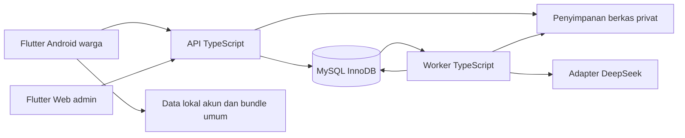
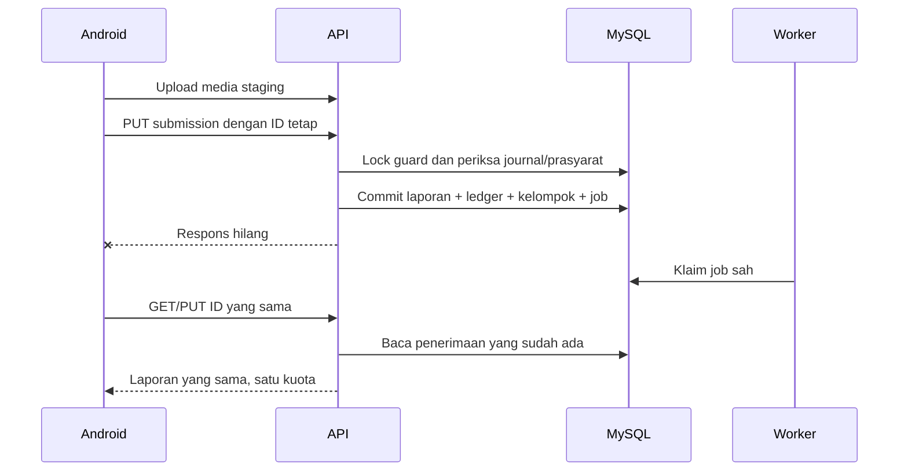
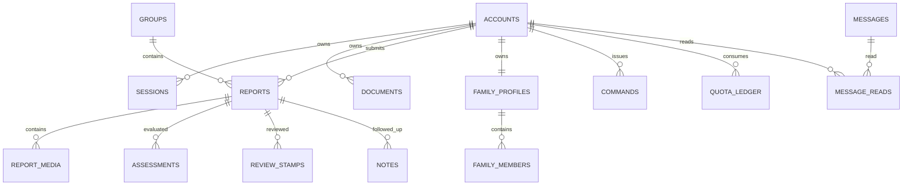

# SiagaBanjir — Software Requirements Specification

> **Living document:** perbarui bersama setiap perubahan terkait menurut [aturan dokumentasi](../rules/documentation.md#living-documents).

| Kontrol | Nilai |
|---|---|
| ID / versi / tanggal | SRS-SIAGABANJIR / v1.0.0 / 18 Oktober 2026 |
| Status | **APPROVED melalui delegasi pelaksanaan/finalisasi SRS-DLG-001; baseline spesifikasi** |
| Tahap | 4 — SRS; berikutnya workspace setup dan implementasi sesuai milestone PRD |
| Pemilik / penyusun | Pemilik proyek berwenang atas produk; asisten menyusun pilihan teknis dalam mandat demo sederhana |
| Sumber | BRD/PRD v0.1.0 dan FRD v1.0.0 APPROVED; tidak diubah oleh penyusunan SRS |
| Otoritas | [SRS-DLG-001 / SRS-APPROVAL-01](DECISIONS.md#srs-dlg-001); bukan jawaban individual atau sign-off baru yang dikarang |
| Implementasi / bukti | Belum ada implementasi aplikasi pada tahap ini; provider, perangkat dan UAT **NOT_RUN** |
| Kontrak mesin | [OpenAPI 3.1](openapi.json); definisi request/response dibaca bersama aturan semantik di sini |

Navigasi: [konteks](#srs-context), [katalog fungsi](#srs-functions), [proses](#srs-processes), [data](#srs-data), [antarmuka](#srs-interfaces), [NFR](#srs-nfr), [verifikasi](#srs-verification), [bukti dan penutupan](#srs-governance).

## 1. Pendahuluan

SRS ini menjadi kontrak kerja tiga anggota tim: backend/AI/maintainer, Flutter warga, dan Flutter admin. Semua fitur demo PRD tetap wajib; spesifikasi melengkapi cara data/antarmuka/proses memenuhi FRD. Keputusan desain yang dipilih di sini mempunyai alasan dan sumber mandat, terpisah dari fakta kemampuan pustaka/provider yang harus dibuktikan.

Urutan otoritas: instruksi pemilik terbaru → keputusan/FRD final → batasan PRD/BRD → kontrak teknis SRS. Konflik yang mengubah fungsi diselesaikan lewat perubahan tercatat, bukan menimpa keputusan lama. Lampiran discovery FRD §30.1–19 bersifat historis; STD-001–012 adalah rincian final. Panduan `4.PROMPT_SRS.md` dipakai secara adaptif; persetujuan sumber yang sudah ada dan delegasi terbaru tidak dibuka kembali sebagai ratusan pertanyaan konfirmasi.

`APPROVED` berarti kontrak spesifikasi diselesaikan dalam mandat pemilik. `DOCUMENT_CHECKED` berarti pemeriksaan artefak. `DOCUMENTED_SUPPORT` berarti dokumentasi vendor dibaca. `NOT_RUN` berarti belum ada eksekusi aplikasi/provider/perangkat. Keempatnya tidak saling menggantikan.

ID `SRS-FR-<modul>-NNN` mempertahankan asal satu FR; kewajiban data/antarmuka/NFR lintas modul mempunyai ID tersendiri. Semua requirement wajib untuk demo, versi 1.0.0. Field wire memakai camelCase, penyimpanan snake_case; pemetaan eksplisit pada kamus data. Waktu wire ISO-8601 dengan offset, respons UTC milidetik; UI Asia/Jakarta. `version` berarti integer positif, bukan versi aplikasi. `resultVersion` adalah versi hasil efektif yang dipakai review.

<a id="srs-context"></a>

## 2. Konteks, lingkungan dan keputusan desain



| ID keputusan | Pilihan / alasan | Batas |
|---|---|---|
| SRS-DEC-001 | API Node 24 LTS + TypeScript strict + Fastify 5; JSON Schema untuk validasi request dan allowlist response | Pilihan proyek; patch TypeScript/Fastify dikunci pada setup setelah build smoke test, bukan klaim sudah terpasang |
| SRS-DEC-002 | MySQL InnoDB melalui driver mysql2 dan migrasi SQL berurutan; basis kompatibilitas MySQL 8.0/8.4, transaksi READ COMMITTED | Laragon 6/MySQL tetap baseline. Versi instance aktual belum diketahui; jangan menganggap MariaDB identik. Tidak memasang/mengganti database pada tahap dokumen |
| SRS-DEC-003 | Antrean persisten di tabel MySQL, satu proses worker, dua pekerjaan aktif maksimum, polling 1 detik; tidak memerlukan broker tambahan | Semua callback memeriksa sumber/generation; jumlah worker adalah konfigurasi demo, bukan kapasitas produksi |
| SRS-DEC-004 | Satu row `business_write_guard` untuk serialisasi transaksi mutasi bisnis demo | Mudah dibuktikan untuk delapan akun; tidak memegang lock saat upload, decode, hash sandi atau panggilan AI. Optimasi nanti harus mempertahankan invariant |
| SRS-DEC-005 | Token sesi opaque 32 byte acak, verifier digest; Android secure storage, token admin web hanya memori | Bukan JWT; reload penuh web meminta login lagi. Maksimum sesi 7 hari dan beberapa perangkat tetap didukung |
| SRS-DEC-006 | Media privat di direktori data di luar webroot, diakses melalui API terotorisasi; staging terpisah | Nama file acak internal; tidak ada path/URL publik yang melewati hak baca. Akses operator OS bukan hak admin aplikasi |
| SRS-DEC-007 | Adapter DeepSeek `deepseek-flash`, Chat Completions, inline gambar; FFmpeg/ffprobe untuk video, Poppler untuk PDF | Dokumentasi mendukung arah ini; kredensial, mutu dan kombinasi binary aktual masih gate PoC |
| SRS-DEC-008 | Flutter SDK stable dikunci bersama Dart pada setup; target Android API 24+, web admin Chrome/Edge desktop stable | Batas target, bukan bukti HP pengguna. Geolocator 14.1.1, flutter_secure_storage 11.2.0 dan flutter_tts 4.2.5 menjadi pilihan awal yang harus lolos dependency resolution/build |
| SRS-DEC-009 | Lapisan Flutter UI → controller → repository; data lokal memakai SQLite dan direktori privat per akun; HTTP client tunggal dengan session generation | Library UI/state tidak mengubah kontrak; pilih SDK ChangeNotifier/ValueNotifier dan repository injection untuk demo, tanpa menambah framework state wajib |
| SRS-DEC-010 | Peta pemilihan titik melalui adapter tile interaktif OSM; input koordinat manual selalu tersedia; nama publik fallback kode kelompok | Peta bukan prasyarat penerimaan. Tidak memakai layanan reverse-geocode wajib atau unduhan peta massal |
| SRS-DEC-011 | OpenAPI menjadi kontrak wire; aturan transaksi/semantik dan akses pada SRS tetap normatif | Schema valid tidak membuktikan kuota, ownership, sumber masih hidup atau model benar |
| SRS-DEC-012 | Bukti perangkat/provider/fixture tetap gate fitur, tidak menghalangi spesifikasi bagian independen | Tidak ada klaim biaya/akurasi/dukungan universal; tidak memerlukan server hosting/backup produksi |

Pilihan versi mayor/adapter sudah ditentukan; exact patch, path binary, alamat API demo dan perangkat nyata adalah manifest lingkungan tahap setup. Keputusan tersebut tidak mengubah perilaku fungsi. Target Android perlu disesuaikan hanya bila dependency/perangkat nyata menunjukkan konflik, dengan catatan dampak dan tanpa mengarang hasil build.

SRS-CON-001: sistem wajib mempertahankan cakupan lokal, platform dan peran PRD. SRS-CON-002: tidak ada endpoint admin yang membuka vault/keluarga atau signup admin publik. SRS-CON-003: tidak menambah dispatch, sensor, shelter, chat, push, subscription wajib atau operasi backup server. SRS-CON-004: konfigurasi rahasia/key hanya pada lingkungan backend, tidak di Flutter atau artefak publik. Verifikasi: inspection dependency, route dan manifest; TC-NF-002/004/005/010.

## 3. Kebutuhan fungsional

<a id="srs-functions"></a>

### 3.1 Katalog requirement atomik

Metadata bersama tiap record: status APPROVED v1.0.0 melalui SRS-DLG-001, prioritas wajib demo, pemilik bisnis pemilik proyek, penanggung jawab teknis sesuai modul. Tujuan/rationale, aktor, trigger/precondition, input, output dan pengecualian diwarisi dari FR sumber yang ditautkan; rincian wire pada operasi/kontrak lokal, aturan data §4 dan proses §3.2–3.8 melengkapinya. Semua AC sumber tetap berlaku, bukan digantikan contoh teknis. Metode verifikasi adalah inspection kontrak serta test/demonstration pada implementasi; seluruh tes produk NOT_RUN.

<a id="srs-fr-auth-001"></a>

#### SRS-FR-AUTH-001 — menyediakan bacaan umum tanpa registrasi dan meminta login untuk aksi pribadi

- **Sumber / tujuan:** [FR-AUTH-001](FRD.md#fr-auth-001); [PRD-F-001](PRD.md#prd-f-001); mendukung tujuan sumber tanpa memperluas scope.
- **Aktor / pemicu:** Tamu; batas objek mengikuti §16, platform mengikuti §9. Pemicu: Membuka Pantau, kontak umum atau panduan tanpa sesi.
- **Kewajiban:** Router publik dan serializer publik wajib menyediakan hanya Pantau/konten umum; pembacaan resource pribadi selalu melalui middleware sesi dan pemeriksaan objek.
- **Kontrak input/output dan izin:** [getMeta](#srs-api-getmeta). Request/response terstruktur pada §5; pengecualian ERR/versi/ownership §3.8/5.1 berlaku.
- **Data / dependensi / keputusan:** model modul §4, SRS-IF-001–010, SRS-DEC-001–012 sesuai tanggung jawab komponen; owner teknis Backend + Flutter.
- **Verifikasi / penerimaan:** [AC-AUTH-001-01](FRD.md#ac-auth-001-01), [AC-AUTH-001-02](FRD.md#ac-auth-001-02); [TC-AUTH-001-01](FRD.md#tc-auth-001-01), [TC-AUTH-001-02](FRD.md#tc-auth-001-02), serta TC-SRS terkait. Status eksekusi **NOT_RUN**.

<a id="srs-fr-auth-002"></a>

#### SRS-FR-AUTH-002 — membuat akun warga dari pendaftaran yang memenuhi aturan, tanpa kewajiban verifikasi email pada demo

- **Sumber / tujuan:** [FR-AUTH-002](FRD.md#fr-auth-002); [PRD-F-002](PRD.md#prd-f-002); mendukung tujuan sumber tanpa memperluas scope.
- **Aktor / pemicu:** Calon warga; batas objek mengikuti §16, platform mengikuti §9. Pemicu: Mengirim pendaftaran email/sandi.
- **Kewajiban:** Signup wajib menormalisasi email, memaksakan unique constraint dan membuat role CITIZEN dalam transaksi; parameter role dari klien ditolak.
- **Kontrak input/output dan izin:** [signup](#srs-api-signup). Request/response terstruktur pada §5; pengecualian ERR/versi/ownership §3.8/5.1 berlaku.
- **Data / dependensi / keputusan:** model modul §4, SRS-IF-001–010, SRS-DEC-001–012 sesuai tanggung jawab komponen; owner teknis Backend + Flutter.
- **Verifikasi / penerimaan:** [AC-AUTH-002-01](FRD.md#ac-auth-002-01), [AC-AUTH-002-02](FRD.md#ac-auth-002-02); [TC-AUTH-002-01](FRD.md#tc-auth-002-01), [TC-AUTH-002-02](FRD.md#tc-auth-002-02), serta TC-SRS terkait. Status eksekusi **NOT_RUN**.

<a id="srs-fr-auth-003"></a>

#### SRS-FR-AUTH-003 — membatasi fitur pribadi kepada sesi sah pemilik

- **Sumber / tujuan:** [FR-AUTH-003](FRD.md#fr-auth-003); [PRD-F-003](PRD.md#prd-f-003); mendukung tujuan sumber tanpa memperluas scope.
- **Aktor / pemicu:** Warga; hak hanya akun yang diautentikasi; batas objek mengikuti §16, platform mengikuti §9. Pemicu: Meminta sesi atau fitur privat.
- **Kewajiban:** Middleware wajib memverifikasi digest token, expiry 7 hari dan credential epoch pada setiap permintaan pribadi; role/owner diambil dari database.
- **Kontrak input/output dan izin:** [login](#srs-api-login), [getAccount](#srs-api-getaccount). Request/response terstruktur pada §5; pengecualian ERR/versi/ownership §3.8/5.1 berlaku.
- **Data / dependensi / keputusan:** model modul §4, SRS-IF-001–010, SRS-DEC-001–012 sesuai tanggung jawab komponen; owner teknis Backend + Flutter.
- **Verifikasi / penerimaan:** [AC-AUTH-003-01](FRD.md#ac-auth-003-01), [AC-AUTH-003-02](FRD.md#ac-auth-003-02); [TC-AUTH-003-01](FRD.md#tc-auth-003-01), [TC-AUTH-003-02](FRD.md#tc-auth-003-02), serta TC-SRS terkait. Status eksekusi **NOT_RUN**.

<a id="srs-fr-auth-004"></a>

#### SRS-FR-AUTH-004 — menerapkan perubahan profil hanya pada akun pemilik yang sah

- **Sumber / tujuan:** [FR-AUTH-004](FRD.md#fr-auth-004); [PRD-F-004](PRD.md#prd-f-004); mendukung tujuan sumber tanpa memperluas scope.
- **Aktor / pemicu:** Pemilik akun; batas objek mengikuti §16, platform mengikuti §9. Pemicu: Membuka atau menyimpan profil sendiri setelah login.
- **Kewajiban:** Mutasi profil wajib memakai If-Match; perubahan email/sandi memerlukan sandi lama benar dan atomik menaikkan credential epoch serta mencabut semua sesi.
- **Kontrak input/output dan izin:** [getAccount](#srs-api-getaccount), [updateProfile](#srs-api-updateprofile), [updateCredentials](#srs-api-updatecredentials). Request/response terstruktur pada §5; pengecualian ERR/versi/ownership §3.8/5.1 berlaku.
- **Data / dependensi / keputusan:** model modul §4, SRS-IF-001–010, SRS-DEC-001–012 sesuai tanggung jawab komponen; owner teknis Backend + Flutter.
- **Verifikasi / penerimaan:** [AC-AUTH-004-01](FRD.md#ac-auth-004-01), [AC-AUTH-004-02](FRD.md#ac-auth-004-02); [TC-AUTH-004-01](FRD.md#tc-auth-004-01), [TC-AUTH-004-02](FRD.md#tc-auth-004-02), serta TC-SRS terkait. Status eksekusi **NOT_RUN**.

<a id="srs-fr-auth-005"></a>

#### SRS-FR-AUTH-005 — memberikan kode pemulihan kepada pemilik untuk disimpan sendiri

- **Sumber / tujuan:** [FR-AUTH-005](FRD.md#fr-auth-005); [PRD-F-005](PRD.md#prd-f-005); mendukung tujuan sumber tanpa memperluas scope.
- **Aktor / pemicu:** Warga pemilik saat pendaftaran; batas objek mengikuti §16, platform mengikuti §9. Pemicu: Pendaftaran akun berhasil.
- **Kewajiban:** Generator wajib membuat 20 byte acak menjadi 32 karakter base32; hanya verifier tersimpan. Respons kode tampil sekali; login+sandi saat ini menyediakan rotasi bila respons hilang.
- **Kontrak input/output dan izin:** [signup](#srs-api-signup), [rotateRecoveryCode](#srs-api-rotaterecoverycode). Request/response terstruktur pada §5; pengecualian ERR/versi/ownership §3.8/5.1 berlaku.
- **Data / dependensi / keputusan:** model modul §4, SRS-IF-001–010, SRS-DEC-001–012 sesuai tanggung jawab komponen; owner teknis Backend + Flutter.
- **Verifikasi / penerimaan:** [AC-AUTH-005-01](FRD.md#ac-auth-005-01), [AC-AUTH-005-02](FRD.md#ac-auth-005-02); [TC-AUTH-005-01](FRD.md#tc-auth-005-01), [TC-AUTH-005-02](FRD.md#tc-auth-005-02), serta TC-SRS terkait. Status eksekusi **NOT_RUN**.

<a id="srs-fr-auth-006"></a>

#### SRS-FR-AUTH-006 — mengizinkan penggantian sandi melalui kode pemulihan sah milik akun

- **Sumber / tujuan:** [FR-AUTH-006](FRD.md#fr-auth-006); [PRD-F-005](PRD.md#prd-f-005); mendukung tujuan sumber tanpa memperluas scope.
- **Aktor / pemicu:** Pemilik yang membuktikan kode sah; batas objek mengikuti §16, platform mengikuti §9. Pemicu: Meminta pemulihan sandi.
- **Kewajiban:** Reset wajib memverifikasi kode dan mengganti sandi, menghabiskan kode, menerbitkan pengganti serta mencabut sesi lama dalam satu transaksi; dua reset memakai kode sama hanya satu berhasil.
- **Kontrak input/output dan izin:** [resetPassword](#srs-api-resetpassword), [rotateRecoveryCode](#srs-api-rotaterecoverycode). Request/response terstruktur pada §5; pengecualian ERR/versi/ownership §3.8/5.1 berlaku.
- **Data / dependensi / keputusan:** model modul §4, SRS-IF-001–010, SRS-DEC-001–012 sesuai tanggung jawab komponen; owner teknis Backend + Flutter.
- **Verifikasi / penerimaan:** [AC-AUTH-006-01](FRD.md#ac-auth-006-01), [AC-AUTH-006-02](FRD.md#ac-auth-006-02); [TC-AUTH-006-01](FRD.md#tc-auth-006-01), [TC-AUTH-006-02](FRD.md#tc-auth-006-02), serta TC-SRS terkait. Status eksekusi **NOT_RUN**.

<a id="srs-fr-auth-007"></a>

#### SRS-FR-AUTH-007 — memberikan hak admin setara kepada dua akun demo yang disiapkan tim

- **Sumber / tujuan:** [FR-AUTH-007](FRD.md#fr-auth-007); [PRD-F-006](PRD.md#prd-f-006); mendukung tujuan sumber tanpa memperluas scope.
- **Aktor / pemicu:** Dua admin disiapkan tim; batas objek mengikuti §16, platform mengikuti §9. Pemicu: Admin login lalu meminta fungsi pengelolaan.
- **Kewajiban:** Seed wajib menghasilkan dua akun ADMIN berbeda tanpa kredensial baku di repo; seluruh operasi admin memakai kewenangan setara dan menolak signup publik sebagai admin.
- **Kontrak input/output dan izin:** [login](#srs-api-login). Request/response terstruktur pada §5; pengecualian ERR/versi/ownership §3.8/5.1 berlaku.
- **Data / dependensi / keputusan:** model modul §4, SRS-IF-001–010, SRS-DEC-001–012 sesuai tanggung jawab komponen; owner teknis Backend + Flutter.
- **Verifikasi / penerimaan:** [AC-AUTH-007-01](FRD.md#ac-auth-007-01), [AC-AUTH-007-02](FRD.md#ac-auth-007-02); [TC-AUTH-007-01](FRD.md#tc-auth-007-01), [TC-AUTH-007-02](FRD.md#tc-auth-007-02), serta TC-SRS terkait. Status eksekusi **NOT_RUN**.

<a id="srs-fr-auth-008"></a>

#### SRS-FR-AUTH-008 — mengakhiri akses sesi setelah logout serta mencegah pembukaan data akun lama oleh sesi lain

- **Sumber / tujuan:** [FR-AUTH-008](FRD.md#fr-auth-008); [PRD-F-057](PRD.md#prd-f-057); mendukung tujuan sumber tanpa memperluas scope.
- **Aktor / pemicu:** Pemilik sesi; batas objek mengikuti §16, platform mengikuti §9. Pemicu: Memilih logout atau kemudian masuk sebagai akun lain.
- **Kewajiban:** Logout wajib menghapus akses token lokal/memori, mengosongkan pratinjau, menghentikan tugas klien dan membatasi callback pada session generation; offline menyimpan hanya kemampuan pencabutan sesi.
- **Kontrak input/output dan izin:** [revokeOfflineSession](#srs-api-revokeofflinesession), [logout](#srs-api-logout); SessionCoordinator §5.4. Request/response terstruktur pada §5; pengecualian ERR/versi/ownership §3.8/5.1 berlaku.
- **Data / dependensi / keputusan:** model modul §4, SRS-IF-001–010, SRS-DEC-001–012 sesuai tanggung jawab komponen; owner teknis Backend + Flutter.
- **Verifikasi / penerimaan:** [AC-AUTH-008-01](FRD.md#ac-auth-008-01), [AC-AUTH-008-02](FRD.md#ac-auth-008-02); [TC-AUTH-008-01](FRD.md#tc-auth-008-01), [TC-AUTH-008-02](FRD.md#tc-auth-008-02), serta TC-SRS terkait. Status eksekusi **NOT_RUN**.

<a id="srs-fr-report-001"></a>

#### SRS-FR-REPORT-001 — memvalidasi jumlah dan jenis kombinasi media sesuai batas laporan

- **Sumber / tujuan:** [FR-REPORT-001](FRD.md#fr-report-001); [PRD-F-007](PRD.md#prd-f-007); mendukung tujuan sumber tanpa memperluas scope.
- **Aktor / pemicu:** Warga pemilik draf; batas objek mengikuti §16, platform mengikuti §9. Pemicu: Memilih media lalu mencoba kirim.
- **Kewajiban:** Penerimaan wajib memeriksa manifest media dan hasil decode/probe aktual: 1–2 foto atau satu video, jumlah/ukuran/codec/durasi sesuai STD-002; media tidak dicampur.
- **Kontrak input/output dan izin:** [uploadMedia](#srs-api-uploadmedia), [submitReport](#srs-api-submitreport). Request/response terstruktur pada §5; pengecualian ERR/versi/ownership §3.8/5.1 berlaku.
- **Data / dependensi / keputusan:** model modul §4, SRS-IF-001–010, SRS-DEC-001–012 sesuai tanggung jawab komponen; owner teknis Backend + Flutter.
- **Verifikasi / penerimaan:** [AC-REPORT-001-01](FRD.md#ac-report-001-01), [AC-REPORT-001-02](FRD.md#ac-report-001-02); [TC-REPORT-001-01](FRD.md#tc-report-001-01), [TC-REPORT-001-02](FRD.md#tc-report-001-02), serta TC-SRS terkait. Status eksekusi **NOT_RUN**.

<a id="srs-fr-report-002"></a>

#### SRS-FR-REPORT-002 — memerlukan tiga unsur wajib dan mencatat waktu kirim otomatis terpisah dari waktu kejadian

- **Sumber / tujuan:** [FR-REPORT-002](FRD.md#fr-report-002); [PRD-F-008](PRD.md#prd-f-008); mendukung tujuan sumber tanpa memperluas scope.
- **Aktor / pemicu:** Warga pemilik draf; batas objek mengikuti §16, platform mengikuti §9. Pemicu: Menekan Kirim setelah mengisi laporan.
- **Kewajiban:** Penerimaan wajib memvalidasi deskripsi, titik dan waktu kejadian terhadap satu timestamp server yang juga menjadi accepted_at; applied_time dan time_source disimpan terpisah.
- **Kontrak input/output dan izin:** [submitReport](#srs-api-submitreport). Request/response terstruktur pada §5; pengecualian ERR/versi/ownership §3.8/5.1 berlaku.
- **Data / dependensi / keputusan:** model modul §4, SRS-IF-001–010, SRS-DEC-001–012 sesuai tanggung jawab komponen; owner teknis Backend + Flutter.
- **Verifikasi / penerimaan:** [AC-REPORT-002-01](FRD.md#ac-report-002-01), [AC-REPORT-002-02](FRD.md#ac-report-002-02); [TC-REPORT-002-01](FRD.md#tc-report-002-01), [TC-REPORT-002-02](FRD.md#tc-report-002-02), serta TC-SRS terkait. Status eksekusi **NOT_RUN**.

<a id="srs-fr-report-003"></a>

#### SRS-FR-REPORT-003 — menerima pilihan titik manual termasuk lokasi lain serta membedakannya dari pengisian GPS

- **Sumber / tujuan:** [FR-REPORT-003](FRD.md#fr-report-003); [PRD-F-009](PRD.md#prd-f-009); mendukung tujuan sumber tanpa memperluas scope.
- **Aktor / pemicu:** Warga pemilik draf; batas objek mengikuti §16, platform mengikuti §9. Pemicu: Mengisi titik melalui GPS atau pilihan manual.
- **Kewajiban:** Pemilih titik wajib menyimpan GPS/MANUAL eksplisit; GPS gagal menyediakan input koordinat/pin manual tanpa geofence, tidak menganggap titik bawaan sudah dipilih.
- **Kontrak input/output dan izin:** [submitReport](#srs-api-submitreport); Pemilih titik GPS/manual §5.4. Request/response terstruktur pada §5; pengecualian ERR/versi/ownership §3.8/5.1 berlaku.
- **Data / dependensi / keputusan:** model modul §4, SRS-IF-001–010, SRS-DEC-001–012 sesuai tanggung jawab komponen; owner teknis Backend + Flutter.
- **Verifikasi / penerimaan:** [AC-REPORT-003-01](FRD.md#ac-report-003-01), [AC-REPORT-003-02](FRD.md#ac-report-003-02); [TC-REPORT-003-01](FRD.md#tc-report-003-01), [TC-REPORT-003-02](FRD.md#tc-report-003-02), serta TC-SRS terkait. Status eksekusi **NOT_RUN**.

<a id="srs-fr-report-004"></a>

#### SRS-FR-REPORT-004 — menahan pengiriman saat kondisi terlarang terdeteksi, termasuk untuk titik manual

- **Sumber / tujuan:** [FR-REPORT-004](FRD.md#fr-report-004); [PRD-F-010](PRD.md#prd-f-010); mendukung tujuan sumber tanpa memperluas scope.
- **Aktor / pemicu:** Warga pada APK demo; batas objek mengikuti §16, platform mengikuti §9. Pemicu: Kirim atau retry dengan mock GPS/mode developer berhasil terdeteksi.
- **Kewajiban:** Penerimaan wajib menolak mock DETECTED dan developer DETECTED pada build demo; jalur manual memakai evaluasi sinyal yang sama, tanpa klaim anti-spoof universal.
- **Kontrak input/output dan izin:** [submitReport](#srs-api-submitreport); DeviceSignalProvider §5.4. Request/response terstruktur pada §5; pengecualian ERR/versi/ownership §3.8/5.1 berlaku.
- **Data / dependensi / keputusan:** model modul §4, SRS-IF-001–010, SRS-DEC-001–012 sesuai tanggung jawab komponen; owner teknis Backend + Flutter.
- **Verifikasi / penerimaan:** [AC-REPORT-004-01](FRD.md#ac-report-004-01), [AC-REPORT-004-02](FRD.md#ac-report-004-02); [TC-REPORT-004-01](FRD.md#tc-report-004-01), [TC-REPORT-004-02](FRD.md#tc-report-004-02), serta TC-SRS terkait. Status eksekusi **NOT_RUN**.

<a id="srs-fr-report-005"></a>

#### SRS-FR-REPORT-005 — mempertahankan arti unknown dan tidak memblokir kirim semata-mata karena unknown mode developer

- **Sumber / tujuan:** [FR-REPORT-005](FRD.md#fr-report-005); [PRD-F-010](PRD.md#prd-f-010); mendukung tujuan sumber tanpa memperluas scope.
- **Aktor / pemicu:** Warga; sistem pemeriksa perangkat; batas objek mengikuti §16, platform mengikuti §9. Pemicu: Status mode developer tidak dapat diperiksa.
- **Kewajiban:** Adapter wajib mempertahankan UNKNOWN bila API tidak memberi sinyal terpercaya; nilai 0 dari Settings.Global saja tidak menjadi bukti developer mode mati.
- **Kontrak input/output dan izin:** [submitReport](#srs-api-submitreport); DeviceSignalProvider §5.4. Request/response terstruktur pada §5; pengecualian ERR/versi/ownership §3.8/5.1 berlaku.
- **Data / dependensi / keputusan:** model modul §4, SRS-IF-001–010, SRS-DEC-001–012 sesuai tanggung jawab komponen; owner teknis Backend + Flutter.
- **Verifikasi / penerimaan:** [AC-REPORT-005-01](FRD.md#ac-report-005-01), [AC-REPORT-005-02](FRD.md#ac-report-005-02); [TC-REPORT-005-01](FRD.md#tc-report-005-01), [TC-REPORT-005-02](FRD.md#tc-report-005-02), serta TC-SRS terkait. Status eksekusi **NOT_RUN**.

<a id="srs-fr-report-006"></a>

#### SRS-FR-REPORT-006 — membatasi pengecualian internal hanya pada pemblokiran mode developer

- **Sumber / tujuan:** [FR-REPORT-006](FRD.md#fr-report-006); [PRD-F-010](PRD.md#prd-f-010); mendukung tujuan sumber tanpa memperluas scope.
- **Aktor / pemicu:** Tim pengembang pada build internal; batas objek mengikuti §16, platform mengikuti §9. Pemicu: Menjalankan alur kirim untuk pengembangan.
- **Kewajiban:** Pengecualian developer wajib bergantung build internal yang didaftarkan pada konfigurasi demo lokal terpisah; tidak ada flag bypass yang dapat diubah dari form atau akun warga.
- **Kontrak input/output dan izin:** [submitReport](#srs-api-submitreport); BuildProfile §5.4. Request/response terstruktur pada §5; pengecualian ERR/versi/ownership §3.8/5.1 berlaku.
- **Data / dependensi / keputusan:** model modul §4, SRS-IF-001–010, SRS-DEC-001–012 sesuai tanggung jawab komponen; owner teknis Backend + Flutter.
- **Verifikasi / penerimaan:** [AC-REPORT-006-01](FRD.md#ac-report-006-01), [AC-REPORT-006-02](FRD.md#ac-report-006-02); [TC-REPORT-006-01](FRD.md#tc-report-006-01), [TC-REPORT-006-02](FRD.md#tc-report-006-02), serta TC-SRS terkait. Status eksekusi **NOT_RUN**.

<a id="srs-fr-ktp-001"></a>

#### SRS-FR-KTP-001 — memerlukan KTP akun yang memenuhi syarat sebelum kirim, tanpa unggah ulang KTP per laporan

- **Sumber / tujuan:** [FR-KTP-001](FRD.md#fr-ktp-001); [PRD-F-011](PRD.md#prd-f-011); mendukung tujuan sumber tanpa memperluas scope.
- **Aktor / pemicu:** Warga pemilik; batas objek mengikuti §16, platform mengikuti §9. Pemicu: Membuat draf atau mencoba pengiriman baru.
- **Kewajiban:** Penerimaan wajib membaca rujukan KTP aktif pemilik dalam transaksi penerimaan; status dari draf/klien tidak memberi hak kirim.
- **Kontrak input/output dan izin:** [getReportingStatus](#srs-api-getreportingstatus), [submitReport](#srs-api-submitreport), [getKtpState](#srs-api-getktpstate), [confirmKtp](#srs-api-confirmktp). Request/response terstruktur pada §5; pengecualian ERR/versi/ownership §3.8/5.1 berlaku.
- **Data / dependensi / keputusan:** model modul §4, SRS-IF-001–010, SRS-DEC-001–012 sesuai tanggung jawab komponen; owner teknis Backend/AI + Flutter.
- **Verifikasi / penerimaan:** [AC-KTP-001-01](FRD.md#ac-ktp-001-01), [AC-KTP-001-02](FRD.md#ac-ktp-001-02); [TC-KTP-001-01](FRD.md#tc-ktp-001-01), [TC-KTP-001-02](FRD.md#tc-ktp-001-02), serta TC-SRS terkait. Status eksekusi **NOT_RUN**.

<a id="srs-fr-ktp-002"></a>

#### SRS-FR-KTP-002 — memeriksa jenis/keterbacaan KTP dan menyajikan hasil kepada pemilik tanpa klaim verifikasi NIK resmi

- **Sumber / tujuan:** [FR-KTP-002](FRD.md#fr-ktp-002); [PRD-F-012](PRD.md#prd-f-012); mendukung tujuan sumber tanpa memperluas scope.
- **Aktor / pemicu:** Sistem untuk pemilik dokumen; batas objek mengikuti §16, platform mengikuti §9. Pemicu: Pemilik menyerahkan KTP untuk pemeriksaan khusus.
- **Kewajiban:** Worker KTP wajib memvalidasi document_type, name_readable dan nama yang benar-benar tersedia; jenis salah/hasil invalid tidak meluluskan dan tidak membatalkan KTP aktif sebelumnya.
- **Kontrak input/output dan izin:** [getJob](#srs-api-getjob), [checkKtp](#srs-api-checkktp), [retryKtp](#srs-api-retryktp). Request/response terstruktur pada §5; pengecualian ERR/versi/ownership §3.8/5.1 berlaku.
- **Data / dependensi / keputusan:** model modul §4, SRS-IF-001–010, SRS-DEC-001–012 sesuai tanggung jawab komponen; owner teknis Backend/AI + Flutter.
- **Verifikasi / penerimaan:** [AC-KTP-002-01](FRD.md#ac-ktp-002-01), [AC-KTP-002-02](FRD.md#ac-ktp-002-02); [TC-KTP-002-01](FRD.md#tc-ktp-002-01), [TC-KTP-002-02](FRD.md#tc-ktp-002-02), serta TC-SRS terkait. Status eksekusi **NOT_RUN**.

<a id="srs-fr-ktp-003"></a>

#### SRS-FR-KTP-003 — memasukkan konfirmasi pemilik sebagai bagian pemenuhan prasyarat KTP

- **Sumber / tujuan:** [FR-KTP-003](FRD.md#fr-ktp-003); [PRD-F-012](PRD.md#prd-f-012); mendukung tujuan sumber tanpa memperluas scope.
- **Aktor / pemicu:** Pemilik dokumen; batas objek mengikuti §16, platform mengikuti §9. Pemicu: Meninjau hasil pemeriksaan KTP lalu mengonfirmasi.
- **Kewajiban:** Konfirmasi wajib menunjuk document_id/version dan job berhasil serta If-Match status KTP; sumber terhapus/usang ditolak, pergantian rujukan atomik.
- **Kontrak input/output dan izin:** [getKtpState](#srs-api-getktpstate), [confirmKtp](#srs-api-confirmktp). Request/response terstruktur pada §5; pengecualian ERR/versi/ownership §3.8/5.1 berlaku.
- **Data / dependensi / keputusan:** model modul §4, SRS-IF-001–010, SRS-DEC-001–012 sesuai tanggung jawab komponen; owner teknis Backend/AI + Flutter.
- **Verifikasi / penerimaan:** [AC-KTP-003-01](FRD.md#ac-ktp-003-01), [AC-KTP-003-02](FRD.md#ac-ktp-003-02); [TC-KTP-003-01](FRD.md#tc-ktp-003-01), [TC-KTP-003-02](FRD.md#tc-ktp-003-02), serta TC-SRS terkait. Status eksekusi **NOT_RUN**.

<a id="srs-fr-ktp-004"></a>

#### SRS-FR-KTP-004 — menahan pengiriman baru setelah KTP prasyarat dihapus

- **Sumber / tujuan:** [FR-KTP-004](FRD.md#fr-ktp-004); [PRD-F-013](PRD.md#prd-f-013); mendukung tujuan sumber tanpa memperluas scope.
- **Aktor / pemicu:** Pemilik KTP; batas objek mengikuti §16, platform mengikuti §9. Pemicu: Menghapus KTP yang memenuhi syarat.
- **Kewajiban:** Hapus dokumen aktif wajib mengosongkan rujukan KTP dalam transaksi pencabutan akses; penerimaan sesudahnya tertahan, ledger laporan lama tidak berubah.
- **Kontrak input/output dan izin:** [submitReport](#srs-api-submitreport), [deleteDocument](#srs-api-deletedocument), [getKtpState](#srs-api-getktpstate). Request/response terstruktur pada §5; pengecualian ERR/versi/ownership §3.8/5.1 berlaku.
- **Data / dependensi / keputusan:** model modul §4, SRS-IF-001–010, SRS-DEC-001–012 sesuai tanggung jawab komponen; owner teknis Backend/AI + Flutter.
- **Verifikasi / penerimaan:** [AC-KTP-004-01](FRD.md#ac-ktp-004-01), [AC-KTP-004-02](FRD.md#ac-ktp-004-02); [TC-KTP-004-01](FRD.md#tc-ktp-004-01), [TC-KTP-004-02](FRD.md#tc-ktp-004-02), serta TC-SRS terkait. Status eksekusi **NOT_RUN**.

<a id="srs-fr-report-007"></a>

#### SRS-FR-REPORT-007 — mempertahankan draf beserta media lokal tanpa menyebutnya diterima backend

- **Sumber / tujuan:** [FR-REPORT-007](FRD.md#fr-report-007); [PRD-F-014](PRD.md#prd-f-014); mendukung tujuan sumber tanpa memperluas scope.
- **Aktor / pemicu:** Warga pemilik draf; batas objek mengikuti §16, platform mengikuti §9. Pemicu: Menyimpan draf saat offline atau syarat kirim belum lengkap.
- **Kewajiban:** Repository lokal wajib menyimpan draf/media di ruang akun/perangkat dan melaporkan kegagalan simpan; payload pernah dikirim tidak dapat diubah sebelum penerimaan atau penutupan revisi terbukti.
- **Kontrak input/output dan izin:** [uploadMedia](#srs-api-uploadmedia), [getUpload](#srs-api-getupload), [closeSubmission](#srs-api-closesubmission); DraftRepository §5.4. Request/response terstruktur pada §5; pengecualian ERR/versi/ownership §3.8/5.1 berlaku.
- **Data / dependensi / keputusan:** model modul §4, SRS-IF-001–010, SRS-DEC-001–012 sesuai tanggung jawab komponen; owner teknis Backend + Flutter.
- **Verifikasi / penerimaan:** [AC-REPORT-007-01](FRD.md#ac-report-007-01), [AC-REPORT-007-02](FRD.md#ac-report-007-02); [TC-REPORT-007-01](FRD.md#tc-report-007-01), [TC-REPORT-007-02](FRD.md#tc-report-007-02), serta TC-SRS terkait. Status eksekusi **NOT_RUN**.

<a id="srs-fr-report-008"></a>

#### SRS-FR-REPORT-008 — melanjutkan pengiriman yang sebelumnya diminta saat aplikasi aktif dan online

- **Sumber / tujuan:** [FR-REPORT-008](FRD.md#fr-report-008); [PRD-F-015](PRD.md#prd-f-015); mendukung tujuan sumber tanpa memperluas scope.
- **Aktor / pemicu:** Warga pemilik permintaan kirim; batas objek mengikuti §16, platform mengikuti §9. Pemicu: Aplikasi aktif kembali dan online setelah Kirim terputus.
- **Kewajiban:** Koordinator kirim wajib merekonsiliasi submission_id dahulu saat resume/online; maksimum tiga upaya satu rangkaian, jeda 5/15 detik, hanya saat akun asal aktif.
- **Kontrak input/output dan izin:** [submitReport](#srs-api-submitreport), [getSubmission](#srs-api-getsubmission). Request/response terstruktur pada §5; pengecualian ERR/versi/ownership §3.8/5.1 berlaku.
- **Data / dependensi / keputusan:** model modul §4, SRS-IF-001–010, SRS-DEC-001–012 sesuai tanggung jawab komponen; owner teknis Backend + Flutter.
- **Verifikasi / penerimaan:** [AC-REPORT-008-01](FRD.md#ac-report-008-01), [AC-REPORT-008-02](FRD.md#ac-report-008-02); [TC-REPORT-008-01](FRD.md#tc-report-008-01), [TC-REPORT-008-02](FRD.md#tc-report-008-02), serta TC-SRS terkait. Status eksekusi **NOT_RUN**.

<a id="srs-fr-report-009"></a>

#### SRS-FR-REPORT-009 — menyediakan tindakan kirim ulang manual dengan prasyarat yang tetap berlaku

- **Sumber / tujuan:** [FR-REPORT-009](FRD.md#fr-report-009); [PRD-F-015](PRD.md#prd-f-015); mendukung tujuan sumber tanpa memperluas scope.
- **Aktor / pemicu:** Warga pemilik permintaan; batas objek mengikuti §16, platform mengikuti §9. Pemicu: Memilih Coba lagi setelah pengiriman tertahan/gagal.
- **Kewajiban:** Tombol Coba lagi wajib menggunakan ID/payload revisi yang sama sampai definitif; perubahan isi memerlukan revisi lama CLOSED/REJECTED_CLOSED dan ID baru.
- **Kontrak input/output dan izin:** [submitReport](#srs-api-submitreport), [getSubmission](#srs-api-getsubmission), [closeSubmission](#srs-api-closesubmission). Request/response terstruktur pada §5; pengecualian ERR/versi/ownership §3.8/5.1 berlaku.
- **Data / dependensi / keputusan:** model modul §4, SRS-IF-001–010, SRS-DEC-001–012 sesuai tanggung jawab komponen; owner teknis Backend + Flutter.
- **Verifikasi / penerimaan:** [AC-REPORT-009-01](FRD.md#ac-report-009-01), [AC-REPORT-009-02](FRD.md#ac-report-009-02); [TC-REPORT-009-01](FRD.md#tc-report-009-01), [TC-REPORT-009-02](FRD.md#tc-report-009-02), serta TC-SRS terkait. Status eksekusi **NOT_RUN**.

<a id="srs-fr-report-010"></a>

#### SRS-FR-REPORT-010 — menghasilkan satu laporan bisnis untuk pengulangan permintaan Kirim yang sama

- **Sumber / tujuan:** [FR-REPORT-010](FRD.md#fr-report-010); [PRD-F-015](PRD.md#prd-f-015); mendukung tujuan sumber tanpa memperluas scope.
- **Aktor / pemicu:** Warga dan sistem penerimaan; batas objek mengikuti §16, platform mengikuti §9. Pemicu: Percobaan untuk maksud Kirim yang sama tiba berulang atau bersamaan.
- **Kewajiban:** Journal unik akun+submission_id wajib mempertahankan hasil minimal; retry identik tidak menambah laporan/kuota, payload berbeda konflik, status terhapus tidak dapat dibuat ulang.
- **Kontrak input/output dan izin:** [submitReport](#srs-api-submitreport), [getSubmission](#srs-api-getsubmission), [closeSubmission](#srs-api-closesubmission). Request/response terstruktur pada §5; pengecualian ERR/versi/ownership §3.8/5.1 berlaku.
- **Data / dependensi / keputusan:** model modul §4, SRS-IF-001–010, SRS-DEC-001–012 sesuai tanggung jawab komponen; owner teknis Backend + Flutter.
- **Verifikasi / penerimaan:** [AC-REPORT-010-01](FRD.md#ac-report-010-01), [AC-REPORT-010-02](FRD.md#ac-report-010-02); [TC-REPORT-010-01](FRD.md#tc-report-010-01), [TC-REPORT-010-02](FRD.md#tc-report-010-02), serta TC-SRS terkait. Status eksekusi **NOT_RUN**.

<a id="srs-fr-report-011"></a>

#### SRS-FR-REPORT-011 — menyediakan riwayat/bukti milik sendiri sebagai baca saja bagi warga setelah diterima

- **Sumber / tujuan:** [FR-REPORT-011](FRD.md#fr-report-011); [PRD-F-016](PRD.md#prd-f-016); mendukung tujuan sumber tanpa memperluas scope.
- **Aktor / pemicu:** Pemilik laporan; admin sesuai fungsi terpisah; batas objek mengikuti §16, platform mengikuti §9. Pemicu: Membuka laporan yang telah diterima.
- **Kewajiban:** Daftar/detail warga wajib menyaring owner sebelum serialisasi; detail terhapus 410 untuk pemilik selama marker berlaku, marker 30 hari tanpa isi, lalu riwayat menghilangkan entri.
- **Kontrak input/output dan izin:** [listOwnReports](#srs-api-listownreports), [getOwnReport](#srs-api-getownreport), [downloadMedia](#srs-api-downloadmedia). Request/response terstruktur pada §5; pengecualian ERR/versi/ownership §3.8/5.1 berlaku.
- **Data / dependensi / keputusan:** model modul §4, SRS-IF-001–010, SRS-DEC-001–012 sesuai tanggung jawab komponen; owner teknis Backend + Flutter.
- **Verifikasi / penerimaan:** [AC-REPORT-011-01](FRD.md#ac-report-011-01), [AC-REPORT-011-02](FRD.md#ac-report-011-02); [TC-REPORT-011-01](FRD.md#tc-report-011-01), [TC-REPORT-011-02](FRD.md#tc-report-011-02), serta TC-SRS terkait. Status eksekusi **NOT_RUN**.

<a id="srs-fr-report-012"></a>

#### SRS-FR-REPORT-012 — menampilkan keadaan proses dan hasil yang tersedia dengan pembedaan AI dan tinjauan admin

- **Sumber / tujuan:** [FR-REPORT-012](FRD.md#fr-report-012); [PRD-F-017](PRD.md#prd-f-017); mendukung tujuan sumber tanpa memperluas scope.
- **Aktor / pemicu:** Pelapor pemilik; batas objek mengikuti §16, platform mengikuti §9. Pemicu: Membuka perkembangan laporannya.
- **Kewajiban:** Detail wajib memisahkan analysis_state, assessment efektif, assessment AI, review dan catatan; tidak menyatakan bantuan/evakuasi telah dikirim dari label tingkat.
- **Kontrak input/output dan izin:** [listOwnReports](#srs-api-listownreports), [getOwnReport](#srs-api-getownreport). Request/response terstruktur pada §5; pengecualian ERR/versi/ownership §3.8/5.1 berlaku.
- **Data / dependensi / keputusan:** model modul §4, SRS-IF-001–010, SRS-DEC-001–012 sesuai tanggung jawab komponen; owner teknis Backend + Flutter.
- **Verifikasi / penerimaan:** [AC-REPORT-012-01](FRD.md#ac-report-012-01), [AC-REPORT-012-02](FRD.md#ac-report-012-02); [TC-REPORT-012-01](FRD.md#tc-report-012-01), [TC-REPORT-012-02](FRD.md#tc-report-012-02), serta TC-SRS terkait. Status eksekusi **NOT_RUN**.

<a id="srs-fr-ai-001"></a>

#### SRS-FR-AI-001 — menghasilkan bantuan penilaian kecocokan bukti dengan keterangan yang dapat ditelusuri ke sumbernya

- **Sumber / tujuan:** [FR-AI-001](FRD.md#fr-ai-001); [PRD-F-018](PRD.md#prd-f-018); mendukung tujuan sumber tanpa memperluas scope.
- **Aktor / pemicu:** Proses analisis; hasil untuk pemilik dan admin; batas objek mengikuti §16, platform mengikuti §9. Pemicu: Laporan bermedia telah diterima dan dijadwalkan untuk analisis.
- **Kewajiban:** Worker wajib mengirim hanya media/frame dan keterangan kepada adapter, memvalidasi skema serta indikator, lalu menyimpan hasil hanya jika sumber/generation masih berlaku.
- **Kontrak input/output dan izin:** [getJob](#srs-api-getjob), [retryReportAnalysis](#srs-api-retryreportanalysis). Request/response terstruktur pada §5; pengecualian ERR/versi/ownership §3.8/5.1 berlaku.
- **Data / dependensi / keputusan:** model modul §4, SRS-IF-001–010, SRS-DEC-001–012 sesuai tanggung jawab komponen; owner teknis Backend/AI + Flutter.
- **Verifikasi / penerimaan:** [AC-AI-001-01](FRD.md#ac-ai-001-01), [AC-AI-001-02](FRD.md#ac-ai-001-02); [TC-AI-001-01](FRD.md#tc-ai-001-01), [TC-AI-001-02](FRD.md#tc-ai-001-02), serta TC-SRS terkait. Status eksekusi **NOT_RUN**.

<a id="srs-fr-ai-002"></a>

#### SRS-FR-AI-002 — mempertahankan laporan tidak cocok untuk review dan mengecualikan buktinya dari penetapan bahaya sebelum ditinjau

- **Sumber / tujuan:** [FR-AI-002](FRD.md#fr-ai-002); [PRD-F-019](PRD.md#prd-f-019); mendukung tujuan sumber tanpa memperluas scope.
- **Aktor / pemicu:** Proses analisis dan admin peninjau; batas objek mengikuti §16, platform mengikuti §9. Pemicu: Hasil analisis menilai bukti tidak cocok.
- **Kewajiban:** Agregator wajib mengecualikan MISMATCH; review biasa tidak mengubah relevansi. Hanya koreksi eksplisit relevansi/tingkat/alasan membuat hasil admin memenuhi kelayakan.
- **Kontrak input/output dan izin:** [retryReportAnalysis](#srs-api-retryreportanalysis), [correctAssessment](#srs-api-correctassessment). Request/response terstruktur pada §5; pengecualian ERR/versi/ownership §3.8/5.1 berlaku.
- **Data / dependensi / keputusan:** model modul §4, SRS-IF-001–010, SRS-DEC-001–012 sesuai tanggung jawab komponen; owner teknis Backend/AI + Flutter.
- **Verifikasi / penerimaan:** [AC-AI-002-01](FRD.md#ac-ai-002-01), [AC-AI-002-02](FRD.md#ac-ai-002-02); [TC-AI-002-01](FRD.md#tc-ai-002-01), [TC-AI-002-02](FRD.md#tc-ai-002-02), serta TC-SRS terkait. Status eksekusi **NOT_RUN**.

<a id="srs-fr-ai-003"></a>

#### SRS-FR-AI-003 — membedakan penilaian belum tersedia dari tingkat rendah

- **Sumber / tujuan:** [FR-AI-003](FRD.md#fr-ai-003); [PRD-F-020](PRD.md#prd-f-020); mendukung tujuan sumber tanpa memperluas scope.
- **Aktor / pemicu:** Proses sistem; dibaca pelapor/admin/publik sesuai izin; batas objek mengikuti §16, platform mengikuti §9. Pemicu: Analisis menunggu, gagal atau belum cukup untuk penilaian.
- **Kewajiban:** Agregator wajib menghasilkan UNRATED ketika tidak ada hasil layak; gagal, kosong, tidak cukup dan pending tidak dipetakan menjadi LOW.
- **Kontrak input/output dan izin:** [retryReportAnalysis](#srs-api-retryreportanalysis), [correctAssessment](#srs-api-correctassessment). Request/response terstruktur pada §5; pengecualian ERR/versi/ownership §3.8/5.1 berlaku.
- **Data / dependensi / keputusan:** model modul §4, SRS-IF-001–010, SRS-DEC-001–012 sesuai tanggung jawab komponen; owner teknis Backend/AI + Flutter.
- **Verifikasi / penerimaan:** [AC-AI-003-01](FRD.md#ac-ai-003-01), [AC-AI-003-02](FRD.md#ac-ai-003-02); [TC-AI-003-01](FRD.md#tc-ai-003-01), [TC-AI-003-02](FRD.md#tc-ai-003-02), serta TC-SRS terkait. Status eksekusi **NOT_RUN**.

<a id="srs-fr-review-001"></a>

#### SRS-FR-REVIEW-001 — mengelompokkan laporan terkait tanpa mengganti atau menghilangkan laporan individual

- **Sumber / tujuan:** [FR-REVIEW-001](FRD.md#fr-review-001); [PRD-F-021](PRD.md#prd-f-021); mendukung tujuan sumber tanpa memperluas scope.
- **Aktor / pemicu:** Sistem pengelompokan; admin pembaca bukti; batas objek mengikuti §16, platform mengikuti §9. Pemicu: Laporan terkait diterima atau keanggotaan dievaluasi.
- **Kewajiban:** Transaksi penempatan wajib mengevaluasi kandidat/bentang dengan aturan jarak/waktu dan tie-break final; setiap laporan memiliki tepat satu group_id efektif, tanpa auto-merge.
- **Kontrak input/output dan izin:** [listGroups](#srs-api-listgroups), [getGroup](#srs-api-getgroup), [listGroupReports](#srs-api-listgroupreports). Request/response terstruktur pada §5; pengecualian ERR/versi/ownership §3.8/5.1 berlaku.
- **Data / dependensi / keputusan:** model modul §4, SRS-IF-001–010, SRS-DEC-001–012 sesuai tanggung jawab komponen; owner teknis Backend + Flutter.
- **Verifikasi / penerimaan:** [AC-REVIEW-001-01](FRD.md#ac-review-001-01), [AC-REVIEW-001-02](FRD.md#ac-review-001-02); [TC-REVIEW-001-01](FRD.md#tc-review-001-01), [TC-REVIEW-001-02](FRD.md#tc-review-001-02), serta TC-SRS terkait. Status eksekusi **NOT_RUN**.

<a id="srs-fr-review-002"></a>

#### SRS-FR-REVIEW-002 — menyajikan prioritas tinjauan dengan makna yang berbeda dari indikasi tingkat publik

- **Sumber / tujuan:** [FR-REVIEW-002](FRD.md#fr-review-002); [PRD-F-022](PRD.md#prd-f-022); mendukung tujuan sumber tanpa memperluas scope.
- **Aktor / pemicu:** Admin peninjau; batas objek mengikuti §16, platform mengikuti §9. Pemicu: Membuka urutan perhatian laporan/kelompok.
- **Kewajiban:** Query antrean wajib memilih kelompok aktif dengan kebutuhan review terbuka; urut level lalu minimum needs_review_since dan ID, UNRATED dipisahkan.
- **Kontrak input/output dan izin:** [listAdminReports](#srs-api-listadminreports), [listGroups](#srs-api-listgroups). Request/response terstruktur pada §5; pengecualian ERR/versi/ownership §3.8/5.1 berlaku.
- **Data / dependensi / keputusan:** model modul §4, SRS-IF-001–010, SRS-DEC-001–012 sesuai tanggung jawab komponen; owner teknis Backend + Flutter.
- **Verifikasi / penerimaan:** [AC-REVIEW-002-01](FRD.md#ac-review-002-01), [AC-REVIEW-002-02](FRD.md#ac-review-002-02); [TC-REVIEW-002-01](FRD.md#tc-review-002-01), [TC-REVIEW-002-02](FRD.md#tc-review-002-02), serta TC-SRS terkait. Status eksekusi **NOT_RUN**.

<a id="srs-fr-review-003"></a>

#### SRS-FR-REVIEW-003 — memungkinkan koreksi hasil AI oleh admin dan memperbarui hasil terkait sesuai koreksi sah

- **Sumber / tujuan:** [FR-REVIEW-003](FRD.md#fr-review-003); [PRD-F-023](PRD.md#prd-f-023); mendukung tujuan sumber tanpa memperluas scope.
- **Aktor / pemicu:** Admin; batas objek mengikuti §16, platform mengikuti §9. Pemicu: Meninjau hasil analisis yang dinilai keliru.
- **Kewajiban:** Koreksi wajib membandingkan versi, menaikkan result_version dan mengunci authority ADMIN; hasil AI berikut tidak menimpa hasil efektif tersebut.
- **Kontrak input/output dan izin:** [getAdminReport](#srs-api-getadminreport), [correctAssessment](#srs-api-correctassessment), [getGroup](#srs-api-getgroup). Request/response terstruktur pada §5; pengecualian ERR/versi/ownership §3.8/5.1 berlaku.
- **Data / dependensi / keputusan:** model modul §4, SRS-IF-001–010, SRS-DEC-001–012 sesuai tanggung jawab komponen; owner teknis Backend + Flutter.
- **Verifikasi / penerimaan:** [AC-REVIEW-003-01](FRD.md#ac-review-003-01), [AC-REVIEW-003-02](FRD.md#ac-review-003-02); [TC-REVIEW-003-01](FRD.md#tc-review-003-01), [TC-REVIEW-003-02](FRD.md#tc-review-003-02), serta TC-SRS terkait. Status eksekusi **NOT_RUN**.

<a id="srs-fr-review-004"></a>

#### SRS-FR-REVIEW-004 — memindahkan keanggotaan laporan ke kelompok pilihan admin tanpa menghilangkan sumber

- **Sumber / tujuan:** [FR-REVIEW-004](FRD.md#fr-review-004); [PRD-F-024](PRD.md#prd-f-024); mendukung tujuan sumber tanpa memperluas scope.
- **Aktor / pemicu:** Admin; batas objek mengikuti §16, platform mengikuti §9. Pemicu: Menemukan laporan berada dalam kelompok salah.
- **Kewajiban:** Pindah wajib memeriksa versi laporan/kedua kelompok dan alasan, mengubah group_id sekali serta menghitung ulang sumber/tujuan secara atomik, termasuk tujuan baru aktif.
- **Kontrak input/output dan izin:** [moveReport](#srs-api-movereport), [getGroup](#srs-api-getgroup). Request/response terstruktur pada §5; pengecualian ERR/versi/ownership §3.8/5.1 berlaku.
- **Data / dependensi / keputusan:** model modul §4, SRS-IF-001–010, SRS-DEC-001–012 sesuai tanggung jawab komponen; owner teknis Backend + Flutter.
- **Verifikasi / penerimaan:** [AC-REVIEW-004-01](FRD.md#ac-review-004-01), [AC-REVIEW-004-02](FRD.md#ac-review-004-02); [TC-REVIEW-004-01](FRD.md#tc-review-004-01), [TC-REVIEW-004-02](FRD.md#tc-review-004-02), serta TC-SRS terkait. Status eksekusi **NOT_RUN**.

<a id="srs-fr-review-005"></a>

#### SRS-FR-REVIEW-005 — menyediakan catatan tindak lanjut kepada admin dan pelapor terkait

- **Sumber / tujuan:** [FR-REVIEW-005](FRD.md#fr-review-005); [PRD-F-025](PRD.md#prd-f-025); mendukung tujuan sumber tanpa memperluas scope.
- **Aktor / pemicu:** Admin penulis; pelapor terkait pembaca; batas objek mengikuti §16, platform mengikuti §9. Pemicu: Menyimpan catatan tindak lanjut sederhana.
- **Kewajiban:** Catatan wajib disimpan pada report_id dan hanya diserialisasi untuk owner/admin; koreksi append-only menunjuk catatan pada laporan sama dan tidak memberi hak ke anggota kelompok lain.
- **Kontrak input/output dan izin:** [getOwnReport](#srs-api-getownreport), [listReportNotes](#srs-api-listreportnotes), [getAdminReport](#srs-api-getadminreport), [appendReportNote](#srs-api-appendreportnote). Request/response terstruktur pada §5; pengecualian ERR/versi/ownership §3.8/5.1 berlaku.
- **Data / dependensi / keputusan:** model modul §4, SRS-IF-001–010, SRS-DEC-001–012 sesuai tanggung jawab komponen; owner teknis Backend + Flutter.
- **Verifikasi / penerimaan:** [AC-REVIEW-005-01](FRD.md#ac-review-005-01), [AC-REVIEW-005-02](FRD.md#ac-review-005-02); [TC-REVIEW-005-01](FRD.md#tc-review-005-01), [TC-REVIEW-005-02](FRD.md#tc-review-005-02), serta TC-SRS terkait. Status eksekusi **NOT_RUN**.

<a id="srs-fr-review-006"></a>

#### SRS-FR-REVIEW-006 — menandai kebutuhan tinjauan ulang ketika bukti baru belum tercakup review sebelumnya

- **Sumber / tujuan:** [FR-REVIEW-006](FRD.md#fr-review-006); [PRD-F-026](PRD.md#prd-f-026); mendukung tujuan sumber tanpa memperluas scope.
- **Aktor / pemicu:** Sistem review; admin; batas objek mengikuti §16, platform mengikuti §9. Pemicu: Bukti/laporan baru masuk ke kelompok yang sudah ditinjau.
- **Kewajiban:** Review wajib mencatat pasangan evidence_version/result_version yang benar-benar dilihat; semua pasangan terkini menentukan badge, bukan waktu halaman dibuka.
- **Kontrak input/output dan izin:** [listAdminReports](#srs-api-listadminreports), [getAdminReport](#srs-api-getadminreport), [reviewReport](#srs-api-reviewreport), [getGroup](#srs-api-getgroup), [listGroupReports](#srs-api-listgroupreports). Request/response terstruktur pada §5; pengecualian ERR/versi/ownership §3.8/5.1 berlaku.
- **Data / dependensi / keputusan:** model modul §4, SRS-IF-001–010, SRS-DEC-001–012 sesuai tanggung jawab komponen; owner teknis Backend + Flutter.
- **Verifikasi / penerimaan:** [AC-REVIEW-006-01](FRD.md#ac-review-006-01), [AC-REVIEW-006-02](FRD.md#ac-review-006-02); [TC-REVIEW-006-01](FRD.md#tc-review-006-01), [TC-REVIEW-006-02](FRD.md#tc-review-006-02), serta TC-SRS terkait. Status eksekusi **NOT_RUN**.

<a id="srs-fr-review-007"></a>

#### SRS-FR-REVIEW-007 — mengeluarkan kejadian selesai dari Pantau aktif sambil mempertahankan riwayat laporan

- **Sumber / tujuan:** [FR-REVIEW-007](FRD.md#fr-review-007); [PRD-F-027](PRD.md#prd-f-027); mendukung tujuan sumber tanpa memperluas scope.
- **Aktor / pemicu:** Admin; batas objek mengikuti §16, platform mengikuti §9. Pemicu: Menandai kejadian aktif sebagai selesai.
- **Kewajiban:** Selesai wajib menutup state kelompok dalam transaksi, mempertahankan sejarah dan mengeluarkannya dari query Pantau aktif; ini bukan penghapusan anggota.
- **Kontrak input/output dan izin:** [listGroups](#srs-api-listgroups), [completeGroup](#srs-api-completegroup). Request/response terstruktur pada §5; pengecualian ERR/versi/ownership §3.8/5.1 berlaku.
- **Data / dependensi / keputusan:** model modul §4, SRS-IF-001–010, SRS-DEC-001–012 sesuai tanggung jawab komponen; owner teknis Backend + Flutter.
- **Verifikasi / penerimaan:** [AC-REVIEW-007-01](FRD.md#ac-review-007-01), [AC-REVIEW-007-02](FRD.md#ac-review-007-02); [TC-REVIEW-007-01](FRD.md#tc-review-007-01), [TC-REVIEW-007-02](FRD.md#tc-review-007-02), serta TC-SRS terkait. Status eksekusi **NOT_RUN**.

<a id="srs-fr-review-008"></a>

#### SRS-FR-REVIEW-008 — mengarahkan kejadian baru ke kelompok aktif baru tanpa otomatis membuka kejadian lama

- **Sumber / tujuan:** [FR-REVIEW-008](FRD.md#fr-review-008); [PRD-F-028](PRD.md#prd-f-028); mendukung tujuan sumber tanpa memperluas scope.
- **Aktor / pemicu:** Sistem pengelompokan; batas objek mengikuti §16, platform mengikuti §9. Pemicu: Laporan untuk kejadian baru diterima di lokasi kejadian lama yang selesai.
- **Kewajiban:** Penempatan baru wajib mengutamakan kandidat selesai hanya bila waktu kejadian eksplisit berada dalam interval sumbernya dan syarat jarak/bentang terpenuhi; selebihnya kandidat aktif/baru.
- **Kontrak input/output dan izin:** [moveReport](#srs-api-movereport), [listGroups](#srs-api-listgroups), [completeGroup](#srs-api-completegroup). Request/response terstruktur pada §5; pengecualian ERR/versi/ownership §3.8/5.1 berlaku.
- **Data / dependensi / keputusan:** model modul §4, SRS-IF-001–010, SRS-DEC-001–012 sesuai tanggung jawab komponen; owner teknis Backend + Flutter.
- **Verifikasi / penerimaan:** [AC-REVIEW-008-01](FRD.md#ac-review-008-01), [AC-REVIEW-008-02](FRD.md#ac-review-008-02); [TC-REVIEW-008-01](FRD.md#tc-review-008-01), [TC-REVIEW-008-02](FRD.md#tc-review-008-02), serta TC-SRS terkait. Status eksekusi **NOT_RUN**.

<a id="srs-fr-review-009"></a>

#### SRS-FR-REVIEW-009 — mempertahankan jejak asal koreksi admin yang dapat ditelusuri

- **Sumber / tujuan:** [FR-REVIEW-009](FRD.md#fr-review-009); [PRD-F-023](PRD.md#prd-f-023); mendukung tujuan sumber tanpa memperluas scope.
- **Aktor / pemicu:** Admin dan sistem pencatat tindakan; batas objek mengikuti §16, platform mengikuti §9. Pemicu: Koreksi penilaian berhasil.
- **Kewajiban:** Mutasi admin wajib menulis audit minimal bersama perubahan bisnis; actor/time/version/reason terlacak tanpa salinan isi privat.
- **Kontrak input/output dan izin:** [correctAssessment](#srs-api-correctassessment), [reviewReport](#srs-api-reviewreport), [moveReport](#srs-api-movereport), [appendReportNote](#srs-api-appendreportnote), [completeGroup](#srs-api-completegroup), [listAudit](#srs-api-listaudit). Request/response terstruktur pada §5; pengecualian ERR/versi/ownership §3.8/5.1 berlaku.
- **Data / dependensi / keputusan:** model modul §4, SRS-IF-001–010, SRS-DEC-001–012 sesuai tanggung jawab komponen; owner teknis Backend + Flutter.
- **Verifikasi / penerimaan:** [AC-REVIEW-009-01](FRD.md#ac-review-009-01), [AC-REVIEW-009-02](FRD.md#ac-review-009-02); [TC-REVIEW-009-01](FRD.md#tc-review-009-01), [TC-REVIEW-009-02](FRD.md#tc-review-009-02), serta TC-SRS terkait. Status eksekusi **NOT_RUN**.

<a id="srs-fr-control-001"></a>

#### SRS-FR-CONTROL-001 — menerapkan pengaturan galeri pada jalur pengiriman yang relevan

- **Sumber / tujuan:** [FR-CONTROL-001](FRD.md#fr-control-001); [PRD-F-029](PRD.md#prd-f-029); mendukung tujuan sumber tanpa memperluas scope.
- **Aktor / pemicu:** Admin; warga terkena kebijakan saat kirim; batas objek mengikuti §16, platform mengikuti §9. Pemicu: Admin mengubah pengaturan galeri global.
- **Kewajiban:** Penerimaan baru wajib memakai gallery_enabled saat commit; rekonsiliasi laporan yang telah diterima tetap mengembalikan hasil lama meski aturan berubah.
- **Kontrak input/output dan izin:** [getReportingStatus](#srs-api-getreportingstatus), [submitReport](#srs-api-submitreport), [getSettings](#srs-api-getsettings), [updateSettings](#srs-api-updatesettings). Request/response terstruktur pada §5; pengecualian ERR/versi/ownership §3.8/5.1 berlaku.
- **Data / dependensi / keputusan:** model modul §4, SRS-IF-001–010, SRS-DEC-001–012 sesuai tanggung jawab komponen; owner teknis Backend + Flutter.
- **Verifikasi / penerimaan:** [AC-CONTROL-001-01](FRD.md#ac-control-001-01), [AC-CONTROL-001-02](FRD.md#ac-control-001-02); [TC-CONTROL-001-01](FRD.md#tc-control-001-01), [TC-CONTROL-001-02](FRD.md#tc-control-001-02), serta TC-SRS terkait. Status eksekusi **NOT_RUN**.

<a id="srs-fr-control-002"></a>

#### SRS-FR-CONTROL-002 — memberlakukan aturan kuota global dengan pemakaian terpisah per akun

- **Sumber / tujuan:** [FR-CONTROL-002](FRD.md#fr-control-002); [PRD-F-030](PRD.md#prd-f-030); mendukung tujuan sumber tanpa memperluas scope.
- **Aktor / pemicu:** Admin pengatur; sistem penerimaan per akun; batas objek mengikuti §16, platform mengikuti §9. Pemicu: Admin menetapkan N laporan per H jam; warga mencoba kirim.
- **Kewajiban:** Penerimaan wajib menghitung ledger (t−H,t] setelah reset_seq di bawah guard transaksi; slot terakhir tidak dapat dipakai dua permintaan sekaligus.
- **Kontrak input/output dan izin:** [getReportingStatus](#srs-api-getreportingstatus), [submitReport](#srs-api-submitreport), [getSettings](#srs-api-getsettings), [updateSettings](#srs-api-updatesettings), [listQuotaAccounts](#srs-api-listquotaaccounts). Request/response terstruktur pada §5; pengecualian ERR/versi/ownership §3.8/5.1 berlaku.
- **Data / dependensi / keputusan:** model modul §4, SRS-IF-001–010, SRS-DEC-001–012 sesuai tanggung jawab komponen; owner teknis Backend + Flutter.
- **Verifikasi / penerimaan:** [AC-CONTROL-002-01](FRD.md#ac-control-002-01), [AC-CONTROL-002-02](FRD.md#ac-control-002-02); [TC-CONTROL-002-01](FRD.md#tc-control-002-01), [TC-CONTROL-002-02](FRD.md#tc-control-002-02), serta TC-SRS terkait. Status eksekusi **NOT_RUN**.

<a id="srs-fr-control-003"></a>

#### SRS-FR-CONTROL-003 — mereset pemakaian kuota pada cakupan terpilih tanpa menghapus laporan

- **Sumber / tujuan:** [FR-CONTROL-003](FRD.md#fr-control-003); [PRD-F-031](PRD.md#prd-f-031); mendukung tujuan sumber tanpa memperluas scope.
- **Aktor / pemicu:** Admin; batas objek mengikuti §16, platform mengikuti §9. Pemicu: Memilih reset pemakaian satu akun atau seluruh akun.
- **Kewajiban:** Reset wajib menyimpan urutan tindakan reset akun/global tanpa menghapus ledger/laporan; konsumsi sesudah reset tetap dihitung dan setting versi lama ditolak.
- **Kontrak input/output dan izin:** [listQuotaAccounts](#srs-api-listquotaaccounts), [resetQuota](#srs-api-resetquota). Request/response terstruktur pada §5; pengecualian ERR/versi/ownership §3.8/5.1 berlaku.
- **Data / dependensi / keputusan:** model modul §4, SRS-IF-001–010, SRS-DEC-001–012 sesuai tanggung jawab komponen; owner teknis Backend + Flutter.
- **Verifikasi / penerimaan:** [AC-CONTROL-003-01](FRD.md#ac-control-003-01), [AC-CONTROL-003-02](FRD.md#ac-control-003-02); [TC-CONTROL-003-01](FRD.md#tc-control-003-01), [TC-CONTROL-003-02](FRD.md#tc-control-003-02), serta TC-SRS terkait. Status eksekusi **NOT_RUN**.

<a id="srs-fr-control-004"></a>

#### SRS-FR-CONTROL-004 — menghapus isi laporan beserta media dari penyimpanan aktif secara permanen

- **Sumber / tujuan:** [FR-CONTROL-004](FRD.md#fr-control-004); [PRD-F-032](PRD.md#prd-f-032); mendukung tujuan sumber tanpa memperluas scope.
- **Aktor / pemicu:** Admin; batas objek mengikuti §16, platform mengikuti §9. Pemicu: Menjalankan penghapusan sah atas laporan.
- **Kewajiban:** Hapus wajib menandai sumber tak dapat diakses, menghapus payload turunan aktif dari query, menghitung agregat dan membuat cleanup job; status 202 bukan klaim media sudah bersih.
- **Kontrak input/output dan izin:** [deleteReport](#srs-api-deletereport), [listReportCleanup](#srs-api-listreportcleanup), [retryReportCleanup](#srs-api-retryreportcleanup), [listAudit](#srs-api-listaudit). Request/response terstruktur pada §5; pengecualian ERR/versi/ownership §3.8/5.1 berlaku.
- **Data / dependensi / keputusan:** model modul §4, SRS-IF-001–010, SRS-DEC-001–012 sesuai tanggung jawab komponen; owner teknis Backend + Flutter.
- **Verifikasi / penerimaan:** [AC-CONTROL-004-01](FRD.md#ac-control-004-01), [AC-CONTROL-004-02](FRD.md#ac-control-004-02); [TC-CONTROL-004-01](FRD.md#tc-control-004-01), [TC-CONTROL-004-02](FRD.md#tc-control-004-02), serta TC-SRS terkait. Status eksekusi **NOT_RUN**.

<a id="srs-fr-control-005"></a>

#### SRS-FR-CONTROL-005 — merekonsiliasi turunan tanpa memunculkan laporan terhapus kembali

- **Sumber / tujuan:** [FR-CONTROL-005](FRD.md#fr-control-005); [PRD-F-033](PRD.md#prd-f-033); mendukung tujuan sumber tanpa memperluas scope.
- **Aktor / pemicu:** Sistem rekonsiliasi setelah tindakan admin; batas objek mengikuti §16, platform mengikuti §9. Pemicu: Laporan sudah dihapus atau hasil worker untuknya tiba terlambat.
- **Kewajiban:** Worker/callback wajib memeriksa deletion/generation sebelum menyimpan; cleanup idempotent dapat diulang tanpa membangkitkan sumber atau mengembalikan kuota.
- **Kontrak input/output dan izin:** [deleteReport](#srs-api-deletereport), [listReportCleanup](#srs-api-listreportcleanup), [retryReportCleanup](#srs-api-retryreportcleanup). Request/response terstruktur pada §5; pengecualian ERR/versi/ownership §3.8/5.1 berlaku.
- **Data / dependensi / keputusan:** model modul §4, SRS-IF-001–010, SRS-DEC-001–012 sesuai tanggung jawab komponen; owner teknis Backend + Flutter.
- **Verifikasi / penerimaan:** [AC-CONTROL-005-01](FRD.md#ac-control-005-01), [AC-CONTROL-005-02](FRD.md#ac-control-005-02); [TC-CONTROL-005-01](FRD.md#tc-control-005-01), [TC-CONTROL-005-02](FRD.md#tc-control-005-02), serta TC-SRS terkait. Status eksekusi **NOT_RUN**.

<a id="srs-fr-monitor-001"></a>

#### SRS-FR-MONITOR-001 — membatasi Pantau publik pada ringkasan yang diizinkan

- **Sumber / tujuan:** [FR-MONITOR-001](FRD.md#fr-monitor-001); [PRD-F-034](PRD.md#prd-f-034); mendukung tujuan sumber tanpa memperluas scope.
- **Aktor / pemicu:** Tamu dan warga; admin lewat fungsi terpisah; batas objek mengikuti §16, platform mengikuti §9. Pemicu: Membuka Pantau atau mencoba akses bukti dari ringkasan.
- **Kewajiban:** Serializer Pantau wajib menggunakan allowlist empat field publik saja; tidak menyertakan ID laporan, pemilik, koordinat, jumlah pelapor atau tautan media.
- **Kontrak input/output dan izin:** [listMonitor](#srs-api-listmonitor). Request/response terstruktur pada §5; pengecualian ERR/versi/ownership §3.8/5.1 berlaku.
- **Data / dependensi / keputusan:** model modul §4, SRS-IF-001–010, SRS-DEC-001–012 sesuai tanggung jawab komponen; owner teknis Backend + Flutter.
- **Verifikasi / penerimaan:** [AC-MONITOR-001-01](FRD.md#ac-monitor-001-01), [AC-MONITOR-001-02](FRD.md#ac-monitor-001-02); [TC-MONITOR-001-01](FRD.md#tc-monitor-001-01), [TC-MONITOR-001-02](FRD.md#tc-monitor-001-02), serta TC-SRS terkait. Status eksekusi **NOT_RUN**.

<a id="srs-fr-monitor-002"></a>

#### SRS-FR-MONITOR-002 — menampilkan lokasi berlaporan tanpa menunggu persetujuan review admin

- **Sumber / tujuan:** [FR-MONITOR-002](FRD.md#fr-monitor-002); [PRD-F-035](PRD.md#prd-f-035); mendukung tujuan sumber tanpa memperluas scope.
- **Aktor / pemicu:** Sistem publikasi; tamu/warga pembaca; batas objek mengikuti §16, platform mengikuti §9. Pemicu: Kelompok aktif berlaporan tersedia.
- **Kewajiban:** Penerimaan wajib menghasilkan kelompok/proyeksi publik awal UNRATED bila belum ada penilaian; tidak menunggu review admin atau AI berhasil untuk mencatat lokasi berlaporan.
- **Kontrak input/output dan izin:** [listMonitor](#srs-api-listmonitor). Request/response terstruktur pada §5; pengecualian ERR/versi/ownership §3.8/5.1 berlaku.
- **Data / dependensi / keputusan:** model modul §4, SRS-IF-001–010, SRS-DEC-001–012 sesuai tanggung jawab komponen; owner teknis Backend + Flutter.
- **Verifikasi / penerimaan:** [AC-MONITOR-002-01](FRD.md#ac-monitor-002-01), [AC-MONITOR-002-02](FRD.md#ac-monitor-002-02); [TC-MONITOR-002-01](FRD.md#tc-monitor-002-01), [TC-MONITOR-002-02](FRD.md#tc-monitor-002-02), serta TC-SRS terkait. Status eksekusi **NOT_RUN**.

<a id="srs-fr-monitor-003"></a>

#### SRS-FR-MONITOR-003 — membedakan tiga tingkat indikasi dari bagian belum dinilai tanpa klaim status resmi

- **Sumber / tujuan:** [FR-MONITOR-003](FRD.md#fr-monitor-003); [PRD-F-036](PRD.md#prd-f-036); mendukung tujuan sumber tanpa memperluas scope.
- **Aktor / pemicu:** Tamu/warga pembaca; batas objek mengikuti §16, platform mengikuti §9. Pemicu: Membaca kelompok yang sudah atau belum dapat dinilai.
- **Kewajiban:** Proyeksi wajib memakai tingkat tertinggi hasil layak anggota yang belum terhapus, atau UNRATED; refresh 30 detik hanya saat visible/online dan mempertahankan snapshot saat gagal.
- **Kontrak input/output dan izin:** [listMonitor](#srs-api-listmonitor). Request/response terstruktur pada §5; pengecualian ERR/versi/ownership §3.8/5.1 berlaku.
- **Data / dependensi / keputusan:** model modul §4, SRS-IF-001–010, SRS-DEC-001–012 sesuai tanggung jawab komponen; owner teknis Backend + Flutter.
- **Verifikasi / penerimaan:** [AC-MONITOR-003-01](FRD.md#ac-monitor-003-01), [AC-MONITOR-003-02](FRD.md#ac-monitor-003-02); [TC-MONITOR-003-01](FRD.md#tc-monitor-003-01), [TC-MONITOR-003-02](FRD.md#tc-monitor-003-02), serta TC-SRS terkait. Status eksekusi **NOT_RUN**.

<a id="srs-fr-vault-001"></a>

#### SRS-FR-VAULT-001 — menyimpan dokumen yang memenuhi aturan sebagai backup privat milik akun pengunggah

- **Sumber / tujuan:** [FR-VAULT-001](FRD.md#fr-vault-001); [PRD-F-037](PRD.md#prd-f-037); mendukung tujuan sumber tanpa memperluas scope.
- **Aktor / pemicu:** Warga pemilik; batas objek mengikuti §16, platform mengikuti §9. Pemicu: Mengunggah dokumen untuk backup privat.
- **Kewajiban:** Finalisasi dokumen wajib memverifikasi upload pemilik dan memeriksa slot 20/100 MiB atomik; gagal ekstraksi tidak menghapus dokumen tersimpan.
- **Kontrak input/output dan izin:** [uploadMedia](#srs-api-uploadmedia), [getUpload](#srs-api-getupload), [listDocuments](#srs-api-listdocuments), [createDocument](#srs-api-createdocument). Request/response terstruktur pada §5; pengecualian ERR/versi/ownership §3.8/5.1 berlaku.
- **Data / dependensi / keputusan:** model modul §4, SRS-IF-001–010, SRS-DEC-001–012 sesuai tanggung jawab komponen; owner teknis Backend + Flutter.
- **Verifikasi / penerimaan:** [AC-VAULT-001-01](FRD.md#ac-vault-001-01), [AC-VAULT-001-02](FRD.md#ac-vault-001-02); [TC-VAULT-001-01](FRD.md#tc-vault-001-01), [TC-VAULT-001-02](FRD.md#tc-vault-001-02), serta TC-SRS terkait. Status eksekusi **NOT_RUN**.

<a id="srs-fr-vault-002"></a>

#### SRS-FR-VAULT-002 — membatasi pembacaan isi backup dokumen kepada pemilik

- **Sumber / tujuan:** [FR-VAULT-002](FRD.md#fr-vault-002); [PRD-F-037](PRD.md#prd-f-037); mendukung tujuan sumber tanpa memperluas scope.
- **Aktor / pemicu:** Pemilik dokumen; batas objek mengikuti §16, platform mengikuti §9. Pemicu: Membuka atau mengambil kembali dokumennya.
- **Kewajiban:** Pembacaan media dokumen wajib melewati owner check setiap permintaan/range; admin bukan pemilik tetap 404, tanpa URL publik permanen.
- **Kontrak input/output dan izin:** [downloadMedia](#srs-api-downloadmedia), [listDocuments](#srs-api-listdocuments), [getDocument](#srs-api-getdocument). Request/response terstruktur pada §5; pengecualian ERR/versi/ownership §3.8/5.1 berlaku.
- **Data / dependensi / keputusan:** model modul §4, SRS-IF-001–010, SRS-DEC-001–012 sesuai tanggung jawab komponen; owner teknis Backend + Flutter.
- **Verifikasi / penerimaan:** [AC-VAULT-002-01](FRD.md#ac-vault-002-01), [AC-VAULT-002-02](FRD.md#ac-vault-002-02); [TC-VAULT-002-01](FRD.md#tc-vault-002-01), [TC-VAULT-002-02](FRD.md#tc-vault-002-02), serta TC-SRS terkait. Status eksekusi **NOT_RUN**.

<a id="srs-fr-vault-003"></a>

#### SRS-FR-VAULT-003 — menyediakan penghapusan dokumen privat oleh pemilik

- **Sumber / tujuan:** [FR-VAULT-003](FRD.md#fr-vault-003); [PRD-F-037](PRD.md#prd-f-037); mendukung tujuan sumber tanpa memperluas scope.
- **Aktor / pemicu:** Pemilik dokumen; batas objek mengikuti §16, platform mengikuti §9. Pemicu: Memilih hapus dokumen sendiri.
- **Kewajiban:** Hapus dokumen wajib mencabut akses, membatalkan job/saran dan memicu cleanup milik pemilik; admin tidak melihat isi atau daftar cleanup privat.
- **Kontrak input/output dan izin:** [deleteDocument](#srs-api-deletedocument), [listOwnCleanup](#srs-api-listowncleanup), [retryOwnCleanup](#srs-api-retryowncleanup). Request/response terstruktur pada §5; pengecualian ERR/versi/ownership §3.8/5.1 berlaku.
- **Data / dependensi / keputusan:** model modul §4, SRS-IF-001–010, SRS-DEC-001–012 sesuai tanggung jawab komponen; owner teknis Backend + Flutter.
- **Verifikasi / penerimaan:** [AC-VAULT-003-01](FRD.md#ac-vault-003-01), [AC-VAULT-003-02](FRD.md#ac-vault-003-02); [TC-VAULT-003-01](FRD.md#tc-vault-003-01), [TC-VAULT-003-02](FRD.md#tc-vault-003-02), serta TC-SRS terkait. Status eksekusi **NOT_RUN**.

<a id="srs-fr-vault-004"></a>

#### SRS-FR-VAULT-004 — menyediakan backup dokumen lintas perangkat untuk akun pemilik

- **Sumber / tujuan:** [FR-VAULT-004](FRD.md#fr-vault-004); [PRD-F-038](PRD.md#prd-f-038); mendukung tujuan sumber tanpa memperluas scope.
- **Aktor / pemicu:** Pemilik login pada perangkat lain; batas objek mengikuti §16, platform mengikuti §9. Pemicu: Mengambil dokumen yang sudah tersimpan di backend.
- **Kewajiban:** Endpoint daftar/detail/media wajib memakai akun yang sama lintas perangkat; pengunduhan pemilik tidak menjanjikan sinkronisasi data lokal tas/kontak.
- **Kontrak input/output dan izin:** [downloadMedia](#srs-api-downloadmedia), [listDocuments](#srs-api-listdocuments), [getDocument](#srs-api-getdocument). Request/response terstruktur pada §5; pengecualian ERR/versi/ownership §3.8/5.1 berlaku.
- **Data / dependensi / keputusan:** model modul §4, SRS-IF-001–010, SRS-DEC-001–012 sesuai tanggung jawab komponen; owner teknis Backend + Flutter.
- **Verifikasi / penerimaan:** [AC-VAULT-004-01](FRD.md#ac-vault-004-01), [AC-VAULT-004-02](FRD.md#ac-vault-004-02); [TC-VAULT-004-01](FRD.md#tc-vault-004-01), [TC-VAULT-004-02](FRD.md#tc-vault-004-02), serta TC-SRS terkait. Status eksekusi **NOT_RUN**.

<a id="srs-fr-family-001"></a>

#### SRS-FR-FAMILY-001 — memulai bantuan isi keluarga atas pilihan pemilik dengan penjelasan tujuan dan pemrosesan eksternal

- **Sumber / tujuan:** [FR-FAMILY-001](FRD.md#fr-family-001); [PRD-F-039](PRD.md#prd-f-039); mendukung tujuan sumber tanpa memperluas scope.
- **Aktor / pemicu:** Pemilik dokumen; batas objek mengikuti §16, platform mengikuti §9. Pemicu: Memilih bantuan isi keluarga dari dokumen.
- **Kewajiban:** Bantuan isi wajib dibuat hanya dari dokumen/versi terpilih dan consent family-v1 eksplisit; tidak menjalankan scan seluruh vault karena upload biasa.
- **Kontrak input/output dan izin:** [extractFamily](#srs-api-extractfamily). Request/response terstruktur pada §5; pengecualian ERR/versi/ownership §3.8/5.1 berlaku.
- **Data / dependensi / keputusan:** model modul §4, SRS-IF-001–010, SRS-DEC-001–012 sesuai tanggung jawab komponen; owner teknis Backend/AI + Flutter.
- **Verifikasi / penerimaan:** [AC-FAMILY-001-01](FRD.md#ac-family-001-01), [AC-FAMILY-001-02](FRD.md#ac-family-001-02); [TC-FAMILY-001-01](FRD.md#tc-family-001-01), [TC-FAMILY-001-02](FRD.md#tc-family-001-02), serta TC-SRS terkait. Status eksekusi **NOT_RUN**.

<a id="srs-fr-family-002"></a>

#### SRS-FR-FAMILY-002 — menyediakan status proses bertahap sambil memungkinkan pengguna memakai aplikasi

- **Sumber / tujuan:** [FR-FAMILY-002](FRD.md#fr-family-002); [PRD-F-040](PRD.md#prd-f-040); mendukung tujuan sumber tanpa memperluas scope.
- **Aktor / pemicu:** Sistem pemrosesan; pemilik pembaca status; batas objek mengikuti §16, platform mengikuti §9. Pemicu: Permintaan bantuan isi diterima.
- **Kewajiban:** Job keluarga wajib mengekspos status/progres unit, tanpa mengunci navigasi klien atau menerapkan profil otomatis.
- **Kontrak input/output dan izin:** [getJob](#srs-api-getjob), [extractFamily](#srs-api-extractfamily). Request/response terstruktur pada §5; pengecualian ERR/versi/ownership §3.8/5.1 berlaku.
- **Data / dependensi / keputusan:** model modul §4, SRS-IF-001–010, SRS-DEC-001–012 sesuai tanggung jawab komponen; owner teknis Backend/AI + Flutter.
- **Verifikasi / penerimaan:** [AC-FAMILY-002-01](FRD.md#ac-family-002-01), [AC-FAMILY-002-02](FRD.md#ac-family-002-02); [TC-FAMILY-002-01](FRD.md#tc-family-002-01), [TC-FAMILY-002-02](FRD.md#tc-family-002-02), serta TC-SRS terkait. Status eksekusi **NOT_RUN**.

<a id="srs-fr-family-003"></a>

#### SRS-FR-FAMILY-003 — meminta review dan memungkinkan koreksi saran sebelum penerapan ke profil

- **Sumber / tujuan:** [FR-FAMILY-003](FRD.md#fr-family-003); [PRD-F-041](PRD.md#prd-f-041); mendukung tujuan sumber tanpa memperluas scope.
- **Aktor / pemicu:** Pemilik hasil pengisian; batas objek mengikuti §16, platform mengikuti §9. Pemicu: Membuka saran sebelum menerapkan.
- **Kewajiban:** Apply wajib menggunakan pilihan saran dan nilai yang ditinjau pemilik; UNKNOWN tidak ditebak, sumber/expiry/profil versi diperiksa sebelum perubahan.
- **Kontrak input/output dan izin:** [applyFamilySuggestions](#srs-api-applyfamilysuggestions). Request/response terstruktur pada §5; pengecualian ERR/versi/ownership §3.8/5.1 berlaku.
- **Data / dependensi / keputusan:** model modul §4, SRS-IF-001–010, SRS-DEC-001–012 sesuai tanggung jawab komponen; owner teknis Backend/AI + Flutter.
- **Verifikasi / penerimaan:** [AC-FAMILY-003-01](FRD.md#ac-family-003-01), [AC-FAMILY-003-02](FRD.md#ac-family-003-02); [TC-FAMILY-003-01](FRD.md#tc-family-003-01), [TC-FAMILY-003-02](FRD.md#tc-family-003-02), serta TC-SRS terkait. Status eksekusi **NOT_RUN**.

<a id="srs-fr-family-004"></a>

#### SRS-FR-FAMILY-004 — menyediakan ulangi atau isi manual tanpa membatalkan backup yang sudah berhasil

- **Sumber / tujuan:** [FR-FAMILY-004](FRD.md#fr-family-004); [PRD-F-042](PRD.md#prd-f-042); mendukung tujuan sumber tanpa memperluas scope.
- **Aktor / pemicu:** Pemilik dokumen; batas objek mengikuti §16, platform mengikuti §9. Pemicu: Pembacaan dokumen gagal/buram.
- **Kewajiban:** Kegagalan job wajib menyediakan retry sumber sah atau edit keluarga manual; state dokumen tersimpan tetap tersedia dan bukan kelulusan KTP.
- **Kontrak input/output dan izin:** [updateFamily](#srs-api-updatefamily), [retryFamilyExtraction](#srs-api-retryfamilyextraction). Request/response terstruktur pada §5; pengecualian ERR/versi/ownership §3.8/5.1 berlaku.
- **Data / dependensi / keputusan:** model modul §4, SRS-IF-001–010, SRS-DEC-001–012 sesuai tanggung jawab komponen; owner teknis Backend/AI + Flutter.
- **Verifikasi / penerimaan:** [AC-FAMILY-004-01](FRD.md#ac-family-004-01), [AC-FAMILY-004-02](FRD.md#ac-family-004-02); [TC-FAMILY-004-01](FRD.md#tc-family-004-01), [TC-FAMILY-004-02](FRD.md#tc-family-004-02), serta TC-SRS terkait. Status eksekusi **NOT_RUN**.

<a id="srs-fr-family-005"></a>

#### SRS-FR-FAMILY-005 — menyimpan profil keluarga minimum yang dikelola pemilik di backend privat

- **Sumber / tujuan:** [FR-FAMILY-005](FRD.md#fr-family-005); [PRD-F-043](PRD.md#prd-f-043); mendukung tujuan sumber tanpa memperluas scope.
- **Aktor / pemicu:** Pemilik keluarga; batas objek mengikuti §16, platform mengikuti §9. Pemicu: Membuat atau memperbarui daftar anggota secara manual atau dari hasil terkonfirmasi.
- **Kewajiban:** Profil wajib menyimpan hanya nama tampilan, enum usia dan kebutuhan pilihan; seluruh pembacaan/mutasi owner-only, tanpa NIK/DOB/alamat hasil ekstraksi.
- **Kontrak input/output dan izin:** [getFamily](#srs-api-getfamily), [updateFamily](#srs-api-updatefamily). Request/response terstruktur pada §5; pengecualian ERR/versi/ownership §3.8/5.1 berlaku.
- **Data / dependensi / keputusan:** model modul §4, SRS-IF-001–010, SRS-DEC-001–012 sesuai tanggung jawab komponen; owner teknis Backend/AI + Flutter.
- **Verifikasi / penerimaan:** [AC-FAMILY-005-01](FRD.md#ac-family-005-01), [AC-FAMILY-005-02](FRD.md#ac-family-005-02); [TC-FAMILY-005-01](FRD.md#tc-family-005-01), [TC-FAMILY-005-02](FRD.md#tc-family-005-02), serta TC-SRS terkait. Status eksekusi **NOT_RUN**.

<a id="srs-fr-family-006"></a>

#### SRS-FR-FAMILY-006 — menerapkan pilihan tambah atau perbarui secara eksplisit tanpa menghapus anggota lama otomatis

- **Sumber / tujuan:** [FR-FAMILY-006](FRD.md#fr-family-006); [PRD-F-044](PRD.md#prd-f-044); mendukung tujuan sumber tanpa memperluas scope.
- **Aktor / pemicu:** Pemilik profil yang sudah terisi; batas objek mengikuti §16, platform mengikuti §9. Pemicu: Menerapkan hasil pengisian berikutnya.
- **Kewajiban:** Apply/manual batch wajib menunjuk ADD/UPDATE/DELETE dan ID target eksplisit; nama sama tidak menggabungkan otomatis, kapasitas akhir ≤20 diperiksa atomik.
- **Kontrak input/output dan izin:** [updateFamily](#srs-api-updatefamily), [applyFamilySuggestions](#srs-api-applyfamilysuggestions). Request/response terstruktur pada §5; pengecualian ERR/versi/ownership §3.8/5.1 berlaku.
- **Data / dependensi / keputusan:** model modul §4, SRS-IF-001–010, SRS-DEC-001–012 sesuai tanggung jawab komponen; owner teknis Backend/AI + Flutter.
- **Verifikasi / penerimaan:** [AC-FAMILY-006-01](FRD.md#ac-family-006-01), [AC-FAMILY-006-02](FRD.md#ac-family-006-02); [TC-FAMILY-006-01](FRD.md#tc-family-006-01), [TC-FAMILY-006-02](FRD.md#tc-family-006-02), serta TC-SRS terkait. Status eksekusi **NOT_RUN**.

<a id="srs-fr-family-007"></a>

#### SRS-FR-FAMILY-007 — mempertahankan profil terkonfirmasi setelah dokumen sumber dihapus

- **Sumber / tujuan:** [FR-FAMILY-007](FRD.md#fr-family-007); [PRD-F-045](PRD.md#prd-f-045); mendukung tujuan sumber tanpa memperluas scope.
- **Aktor / pemicu:** Pemilik dokumen dan keluarga; batas objek mengikuti §16, platform mengikuti §9. Pemicu: Menghapus dokumen sumber setelah profil dikonfirmasi.
- **Kewajiban:** Penghapusan sumber wajib membatalkan saran yang belum diterapkan, sedangkan anggota yang sudah dikonfirmasi tetap data profil mandiri.
- **Kontrak input/output dan izin:** [deleteDocument](#srs-api-deletedocument), [getFamily](#srs-api-getfamily), [applyFamilySuggestions](#srs-api-applyfamilysuggestions). Request/response terstruktur pada §5; pengecualian ERR/versi/ownership §3.8/5.1 berlaku.
- **Data / dependensi / keputusan:** model modul §4, SRS-IF-001–010, SRS-DEC-001–012 sesuai tanggung jawab komponen; owner teknis Backend/AI + Flutter.
- **Verifikasi / penerimaan:** [AC-FAMILY-007-01](FRD.md#ac-family-007-01), [AC-FAMILY-007-02](FRD.md#ac-family-007-02); [TC-FAMILY-007-01](FRD.md#tc-family-007-01), [TC-FAMILY-007-02](FRD.md#tc-family-007-02), serta TC-SRS terkait. Status eksekusi **NOT_RUN**.

<a id="srs-fr-ready-001"></a>

#### SRS-FR-READY-001 — menghasilkan saran tas yang dapat ditelusuri ke katalog dan kategori keluarga

- **Sumber / tujuan:** [FR-READY-001](FRD.md#fr-ready-001); [PRD-F-046](PRD.md#prd-f-046); mendukung tujuan sumber tanpa memperluas scope.
- **Aktor / pemicu:** Warga pemilik keluarga; batas objek mengikuti §16, platform mengikuti §9. Pemicu: Membuka personalisasi tas.
- **Kewajiban:** Kalkulator lokal wajib mengevaluasi pemicu OR per item/anggota unik dan mode HOUSEHOLD/MEMBER; sumber katalog/versi dapat ditelusuri tanpa meminta daftar bebas dari AI.
- **Kontrak input/output dan izin:** [getContentPart](#srs-api-getcontentpart); BagCalculator §5.4. Request/response terstruktur pada §5; pengecualian ERR/versi/ownership §3.8/5.1 berlaku.
- **Data / dependensi / keputusan:** model modul §4, SRS-IF-001–010, SRS-DEC-001–012 sesuai tanggung jawab komponen; owner teknis Flutter.
- **Verifikasi / penerimaan:** [AC-READY-001-01](FRD.md#ac-ready-001-01), [AC-READY-001-02](FRD.md#ac-ready-001-02); [TC-READY-001-01](FRD.md#tc-ready-001-01), [TC-READY-001-02](FRD.md#tc-ready-001-02), serta TC-SRS terkait. Status eksekusi **NOT_RUN**.

<a id="srs-fr-ready-002"></a>

#### SRS-FR-READY-002 — menyimpan perubahan tas pribadi secara lokal per akun dan perangkat

- **Sumber / tujuan:** [FR-READY-002](FRD.md#fr-ready-002); [PRD-F-047](PRD.md#prd-f-047); mendukung tujuan sumber tanpa memperluas scope.
- **Aktor / pemicu:** Warga pada akun/perangkat sendiri; batas objek mengikuti §16, platform mengikuti §9. Pemicu: Menandai kesiapan barang atau menambah item sendiri.
- **Kewajiban:** Repository tas wajib mempertahankan item/progres per akun/perangkat; perubahan target mereset hanya item terkait, item tidak aktif diarsip dan nol item bukan 100%.
- **Kontrak input/output dan izin:** BagRepository §5.4. Request/response terstruktur pada §5; pengecualian ERR/versi/ownership §3.8/5.1 berlaku.
- **Data / dependensi / keputusan:** model modul §4, SRS-IF-001–010, SRS-DEC-001–012 sesuai tanggung jawab komponen; owner teknis Flutter.
- **Verifikasi / penerimaan:** [AC-READY-002-01](FRD.md#ac-ready-002-01), [AC-READY-002-02](FRD.md#ac-ready-002-02); [TC-READY-002-01](FRD.md#tc-ready-002-01), [TC-READY-002-02](FRD.md#tc-ready-002-02), serta TC-SRS terkait. Status eksekusi **NOT_RUN**.

<a id="srs-fr-ready-003"></a>

#### SRS-FR-READY-003 — menampilkan direktori sesuai konten yang diterbitkan dan status sumbernya

- **Sumber / tujuan:** [FR-READY-003](FRD.md#fr-ready-003); [PRD-F-048](PRD.md#prd-f-048); mendukung tujuan sumber tanpa memperluas scope.
- **Aktor / pemicu:** Tamu/warga; batas objek mengikuti §16, platform mengikuti §9. Pemicu: Membuka direktori kontak umum.
- **Kewajiban:** Direktori wajib menampilkan sumber/label; nomor contoh tidak mempunyai aksi panggilan, nomor aktif menyediakan salin/dialer tanpa menelepon otomatis.
- **Kontrak input/output dan izin:** [getContentPart](#srs-api-getcontentpart); ContactsPresenter §5.4. Request/response terstruktur pada §5; pengecualian ERR/versi/ownership §3.8/5.1 berlaku.
- **Data / dependensi / keputusan:** model modul §4, SRS-IF-001–010, SRS-DEC-001–012 sesuai tanggung jawab komponen; owner teknis Flutter.
- **Verifikasi / penerimaan:** [AC-READY-003-01](FRD.md#ac-ready-003-01), [AC-READY-003-02](FRD.md#ac-ready-003-02); [TC-READY-003-01](FRD.md#tc-ready-003-01), [TC-READY-003-02](FRD.md#tc-ready-003-02), serta TC-SRS terkait. Status eksekusi **NOT_RUN**.

<a id="srs-fr-ready-004"></a>

#### SRS-FR-READY-004 — menyimpan kontak pribadi lokal pada akun/perangkat pemilik tanpa mengunggah ke backend

- **Sumber / tujuan:** [FR-READY-004](FRD.md#fr-ready-004); [PRD-F-049](PRD.md#prd-f-049); mendukung tujuan sumber tanpa memperluas scope.
- **Aktor / pemicu:** Warga pemilik kontak; batas objek mengikuti §16, platform mengikuti §9. Pemicu: Menambahkan atau mengelola kontak pribadi.
- **Kewajiban:** Kontak pribadi wajib CRUD lokal maksimum 100 dan tidak mempunyai endpoint upload backend; validasi nomor mengikuti STD-002.
- **Kontrak input/output dan izin:** PrivateContactsRepository §5.4. Request/response terstruktur pada §5; pengecualian ERR/versi/ownership §3.8/5.1 berlaku.
- **Data / dependensi / keputusan:** model modul §4, SRS-IF-001–010, SRS-DEC-001–012 sesuai tanggung jawab komponen; owner teknis Flutter.
- **Verifikasi / penerimaan:** [AC-READY-004-01](FRD.md#ac-ready-004-01), [AC-READY-004-02](FRD.md#ac-ready-004-02); [TC-READY-004-01](FRD.md#tc-ready-004-01), [TC-READY-004-02](FRD.md#tc-ready-004-02), serta TC-SRS terkait. Status eksekusi **NOT_RUN**.

<a id="srs-fr-ready-005"></a>

#### SRS-FR-READY-005 — memisahkan data lokal pribadi antar akun pada perangkat yang sama

- **Sumber / tujuan:** [FR-READY-005](FRD.md#fr-ready-005); [PRD-F-050](PRD.md#prd-f-050); mendukung tujuan sumber tanpa memperluas scope.
- **Aktor / pemicu:** Warga berganti akun pada satu perangkat; batas objek mengikuti §16, platform mengikuti §9. Pemicu: B login setelah A menggunakan data lokal.
- **Kewajiban:** Semua query/persistensi lokal wajib memakai account namespace dari sesi sah; callback mempunyai session generation dan tidak menulis namespace akun pengganti.
- **Kontrak input/output dan izin:** AccountScope §5.4. Request/response terstruktur pada §5; pengecualian ERR/versi/ownership §3.8/5.1 berlaku.
- **Data / dependensi / keputusan:** model modul §4, SRS-IF-001–010, SRS-DEC-001–012 sesuai tanggung jawab komponen; owner teknis Flutter.
- **Verifikasi / penerimaan:** [AC-READY-005-01](FRD.md#ac-ready-005-01), [AC-READY-005-02](FRD.md#ac-ready-005-02); [TC-READY-005-01](FRD.md#tc-ready-005-01), [TC-READY-005-02](FRD.md#tc-ready-005-02), serta TC-SRS terkait. Status eksekusi **NOT_RUN**.

<a id="srs-fr-ready-006"></a>

#### SRS-FR-READY-006 — menyediakan pembacaan teks dan pemutaran suara sesuai dukungan perangkat

- **Sumber / tujuan:** [FR-READY-006](FRD.md#fr-ready-006); [PRD-F-051](PRD.md#prd-f-051); mendukung tujuan sumber tanpa memperluas scope.
- **Aktor / pemicu:** Tamu/warga pembaca panduan; batas objek mengikuti §16, platform mengikuti §9. Pemicu: Memilih baca atau dengarkan panduan.
- **Kewajiban:** Adapter TTS wajib menyediakan putar/jeda/lanjut/hentikan, satu panduan, fallback teks dan pemeriksaan voice/jaringan; leave/logout menghentikan suara.
- **Kontrak input/output dan izin:** [getContentPart](#srs-api-getcontentpart); SpeechController §5.4. Request/response terstruktur pada §5; pengecualian ERR/versi/ownership §3.8/5.1 berlaku.
- **Data / dependensi / keputusan:** model modul §4, SRS-IF-001–010, SRS-DEC-001–012 sesuai tanggung jawab komponen; owner teknis Flutter.
- **Verifikasi / penerimaan:** [AC-READY-006-01](FRD.md#ac-ready-006-01), [AC-READY-006-02](FRD.md#ac-ready-006-02); [TC-READY-006-01](FRD.md#tc-ready-006-01), [TC-READY-006-02](FRD.md#tc-ready-006-02), serta TC-SRS terkait. Status eksekusi **NOT_RUN**.

<a id="srs-fr-ready-007"></a>

#### SRS-FR-READY-007 — menyediakan kontak umum dan teks panduan dasar sejak instalasi pertama offline

- **Sumber / tujuan:** [FR-READY-007](FRD.md#fr-ready-007); [PRD-F-052](PRD.md#prd-f-052); mendukung tujuan sumber tanpa memperluas scope.
- **Aktor / pemicu:** Tamu/warga pada instalasi baru; batas objek mengikuti §16, platform mengikuti §9. Pemicu: Membuka kontak umum atau panduan sebelum ada jaringan.
- **Kewajiban:** Bundle aplikasi wajib menyertakan kontak/panduan dasar berlabel sumber/fixture dan manifest versi sehingga instalasi pertama offline tetap dapat membaca teks.
- **Kontrak input/output dan izin:** [getContentManifest](#srs-api-getcontentmanifest), [getContentPart](#srs-api-getcontentpart); ContentBundle §5.4. Request/response terstruktur pada §5; pengecualian ERR/versi/ownership §3.8/5.1 berlaku.
- **Data / dependensi / keputusan:** model modul §4, SRS-IF-001–010, SRS-DEC-001–012 sesuai tanggung jawab komponen; owner teknis Flutter.
- **Verifikasi / penerimaan:** [AC-READY-007-01](FRD.md#ac-ready-007-01), [AC-READY-007-02](FRD.md#ac-ready-007-02); [TC-READY-007-01](FRD.md#tc-ready-007-01), [TC-READY-007-02](FRD.md#tc-ready-007-02), serta TC-SRS terkait. Status eksekusi **NOT_RUN**.

<a id="srs-fr-ready-008"></a>

#### SRS-FR-READY-008 — mengambil pembaruan konten umum ketika online dan menyediakannya untuk baca offline setelah berhasil

- **Sumber / tujuan:** [FR-READY-008](FRD.md#fr-ready-008); [PRD-F-052](PRD.md#prd-f-052); mendukung tujuan sumber tanpa memperluas scope.
- **Aktor / pemicu:** Sistem pembaruan konten; tamu/warga; batas objek mengikuti §16, platform mengikuti §9. Pemicu: Online setelah admin memperbarui kontak/panduan.
- **Kewajiban:** Updater wajib mengambil seluruh bagian revisi konten, memverifikasi hash, lalu mengganti snapshot lokal atomik; revisi parsial tidak tampil sebagai update berhasil.
- **Kontrak input/output dan izin:** [getContentManifest](#srs-api-getcontentmanifest), [getContentPart](#srs-api-getcontentpart), [publishContent](#srs-api-publishcontent), [withdrawContent](#srs-api-withdrawcontent); ContentUpdater §5.4. Request/response terstruktur pada §5; pengecualian ERR/versi/ownership §3.8/5.1 berlaku.
- **Data / dependensi / keputusan:** model modul §4, SRS-IF-001–010, SRS-DEC-001–012 sesuai tanggung jawab komponen; owner teknis Flutter.
- **Verifikasi / penerimaan:** [AC-READY-008-01](FRD.md#ac-ready-008-01), [AC-READY-008-02](FRD.md#ac-ready-008-02); [TC-READY-008-01](FRD.md#tc-ready-008-01), [TC-READY-008-02](FRD.md#tc-ready-008-02), serta TC-SRS terkait. Status eksekusi **NOT_RUN**.

<a id="srs-fr-content-001"></a>

#### SRS-FR-CONTENT-001 — memungkinkan admin mengelola konten umum untuk diperoleh warga

- **Sumber / tujuan:** [FR-CONTENT-001](FRD.md#fr-content-001); [PRD-F-053](PRD.md#prd-f-053); mendukung tujuan sumber tanpa memperluas scope.
- **Aktor / pemicu:** Admin web; batas objek mengikuti §16, platform mengikuti §9. Pemicu: Mengelola dan menerbitkan kontak umum, panduan atau katalog tas.
- **Kewajiban:** CMS wajib memisahkan draf, publish dan withdrawal; expected version berlaku, publikasi membuat revision bundle baru tanpa mengubah versi publik saat edit belum diterbitkan.
- **Kontrak input/output dan izin:** [listContentAdmin](#srs-api-listcontentadmin), [createContentDraft](#srs-api-createcontentdraft), [updateContentDraft](#srs-api-updatecontentdraft), [publishContent](#srs-api-publishcontent), [withdrawContent](#srs-api-withdrawcontent), [deleteContentDraft](#srs-api-deletecontentdraft). Request/response terstruktur pada §5; pengecualian ERR/versi/ownership §3.8/5.1 berlaku.
- **Data / dependensi / keputusan:** model modul §4, SRS-IF-001–010, SRS-DEC-001–012 sesuai tanggung jawab komponen; owner teknis Backend + Flutter.
- **Verifikasi / penerimaan:** [AC-CONTENT-001-01](FRD.md#ac-content-001-01), [AC-CONTENT-001-02](FRD.md#ac-content-001-02); [TC-CONTENT-001-01](FRD.md#tc-content-001-01), [TC-CONTENT-001-02](FRD.md#tc-content-001-02), serta TC-SRS terkait. Status eksekusi **NOT_RUN**.

<a id="srs-fr-inbox-001"></a>

#### SRS-FR-INBOX-001 — menyediakan pesan terbit di inbox warga tanpa ketergantungan push eksternal

- **Sumber / tujuan:** [FR-INBOX-001](FRD.md#fr-inbox-001); [PRD-F-054](PRD.md#prd-f-054); mendukung tujuan sumber tanpa memperluas scope.
- **Aktor / pemicu:** Admin penerbit; seluruh warga penerima sesuai aturan publikasi; batas objek mengikuti §16, platform mengikuti §9. Pemicu: Menerbitkan pesan peringatan.
- **Kewajiban:** Query inbox wajib mengambil semua pesan aktif pada waktu server bagi setiap warga, termasuk akun baru; tanpa targeting atau push eksternal.
- **Kontrak input/output dan izin:** [publishMessage](#srs-api-publishmessage), [listMessagesAdmin](#srs-api-listmessagesadmin), [getMessageAdmin](#srs-api-getmessageadmin), [listInbox](#srs-api-listinbox). Request/response terstruktur pada §5; pengecualian ERR/versi/ownership §3.8/5.1 berlaku.
- **Data / dependensi / keputusan:** model modul §4, SRS-IF-001–010, SRS-DEC-001–012 sesuai tanggung jawab komponen; owner teknis Backend + Flutter.
- **Verifikasi / penerimaan:** [AC-INBOX-001-01](FRD.md#ac-inbox-001-01), [AC-INBOX-001-02](FRD.md#ac-inbox-001-02); [TC-INBOX-001-01](FRD.md#tc-inbox-001-01), [TC-INBOX-001-02](FRD.md#tc-inbox-001-02), serta TC-SRS terkait. Status eksekusi **NOT_RUN**.

<a id="srs-fr-inbox-002"></a>

#### SRS-FR-INBOX-002 — memperlihatkan koreksi pesan pada inbox setelah sinkronisasi

- **Sumber / tujuan:** [FR-INBOX-002](FRD.md#fr-inbox-002); [PRD-F-055](PRD.md#prd-f-055); mendukung tujuan sumber tanpa memperluas scope.
- **Aktor / pemicu:** Admin; batas objek mengikuti §16, platform mengikuti §9. Pemicu: Memperbaiki pesan yang sudah terbit.
- **Kewajiban:** Edit judul/isi wajib menaikkan content_version dan menghasilkan unread bagi penanda versi lama; perubahan akhir saja hanya menaikkan object version.
- **Kontrak input/output dan izin:** [getMessageAdmin](#srs-api-getmessageadmin), [editMessage](#srs-api-editmessage), [listInbox](#srs-api-listinbox). Request/response terstruktur pada §5; pengecualian ERR/versi/ownership §3.8/5.1 berlaku.
- **Data / dependensi / keputusan:** model modul §4, SRS-IF-001–010, SRS-DEC-001–012 sesuai tanggung jawab komponen; owner teknis Backend + Flutter.
- **Verifikasi / penerimaan:** [AC-INBOX-002-01](FRD.md#ac-inbox-002-01), [AC-INBOX-002-02](FRD.md#ac-inbox-002-02); [TC-INBOX-002-01](FRD.md#tc-inbox-002-01), [TC-INBOX-002-02](FRD.md#tc-inbox-002-02), serta TC-SRS terkait. Status eksekusi **NOT_RUN**.

<a id="srs-fr-inbox-003"></a>

#### SRS-FR-INBOX-003 — menampilkan status pencabutan setelah inbox tersinkron agar pesan lama tidak dianggap berlaku

- **Sumber / tujuan:** [FR-INBOX-003](FRD.md#fr-inbox-003); [PRD-F-055](PRD.md#prd-f-055); mendukung tujuan sumber tanpa memperluas scope.
- **Aktor / pemicu:** Admin; batas objek mengikuti §16, platform mengikuti §9. Pemicu: Mencabut pesan terbit.
- **Kewajiban:** Query/klien wajib mengeluarkan pesan saat expiry diketahui atau pencabutan tersinkron; pesan terminal tidak diaktifkan dengan edit dan admin menyimpan riwayat 90 hari.
- **Kontrak input/output dan izin:** [listMessagesAdmin](#srs-api-listmessagesadmin), [getMessageAdmin](#srs-api-getmessageadmin), [revokeMessage](#srs-api-revokemessage), [expireMessage](#srs-api-expiremessage), [listInbox](#srs-api-listinbox). Request/response terstruktur pada §5; pengecualian ERR/versi/ownership §3.8/5.1 berlaku.
- **Data / dependensi / keputusan:** model modul §4, SRS-IF-001–010, SRS-DEC-001–012 sesuai tanggung jawab komponen; owner teknis Backend + Flutter.
- **Verifikasi / penerimaan:** [AC-INBOX-003-01](FRD.md#ac-inbox-003-01), [AC-INBOX-003-02](FRD.md#ac-inbox-003-02); [TC-INBOX-003-01](FRD.md#tc-inbox-003-01), [TC-INBOX-003-02](FRD.md#tc-inbox-003-02), serta TC-SRS terkait. Status eksekusi **NOT_RUN**.

<a id="srs-fr-inbox-004"></a>

#### SRS-FR-INBOX-004 — mencatat status dibaca untuk akun yang melakukan tindakan

- **Sumber / tujuan:** [FR-INBOX-004](FRD.md#fr-inbox-004); [PRD-F-056](PRD.md#prd-f-056); mendukung tujuan sumber tanpa memperluas scope.
- **Aktor / pemicu:** Warga pemilik inbox; batas objek mengikuti §16, platform mengikuti §9. Pemicu: Membaca lalu menandai pesan sudah dibaca.
- **Kewajiban:** Read wajib mencatat akun+message_id+content_version yang dilihat, tanpa meluluskan versi lebih baru atau mengubah status akun lain.
- **Kontrak input/output dan izin:** [markRead](#srs-api-markread). Request/response terstruktur pada §5; pengecualian ERR/versi/ownership §3.8/5.1 berlaku.
- **Data / dependensi / keputusan:** model modul §4, SRS-IF-001–010, SRS-DEC-001–012 sesuai tanggung jawab komponen; owner teknis Backend + Flutter.
- **Verifikasi / penerimaan:** [AC-INBOX-004-01](FRD.md#ac-inbox-004-01), [AC-INBOX-004-02](FRD.md#ac-inbox-004-02); [TC-INBOX-004-01](FRD.md#tc-inbox-004-01), [TC-INBOX-004-02](FRD.md#tc-inbox-004-02), serta TC-SRS terkait. Status eksekusi **NOT_RUN**.

<a id="srs-processes"></a>

### 3.2 Penerimaan, pengulangan dan kuota

Klien membuat `submissionId` UUIDv4 dan membekukan isi pada Kirim, termasuk identitas media. Upload dilakukan per file ke staging privat; ini belum menerima laporan atau mengonsumsi kuota. Sinyal perangkat diobservasi ulang sebelum penerimaan baru; perubahan snapshot sinyal tidak membuat payload bisnis baru. Fingerprint bisnis terdiri dari deskripsi/titik/waktu dan urutan ID upload immutable; tidak memasukkan token, requestId, timestamp pengamatan sinyal atau header retry. ID upload mengikat digest bytes pada penciptaan dan tidak pernah digunakan ulang walau bytes kemudian dibersihkan. Fingerprint retry dapat dihitung dari request tanpa perlu membuka kembali media terhapus.

Di bawah guard transaksi: autentikasi/ownership → lookup journal ID → bila belum terminal, validasi input/berkas → KTP aktif → sinyal perangkat → galeri terbaru → kuota → commit laporan, ledger, kelompok/proyeksi dan job bersama-sama. Fingerprint memakai HMAC-SHA256 key backend terhadap JSON kanonik dengan urutan field tetap; verifier minimal disimpan, bukan salinan keterangan/koordinat. ID upload/path tidak dapat diganti diam-diam pada revisi yang sama.

| Keadaan | Hasil |
|---|---|
| Journal ACCEPTED, fingerprint sama | Kembalikan penerimaan yang sama; 200 pada replay, tanpa mengulang quota/KTP/galeri sebagai penerimaan baru |
| Journal ACCEPTED/terminal, fingerprint berbeda | 409 IDEMPOTENCY_CONFLICT; tidak mengubah objek |
| Sumber diterima sudah dihapus | Status DELETED tanpa isi; tidak menerima lagi memakai ID lama |
| Belum ada journal, input/prasyarat bisnis gagal definitif | Simpan REJECTED_CLOSED dengan kode aman; tidak menambah laporan/kuota. Koreksi memakai ID baru |
| Upload belum lengkap atau service sementara gagal | 409 UPLOAD_NOT_READY / 503; identitas tetap belum pasti/terbuka, isi tidak diedit sampai direkonsiliasi atau ditutup |
| GET submission 404 | Bukan bukti bahwa request yang sedang berjalan tidak akan diterima. Tetap terkunci atau panggil close |
| POST close mendahului penerimaan | Buat journal CLOSED (termasuk jika sebelumnya belum ada); request terlambat tidak dapat menerima |
| Penerimaan mendahului close | Close mengembalikan ACCEPTED yang sama; tidak membatalkan laporan |
| Auth gagal sebelum identitas aman diketahui | Tidak membuat journal publik; login akun asal lalu rekonsiliasi |

`Idempotency-Key` untuk PUT submission sama dengan ID path. Seluruh journal minimal dipertahankan selama akun ada; aplikasi tidak menawarkan penghapusan akun. Akhir penanda 30 hari tidak menghapus kendali anti-duplikasi. Replay diperiksa setelah izin dan tidak pernah mengembalikan payload objek yang sudah dihapus atau akses dicabut.

Kuota memakai `accepted_at=t` dan urutan penerimaan `accept_seq`. Untuk akun A, batas reset adalah maksimum urutan reset global dan reset A; hitung ledger `reset_seq < accept_seq`, `accepted_at > t−H` dan `accepted_at <= t`. N=3/H=6 default, rentang FRD tetap. Timestamp milidetik dan urutan tindakan memisahkan reset/penerimaan pada milidetik sama. Ledger minimal bertahan 24 jam; tepat umur 24 jam tidak diperlukan untuk H maksimum karena batas kiri eksklusif. Mengubah H dapat memasukkan kembali penerimaan yang masih di jendela baru. Semua perubahan setting/reset memakai guard dan version. `remaining=max(0,N−used)`. Bila used≥N, `nextReleaseAt` adalah waktu ledger urut tertua pada indeks nol `used−N` ditambah H: bukan expiry paling awal bila lebih dari satu penerimaan harus keluar agar tersedia slot. Bila sudah ada slot, null. Angka ini snapshot dengan asumsi tidak ada perubahan/reset/penerimaan berikutnya.



### 3.3 Kelompok, jarak, urutan dan nama

Jarak memakai Haversine dengan radius 6.371.008,8 m; ubah ke milimeter dengan pembulatan terdekat sebelum perbandingan/tie-break. Selisih waktu integer milidetik. Ini presisi komputasi demo, bukan akurasi GPS. Titik 1500 m/3000 m pada fixture jarak wajib inklusif; jangan menambahkan epsilon meter tersembunyi. Uji rumus terpisah dari uji aturan dengan fixture jarak terkontrol.

Pilih calon dengan sekurangnya satu anggota berjarak ≤1.500 m dan selisih waktu ≤6 jam; gabungan semua pasangan berjarak ≤3.000 m dan rentang waktu ≤12 jam. Evaluasi semua anggota yang belum dihapus; anggota yang dipindahkan manual tetap ikut perhitungan calon baru. Grup yang melewati batas karena koreksi manual tidak otomatis dipisah, tetapi penambahan otomatis baru tetap harus memenuhi batas gabungan. Grup kosong tidak tampil aktif.

Waktu terapan `occurred_at ?? accepted_at`; simpan `time_source=OCCURRED/ACCEPTED`. Calon selesai hanya berlaku jika occurred_at eksplisit berada dalam interval min/max waktu terapan anggota selesai yang masih ada. Urutan: calon selesai yang memenuhi → selain itu aktif → bila tidak ada buat aktif baru. Dalam kelas calon: minimum jarak ke anggota → waktu pembuatan kelompok → UUID leksikografis. Tidak ada merge kelompok otomatis. Perpindahan manual ke kelompok baru dibuat atomik dalam satu aksi move, bukan alat split/merge massal.

Nama lokasi memakai label wilayah dari sumber tepercaya bila tersedia pada laporan paling awal diterima yang masih ada, tie-break ID. Konfigurasi demo awal tidak mewajibkan dataset wilayah atau geocoder: gunakan `Lokasi laporan <kode kelompok>` ketika label tidak tersedia. Kode kelompok stabil dan acak, tidak mengandung ID akun atau koordinat. Field wilayah dari klien bebas tidak langsung menjadi label publik. Hapus/pindah menghitung ulang nama sumber yang berhak.

### 3.4 Penilaian, review dan pemutakhiran

Hasil efektif memuat relevance, level, explanation, authority dan result_version. AI yang cocok dan cukup dapat menjadi bukti layak tanpa menunggu admin; MISMATCH/INSUFFICIENT/invalid tidak layak. Koreksi admin mewajibkan relevansi, tingkat dan alasan; MATCH dengan level UNRATED tetap tidak layak. Semula tidak cocok baru dapat menjadi layak melalui koreksi eksplisit admin. Nilai kelompok adalah maksimum level bukti layak; kosong berarti UNRATED.

`evidence_version` laporan diterima bermula 1; media/teks/titik warga tidak dapat diubah. `result_version` bertambah saat hasil efektif berubah. `review_stamps` mencatat pasangan bukti/hasil yang dilihat, aktor dan waktu. Koreksi hasil bukan otomatis klik Ditinjau; admin menandai review melalui aksi tersendiri. Dua admin melihat pasangan yang sama dapat memperoleh hasil review yang sama tanpa mengubah isi; hasil pasangan usang ditolak.

Kebutuhan review mula-mula sejak accepted_at. Jika belum pernah selesai direview, hasil baru mempertahankan waktu kebutuhan lama. Setelah pasangan sebelumnya direview lalu hasil efektif berubah, tunggu dimulai pada commit perubahan. Catatan, refresh dan pindah kelompok tidak mereset waktu ini. Kelompok Ditinjau hanya jika seluruh pasangan terkini tercakup; status reviewed tidak memberi kelayakan pada bukti yang tidak relevan.

Antrean hanya kelompok ACTIVE dengan review terbuka. RATED: HIGH, MEDIUM, LOW, minimum waktu kebutuhan, ID. UNRATED terpisah: minimum waktu kebutuhan, ID. Pantau hanya ACTIVE dan anggota belum terhapus; level menurun HIGH/MEDIUM/LOW lalu updated_at menurun/ID, UNRATED terpisah. Pindah/sumber baru/delete memperbarui keduanya dalam transaksi yang sama. Perubahan selesai tidak menghapus pekerjaan review pada sejarah, namun sejarah tidak masuk antrean aktif.

Polling Pantau/antrean/inbox: pada buka/resume/online kembali/manual dan sukses aksi admin, lalu tiap 30 detik selama terlihat+online. Satu request aktif per resource; respons dengan generation/sequence lama dibuang. Snapshot lama tetap disertai waktu/error bila gagal; tidak menimpa form. Buka detail aktif boleh memakai polling yang sama, berhenti ketika navigasi/logout. Tidak mempersistenkan snapshot privat.

### 3.5 Worker, retry dan penghapusan

Job durable dibuat bersama transaksi sumber, dengan `kind, source_id, source_version, generation, state, attempt, available_at, lease_token, lease_until`. Worker mengklaim row melalui transaksi singkat; gunakan SKIP LOCKED hanya untuk antrean. Lease 90 detik, heartbeat 15 detik; klaim ulang sesudah lease berakhir mengganti token. Callback harus cocok lease_token/generation sebelum commit. Panggilan luar tidak pernah berada dalam transaksi database. Tidak menjanjikan panggilan provider exactly-once saat proses mati; hasil bisnis hanya satu, dan kemungkinan biaya upaya ulang dicatat.

Manifest sumber disimpan sejak job dibuat dalam `job_sources(job_id, source_id, source_version, order_index)`, termasuk saat hasil belum tersedia atau gagal. REPORT/KTP mempunyai satu sumber; FAMILY mempunyai daftar dokumen terpilih. Untuk FAMILY, `sourceId` pada respons menunjuk ID permintaan ekstraksi induk yang stabil; untuk REPORT/KTP menunjuk laporan/dokumen. Semua sumber diperiksa kembali sebelum unit dimulai dan hasil diterapkan. Kunci kerja aktif unik mengikat pemilik, tujuan dan daftar sumber/versi kanonik; permintaan untuk pekerjaan yang sama saat QUEUED/RUNNING mengembalikan pekerjaan aktif. Generation membedakan upaya, tidak mengizinkan dua pekerjaan aktif untuk sumber logis yang sama.

`attempt` pada respons adalah nomor upaya unit yang sedang/terakhir diproses, sedangkan `completedUnits/totalUnits` menunjukkan kemajuan dokumen. `incomplete` hanya boolean ketika FAMILY berhasil, bernilai true jika sekurangnya satu dokumen menghasilkan saran tidak lengkap; pada tujuan/status lain nilainya null. `suggestions` tetap null sebelum seluruh unit berhasil. Hasil parsial yang sah harus terlihat sebagai belum lengkap dan tetap dapat diperiksa/diisi manual.

Setiap unit panggilan AI: timeout 60 detik, maksimum 3 upaya dengan jeda 5 lalu 15 detik untuk timeout/network/429/5xx; 400/401/403, output invalid dan input tidak didukung langsung FAILED. Manual retry hanya pada FAILED dan sumber masih sah, memulai generation baru; retry saat QUEUED/RUNNING mengembalikan job aktif, tidak membuat paralel tambahan. Analisis ulang manual tidak membatalkan koreksi efektif admin. Worker maksimum dua job aktif; heartbeat tetap berjalan selama unit PDF/AI diproses. Ekstraksi beberapa dokumen mengerjakan unit berurutan dengan progres; bila ada unit gagal, parent FAILED dan tidak menawarkan kumpulan seolah lengkap. Hasil parsial yang sah di satu dokumen memakai UNKNOWN, bukan nama/usia tebakan.

Hapus laporan/dokumen: dalam transaksi cabut akses, hapus/null payload aktif dan hasil terkait dari tabel layanan, batalkan generation job, keluarkan sumber dari agregat, buat cleanup untuk path privat, tulis audit yang diizinkan. Media endpoint memeriksa deletion sebelum setiap pembukaan/range; data yang sudah diterima perangkat atau sengaja diunduh tidak dapat ditarik kembali. Setelah commit 202, bytes yang masih ada hanya berada dalam ruang pembersihan yang tidak dilayani API. File tidak ditemukan dianggap sudah dibersihkan.

Cleanup maksimal tiga upaya otomatis 5/15 detik lalu FAILED dengan retry manual pekerjaan yang sama. Admin hanya cleanup laporan; pemilik hanya cleanup dokumen sendiri. Mengulang tidak menambah penanda atau mereset umur retensi. Data temporary/working copies maksimum 24 jam, dibersihkan lebih awal setelah selesai/gagal; sweeper tiap 15 menit saat worker berjalan. Ketika worker berhenti melewati tenggat, akses tetap tidak tersedia dan pekerjaan dinyatakan terlambat saat dilanjutkan; tidak mengklaim tenggat terpenuhi.

Penanda laporan tepat delete_at+30 hari tidak tampil; audit tindakan tepat created_at+90 hari tidak tampil. Cleanup fisik penanda/audit maksimal 24 jam sesudah tenggat, kecuali kegagalan yang tetap dilacak. Catatan pesan terminal 90 hari sejak ended/revoked; saran keluarga 24 jam sejak tersedia; hasil sah sumber yang belum dihapus mengikuti lifecycle sumber. Log operasional minimal disimpan 7 hari sebagai pilihan teknis demo, tanpa body/credential/koordinat/isi AI. Metadata aksi anti-replay boleh tetap tanpa isi privat selama akun/lifecycle memerlukannya.

```mermaid
sequenceDiagram
  participant M as Admin
  participant A as API
  participant D as MySQL
  participant W as Worker AI/cleanup
  M->>A: Hapus dengan versi dan alasan
  A->>D: Cabut akses, batalkan generation, agregat, cleanup
  D-->>A: Commit
  A-->>M: 202 pembersihan tertunda
  W->>D: Hasil AI dengan generation lama
  D-->>W: Ditolak; sumber terhapus
  W->>D: Status cleanup gagal atau selesai
```

### 3.6 KTP, keluarga dan tas

Upload/simpan dokumen, pemeriksaan KTP, dan bantuan keluarga adalah tiga tindakan berbeda dengan purpose/consent. Satu KTP aktif; kandidat gagal tidak menggugurkan yang lama. Dokumen yang diganti tetap tersimpan biasa. Konfirmasi mengecek source version, job sukses, nama dapat dibaca, serta ktp_state_version; nama profil bukan verifikasi identitas.

Keluarga mempunyai satu `profile_version`. PATCH manual adalah batch ADD/UPDATE/DELETE seluruhnya berhasil atau tidak berubah. UPDATE wajib memberId; ADD clientMemberId UUID baru; beberapa operasi atas target sama pada batch ditolak. Kapasitas dihitung pada hasil akhir (≤20). Apply ekstraksi memerlukan familyVersion, suggestionId terpilih, hasil edit dan target. Dokumen sumber/job/expiry diperiksa kembali dalam transaksi; yang tidak dipilih tidak mengubah profil. Tidak ada penggabungan nama otomatis. Model tidak menyarankan specialNeeds; hanya pemilik memilihnya.

Tas dihitung di perangkat dari katalog terbit dan profil yang diperoleh pada sesi: general berlaku umum; kategori pemicu usia/kebutuhan memakai OR; anggota yang memenuhi beberapa pemicu item dihitung sekali. HOUSEHOLD = q jika general atau ada anggota cocok; MEMBER = q × anggota cocok. UNKNOWN hanya cocok general. Profil kosong tetap item general HOUSEHOLD. Item ber-ID berbeda tidak digabung karena nama sama. Snapshot tas turunan dapat dipersistenkan, profil keluarga sumber tidak disimpan persisten.

Progres item aktif dengan centang/seluruh item aktif ×100%, tampilan dibulatkan integer terdekat; nol item `Belum ada item`. Nama/unit tampilan berubah tanpa mengubah target mempertahankan centang; target berubah menandai perlu tinjau dan menghapus centang item itu. Item hilang dari rekomendasi menjadi arsip lokal; bila kembali dengan ID/target sama tetap meminta tinjau ulang sebelum dianggap siap. Item pribadi independen, maksimum 200. Detail rumus dan contoh final tetap STD-007.

### 3.7 Konten dan pesan

CMS menyimpan draft terpisah dari published value. Publish membuat snapshot konten baru yang immutable dan manifest per contacts/guides/catalog dengan jumlah serta SHA-256 JSON kanonik. Setiap bagian diunduh 20 item per halaman terikat revision; klien memverifikasi semua bagian dan mengganti lokal atomik. Pertahankan revision terkini tanpa expiry dan satu sebelumnya minimal 24 jam agar unduhan berjalan dapat selesai; revision lebih lama 410 CONTENT_REVISION_GONE, klien memulai dari manifest baru. Withdrawal membuat snapshot baru; jangan mengklaim perangkat offline telah mengetahuinya. Hapus draft hanya jika belum pernah terbit; sumber terbit ditarik, bukan menghilang tanpa revision.

Pesan dipublikasikan sekarang, akhir opsional. Object version berubah pada setiap mutasi; content_version berubah hanya judul/isi. Metadata akhir tidak mereset baca. Warga hanya menandai versi yang dilihat; request read untuk versi masa depan ditolak, versi lama sah tidak meluluskan versi baru. Revoke/expire terminal tidak dapat diaktifkan lewat edit; membuat pesan baru menggunakan ID baru. Akhiri sekarang melalui endpoint expire, bukan timestamp invalid. Daftar admin mengikuti masa simpan 90 hari; tidak ada endpoint daftar pembaca per warga. Klien sesi offline menegakkan akhir yang sudah diketahui dengan waktu server terakhir + elapsed monotonic; bila perangkat reboot/data waktu tidak lagi dapat dipercaya, minta sinkron sebelum menampilkan inbox aktif.

### 3.8 Matriks hasil konflik

| Urutan yang bersaing | Oracle final |
|---|---|
| Dua perubahan admin dari versi sama | Satu commit, kedua 409 VERSION_CONFLICT; ketikan tidak dibuang |
| Review A dan penerimaan B | Review A sah bila pasangan A tetap; B belum dicakup, badge kelompok tetap perlu review |
| Review A dan hasil A berubah | Pasangan usang 409; tidak menandai hasil baru ditinjau |
| AI selesai sesudah koreksi admin | Simpan jejak AI bila generation sah; authority ADMIN/result efektif tidak ditimpa |
| Delete sebelum catatan/hasil | Aksi berikut ditolak; jika catatan/hasil mendahului delete, delete mencakupnya |
| Dua move laporan sama | Versi laporan/kedua kelompok dibandingkan; satu group_id efektif; tidak menduplikasi |
| Close kelompok dan penempatan baru | Keduanya di bawah guard; status terbaru menentukan kandidat, kejadian selesai tidak otomatis reopen |
| Reset dan penerimaan pada timestamp sama | Urutan action_seq menentukan; penerimaan setelah reset tetap mengonsumsi |
| KTP diganti/dihapus dan konfirmasi lama | Source/ktp_state version usang ditolak; accepted report lama tetap |
| Apply keluarga dan edit perangkat lain | Version usang ditolak, tidak menimpa; semua batch rollback |
| Logout A/login B dan callback A | Session generation tidak cocok: buang hasil di klien; worker tetap milik A |
| Read versi lama dan edit pesan | Read tersimpan hanya versi lama; versi baru tetap unread |

Semua mutasi bisnis menggunakan urutan lock `business_write_guard → objek target terurut → job/audit/journal`. Job claim sendiri tidak mengambil guard, commit claim dahulu; callback baru mengambil guard dan memeriksa lease. Lock timeout/deadlock rollback seluruh transaksi dan respons retryable; client memakai identitas aksi sama. Tidak memilih hasil berdasarkan waktu respons tiba di perangkat.

<a id="srs-data"></a>

## 4. Data, integritas dan lifecycle

Tipe dasar: UUIDv4 `CHAR(36)` ASCII/binary; urutan audit/penerimaan `BIGINT UNSIGNED` diserialisasi string bila dikirim agar tidak kehilangan presisi JS; version `INT UNSIGNED`; waktu `DATETIME(3)` UTC; teks `utf8mb4`; booleans; digest `BINARY(32)`; koordinat `DECIMAL(12,9)`/`DECIMAL(13,9)`; jumlah bytes `BIGINT UNSIGNED`. Input dibatasi sebelum pembulatan koordinat; nilai tidak berhingga ditolak. Schema wire adalah JSON Schema pada OpenAPI, bukan nama kolom SQL.

Semua ID relasi memakai FK kecuali referensi historis minimal ke objek yang payloadnya sudah dibersihkan. FK tidak memberi hak baca. String enum disimpan dengan CHECK/validasi yang cocok; tidak memakai nomor magic. `deleted_at` wajib dibaca setiap query aktif, bukan hanya menyembunyikan tombol. Unique constraint ditegakkan layanan dan DB. Email ternormalisasi unik dalam kolasi binary setelah trim/lowercase; nama tidak menjadi kunci identitas.



| ID data | Entity / field penting | Kunci / integritas / lifecycle |
|---|---|---|
| SRS-DATA-001 | accounts: id, email_normalized, display_name, role, password_hash/salt/params, credential_epoch, version | Email UNIQUE; CITIZEN/ADMIN; tidak ada password/kode plaintext atau field NIK keluarga |
| SRS-DATA-002 | recovery_verifiers: account_id, verifier, generation, used_at | Satu generasi aktif per akun; reset dan rotasi atomik; kode rahasia tidak dapat dibaca ulang |
| SRS-DATA-003 | sessions: id, account_id, token_digest, revoke_digest, epoch, expires_at, revoked_at | Digest unik; expiry maksimum 7 hari; revoke secret hanya mencabut sesi sendiri |
| SRS-DATA-004 | auth_failures: principal_digest, source_digest, window_start, count, blocked_until | Tidak menyimpan email/IP mentah pada log; 5 kegagalan/15 menit → tahan 15 menit; hapus bucket kedaluwarsa setelah tidak diperlukan |
| SRS-DATA-005 | business_write_guard: id=1; action sequence pada commands | Guard transaksi demo; tidak berisi payload privat |
| SRS-DATA-006 | commands: id, actor_scope, client_key, operation, fingerprint, state, object_id, action_seq, committed_at, safe_error | UNIQUE(actor_scope, client_key); operation/fingerprint tidak boleh berganti; tidak menyimpan respons rahasia atau objek penuh; terminal tombstone minimal selama akun ada |
| SRS-DATA-007 | uploads: id, owner_id, purpose, origin, blob_key, digest, mime, bytes, duration_ms/page_count, state, expires_at | ID per pemilik tidak digunakan ulang; origin/purpose tidak berubah; READY ≤24 jam; pemakaian tunggal menjadi ATTACHED; setelah purge tersisa ID/owner/state minimal untuk menolak reuse. Staged doc belum mengonsumsi slot dokumen permanen |
| SRS-DATA-008 | reports: id, owner_id, group_id, description, lat/lon/source, occurred_at, accepted_at, applied_time/source, accept_seq, version, evidence_version, result_version, needs_review_since, deleted_at | Satu group_id efektif; konten warga immutable setelah diterima; payload null/purge saat hapus, kontrol minimal terpisah |
| SRS-DATA-009 | report_media: report_id, upload_id, order_index | UNIQUE(upload_id), UNIQUE(report_id, order_index); jumlah/jenis/ukuran diperiksa sebelum commit |
| SRS-DATA-010 | quota_settings: id=1, gallery_enabled, quota_count, quota_hours, global_reset_seq, version; quota_accounts: account_id, reset_seq | N 1–20/H 1–24; reset tidak menghapus laporan; semua kontrol dengan guard/versi |
| SRS-DATA-011 | quota_ledger: account_id, report_id, accept_seq, accepted_at | UNIQUE(report_id); indeks account_id/accepted_at; tetap ada setelah isi laporan dihapus sampai keluar H maksimum |
| SRS-DATA-012 | groups: id, code, state, created_at, completed_at, location_label/source_report_id, level, review_state, open_since, updated_at, version | Kode unik tanpa PII; ACTIVE/COMPLETED; derived fields dari sumber hidup; kosong tidak masuk publik |
| SRS-DATA-013 | assessments: id, report_id, source/generation, evidence_version, result_version, relevance, level, reason, authority, created_at | AI awal dibedakan dari admin; raw provider tidak persisten; efektif ADMIN tidak ditimpa worker |
| SRS-DATA-014 | review_stamps: report_id, evidence_version, result_version, reviewer_id, reviewed_at | UNIQUE(report_id,evidence_version,result_version); cakupan review bukan badge mutable tanpa sumber |
| SRS-DATA-015 | notes: id, report_id, author_id, body, correction_of, correction_reason, created_at | Append-only; correction_of harus report sama; pemilik/admin saja; purge bersama laporan |
| SRS-DATA-016 | jobs: id, kind, owner_id, source_id/version, generation, state, attempt, available_at, lease_token/until, progress, incomplete, safe_error, active_work_key; job_sources: job_id, source_id/version, order_index | UNIQUE active_work_key selama QUEUED/RUNNING, null saat terminal; manifest sumber immutable; generation/lease mencegah hasil usang; detail DOC/FAMILY tidak disajikan ke admin |
| SRS-DATA-017 | cleanup_jobs: id, object_type/id, owner_id, protected_paths, attempt/state, updated_at | Path internal tak masuk respons; scope REPORT untuk admin, DOCUMENT untuk owner; pekerjaan tidak dihentikan oleh expiry marker |
| SRS-DATA-018 | documents: id, owner_id, display_name, upload_id, version, created_at, deleted_at; ktp_states: account_id, active_document_id, version | ≤20/100 MiB akun; doc version immutable pada bytes; hapus/ganti rujukan atomik; old active file tetap bila tidak dihapus |
| SRS-DATA-019 | consents: id, owner_id, purpose, source_id/version, text_version, granted_at | Purpose KTP/FAMILY/REPORT terpisah; tanpa salinan berkas, tindakan sesuai penjelasan versi |
| SRS-DATA-020 | family_profiles: account_id, version; family_members: id, account_id, display_name, age_group, needs | ≤20; hanya field minimum; profile update atomik, no cascade delete dari sumber dokumen |
| SRS-DATA-021 | extraction_suggestions: id, job_id, source_document_id/version, page, display_name, age_group, available_at, expires_at | ≤20 hasil per dokumen, total ≤400; tidak persisten DOB/NIK; parent all units valid, expiry 24 jam; deleted source membatalkan parent/apply |
| SRS-DATA-022 | content_items: id, kind, draft_json, published_json, version, state; content_revisions: revision, snapshot/hash/count, published_at | Payload per kind tervalidasi; publish atomik snapshot semua jenis; current dan previous seperti §3.7 |
| SRS-DATA-023 | messages: id, title/body, published_at, ends_at, ended_at, state, content_version, version | Server time menentukan ACTIVE; terminal 90 hari; ubah metadata tidak menaikkan content_version |
| SRS-DATA-024 | message_reads: account_id, message_id, content_version, read_at | UNIQUE(account_id,message_id,content_version); no admin readership API; purge mengikuti pesan |
| SRS-DATA-025 | deletion_markers: report_id, owner_id, deleted_at, visible_until | Hanya ID/waktu/label; 30 hari, tidak menjadi anggota kelompok atau sumber level |
| SRS-DATA-026 | admin_audit: id, actor_id, object_id, action, version, time, reason, outcome, cleanup_id | Hanya aksi admin, minimal tanpa isi/kredensial/koordinat; 90 hari |
| SRS-DATA-027 | Local: account_id namespace, drafts/files, bag_items/checks/archive, contacts, content_snapshot, pending_revoke | Draf≤20, item pribadi≤200, kontak≤100; data privat layanan hanya memori sesi; SQLite transaksi dan atomic file replacement |

Indeks tambahan minimum: reports(owner_id,accepted_at,id), reports(group_id,deleted_at), groups(state,level,open_since,id), jobs(state,available_at,lease_until), documents(owner_id,deleted_at), messages(state,ends_at,published_at,id), audit(created_at,id). Pagination dan filter selalu menambahkan ownership terlebih dahulu. Pembersihan payload tidak menghapus journal/ledger sebelum kewajiban anti-replay/kuota berakhir.

Normalisasi teks biasa trim tepi lalu hitung Unicode code point, tanpa silent truncation; sandi tidak trim/normalisasi. String kosong tidak dipakai mengganti null. Kategori keluarga: TODDLER=0–4, CHILD=5–11, TEEN=12–17, ADULT=18–59, OLDER_ADULT=60+, UNKNOWN. Ini enum aplikasi, bukan klasifikasi medis. Usia dihitung sementara dari data cukup pada tanggal pemrosesan Asia/Jakarta; hasil harus ditinjau pemilik, DOB tidak disimpan.

Transaksi file/database tidak diklaim atomik secara filesystem: tulis staging → validasi → pindah ke path privat final → transaksi metadata/attach. Kegagalan sebelum commit meninggalkan orphan tidak dapat dibaca yang dibersihkan sweeper. Respons sukses hanya setelah file final tersedia dan metadata commit. Delete melakukan kebalikannya: revoke metadata dahulu, hapus bytes melalui cleanup; tidak ada akses melalui path mentah.

<a id="srs-interfaces"></a>

## 5. Antarmuka dan kontrak

### 5.1 Konvensi HTTP, izin dan versi

| ID | Kontrak wajib |
|---|---|
| SRS-IF-001 | Prefix `/api/v1`, UTF-8 JSON; sukses `{data,requestId,serverTime}`. `requestId` UUID korelasi server per upaya, berbeda dari idempotency key; private response `Cache-Control: no-store`. Blob menggunakan Content-Type aktual dan Content-Disposition aman |
| SRS-IF-002 | Error `{code,message,requestId,retryable,fields,currentVersion,retryAfterSeconds}`; fields hanya nama/kode field, tanpa mengulang nilai privat. 400 format/query, 401 sesi/kredensial, 403 role/prasyarat perangkat, 404 objek tidak berhak/tidak ada, 409 konflik/prasyarat, 410 sumber milik sendiri sudah tak tersedia, 413 ukuran, 415 format, 422 validasi, 428 versi hilang, 429 kuota/throttle, 503 sementara |
| SRS-IF-003 | Token `Authorization: Bearer <opaque>`; role dan owner dari sesi server. PUBLIC/revocation capability tanpa token; lainnya wajib. Tidak menerima ownerId/role dari request. Unauthorized object memakai 404; informasi deletion 410 hanya pemilik/admin yang berhak pada objek laporan |
| SRS-IF-004 | Mutasi memakai Idempotency-Key UUID; namespace akun/aksi publik terikat principal. Replay mengecek izin, operation/fingerprint dan state terkini. Aksi dengan sumber terhapus tidak mengembalikan isi lama. Secrets signup/login/reset/rotasi tidak disimpan/replay: respons hilang memakai login baru atau alur rotasi FRD, respons ulang aman 409 RESULT_ALREADY_COMMITTED |
| SRS-IF-005 | If-Match berisi versi integer diapit kutip; version usang 409 tanpa overwrite. Resource: profil→account.version, KTP→ktp_state.version, control/reset→settings.version, report→report.version, group→group.version, CMS/message→object.version. Review memakai pasangan versi; apply keluarga memakai familyVersion eksplisit |
| SRS-IF-006 | Upload satu file multipart; purpose/origin terikat, MIME/probe aktual wajib. Report hanya origin CAMERA/GALLERY; FILE hanya dokumen. Report ≤10 MiB/foto atau ≤25 MiB/video 0<durasi≤5 detik; document ≤10 MiB/PDF≤10 halaman tanpa password. Bandingkan durasi presisi probe sebelum pembulatan durasiMs pada wire. Envelope multipart maksimal 26 MiB, JSON request 512 KiB agar serialisasi Unicode escaped tetap dapat membawa field sah; pelanggaran tidak menghapus draf |
| SRS-IF-007 | AI menerima hanya input tujuan yang disetujui, keluaran structured tervalidasi; model instructions dari media/deskripsi diperlakukan sebagai data. Tidak membuka tools, URL eksternal atau seluruh vault akibat isi dokumen |
| SRS-IF-008 | Adapter perangkat mengembalikan DETECTED/NOT_DETECTED/UNKNOWN beserta waktu/build; manual bukan bypass, build internal bukan flag pengguna; platform support tetap perlu bukti |
| SRS-IF-009 | Klien memisahkan local durable vs session private; response diberi account/session generation sebelum diterapkan. Pending revoke hanya kemampuan mencabut, tidak dapat membaca/menulis data |
| SRS-IF-010 | Daftar 20 item; cursor opaque terikat aktor/filter/urutan/revision, nextCursor null jika akhir. Teks q≤100, from≤to; urutan ID deterministik. Refresh mengganti daftar dari halaman pertama, merge dedup ID saat load berikutnya; daftar bergerak tidak diklaim snapshot transaksi penuh |

Cursor dibuat layanan dengan payload urutan/filter/namespace+HMAC, bukan ID owner yang dapat diubah klien. Expiry cursor 15 menit; konten pinned revision dapat dimulai ulang bila cursor habis. Tidak mengirim parameter SQL/sort bebas. Filter status admin tidak membuka resource privat tambahan. Media mendukung GET terotorisasi: tanpa Range menghasilkan 200, satu rentang bytes sah menghasilkan 206 dengan Content-Range, rentang tidak terpenuhi 416, dan format multi-range ditolak 400. Pemeriksaan izin mendahului informasi panjang/rentang berkas. Replay tidak mengubah marker/penghapusan.

Bearer token disimpan sebagai SHA-256 digest karena entropy tinggi; recovery code random 160-bit memakai HMAC verifier server (key terpisah journal/cursor). Sandi memakai `crypto.scrypt` async N=131072,r=8,p=1,salt acak 16 byte,key 64 byte,maxmem 256 MiB. Hash sebelum lock; di dalam transaksi periksa credential epoch masih sama. Perbandingan constant-time. Laju login/reset 5 kegagalan/15 menit per principal+source; pesan generik, akun tak ada tetap menjalankan dummy verifier dengan beban setara. Batasi dua derivasi hash paralel untuk demo agar RAM terkendali; antrean penuh 503 tanpa menyebut sandi salah.

Login menerbitkan accessToken serta revokeSecret berbeda, masing-masing 32 byte base64url. Revoke endpoint hanya menerima sessionId+secret untuk menandai sesi itu revoked; tidak mengeluarkan token baru/data akun. Logout offline menghapus access token lokal, menyimpan revoke secret terbatas dan memblokir semua penggunaan sesi lama di klien. Online berikutnya mengirim pencabutan; failure tetap pending, expiry server maksimum 7 hari. Pada admin web token hanya memori, sehingga tidak ada ketergantungan cookie/CSRF session; CORS allowlist origin demo dan tanpa wildcard kredensial. Tidak menaruh token pada URL/localStorage.

Validasi lintas field yang tidak ditangkap schema: occurredAt berada pada [acceptedAt−30 hari, acceptedAt+5 menit]; media combination aktual; ownership/consent; batas kapasitas akhir; correctionOf laporan sama; message endsAt sesudah publishedAt; source VERIFIED memerlukan sumber/tanggal pemeriksaan; MATCH+UNRATED tidak eligible; `kind` CMS cocok schema; jumlah/peran/expiry data benar. Semua URL sumber hanya HTTPS dan tidak di-fetch otomatis oleh backend. Query kelompok state default ACTIVE, queue default ALL; antrean RATED/UNRATED hanya untuk ACTIVE, kombinasi dengan COMPLETED ditolak400. Pantau memiliki section RATED/UNRATED terpisah agar dua daftar dapat dimuat sendiri. Ini wajib diuji di service, tidak cukup hanya lolos OpenAPI.

### 5.2 Katalog operasi API

Schema lengkap dan required/optional field berada pada `openapi.json`. Semua operasi berikut memakai aturan bersama §5.1 dan requirement sumber. `CITIZEN` hanya akun warga pemilik; `OWNER_OR_REPORT_ADMIN` memungkinkan admin untuk sumber REPORT saja, bukan DOCUMENT/FAMILY. Admin UI memakai data laporan yang memang dapat dibaca, tidak menampilkan daftar dokumen warga.

| Operasi | Method/path | Input → output | Izin / versi |
|---|---|---|---|
| <a id="srs-api-getmeta"></a>getMeta | `GET /meta` | tanpa body → Meta; HTTP 200 | PUBLIC; aturan sumber/aksi |
| <a id="srs-api-listmonitor"></a>listMonitor | `GET /public/monitor` | tanpa body → MonitorItemPage; HTTP 200 | PUBLIC; aturan sumber/aksi |
| <a id="srs-api-getcontentmanifest"></a>getContentManifest | `GET /public/content/manifest` | tanpa body → ContentManifest; HTTP 200 | PUBLIC; aturan sumber/aksi |
| <a id="srs-api-getcontentpart"></a>getContentPart | `GET /public/content/{revision}/{kind}` | tanpa body → ContentItemPage; HTTP 200 | PUBLIC; aturan sumber/aksi |
| <a id="srs-api-signup"></a>signup | `POST /auth/signup` | Signup → SignupResult; HTTP 201 | PUBLIC; aturan sumber/aksi |
| <a id="srs-api-login"></a>login | `POST /auth/login` | Login → Session; HTTP 200 | PUBLIC; aturan sumber/aksi |
| <a id="srs-api-resetpassword"></a>resetPassword | `POST /auth/reset-password` | RecoveryReset → RecoveryResult; HTTP 200 | PUBLIC; aturan sumber/aksi |
| <a id="srs-api-revokeofflinesession"></a>revokeOfflineSession | `POST /auth/revoke` | Revoke → Ack; HTTP 200 | REVOCATION_SECRET; aturan sumber/aksi |
| <a id="srs-api-logout"></a>logout | `POST /auth/logout` | tanpa body → Ack; HTTP 200 | SESSION; aturan sumber/aksi |
| <a id="srs-api-getaccount"></a>getAccount | `GET /me` | tanpa body → Account; HTTP 200 | SESSION; aturan sumber/aksi |
| <a id="srs-api-updateprofile"></a>updateProfile | `PATCH /me` | ProfileUpdate → Account; HTTP 200 | SESSION; If-Match |
| <a id="srs-api-updatecredentials"></a>updateCredentials | `POST /me/credentials` | CredentialsUpdate → Ack; HTTP 200 | SESSION; If-Match |
| <a id="srs-api-rotaterecoverycode"></a>rotateRecoveryCode | `POST /me/recovery-code` | PasswordProof → RecoveryResult; HTTP 200 | SESSION; aturan sumber/aksi |
| <a id="srs-api-getreportingstatus"></a>getReportingStatus | `GET /me/reporting-status` | tanpa body → ReportingStatus; HTTP 200 | CITIZEN; aturan sumber/aksi |
| <a id="srs-api-uploadmedia"></a>uploadMedia | `PUT /me/uploads/{uploadId}` | UploadInput → Upload; HTTP 201 | CITIZEN; aturan sumber/aksi |
| <a id="srs-api-getupload"></a>getUpload | `GET /me/uploads/{uploadId}` | tanpa body → Upload; HTTP 200 | CITIZEN; aturan sumber/aksi |
| <a id="srs-api-submitreport"></a>submitReport | `PUT /me/submissions/{submissionId}` | Submission → SubmissionState; HTTP 201 | CITIZEN; aturan sumber/aksi |
| <a id="srs-api-getsubmission"></a>getSubmission | `GET /me/submissions/{submissionId}` | tanpa body → SubmissionState; HTTP 200 | CITIZEN; aturan sumber/aksi |
| <a id="srs-api-closesubmission"></a>closeSubmission | `POST /me/submissions/{submissionId}/close` | tanpa body → SubmissionState; HTTP 200 | CITIZEN; aturan sumber/aksi |
| <a id="srs-api-listownreports"></a>listOwnReports | `GET /me/reports` | tanpa body → HistoryItemPage; HTTP 200 | CITIZEN; aturan sumber/aksi |
| <a id="srs-api-getownreport"></a>getOwnReport | `GET /me/reports/{reportId}` | tanpa body → ReportDetail; HTTP 200 | CITIZEN; aturan sumber/aksi |
| <a id="srs-api-listreportnotes"></a>listReportNotes | `GET /reports/{reportId}/notes` | tanpa body → NotePage; HTTP 200 | OWNER_OR_REPORT_ADMIN; aturan sumber/aksi |
| <a id="srs-api-downloadmedia"></a>downloadMedia | `GET /media/{mediaId}` | tanpa body → stream bytes terotorisasi; HTTP 200 | OWNER_OR_REPORT_ADMIN; aturan sumber/aksi |
| <a id="srs-api-getjob"></a>getJob | `GET /jobs/{jobId}` | tanpa body → Job; HTTP 200 | OWNER_OR_REPORT_ADMIN; aturan sumber/aksi |
| <a id="srs-api-retryreportanalysis"></a>retryReportAnalysis | `POST /reports/{reportId}/analysis-retries` | tanpa body → Job; HTTP 202 | OWNER_OR_REPORT_ADMIN; aturan sumber/aksi |
| <a id="srs-api-listadminreports"></a>listAdminReports | `GET /admin/reports` | tanpa body → ReportSummaryPage; HTTP 200 | ADMIN; aturan sumber/aksi |
| <a id="srs-api-getadminreport"></a>getAdminReport | `GET /admin/reports/{reportId}` | tanpa body → ReportDetail; HTTP 200 | ADMIN; aturan sumber/aksi |
| <a id="srs-api-correctassessment"></a>correctAssessment | `PATCH /admin/reports/{reportId}/assessment` | AssessmentUpdate → ReportDetail; HTTP 200 | ADMIN; If-Match |
| <a id="srs-api-reviewreport"></a>reviewReport | `PUT /admin/reports/{reportId}/review` | ReviewInput → ReviewState; HTTP 200 | ADMIN; aturan sumber/aksi |
| <a id="srs-api-movereport"></a>moveReport | `POST /admin/reports/{reportId}/moves` | Move → ReportDetail; HTTP 200 | ADMIN; If-Match |
| <a id="srs-api-appendreportnote"></a>appendReportNote | `POST /admin/reports/{reportId}/notes` | NoteInput → Note; HTTP 201 | ADMIN; aturan sumber/aksi |
| <a id="srs-api-deletereport"></a>deleteReport | `POST /admin/reports/{reportId}/deletions` | DeleteReport → Deletion; HTTP 202 | ADMIN; If-Match |
| <a id="srs-api-listgroups"></a>listGroups | `GET /admin/groups` | tanpa body → GroupPage; HTTP 200 | ADMIN; aturan sumber/aksi |
| <a id="srs-api-getgroup"></a>getGroup | `GET /admin/groups/{groupId}` | tanpa body → GroupDetail; HTTP 200 | ADMIN; aturan sumber/aksi |
| <a id="srs-api-listgroupreports"></a>listGroupReports | `GET /admin/groups/{groupId}/reports` | tanpa body → ReportSummaryPage; HTTP 200 | ADMIN; aturan sumber/aksi |
| <a id="srs-api-completegroup"></a>completeGroup | `POST /admin/groups/{groupId}/complete` | tanpa body → Group; HTTP 200 | ADMIN; If-Match |
| <a id="srs-api-getsettings"></a>getSettings | `GET /admin/reporting-settings` | tanpa body → Settings; HTTP 200 | ADMIN; aturan sumber/aksi |
| <a id="srs-api-updatesettings"></a>updateSettings | `PATCH /admin/reporting-settings` | SettingsUpdate → Settings; HTTP 200 | ADMIN; If-Match |
| <a id="srs-api-listquotaaccounts"></a>listQuotaAccounts | `GET /admin/quotas` | tanpa body → QuotaAccountPage; HTTP 200 | ADMIN; aturan sumber/aksi |
| <a id="srs-api-resetquota"></a>resetQuota | `POST /admin/quota-resets` | QuotaReset → Settings; HTTP 200 | ADMIN; If-Match |
| <a id="srs-api-listreportcleanup"></a>listReportCleanup | `GET /admin/cleanup` | tanpa body → CleanupPage; HTTP 200 | ADMIN; aturan sumber/aksi |
| <a id="srs-api-retryreportcleanup"></a>retryReportCleanup | `POST /admin/cleanup/{cleanupId}/retry` | tanpa body → Cleanup; HTTP 202 | ADMIN; aturan sumber/aksi |
| <a id="srs-api-listaudit"></a>listAudit | `GET /admin/audit` | tanpa body → AuditPage; HTTP 200 | ADMIN; aturan sumber/aksi |
| <a id="srs-api-listdocuments"></a>listDocuments | `GET /me/documents` | tanpa body → DocumentPage; HTTP 200 | CITIZEN; aturan sumber/aksi |
| <a id="srs-api-createdocument"></a>createDocument | `POST /me/documents` | DocumentCreate → Document; HTTP 201 | CITIZEN; aturan sumber/aksi |
| <a id="srs-api-getdocument"></a>getDocument | `GET /me/documents/{documentId}` | tanpa body → Document; HTTP 200 | CITIZEN; aturan sumber/aksi |
| <a id="srs-api-deletedocument"></a>deleteDocument | `POST /me/documents/{documentId}/deletions` | tanpa body → Deletion; HTTP 202 | CITIZEN; If-Match |
| <a id="srs-api-listowncleanup"></a>listOwnCleanup | `GET /me/cleanup` | tanpa body → CleanupPage; HTTP 200 | CITIZEN; aturan sumber/aksi |
| <a id="srs-api-retryowncleanup"></a>retryOwnCleanup | `POST /me/cleanup/{cleanupId}/retry` | tanpa body → Cleanup; HTTP 202 | CITIZEN; aturan sumber/aksi |
| <a id="srs-api-getktpstate"></a>getKtpState | `GET /me/ktp` | tanpa body → KtpState; HTTP 200 | CITIZEN; aturan sumber/aksi |
| <a id="srs-api-checkktp"></a>checkKtp | `POST /me/ktp-checks` | KtpCheck → Job; HTTP 202 | CITIZEN; aturan sumber/aksi |
| <a id="srs-api-confirmktp"></a>confirmKtp | `POST /me/ktp-confirmations` | KtpConfirm → KtpState; HTTP 200 | CITIZEN; If-Match |
| <a id="srs-api-retryktp"></a>retryKtp | `POST /me/ktp-checks/{jobId}/retry` | tanpa body → Job; HTTP 202 | CITIZEN; aturan sumber/aksi |
| <a id="srs-api-getfamily"></a>getFamily | `GET /me/family` | tanpa body → Family; HTTP 200 | CITIZEN; aturan sumber/aksi |
| <a id="srs-api-updatefamily"></a>updateFamily | `PATCH /me/family` | FamilyUpdate → Family; HTTP 200 | CITIZEN; If-Match |
| <a id="srs-api-extractfamily"></a>extractFamily | `POST /me/family-extractions` | ExtractionCreate → Job; HTTP 202 | CITIZEN; aturan sumber/aksi |
| <a id="srs-api-retryfamilyextraction"></a>retryFamilyExtraction | `POST /me/family-extractions/{jobId}/retry` | tanpa body → Job; HTTP 202 | CITIZEN; aturan sumber/aksi |
| <a id="srs-api-applyfamilysuggestions"></a>applyFamilySuggestions | `POST /me/family-extractions/{jobId}/apply` | ExtractionApply → Family; HTTP 200 | CITIZEN; aturan sumber/aksi |
| <a id="srs-api-listcontentadmin"></a>listContentAdmin | `GET /admin/content/{kind}` | tanpa body → ContentAdminPage; HTTP 200 | ADMIN; aturan sumber/aksi |
| <a id="srs-api-createcontentdraft"></a>createContentDraft | `POST /admin/content/{kind}` | ContentInput → ContentAdmin; HTTP 201 | ADMIN; aturan sumber/aksi |
| <a id="srs-api-updatecontentdraft"></a>updateContentDraft | `PUT /admin/content/{kind}/{contentId}` | ContentInput → ContentAdmin; HTTP 200 | ADMIN; If-Match |
| <a id="srs-api-publishcontent"></a>publishContent | `POST /admin/content/{kind}/{contentId}/publish` | tanpa body → ContentAdmin; HTTP 200 | ADMIN; If-Match |
| <a id="srs-api-withdrawcontent"></a>withdrawContent | `POST /admin/content/{kind}/{contentId}/withdraw` | tanpa body → ContentAdmin; HTTP 200 | ADMIN; If-Match |
| <a id="srs-api-deletecontentdraft"></a>deleteContentDraft | `DELETE /admin/content/{kind}/{contentId}` | tanpa body → Ack; HTTP 200 | ADMIN; If-Match |
| <a id="srs-api-publishmessage"></a>publishMessage | `POST /admin/messages` | MessageCreate → Message; HTTP 201 | ADMIN; aturan sumber/aksi |
| <a id="srs-api-listmessagesadmin"></a>listMessagesAdmin | `GET /admin/messages` | tanpa body → MessagePage; HTTP 200 | ADMIN; aturan sumber/aksi |
| <a id="srs-api-getmessageadmin"></a>getMessageAdmin | `GET /admin/messages/{messageId}` | tanpa body → Message; HTTP 200 | ADMIN; aturan sumber/aksi |
| <a id="srs-api-editmessage"></a>editMessage | `PATCH /admin/messages/{messageId}` | MessageUpdate → Message; HTTP 200 | ADMIN; If-Match |
| <a id="srs-api-revokemessage"></a>revokeMessage | `POST /admin/messages/{messageId}/revoke` | tanpa body → Message; HTTP 200 | ADMIN; If-Match |
| <a id="srs-api-expiremessage"></a>expireMessage | `POST /admin/messages/{messageId}/expire` | tanpa body → Message; HTTP 200 | ADMIN; If-Match |
| <a id="srs-api-listinbox"></a>listInbox | `GET /me/inbox` | tanpa body → InboxItemPage; HTTP 200 | CITIZEN; aturan sumber/aksi |
| <a id="srs-api-markread"></a>markRead | `PUT /me/inbox/{messageId}/read` | ReadInput → ReadResult; HTTP 200 | CITIZEN; aturan sumber/aksi |

Daftar memakai cursor berdasarkan tuple urutan di bawah, dengan ID sebagai pemutus terakhir. Pencarian q adalah pencocokan substring literal setelah normalisasi NFC/case-fold; karakter `%`/`_` tidak menjadi wildcard SQL. Query kosong berarti tanpa pencarian. Filter waktu laporan inklusif dan memakai acceptedAt; from/to adalah timestamp ber-offset. Penanda hapus tetap di posisi waktu penerimaan asal, yang tersedia pada journal minimal, dan tidak dicari melalui isi yang telah dihapus.

| Daftar | Urutan / field pencarian q |
|---|---|
| Laporan warga/admin/anggota kelompok | acceptedAt menurun, ID menaik; kode laporan (UUID) dan deskripsi yang boleh dibaca. Penanda hapus hanya cocok kode, tidak isi lama. Filter status hanya memilih laporan aktif yang sesuai; marker tidak lolos filter status proses/review |
| Catatan laporan | createdAt menaik, ID menaik; body/kode catatan pada laporan yang boleh dibaca. Detail memuat 20 pertama dan nextNoteCursor untuk lanjutan |
| Kelompok dan Pantau | Aturan tingkat/waktu §3.4; pencarian label lokasi/kode kelompok. Queue ALL: kelompok ACTIVE memakai urutan Pantau; COMPLETED memakai completedAt menurun lalu ID |
| Dokumen pemilik | createdAt menurun, ID menaik; displayName/kode dokumen |
| Inbox dan pesan admin | publishedAt menurun, ID menaik; judul/isi yang boleh dibaca. Inbox hanya pesan ACTIVE; admin mencakup terminal selama retensi |
| Konten publik/CMS | nama atau judul ternormalisasi menaik, ID menaik; nama/judul. Paket pembaruan meminta seluruh halaman tanpa q dan terikat revision; pencarian UI dilakukan pada snapshot lengkap. Hash manifest mencakup seluruh bagian, bukan hasil pencarian |
| Akun kuota | displayName ternormalisasi menaik, ID menaik; displayName/kode akun, tanpa membuka dokumen/keluarga |
| Cleanup dan audit | updatedAt/createdAt menurun lalu ID; pengenal/status/aksi yang boleh dibaca, tanpa pencarian payload terhapus |

String pembanding alfabetis memakai NFC/case-fold lalu urutan Unicode code point; keluaran display tetap mempertahankan teks asli yang sah. Filter yang tidak didukung ditolak 400, bukan diabaikan diam-diam. Field status laporan QUEUED/RUNNING/SUCCEEDED/FAILED mengacu analysisState; NEEDS_REVIEW/REVIEWED mengacu pasangan review terkini.

JSON kanonik untuk fingerprint/hash menggunakan UTF-8 tanpa BOM/spasi, key objek diurut leksikografis, array mempertahankan urutan kontrak, angka terbatas dan tanpa representasi negatif nol. String tidak diubah isinya; escape hanya quote/backslash dan kontrol JSON. Implementasi backend dan Flutter wajib berbagi fixture hash, termasuk teks Unicode. Manifest hashing dilakukan atas array item lengkap per bagian dengan urutan di atas; envelope, cursor dan serverTime tidak termasuk. Bagian kosong memakai hash array kosong. Revisi/kind/count/hash harus cocok sebelum mengganti snapshot.

### 5.3 Adapter analisis dan media

Kontrak backend→provider dipilih `POST https://api.deepseek.com/chat/completions`, model `deepseek-flash`, bearer key hanya worker, `stream=false`, response_format JSON object. Request mengandung prompt versi sesuai tujuan dan content gambar inline base64 pada user message. Tidak memakai file upload persisten provider atau URL privat yang dibuat publik. Dukungan format gambar didokumentasikan pada [DeepSeek Vision](https://api-docs.deepseek.com/guides/vision/); pengiriman aktual dan mutu belum diuji. JSON mode tidak menggantikan validasi dan bisa kosong menurut [panduan JSON](https://api-docs.deepseek.com/guides/json_mode/).

Pilihan praproses proyek: foto laporan dikoreksi orientasinya, EXIF pada salinan kerja dibuang, JPEG long edge maksimum 1600 px quality 85; dokumen long edge maksimum 2400 px quality 90, tanpa upscaling yang diklaim memperbaiki keterbacaan. Video: 3 frame pada 0, durasi/2, dan max(0,durasi−1 frame); bila video terlalu pendek/identik, tetap catat tiga posisi dan jangan mengarang informasi tambahan. Pertahankan bukti asli privat. Jika ukuran salinan >2 MiB per frame/halaman, kompres bertahap sampai quality 70; bila tetap terlalu besar tandai PREPROCESS_FAILED, bukan memotong teks diam-diam. Request adapter maksimum 40 MiB, maksimal 10 gambar per unit dokumen, dua foto/3 frame untuk laporan. Pengiriman unit satu dokumen mencegah seluruh vault ikut diproses.

PDF diprobe jumlah halaman/password dan dirender via Poppler ke halaman gambar, tanpa JavaScript/link eksternal. FFmpeg/Poppler dipanggil sebagai executable fixed path dengan argument array, bukan string shell dari nama file. Nama upload tidak digunakan sebagai path/switch. Timeout praproses per berkas 60 detik, keluaran workspace privat maksimal 100 MiB; pelanggaran menghasilkan gagal yang dapat ditindaklanjuti. Limit ini batas upaya komputasi; dokumen yang memenuhi batas simpan tetap tersimpan walau analisis tidak mampu memprosesnya.

| Tujuan / prompt versi | Keluaran provider yang diwajibkan | Validasi/hasil minimum |
|---|---|---|
| report-v1 | relevance MATCH/MISMATCH/INSUFFICIENT, sufficientInformation boolean, supportedIndicators[], explanation≤1000 | Indikator LOCAL_INUNDATION, BUILDING_WATER, ACCESS_DISRUPTED, TRAPPED, HELP_REQUIRED, EVACUATION_REQUIRED. Layanan menurunkan level dari indikator tertinggi jika MATCH+cukup; tanpa indikator cukup → UNRATED. Tidak meminta angka confidence/depth |
| ktp-v1 | documentType KTP/OTHER/UNKNOWN, nameReadable boolean, extractedName nullable≤120, explanation≤1000 | KTP+nameReadable+nama nonkosong baru layak konfirmasi. Hasil bukan verifikasi NIK/keaslian; data hanya owner |
| family-v1 | members[] maksimum 20 per dokumen, name nullable≤80, ageGroup enum, page 1–10; incomplete boolean | UNKNOWN jika tidak cukup, tidak mengeluarkan specialNeeds/DOB/NIK. Keluaran melebihi batas gagal validasi dan menyediakan jalur isi manual; tidak memotong otomatis; incomplete terlihat dan manual tersedia |

Parser harus menolak field unknown yang mengubah makna, tipe/enum invalid, kontradiksi dan hasil terpotong; tidak merender HTML/Markdown aktif dari model. Retain hanya normalized allowlist, prompt/model version, latensi dan usage numerik. Raw response/temporary DOB tidak masuk DB/log. `max_tokens` pilihan awal 2048 laporan/KTP dan 4096 keluarga; jika finish reason menunjukkan terpotong, gagal validasi tanpa apply. Kapabilitas JSON+image harus diuji pada model aktual. Kegagalan akses provider terlihat sebagai gagal; fixture diberi label dan tidak dianggap AI nyata.

### 5.4 Kontrak adapter klien dan perangkat

| Adapter | Input / output | Invariant dan kasus gagal |
|---|---|---|
| AccountScope | accountId/sessionGeneration; scope repository | Semua operasi async membawa scope asal; berganti akun membatalkan subscription dan membuang respons lama |
| DraftRepository | save/load/delete draft, mediaRefs; hasil persisted/error | Maksimal 20, app-private directory + SQLite accountId; commit file sebelum pointer, kegagalan tidak false saved; app restart memulihkan versi terakhir |
| SubmitCoordinator | immutable draft revision; accepted/held/unknown/closed | Retry foreground 3 upaya 5/15 detik; GET 404 tidak unlock; explicit close untuk penutupan revisi |
| DeviceSignalProvider | permission/location/build; enum signal dan observedAt | Gunakan geolocator dan Android bridge; isMock API 31+, compatibility older. Settings.Global=0 saja tetap UNKNOWN; jangan menganggap permission denied sebagai developer off |
| PointPicker | GPS atau titik manual; lat/lon/source | Manual input angka/pin sah; saat tile/GPS gagal form tetap dapat dipakai. Sebelum submit ambil sinyal yang dapat diketahui; snapshot berumur >60 detik berdasarkan elapsed monotonic lokal meminta recheck. Jam perangkat yang berbeda dari server tidak menjadi alasan blok tersendiri; observedAt bukan attestation. Perangkat offline tidak menghasilkan bypass |
| BuildProfile | buildId dan identitas build internal/demo | Internal ID dan endpoint lingkungan internal terpisah; hanya developer block yang dapat dikecualikan, mock tetap blok. Backend tidak mengklaim identitas build dari klien sebagai attestation tahan manipulasi |
| BagCalculator | katalog versi + keluarga sesi; itemId,target,source | Rumus §3.6 deterministik; tanpa jaringan gunakan snapshot tas terakhir dengan penanda belum diperbarui |
| BagRepository | toggle/add/edit/archive/delete; persisted/error | Item tambahan≤200, centang boolean; sumber keluarga privat tidak ditulis ke DB lokal |
| PrivateContactsRepository | nama/keterangan/nomor; CRUD/salin/dial | Maksimal 100; tidak mempunyai endpoint backend. Dial hanya membuka UI telepon atas tindakan pengguna |
| ContentUpdater | manifest dan semua halaman; valid revision/error | Bundle awal offline; hash/count/pinned revision; unduhan parsial tidak mengganti snapshot lama |
| SpeechController | teks/voice; playing/paused/stopped/unavailable | Satu panduan, Indonesian voice bila tersedia; sentence chunks menjaga pause/resume, minimal lanjut dari kalimat yang dijeda bila engine tidak mendukung offset tepat; teks selalu ada |
| SessionCoordinator | login/logout/revoke queue | Secure storage Android untuk token; web memory; data privat sesi dibuang saat ditutup/logout/expiry; data lokal pilihan tetap milik akun asal |

Peta interaktif meminta tile yang sedang dilihat saja, memakai identitas aplikasi, atribusi OpenStreetMap yang terlihat dan HTTP caching sesuai kebijakan [OSMF](https://operations.osmfoundation.org/policies/tiles/). Jangan mengirim deskripsi, nama warga, dokumen atau token pada URL tile. Tile cache adalah konten umum, bukan cache laporan; tidak menyimpan posisi viewport/riwayat titik privat sesudah logout. Tidak menjanjikan peta offline; form koordinat tetap tersedia.

Kontrol UI wajib dapat dipakai keyboard pada web, menampilkan teks selain warna, mempertahankan input saat error, dan memungkinkan teks diperbesar sampai 200% tanpa kehilangan aksi utama. Aksi hapus/reset menunjukkan dampak sebelum request; aksi review menyebut cakupan laporan/versi, tidak mengesahkan bukti yang tidak dilihat. Form konflik menyimpan ketikan lokal sesi untuk dibandingkan dengan sumber terbaru. Penghapusan data layanan yang diketahui membersihkan pratinjau di klien; perangkat yang tidak menerima perubahan diberi indikator data terakhir, tidak dijanjikan pencabutan jarak jauh instan.

<a id="srs-nfr"></a>

## 6. Kebutuhan nonfungsional dan kondisi pengukuran

Angka engineering di bawah adalah target demo yang dipilih dalam delegasi, bukan hasil benchmark atau standar produksi. Semua sumber PRD-NF tetap berlaku; pembuktian aktual NOT_RUN.

<a id="srs-nfr-001"></a>

### SRS-NFR-001 — Kompatibilitas

**Sumber:** [PRD-NF-001](PRD.md#prd-nf-001); STD-012; SRS-DLG-001. **Owner:** Flutter warga/admin; wajib demo; APPROVED v1.0.0.

**Requirement:** Aplikasi wajib menjalankan alur warga pada target Android API 24+ dan admin pada Chrome/Edge desktop versi yang dicatat dalam manifest uji.

**Acceptance / metode:** Satu Android nyata dan satu browser admin wajib diuji; tambahan emulator API 24 untuk batas minimum bila perangkat nyata lebih baru. Semua fungsi tetap memiliki fallback sesuai FRD, bukan klaim semua perangkat didukung. Inspection dan test/demonstration; [TC-NF-001](FRD.md#tc-nf-001) dan skenario teknis terkait. **NOT_RUN**.

<a id="srs-nfr-002"></a>

### SRS-NFR-002 — Runtime dan persistensi

**Sumber:** [PRD-NF-002](PRD.md#prd-nf-002); STD-012; SRS-DLG-001. **Owner:** Backend/maintainer; wajib demo; APPROVED v1.0.0.

**Requirement:** API/worker wajib memakai codebase TypeScript bersama, proses terpisah, MySQL melalui Laragon 6 dan antrean persisten.

**Acceptance / metode:** Stop/restart worker dengan job menunggu; job tidak hilang, API tetap menerima sesuai kapasitas dan menampilkan pending. Patch/dependency/binary exact tercatat pada manifest setup. Inspection dan test/demonstration; [TC-NF-002](FRD.md#tc-nf-002) dan skenario teknis terkait. **NOT_RUN**.

<a id="srs-nfr-003"></a>

### SRS-NFR-003 — Analisis dan biaya

**Sumber:** [PRD-NF-003](PRD.md#prd-nf-003); STD-012; SRS-DLG-001. **Owner:** Backend/AI; wajib demo; APPROVED v1.0.0.

**Requirement:** Adapter wajib mencatat model/prompt version, durasi serta usage yang tersedia per upaya tanpa isi privat.

**Acceptance / metode:** 3 frame dari video, kasus foto/KTP/KK dan invalid/timeout diuji; laporan biaya dari penggunaan aktual hanya jika pricing terverifikasi saat eksekusi. Tidak menetapkan klaim akurasi dari fixture. Inspection dan test/demonstration; [TC-NF-003](FRD.md#tc-nf-003) dan skenario teknis terkait. **NOT_RUN**.

<a id="srs-nfr-004"></a>

### SRS-NFR-004 — Ketergantungan demo

**Sumber:** [PRD-NF-004](PRD.md#prd-nf-004); STD-012; SRS-DLG-001. **Owner:** Maintainer; wajib demo; APPROVED v1.0.0.

**Requirement:** Aplikasi wajib berjalan dengan dependency yang tidak menambah subscription wajib di luar layanan yang telah disepakati.

**Acceptance / metode:** Inspection manifest/lockfile dan alur tanpa email/SMS/push; biaya provider aktual dicatat, tidak membuat akun/layanan baru lewat spesifikasi. Inspection dan test/demonstration; [TC-NF-004](FRD.md#tc-nf-004) dan skenario teknis terkait. **NOT_RUN**.

<a id="srs-nfr-005"></a>

### SRS-NFR-005 — Keamanan dan privasi

**Sumber:** [PRD-NF-005](PRD.md#prd-nf-005); STD-012; SRS-DLG-001. **Owner:** Backend/Flutter; wajib demo; APPROVED v1.0.0.

**Requirement:** Setiap pembacaan/mutasi privat wajib menegakkan sesi, role, ownership dan lifecycle sumber di layanan.

**Acceptance / metode:** Matriks A/B/admin/tamu: nol pengungkapan tidak sah pada seluruh permintaan ID/range/replay; no secrets/body di log, no local upload tas/kontak, sesi lama ditolak setelah reset. Inspection dan test/demonstration; [TC-NF-005](FRD.md#tc-nf-005) dan skenario teknis terkait. **NOT_RUN**.

<a id="srs-nfr-006"></a>

### SRS-NFR-006 — Konsistensi dan pemulihan

**Sumber:** [PRD-NF-006](PRD.md#prd-nf-006); STD-012; SRS-DLG-001. **Owner:** Backend/QA; wajib demo; APPROVED v1.0.0.

**Requirement:** Setiap tindakan bisnis wajib memberi paling banyak satu efek yang sah meskipun respons hilang atau proses mati.

**Acceptance / metode:** 10 request bersamaan memakai kunci sama →1 laporan/ledger; 2 request satu slot→1 diterima; semua kasus TC-X dan TC-SRS terkait memiliki hasil final tepat, bukan eventual resurrection. Inspection dan test/demonstration; [TC-NF-006](FRD.md#tc-nf-006) dan skenario teknis terkait. **NOT_RUN**.

<a id="srs-nfr-007"></a>

### SRS-NFR-007 — Keterbacaan

**Sumber:** [PRD-NF-007](PRD.md#prd-nf-007); STD-012; SRS-DLG-001. **Owner:** Flutter/konten; wajib demo; APPROVED v1.0.0.

**Requirement:** UI wajib menjaga makna status tanpa mengandalkan warna/audio dan mempertahankan aksi utama pada teks 200%.

**Acceptance / metode:** Walkthrough Android/web, keyboard web, tanpa voice, offline pertama dan konten berlabel sumber; tidak mengklaim sertifikasi aksesibilitas. Inspection dan test/demonstration; [TC-NF-007](FRD.md#tc-nf-007) dan skenario teknis terkait. **NOT_RUN**.

<a id="srs-nfr-008"></a>

### SRS-NFR-008 — Kinerja demo dan pemeliharaan

**Sumber:** [PRD-NF-008](PRD.md#prd-nf-008); STD-012; SRS-DLG-001. **Owner:** Maintainer/backend; wajib demo; APPROVED v1.0.0.

**Requirement:** Pada dataset demo dan lingkungan uji tercatat, operasi JSON non-AI/non-upload wajib mencapai p95≤2 detik setelah warm-up.

**Acceptance / metode:** Pilihan engineering demo: laptop acuan≥4 logical CPU/8GiB RAM, MySQL + API lokal, 8 klien aktif, 100 request sesudah 10 warm-up, jaringan LAN stabil dicatat. Auth hash/upload/AI diukur terpisah; gagal target dicatat sebagai defect atau perubahan beralasan, bukan SLA produksi. Inspection dan test/demonstration; [TC-NF-008](FRD.md#tc-nf-008) dan skenario teknis terkait. **NOT_RUN**.

<a id="srs-nfr-009"></a>

### SRS-NFR-009 — Bukti demo

**Sumber:** [PRD-NF-009](PRD.md#prd-nf-009); STD-012; SRS-DLG-001. **Owner:** Seluruh tim; wajib demo; APPROVED v1.0.0.

**Requirement:** Paket uji wajib memuat 2 admin, 6 warga, 12 laporan, 6 KTP+2 KK sintetis dengan asal dan expected/actual yang dapat ditelusuri.

**Acceptance / metode:** Manifest ID/kepemilikan/kondisi/izin; setiap hasil fixture/provider/build dibedakan; belum dijalankan tetap NOT_RUN. Inspection dan test/demonstration; [TC-NF-009](FRD.md#tc-nf-009) dan skenario teknis terkait. **NOT_RUN**.

<a id="srs-nfr-010"></a>

### SRS-NFR-010 — Tahap dan perubahan

**Sumber:** [PRD-NF-010](PRD.md#prd-nf-010); STD-012; SRS-DLG-001. **Owner:** Maintainer/pemilik; wajib demo; APPROVED v1.0.0.

**Requirement:** Implementasi wajib mempertahankan scope, ID kebutuhan dan batas keputusan yang disetujui.

**Acceptance / metode:** RTM dua arah tidak orphan; perubahan data/API memuat dampak FR/AC/TC; setup tahap 5 tidak memperkenalkan kewajiban server produksi. Inspection dan test/demonstration; [TC-NF-010](FRD.md#tc-nf-010) dan skenario teknis terkait. **NOT_RUN**.

Transport memakai HTTPS untuk perangkat jaringan dan pemrosesan data privat; pengembangan loopback HTTP hanya dengan fixture sintetis. Pengaturan lokal/certificate termasuk petunjuk setup, bukan proyek hosting baru. Auth/API key tidak ditulis ke log atau path file. Upload/provider response tidak menjadi string shell atau HTML aktif. Semua data SQL menggunakan parameter binding.

Polling tidak mengklaim real-time instan: pada jaringan stabil dan halaman aktif, perubahan yang sudah commit diharapkan tampak paling lambat 35 detik (30 detik interval + budget 5 detik fetch/render); ketika gagal/offline, label stale segera menggantikan klaim terbaru. Target diukur dengan clock sumber/klien tercatat, tanpa mengubah aturan mempertahankan data terakhir.

<a id="srs-verification"></a>

## 7. Verifikasi dan acceptance

### 7.1 Skenario teknis lintas kontrak

Seluruh 156 TC FRD diwariskan. Kasus di bawah menambah teknik pemeriksaan protokol dan race; satu kasus dapat menguji beberapa FR. Ini rencana eksekusi produk **NOT_RUN**, berbeda dari validator dokumen/schema yang dapat dijalankan sekarang.

| ID | Asal FR | Kasus / langkah | Expected result | Status |
|---|---|---|---|---|
| <a id="tc-srs-001"></a>TC-SRS-001 | [FR-AUTH-002](FRD.md#fr-auth-002), [FR-AUTH-005](FRD.md#fr-auth-005) | Signup respons hilang: Signup commit lalu respons diputus; ulangi dengan kunci sama, login memakai sandi pendaftaran dan rotate kode. | Satu akun/email; tidak replay secret; pengganti hanya melalui sandi sah; kode lama tidak berlaku. | NOT_RUN |
| <a id="tc-srs-002"></a>TC-SRS-002 | [FR-AUTH-006](FRD.md#fr-auth-006) | Reset kode bersamaan: Dua request memakai kode yang sama dan sandi berbeda, jalankan bersamaan. | Satu reset commit; satu kode pengganti aktif; semua sesi lama ditolak; request kedua tidak mengubah sandi. | NOT_RUN |
| <a id="tc-srs-003"></a>TC-SRS-003 | [FR-REPORT-010](FRD.md#fr-report-010), [FR-CONTROL-002](FRD.md#fr-control-002) | Replay dan payload berubah: Sepuluh PUT ID sama dengan payload sama lalu satu payload berbeda; putus respons pertama. | Satu laporan/ledger, replay sama, payload berbeda 409; kuota tidak bertambah lagi. | NOT_RUN |
| <a id="tc-srs-004"></a>TC-SRS-004 | [FR-REPORT-009](FRD.md#fr-report-009), [FR-REPORT-010](FRD.md#fr-report-010) | Close melawan request terlambat: GET 404 lalu close dan penerimaan bersaing dalam kedua urutan. | Jika close menang maka tidak diterima; jika penerimaan menang close mengembalikan accepted yang sama; tidak unlock dengan 404 saja. | NOT_RUN |
| <a id="tc-srs-005"></a>TC-SRS-005 | [FR-CONTROL-002](FRD.md#fr-control-002), [FR-CONTROL-003](FRD.md#fr-control-003) | Batas waktu dan reset: Jam terkontrol 08.00→14.00, H 6; ulangi reset/accept pada milidetik sama dengan urutan berbeda; perbesar H. | Batas kiri eksklusif, accept_seq sesudah reset dihitung, pembesaran H memakai ledger relevan. | NOT_RUN |
| <a id="tc-srs-006"></a>TC-SRS-006 | [FR-REPORT-001](FRD.md#fr-report-001), [FR-VAULT-001](FRD.md#fr-vault-001) | Batas format dan kapasitas: File tepat 10 MiB/+1 byte, video 5 s/+1 ms, PDF 10/11 halaman/password, dua finalisasi slot dokumen terakhir. | Batas sah lolos, pelanggaran ditolak tanpa sukses palsu; satu slot tidak dipakai dua dokumen. | NOT_RUN |
| <a id="tc-srs-007"></a>TC-SRS-007 | [FR-KTP-003](FRD.md#fr-ktp-003), [FR-KTP-004](FRD.md#fr-ktp-004) | Konfirmasi sumber usang: Periksa KTP A, aktifkan B/hapus A, lalu kirim konfirmasi A versi lama. | A tidak kembali aktif; status aktif sesuai transaksi terbaru; laporan lama tetap. | NOT_RUN |
| <a id="tc-srs-008"></a>TC-SRS-008 | [FR-REVIEW-001](FRD.md#fr-review-001), [FR-REVIEW-008](FRD.md#fr-review-008) | Batas kandidat: Fixture jarak 1500/1500.001 m, bentang 3000/3000.001 m, chain A–B–C, kandidat seri, kejadian selesai/laporan terlambat. | Aturan inklusif/chain/tie-break/selesai tepat; tidak auto-merge atau reopen. | NOT_RUN |
| <a id="tc-srs-009"></a>TC-SRS-009 | [FR-REVIEW-006](FRD.md#fr-review-006) | Review sumber berubah: Review A bersamaan B masuk; lalu ulangi ketika hasil A sendiri berubah. | Kasus B review A tetap sah tapi badge perlu review; hasil A berubah menolak stamp usang. | NOT_RUN |
| <a id="tc-srs-010"></a>TC-SRS-010 | [FR-REVIEW-003](FRD.md#fr-review-003), [FR-AI-001](FRD.md#fr-ai-001) | Koreksi sebelum AI: Admin koreksi efektif lalu hasil AI sah/lease lama tiba. | Authority ADMIN tetap; lease lama ditolak; tidak menambah kebutuhan review hanya karena jejak AI non-efektif. | NOT_RUN |
| <a id="tc-srs-011"></a>TC-SRS-011 | [FR-CONTROL-004](FRD.md#fr-control-004), [FR-CONTROL-005](FRD.md#fr-control-005) | Delete dan cleanup parsial: Delete laporan, satu file gagal dihapus; kirim callback AI/retry penerimaan lama; retry cleanup. | Akses dicabut/agregat berubah, tidak refund/resurrection; status pending/failed sampai bytes bersih. | NOT_RUN |
| <a id="tc-srs-012"></a>TC-SRS-012 | [FR-REVIEW-004](FRD.md#fr-review-004), [FR-REVIEW-005](FRD.md#fr-review-005) | Pindah dan catatan: Pindah A dari grup B ke C termasuk batas otomatis terlampaui, baca catatan A sebagai pelapor B/C. | Satu keanggotaan, alasan/audit dan kedua agregat tepat; hanya pemilik A/admin membaca catatan. | NOT_RUN |
| <a id="tc-srs-013"></a>TC-SRS-013 | [FR-AUTH-008](FRD.md#fr-auth-008), [FR-READY-005](FRD.md#fr-ready-005) | Logout offline/switch: Logout A offline, login B saat callback A tertunda, sambung jaringan dan kirim revoke capability. | Callback tidak diterapkan ke B; capability tidak dapat GET data; data lokal A masih terisolasi. | NOT_RUN |
| <a id="tc-srs-014"></a>TC-SRS-014 | [FR-VAULT-002](FRD.md#fr-vault-002), [FR-VAULT-004](FRD.md#fr-vault-004) | Akses blob/range: B/admin menebak media dokumen A, owner mengambil di perangkat lain; delete saat request baru. | Tidak berhak 404; owner sah berhasil; request sesudah delete tidak mendapat bytes; unduhan lama tidak diklaim dapat ditarik. | NOT_RUN |
| <a id="tc-srs-015"></a>TC-SRS-015 | [FR-FAMILY-006](FRD.md#fr-family-006), [FR-FAMILY-007](FRD.md#fr-family-007) | Apply setelah edit/delete: Apply saran terhadap versi profil lama atau sumber yang sudah dihapus; nama sama pada ADD/UPDATE. | 409/410, tidak sebagian apply; tidak auto-merge; profil terkonfirmasi lama tetap. | NOT_RUN |
| <a id="tc-srs-016"></a>TC-SRS-016 | [FR-READY-001](FRD.md#fr-ready-001), [FR-READY-002](FRD.md#fr-ready-002) | Rumus dan progres: Fixture satu Dewasa + satu Balita, dua pemicu pada satu anggota, profil kosong, target berubah dan katalog hilang/kembali. | Target 1/2/1; anggota tidak ganda; item umum per rumah tetap; hanya centang terkait reset; nol bukan 100%. | NOT_RUN |
| <a id="tc-srs-017"></a>TC-SRS-017 | [FR-READY-007](FRD.md#fr-ready-007), [FR-READY-008](FRD.md#fr-ready-008) | Paket konten terputus: Instalasi pertama offline, lalu unduh beberapa halaman revision baru dan putus/ubah revision. | Bundle awal terbaca; tidak memasang campuran versi; hash/count gagal mempertahankan paket lama. | NOT_RUN |
| <a id="tc-srs-018"></a>TC-SRS-018 | [FR-INBOX-002](FRD.md#fr-inbox-002), [FR-INBOX-003](FRD.md#fr-inbox-003), [FR-INBOX-004](FRD.md#fr-inbox-004) | Versi baca/expiry: Read v1 bersamaan isi v2, edit akhir saja, expiry diketahui offline, pesan terminal diedit untuk aktif. | v2 unread; metadata tidak mereset baca; expired disembunyikan; terminal tidak aktif kembali. | NOT_RUN |
| <a id="tc-srs-019"></a>TC-SRS-019 | [FR-AI-001](FRD.md#fr-ai-001), [FR-FAMILY-002](FRD.md#fr-family-002) | Worker mati dan lease: Matikan worker sesudah call sebelum commit, lease kedaluwarsa dan diklaim ulang, callback lama tiba. | Satu hasil efektif; token lama ditolak; kemungkinan upaya provider ganda dilaporkan, tidak diklaim exactly-once. | NOT_RUN |
| <a id="tc-srs-020"></a>TC-SRS-020 | [FR-AI-001](FRD.md#fr-ai-001), [FR-KTP-002](FRD.md#fr-ktp-002), [FR-FAMILY-003](FRD.md#fr-family-003) | Keluaran AI rusak: Provider nyata atau adapter test menghasilkan kosong, truncated, enum invalid, field PII tambahan dan instruksi dalam dokumen. | Tidak apply hasil invalid, tidak menjalankan instruksi sumber; log/hasil normalisasi tidak memuat field terlarang. | NOT_RUN |
| <a id="tc-srs-021"></a>TC-SRS-021 | [FR-REPORT-004](FRD.md#fr-report-004), [FR-REPORT-005](FRD.md#fr-report-005), [FR-REPORT-006](FRD.md#fr-report-006) | Sinyal dan build: Perangkat aktual dengan GPS/manual, mock detected, developer unknown dan internal/demo. | Mock selalu blok; developer unknown sendiri tidak blok; internal hanya mengubah blok developer, metode aktual tercatat. | NOT_RUN |
| <a id="tc-srs-022"></a>TC-SRS-022 | [FR-READY-006](FRD.md#fr-ready-006) | Suara dan teks: Voice Indonesia terpasang/tidak, network voice offline, pause/resume, pindah halaman/logout. | Teks tetap tersedia; satu suara; tidak mengunduh voice diam-diam; stop pada leave/logout; batas resume dijelaskan. | NOT_RUN |
| <a id="tc-srs-023"></a>TC-SRS-023 | [FR-REPORT-011](FRD.md#fr-report-011), [FR-CONTROL-004](FRD.md#fr-control-004) | Tenggat retensi: Jam tepat 30 hari marker/90 hari audit dan pesan terminal; cleanup belum tuntas. | Entri hilang tepat deadline tanpa reset kuota/idempotensi atau membatalkan cleanup. | NOT_RUN |
| <a id="tc-srs-024"></a>TC-SRS-024 | [FR-AUTH-003](FRD.md#fr-auth-003), [FR-MONITOR-001](FRD.md#fr-monitor-001) | Kebocoran serializer dan log: Uji seluruh route sebagai tamu/A/B/admin; periksa respons publik, error, replay, log dan lalu lintas lokal. Varian 21 pesan menguji dua halaman, cursor/filter yang diubah, serta expiry cursor. | Empat field Pantau saja; vault/keluarga privat; token/body/NIK/koordinat tidak masuk log; kontak/tas lokal tidak diunggah; halaman kedua tidak memperluas akses dan cursor invalid ditolak. | NOT_RUN |

### 7.2 Protokol bukti dan data demo

Manifest fixture akan berisi ADM01–02, W01–06, REP01–12, KTP01–06 dan KK01–02. REP01 foto valid, REP02 dua foto, REP03 video, REP04 tidak cocok, REP05 informasi kurang, REP06 retry respons hilang, REP07 batas kuota, REP08 chain/bentang, REP09 laporan terlambat, REP10 koreksi admin, REP11 hapus/job terlambat, REP12 kejadian baru. Varian mempergunakan reset fixture terisolasi; rejected attempt bukan laporan bisnis tambahan. Semua gambar/dokumen sintetis berlabel, bukan identitas nyata.

PoC provider: catat tanggal/model/endpoint/prompt, hash spesimen, konfigurasi preprocessing, expected berdasarkan review manusia, normalized actual, status/latensi/usage/error tanpa rahasia. Lulus integrasi bila tiga tujuan dapat menerima input sesuai kontrak dan status gagal ditangani; mutu ekstraksi dinilai per field, kecocokan/tingkat dibandingkan rubrik. Sampel kecil tidak menghasilkan klaim akurasi populasi. Jika kemampuan model tidak memenuhi, fitur belum lulus; adapter/konfigurasi diperbaiki tanpa mengganti fixture menjadi bukti nyata.

Perangkat: catat model/OS/build, izin, metode sinyal, hasil actual dan bukti aman. Emulator tidak meluluskan seluruh perangkat nyata. Dukungan TTS bergantung engine/voice; Android24 target tidak berarti semua fitur native tersedia identik. Nomor kontak contoh tidak dipanggil sebagai tes.

Entry pengujian aplikasi: build/versi dependency tercatat, migrasi/seed sintetis tersedia, expected contract v1.0.0, perangkat/provider terkait siap, log aman. Exit demo: seluruh kasus wajib yang relevan dijalankan, nol defect yang membocorkan data atau menggandakan/membangkitkan laporan, tidak ada fitur wajib diam-diam hilang; kegagalan/pengecualian dilaporkan dengan dampaknya. Dokumen approved tidak memenuhi exit tersebut dengan sendirinya.

<a id="srs-governance"></a>

## 8. Keterlacakan, risiko dan kendali perubahan

RTM lengkap berada pada [register SRS](TRACEABILITY.md#srs-traceability). Setiap SRS-FR menunjuk FR/AC/TC sumber, operasi API atau kontrak lokal, dan verification. Sepuluh NFR menunjuk sumber PRD-NF; 24 skenario teknis memperluas 156 TC FRD tanpa mengganti ID lama. Data/interface/constraint ditautkan per modul dan diuji melalui kasus lintas fitur. [Keputusan SRS](DECISIONS.md#srs-dlg-001) memisahkan mandat pemilik, pilihan desain asisten, dokumentasi primer dan bukti yang belum ada.

| Risiko / bukti tersisa | Status / tindakan / penanggung jawab | Batas penggunaan |
|---|---|---|
| SRS-EV-001 Perangkat/SDK/plugin aktual | EVIDENCE_PENDING; Flutter mengisi manifest dan menjalankan TC-SRS-021/022 serta TC-NF-001 | Spesifikasi target jelas; belum boleh mengklaim dukungan perangkat pengguna |
| SRS-EV-002 Akun/model AI media | EVIDENCE_PENDING; backend/AI menjalankan foto/video+failure protocol | Dokumentasi mendukung pilihan; belum ada hasil provider nyata |
| SRS-EV-003 KTP/KK/PDF/ekstraksi | EVIDENCE_PENDING; backend/AI menguji 8 spesimen sintetis dan preprocessing | Tidak ada klaim identitas resmi, kualitas baca atau biaya aktual |
| SRS-EV-004 Fixture/konten/asal aset | EVIDENCE_PENDING; tim menyiapkan manifest dan verifikasi sumber | Nomor/aset contoh tidak disebut aktif/berlisensi sebelum diverifikasi |
| SRS-EV-005 Build/patch/database | SETUP_PENDING; maintainer mengunci versi dan menjalankan smoke test | Tidak mengklaim mesin sudah memiliki Flutter/MySQL tertentu hanya dari dokumen |

Batas bukti melanjutkan FRD STD-012 dan mandat demo: spesifikasi serta keputusan rutin dapat selesai sementara eksekusi menunggu tahap implementasi. Tidak ada critical unresolved pilihan fungsi yang dialihkan ke pengguna. Bila hasil pembuktian memerlukan perubahan fungsi/target, catat ID perubahan, sumber, alternatif, dampak FR/SRS/API/data/tes dan keputusan pemilik yang relevan; jangan merevisi baseline diam-diam.

### 8.1 Pembagian implementasi setelah dokumen

| Paket | Penanggung jawab utama | Ketergantungan / hasil |
|---|---|---|
| M1 akun/dokumen/KTP | Backend/AI + Flutter warga | Auth/ownership/upload/schema fondasi; admin seed; kontrak klien disepakati sebelum UI terhubung |
| M2 laporan/AI | Backend/AI + Flutter warga | Draf/idempotensi/kuota, device adapter, tiga tujuan AI yang dibedakan |
| M3 admin/Pantau | Backend + Flutter admin/warga | Kelompok, review/version, catatan, selesai, control/delete, projection publik |
| M4 pendukung | Flutter warga/admin + backend | Keluarga/tas, konten/TTS, kontak, inbox; tidak dianggap opsional |
| M5 validasi | Ketiga anggota | Fixture/provider/perangkat, seluruh alur dan kasus konflik; hasil/defect dicatat |

Detail nama pembagian dua anggota Flutter dapat diisi tim tanpa mengubah kontrak. Setup tahap 5 membuat struktur repo, konfigurasi contoh tanpa rahasia, migrasi/seed dan cara menjalankan demo lokal. Tidak membuat server publik, layanan berbayar baru, backup produksi atau operasi rumit sebagai prasyarat.

### 8.2 Quality gate dokumen

Gate sumber/otoritas: keputusan lama tetap dan mandat baru literal. Gate scope: seluruh 57 F/10 NF diwariskan. Gate fungsi/data/interface: setiap FR terpetakan, schema/operasi/semantic validation/ownership tersedia. Gate konflik: oracle normal/gagal/concurrent eksplisit. Gate bukti: actual tidak dikarang. Gate artefak: referensi, skema, contoh payload dan batas input diperiksa oleh auditor.

Hasil pemeriksaan aktual dicatat pada [audit SRS](TRACEABILITY.md#srs-audit-v100) dan hasil mesin (arsip lokal). Status akhir spesifikasi **APPROVED v1.0.0 melalui delegasi**, siap menjadi acuan tahap 5. Pengujian aplikasi/provider/perangkat tetap NOT_RUN; risiko bukti di atas harus ditutup sebelum fitur terkait disebut berhasil.

## 9. Lampiran bukti, contoh dan konfigurasi

### 9.1 Sumber primer yang diperiksa

Pemeriksaan 18 Oktober 2026. Fakta ringkas di bawah berasal dari sumber primer; pemilihan library/konfigurasi/kontrak adalah keputusan desain proyek. Tidak ada panggilan AI atau instalasi dependency dalam penyusunan ini.

| Sumber | URL primer | Temuan / batas |
|---|---|---|
| <a id="srs-res-001"></a>SRS-RES-001 | [DeepSeek Vision](https://api-docs.deepseek.com/guides/vision/) | Dokumentasi mendukung deepseek-flash dengan gambar melalui Chat Completions dan inline base64. Masukan proyek diproses backend; kemampuan akun dan kualitas belum diuji. |
| <a id="srs-res-002"></a>SRS-RES-002 | [DeepSeek JSON Output](https://api-docs.deepseek.com/guides/json_mode/) | JSON mode memerlukan instruksi format dan dapat menghasilkan isi kosong; parsing dan validasi semantik tetap diperlukan. |
| <a id="srs-res-003"></a>SRS-RES-003 | [Node.js releases](https://nodejs.org/en/about/previous-releases) | Cabang 24 tercatat LTS pada pemeriksaan. Pemilihan runtime Node 24 adalah keputusan proyek, bukan hasil uji aplikasi. |
| <a id="srs-res-004"></a>SRS-RES-004 | [Fastify LTS](https://fastify.dev/docs/latest/Reference/LTS/) | Fastify mendokumentasikan kebijakan dukungan Node LTS. Fastify 5 dipilih; kombinasi patch aktual tetap perlu build smoke test. |
| <a id="srs-res-005"></a>SRS-RES-005 | [MySQL locking reads](https://dev.mysql.com/doc/refman/8.4/en/innodb-locking-reads.html) | Locking read tersedia; SKIP LOCKED ditujukan antara lain untuk pola antrean, bukan query bisnis konsisten. |
| <a id="srs-res-006"></a>SRS-RES-006 | [Flutter supported platforms](https://docs.flutter.dev/reference/supported-platforms) | Halaman yang dibaca menyebut Flutter 3.47 dan Android API 24–37. Target minimum proyek API 24; itu bukan inventaris HP pengguna. |
| <a id="srs-res-007"></a>SRS-RES-007 | [Android developer setting](https://developer.android.com/reference/android/provider/Settings.Global#DEVELOPMENT_SETTINGS_ENABLED) | Nilai 0 pada pembacaan setting oleh aplikasi pihak ketiga tidak membuktikan status developer off; adapter mempertahankan unknown. |
| <a id="srs-res-008"></a>SRS-RES-008 | [Android Location](https://developer.android.com/reference/android/location/Location#isMock()) | isMock pada API 31+ adalah penanda mock pada objek lokasi; API lama memakai jalur kompatibel. Tidak memberi deteksi universal. |
| <a id="srs-res-009"></a>SRS-RES-009 | [Android Voice](https://developer.android.com/reference/android/speech/tts/Voice#isNetworkConnectionRequired()) | Voice mempunyai informasi kebutuhan jaringan; ketersediaan bahasa/engine tetap diuji. |
| <a id="srs-res-010"></a>SRS-RES-010 | [OWASP password storage](https://cheatsheetseries.owasp.org/cheatsheets/Password_Storage_Cheat_Sheet.html) | Scrypt dengan N=2^17, r=8, p=1 merupakan konfigurasi yang didokumentasikan. Proyek memilih scrypt builtin untuk mengurangi ketergantungan native. |
| <a id="srs-res-011"></a>SRS-RES-011 | [Node crypto scrypt](https://nodejs.org/api/crypto.html#cryptoscryptpassword-salt-keylen-options-callback) | Dokumentasi API menjelaskan scrypt/salt/maxmem. Versi runtime 24 harus diverifikasi dengan API versinya pada setup; tidak menjalankan kode hash sekarang. |
| <a id="srs-res-012"></a>SRS-RES-012 | [geolocator](https://pub.dev/packages/geolocator/versions) | Publisher mencantumkan geolocator 14.1.1. Digunakan sebagai kandidat adapter lokasi; dukungan perangkat masih perlu uji. |
| <a id="srs-res-013"></a>SRS-RES-013 | [flutter_secure_storage](https://pub.dev/packages/flutter_secure_storage) | Publisher mencantumkan 11.2.0 dan platform secure storage. Dipakai untuk token Android; bukan alasan menyimpan token admin web persisten. |
| <a id="srs-res-014"></a>SRS-RES-014 | [flutter_tts](https://pub.dev/packages/flutter_tts) | Publisher mencantumkan 4.2.5 dan kemampuan suara lintas platform; jeda/lanjut harus diuji pada engine aktual. |
| <a id="srs-res-015"></a>SRS-RES-015 | [OSMF tile policy](https://operations.osmfoundation.org/policies/tiles/) | Tile interaktif membutuhkan atribusi, identitas aplikasi dan cache sesuai header; bulk download/prefetch offline dilarang. Ketersediaan tanpa jaminan. |
| <a id="srs-res-016"></a>SRS-RES-016 | [FFmpeg filters](https://ffmpeg.org/ffmpeg-filters.html) | Dokumentasi filter menjadi acuan ekstraksi frame; timestamp 0/tengah/akhir dan ukuran keluaran adalah pilihan proyek. |
| <a id="srs-res-017"></a>SRS-RES-017 | [Poppler](https://poppler.freedesktop.org/) | Poppler adalah pustaka rendering PDF. Utilitas render/probe dipilih untuk adapter PDF; binary Windows dan batas resource perlu smoke test. |

### 9.2 Contoh payload dan batas schema

[Contoh kontrak](examples.json) berisi payload sintetis valid/invalid beserta expected-validity untuk validator JSON Schema. Contoh tidak memanggil endpoint atau provider. Aturan waktu relatif, ownership, kuota, file aktual, kapasitas dan konflik membutuhkan service test pada implementasi.

Contoh penerimaan: W01 mengirim submission UUID tetap dengan dua upload foto READY miliknya, deskripsi lengkap, titik manual sah, occurredAt null, sinyal developer UNKNOWN/mock NOT_DETECTED. Bila seluruh prasyarat sah, journal ACCEPTED dan tepat satu ledger tercipta. Respons hilang diikuti GET/PUT yang sama memberikan reportId yang sama. Varian KTP terhapus sebelum commit menghasilkan REJECTED_CLOSED tanpa ledger; varian upload masih diproses menghasilkan UPLOAD_NOT_READY dan belum membuka revisi untuk diedit.

### 9.3 Catatan inventaris lokal dan status implementasi

Pemeriksaan PATH pada sesi ini menemukan node, ffmpeg dan ffprobe. Flutter, Dart, adb dan mysql tidak ditemukan pada PATH proses ini; itu tidak membuktikan tidak terpasang di lokasi lain atau laptop tim. Tidak memeriksa credential, tidak membuat akun/provider call, tidak memasang SDK/server, dan tidak menyiapkan deployment. Versi instance database/perangkat uji tetap bagian manifest tahap setup.
